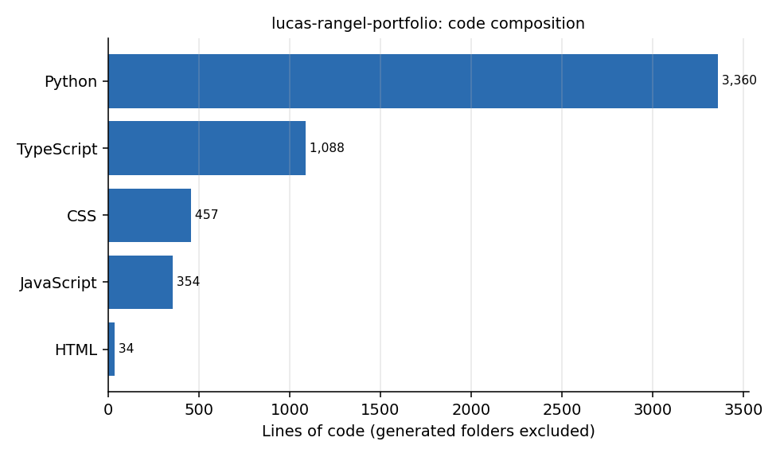

# lucas-rangel-portfolio

Monorepo of the public Rangel Tech portfolio. One repository, two release images:

| Image (service) | What it is | Source |
|---|---|---|
| `portfolio-web` | nginx: the personal site (`lucas.rangeltech.net`), the static RAG UI (`rag.rangeltech.net`) and the Metabase reverse proxy (`bi.rangeltech.net`). Content is baked in at build time. | `apps/site`, `apps/rag-web`, `nginx/`, `docker/web.Dockerfile` |
| `portfolio-api` | One FastAPI process: RAG `answer`/`explore`/`health` routes, the `rag_chat_backend` package used as a library, and the article feedback routes (SQLite). Embeddings are computed in-process (or switched off). | `apps/api`, `docker/api.Dockerfile` |

```
apps/site       Next.js static export of the personal site
apps/rag-web    RAG chat UI, static export (imported with history from the former rag-chat repo)
apps/api        portfolio_api (FastAPI routes) + rag_chat_backend (retrieval, SQL agent, guardrails, LLM client) + tests
nginx/          default.conf (site + catch-all), rag.conf, bi.conf
docker/         web.Dockerfile, api.Dockerfile
scripts/        verify.sh (gate), build_release.sh, test_embed.py
docs/           RUNBOOK_EMBEDDINGS.md
```

## Codebase at a glance



Lines of code per language, counted from the repository files (generated and vendored folders excluded).

## Ports and routing (for the Traefik labels)

`portfolio-web` selects the site by the `Host` header that Traefik forwards, so keep the original Host.

| Host | Container port | Notes |
|---|---|---|
| `lucas.rangeltech.net` | 80 (web) | static site. `PathPrefix(/api/feedback)` and `PathPrefix(/api/explore)` go to `portfolio-api:8080` |
| `rag.rangeltech.net` | 80 (web) | static UI. `PathPrefix(/api)` goes to `portfolio-api:8080` (priority above the web router) |
| `bi.rangeltech.net` | 8081 (web) | proxy to `metabase:3000` (resolver 127.0.0.11) |
| any Host, `/healthz` | 80 and 8080 (web) | catch-all default server; the image HEALTHCHECK uses port 80 |

nginx never serves `/api/*` (404): the edge must route it to the API. TLS, security headers (CSP, HSTS) and rate limits stay at the edge.

## portfolio-api environment

Required in production (listed in `env.required` of the release manifest): `RAG_DATABASE_URL`, `RAG_SQL_DATABASE_URL`, `FEEDBACK_ADMIN_TOKEN`.
The process starts without them: `/api/health` answers 200 with `status` `pending` (nothing configured) or `degraded` + `db_unavailable` (Postgres unreachable).

| Variable | Default | Purpose |
|---|---|---|
| `RAG_DATABASE_URL` | none | Postgres (read-only role) with the notices table and pgvector table |
| `RAG_SQL_DATABASE_URL` | none | read-only Postgres role for the SQL-agent bases |
| `RAG_TABLE`, `RAG_VECTORS_TABLE` | `pncp.obt_pncp_editais_semantico`, `pncp.editais_embeddings` | tables |
| `RAG_EXTRA_CORPORA` | `[]` | JSON list of extra bases (`type: sql` entries use `RAG_SQL_DATABASE_URL`) |
| `RAG_DATASET_SLUG`, `RAG_RELEASE`, `RAG_MANIFEST_SHA256`, `RAG_BASE_ID`, `RAG_PROFILE`, `RAG_CUTOFF` | see `server.make_engine` | corpus provenance shown in citations |
| `RAG_INDEX_PATH` | none | SQLite index instead of Postgres (local use) |
| `QWEN_BASE_URL` / `LLM_BASE_URL`, `QWEN_API_KEY` / `LLM_API_KEY`, `QWEN_MODEL` / `LLM_MODEL`, `QWEN_EXTRA_HEADERS` | none | OpenAI-compatible chat model; unset = cited extractive mode |
| `EMBED_PROVIDER` | `none` | `none` (lexical search) or `openai_compat` (alias `qwen`). `vertex` was removed |
| `EMBED_BASE_URL`, `EMBED_API_KEY`, `EMBED_MODEL`, `EMBED_DIM`, `EMBED_EXTRA_HEADERS`, `EMBED_QUERY_INSTRUCT`, `EMBED_TIMEOUT_S`, `EMBED_ATTEMPTS` | `qwen-embedding`, `768`, 8 s, 2 | embedding endpoint (see `docs/RUNBOOK_EMBEDDINGS.md`) |
| `FEEDBACK_DB` | `/data/feedback.db` | SQLite file (mount a volume on `/data`) |
| `FEEDBACK_ADMIN_TOKEN` | none | enables `DELETE /api/feedback/comments/{id}` (header `X-Admin-Token`) |
| `FEEDBACK_ARTICLES_FILE`, `FEEDBACK_SITE_ROOT` | baked `articles.json` | which article slugs accept feedback |
| `GUARD_ANSWER_*`, `GUARD_EXPLORE_*` (`DAILY_PER_IP`, `DAILY_GLOBAL`, `CONCURRENT_PER_IP`, `CONCURRENT_GLOBAL`) | 300/4000/2/6 and 1000/20000/4/12 | per-address and global request limits |
| `PORT`, `GIT_COMMIT` | `8080`, build arg | |

Hardening: both images run as non-root (web uid 101, api uid 10001) and work with `read_only: true` plus `tmpfs: /tmp`
(api also needs a writable `/data` volume), `cap_drop: [ALL]`, `no-new-privileges`. Both have a `HEALTHCHECK`.

## Develop and verify

```bash
bash scripts/verify.sh          # ruff + pytest, typechecks, site unit tests, builds both images, smoke-tests them hardened
cd apps/api && pip install -r requirements-dev.txt && ruff check . && python -m pytest -q
```

The API tests use a fixture index and fake stores: no network and no Postgres.

## Release

Tag `v*` (or run the Release workflow with a version). It runs the gate, builds both images and publishes one GitHub Release with
`portfolio-web.image.tar.gz`, `release-manifest.portfolio-web.json`, `portfolio-api.image.tar.gz`, `release-manifest.portfolio-api.json`
(contract: schema 1, docker-archive, sha256, image id, healthcheck, required env). The release never deploys; `vps_rt_infra` does.

## History

`apps/rag-web` and `apps/api/rag_chat_backend` were imported with `git subtree` from `LucasRangelSSouza/rag-chat` (origin commit `f498dcf`), keeping its
history. The feedback API (`apps/api/portfolio_api/feedback.py`) came from a private service that had no version control (origin: the `portfolio-feedback-api` container source on the VPS, `app.py` of 151 lines).
