# A 27B model on a 24 GB card in three ways

**Lucas Rangel** · [Kaggle writeup](https://www.kaggle.com/writeups/lucasrangelss/a-27b-model-on-a-24-gb-card-in-three-ways) · [Executable notebook](https://www.kaggle.com/code/lucasrangelss/a-27b-model-on-a-24-gb-card-in-three-ways) · [Code and data](https://github.com/LucasRangelSSouza/gpu-ai-benchmark-hub) · [Dataset](https://www.kaggle.com/datasets/lucasrangelss/gpu-ai-benchmark-campaign-2026)

## Abstract

A 27 billion parameter language model in full BF16 precision needs about 52 gigabytes for its weights. A 24 gigabyte graphics card, the size of an RTX 3090 or 4090, cannot hold it. There are three ways to get a 27 billion class model to answer on such a card, and I measured all three: quantize it to 4 bits so that it fits (AWQ), stream the full-precision weights through the card one layer at a time from disk (AirLLM), or give up on the size and run a 9 billion parameter model that fits at full precision.

The three are not close, and a fourth route, a quantized file in llama.cpp, is faster still for a single user.

- The 4-bit AWQ build ran at 46.7 tokens per second for one user on an RTX 3090 and 53.7 on an RTX 4090, and up to 257 and 296 tokens per second in aggregate with 16 users.
- The 9 billion parameter model in BF16 ran at 48.2 and 56.9 tokens per second for one user on the same cards, and 544 and 710 in aggregate with 32 users.
- AirLLM, streaming the BF16 weights, ran at 0.038 to 0.039 tokens per second on the 3090 and 0.083 to 0.089 on the 4090. A 256-token answer takes about 1.8 hours on the 3090 and 48 minutes on the 4090. It used 3.5 gigabytes of GPU memory.
- In dollars per million output tokens, AWQ cost about 0.39 on the 3090 at the service level, the 9 billion model about 0.18, and AirLLM about 1,500 dollars.
- On the capability checks, the AWQ build of the 27 billion model scored 95.3 percent on math, 80.0 on knowledge and 94.5 on code. The 9 billion base model scored 98.0, 75.0 and 87.8. The larger model's advantage is 5 points on knowledge and 6.7 on code.

The ranking is plain. Quantization is the route for anyone who wants the larger model on a small card. The smaller model is the route for anyone who wants speed and can accept the capability gap. Offloading is a way to prove that a model can run, and not a way to use it.

> **Code and data.** Everything behind this article is public: the code that ran, the curated data, the analysis that regenerates every figure, and tests that pin the conclusions to the data. Repositories: [quantization-and-offload-lab](https://github.com/LucasRangelSSouza/quantization-and-offload-lab), [llm-serving-engines-bench](https://github.com/LucasRangelSSouza/llm-serving-engines-bench). Index of the whole series: [gpu-ai-benchmark-hub](https://github.com/LucasRangelSSouza/gpu-ai-benchmark-hub).

## 1. The problem

Weights dominate the memory of a language model. A model with P billion parameters stored with b bytes each needs P times b gigabytes for the weights, and the serving engine needs more for the cache of the conversation and for its own buffers. In this series I use the rule that the weights times 1.15 plus room for the cache must fit in the card's memory.

For the 27 billion parameter model the weights occupy 17.8 GiB in the AWQ build, 27.7 in NVFP4, 28.1 in FP8 and 51.1 in BF16. Against a 24 gigabyte card, only the AWQ build fits with room for a cache, and only just, as the compatibility article showed. Everything else is a choice about what to give up.

Here is how the BF16 start ended on the RTX 3090, with the lines selected from the curated log. The totals are the card memory in bytes (25.35 billion). The failing start used the speculative configuration, so the log says that the BF16 build with its drafter did not load, and it does not test BF16 alone.

```
[rank0]:[W1027 04:50:58.178919349 CUDACachingAllocator.cpp:3933] memory allocation failed with OOM on device 0 while trying to allocate 356515840 bytes (free: 20774912, total: 25351356416).
[rank0]:[W1027 04:50:58.191917406 CUDACachingAllocator.cpp:3933] memory allocation failed with OOM on device 0 while trying to allocate 178257920 bytes (free: 66912256, total: 25351356416).
[rank0]:[W1027 04:50:58.199510827 CUDACachingAllocator.cpp:3933] memory allocation failed with OOM on device 0 while trying to allocate 167772160 bytes (free: 43843584, total: 25351356416).
```

And the AWQ start on the same card, same session, which did run:

```
INFO 10-27 04:41:56 [compressed_tensors_wNa16.py:132] Using MarlinLinearKernel for CompressedTensorsWNA16
INFO 10-27 04:42:08 [model_runner.py:428] Model loading took 17.8 GiB memory and 12.650975 seconds
INFO 10-27 04:44:41 [gpu_worker.py:640] Available KV cache memory: 1.7 GiB
INFO 10-27 04:44:41 [kv_cache_utils.py:2395] GPU KV cache size: 16,865 tokens, Maximum concurrency for 8,192 tokens per request: 2.06x
```

The weights took 17.8 GiB through a Marlin kernel and the server was left with 1.7 GiB of cache budget, enough for 16,865 tokens. That is the margin the rest of the article works inside.

## 2. Route one: quantize

AWQ stores each weight in 4 bits, protecting the weights that matter most for accuracy, and the quantization article in this series measured how little it costs on the benchmarks I ran. On a 24 gigabyte card the build leaves about 2.2 gigabytes under the 1.15 rule, enough for a short context. The measurements below used short prompts.

**Table 1.** Route one: quantize

| GPU | Users | Per user | Tok/s | Ttft95 |
|---|---|---|---|---|
| RTX 3090 | 1 | 46.7 | 44.9 | 0.13 |
| RTX 3090 | 4 | 39.9 | 137.1 | 0.32 |
| RTX 3090 | 8 | 37.8 | 224.1 | 0.46 |
| RTX 3090 | 16 | 37.6 | 247 | 10.55 |
| RTX 4090 | 1 | 53.7 | 52.1 | 0.15 |
| RTX 4090 | 4 | 46.2 | 161.3 | 0.33 |
| RTX 4090 | 8 | 43.1 | 282.7 | 0.29 |
| RTX 4090 | 16 | 42.6 | 295.9 | 8.23 |

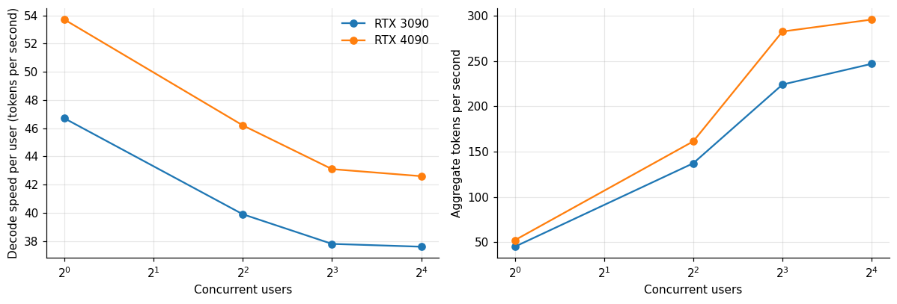

*Figure 1. Route one: quantize.*

On the 3090, AWQ delivered 46.7 tokens per second to a single user, 39.9 at four users and 37.8 at eight (with a 95th percentile first-token time of 0.46 seconds), and the aggregate reached 224 at eight users and 247 at sixteen (257 in the best repeat), where the first-token time degraded to about 10 seconds. On the 4090 the figures were 53.7, 46.2 and 43.1 tokens per second at one, four and eight users, an aggregate of 283 at eight users and 296 at sixteen, with the first token at 8.2 seconds in the 16-user run. In practice the service level I use, 20 tokens per second and a three-second first token, is met up to eight users on both cards.

These speeds are comfortable. A person reads at about 5 to 7 tokens per second, and the cards produce six to eight times that for a single user.

## 3. Route two: a smaller model

The second route skips the quantization and the capability that goes with the larger model. A 9 billion parameter model in BF16 takes about 17 GiB and fits a 24 gigabyte card with a larger cache than the 27 billion AWQ build.

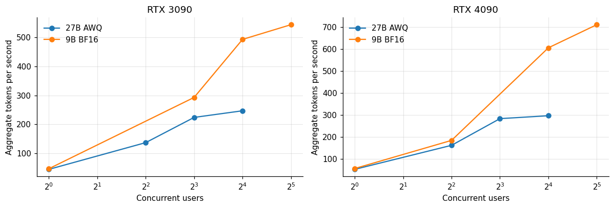

*Figure 2. Route two: a smaller model.*

**Table 2.** Route two: a smaller model

|  | Model users | 27B AWQ | 9B BF16 |
|---|---|---|---|
| RTX 3090 | 1 | 46.7 | 48.2 |
| RTX 3090 | 4 | 39.9 | – |
| RTX 3090 | 8 | 37.8 | 44.9 |
| RTX 3090 | 16 | 37.6 | 41.4 |
| RTX 3090 | 32 | – | 40.9 |
| RTX 4090 | 1 | 53.7 | 56.9 |
| RTX 4090 | 4 | 46.2 | 51.5 |
| RTX 4090 | 8 | 43.1 | – |
| RTX 4090 | 16 | 42.6 | 45.5 |
| RTX 4090 | 32 | – | 42.9 |

On the 3090, the 9 billion model delivered 48.2 tokens per second for a single user and 41.4 at sixteen, and an aggregate of 544 at thirty-two users. On the 4090 it gave 56.9 for a single user and 710 in aggregate at thirty-two. That is about twice the aggregate throughput of the 27 billion AWQ build on the same card, and it holds up to twice as many users within the service level (16 users against 8).

The single-user speed barely differs between the two models (48.2 against 46.7 on the 3090), because a 4-bit 27 billion model reads 17.8 GiB per token and a BF16 9 billion model about 16.7. Bandwidth, not parameter count, sets the speed. The 9 billion model is cheaper where many users share the card, because it needs less compute per token and leaves more memory for the cache.

## 4. Route three: offload

AirLLM keeps the model on disk and brings it to the GPU one layer at a time. A forward pass loads layer 1, computes it, frees it, loads layer 2, and so on, so the card needs memory for a single layer. The full-precision 27 billion model occupies about 52 gigabytes on disk and about 3.5 gigabytes of GPU memory at any moment. The price is that every token must read the entire model from disk.

The AirLLM run left a console output, and I kept the part that matters. These are the end of the layer-splitting progress bar (printed twice), the line that names the model class, the warnings about missing kernels and the final result line of the run on the RTX 5090 (lines selected from the file, long ones cut).

```
100%|██████████| 68/68 [08:51<00:00, 11.81s/it]
100%|██████████| 68/68 [08:51<00:00,  7.82s/it]
built empty Qwen3_5ForConditionalGeneration via AutoModelForImageTextToText (attn=sdpa)
[transformers] `causal_conv1d_fn` is falling back to its reference PyTorch implementation because `causal_conv1d` is not installed. This is correct but much slower; install `causal_conv1d` for the optimiz…
[transformers] `chunk_gated_delta_rule` is falling back to its reference PyTorch implementation because `flash-linear-attention` is not installed. This is correct but much slower; install `flash-linear-at…
[transformers] `causal_conv1d_update` is falling back to its reference PyTorch implementation because `causal_conv1d` is not installed. This is correct but much slower; install `causal_conv1d` for the opt…
[transformers] `fused_recurrent_gated_delta_rule` is falling back to its reference PyTorch implementation because `flash-linear-attention` is not installed. This is correct but much slower; install `flash…
{"load_s": 549.0, "res": {"8": {"s": 289.5, "tok_s": 0.028}, "32": {"s": 1047.3, "tok_s": 0.031}}, "vram_gb": 3.57}
```

The splitting of the checkpoint into 68 per-layer files took 8 minutes 51 seconds of the 549 seconds the script counted as load time. The four warnings say that the library fell back to reference PyTorch implementations because two optional kernel packages were not installed, and the transformers library says this is slower. I did not install them and did not rerun, so I do not know how much of the 0.03 tokens per second they account for. The streaming rate in the text is therefore a measurement of this setup and not of the best AirLLM can do.

**Table 3.** Route three: offload

| GPU | Load s | Gen 8 tokens s | Tok s 8 | Gen 32 tokens s | Tok s 32 | VRAM GB | Effective GB s | Seconds for 256 tokens |
|---|---|---|---|---|---|---|---|---|
| RTX 3090 | 465.9 | 212.8 | 0.038 | 831.2 | 0.039 | 3.54 | 2.141 | 6,564 |
| RTX 4090 | 1,010 | 96.5 | 0.083 | 361.2 | 0.089 | 3.54 | 4.886 | 2,876 |
| RTX 5090 | – | – | 0.03 | – | – | 3.57 | 1.647 | 8,533 |
| L40S | 139.1 | 166.7 | 0.048 | 640.7 | 0.05 | 3.54 | 2.745 | 5,120 |

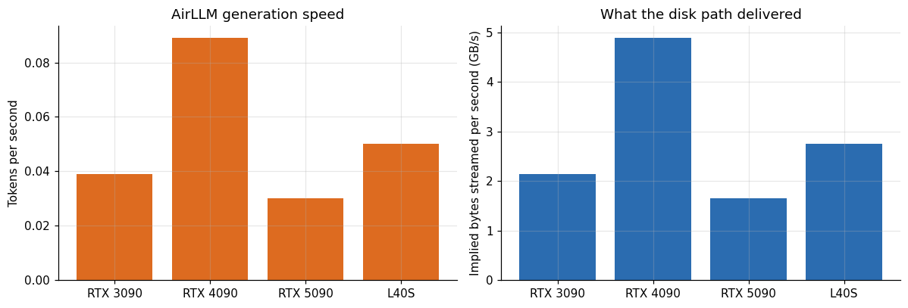

*Figure 3. AirLLM generation speed.*

The measured speeds were 0.039 tokens per second on the 3090, 0.089 on the 4090, 0.050 on the L40S and about 0.03 on the 5090 (the console output of that run is shown above: 549 seconds of loading, 8 tokens in 289.5 seconds and 32 in 1,047.3). Generating 8 new tokens took 212.8 seconds on the 3090, 96.5 on the 4090 and 166.7 on the L40S, and generating 32 took 831.2, 361.2 and 640.7 seconds, which makes the speed constant per token, as expected for a method that reads the whole model each time.

If every token reads about 54.9 gigabytes (the BF16 checkpoint), the implied streaming rate is 2.1 gigabytes per second on the 3090, 4.9 on the 4090, 2.7 on the L40S and 1.6 on the 5090. These are the speeds of storage and the PCIe link, set by the rented host, not by the GPU. Four cards with different GPUs span a factor of three in speed, and the ordering follows each host's disk, not each card's arithmetic. The 4090 host read the model three times as fast as the 5090 host.

Loading took longer still. Preparing the model, which splits the checkpoint into per-layer files, took 139 seconds on the L40S host, 466 on the 3090 host and 1,010 on the 4090 host.

## 5. The three routes side by side

**Table 4.** The three routes side by side

| GPU | Route | Tokens per s | Seconds for 256 tokens | USD per 1k tokens single stream |
|---|---|---|---|---|
| RTX 3090 | 27B AWQ, one user | 46.7 | 5.482 | 0.0013 |
| RTX 3090 | 9B BF16, one user | 48.2 | 5.311 | 0.0013 |
| RTX 3090 | 27B BF16 via AirLLM | 0.039 | 6,564 | 1.574 |
| RTX 4090 | 27B AWQ, one user | 53.7 | 4.767 | 0.0026 |
| RTX 4090 | 9B BF16, one user | 56.9 | 4.499 | 0.0024 |
| RTX 4090 | 27B BF16 via AirLLM | 0.089 | 2,876 | 1.548 |

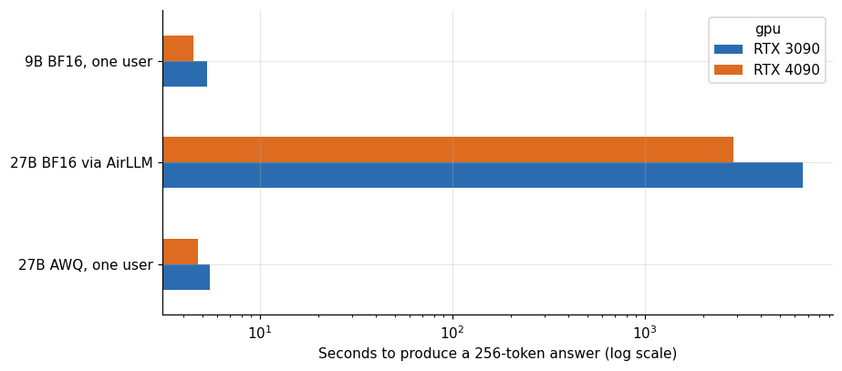

*Figure 4. The three routes side by side.*

Answering a 256-token question takes 5.5 seconds with the AWQ build on the 3090 and 4.8 on the 4090, 5.3 and 4.5 seconds with the 9 billion model, and 6,560 seconds on the 3090 and 2,880 on the 4090 with AirLLM. That is 1.8 hours against 5 seconds, a factor of 1,200 on the 3090. For a single stream, the cost per thousand tokens is 0.0013 dollars with AWQ on the 3090, 0.0013 with the 9 billion model, and 1.6 dollars with AirLLM. The last figure is a thousand times the others, and the reason is time: the card is rented by the hour, and every token takes 26 seconds.

## 6. What capability does each route keep?

**Table 5.** What capability does each route keep?

| Model | Gsm8k acc | Mmlu acc | Humaneval acc | Json acc | Gsm8k n | Mmlu n | Humaneval n | Json n |
|---|---|---|---|---|---|---|---|---|
| 27b_abliterated_awq | 0.953 | 0.8 | 0.945 | 1 | 150 | 200 | 164 | 24 |
| Qwen3.5-9B_base | 0.98 | 0.75 | 0.878 | 1 | 150 | 200 | 164 | 24 |
| Huihui-Qwen3.5-9B_abliterated | 0.92 | 0.725 | 0.835 | 1 | 150 | 200 | 164 | 24 |

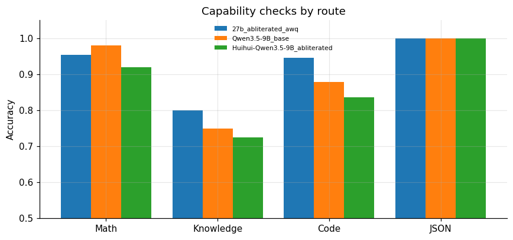

*Figure 5. Capability checks by route.*

AirLLM serves the unquantized model, so it keeps whatever capability the BF16 weights have, which in the quantization ladder was 95.3 percent on math, 82.0 on knowledge and 92.1 on code, within noise of the 4-bit build (94.7, 80.0, 93.3). The quantized route therefore loses nothing visible that the offload route keeps. The smaller model loses something: 5 points of knowledge (75.0 against 80.0) and 6.7 points of code (87.8 against 94.5), and gains 2.7 points on math, where the 9 billion base scored 98.0 against 95.3. The comparison has the caveat from the cost article: the 9 billion base model is an aligned model and the 27 billion build is not, which can move scores in either direction.

## 7. A fourth route: llama.cpp with a quantized GGUF file

The three routes above all assume the vLLM serving stack for the first two. llama.cpp is a different engine: a C++ implementation that loads quantized model files in the GGUF format and is built for running on one machine, including cards with little memory. It was part of the tool list in the study, and one run on the RTX 4090 produced benchmark lines for the 9 billion parameter model in two quantizations.

**Table 6.** A fourth route: llama.cpp with a quantized GGUF file

| GPU | Quant | Size GiB | Params b | Test | Tokens per s | Stdev | Backend |
|---|---|---|---|---|---|---|---|
| RTX 4090 | Q4_K - Medium | 5.28 | 8.95 | pp512 | 10,864 | 189.6 | CUDA, all layers offloaded to the GPU |
| RTX 4090 | Q4_K - Medium | 5.28 | 8.95 | tg128 | 146.8 | 0.06 | CUDA, all layers offloaded to the GPU |
| RTX 4090 | Q8_0 | 8.86 | 8.95 | pp512 | 11,743 | 239 | CUDA, all layers offloaded to the GPU |
| RTX 4090 | Q8_0 | 8.86 | 8.95 | tg128 | 97.02 | 0.01 | CUDA, all layers offloaded to the GPU |

**Table 7.** A fourth route: llama.cpp with a quantized GGUF file (part 2)

| Quant | Size GiB | Pp512 | Tg128 | Implied bandwidth GB s |
|---|---|---|---|---|
| Q4_K - Medium | 5.3 | 10,864 | 146.8 | 832.3 |
| Q8_0 | 8.9 | 11,743 | 97 | 922.9 |

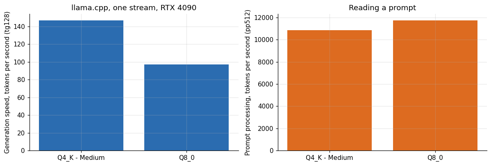

*Figure 6. llama.cpp, one stream, RTX 4090.*

The Q4_K_M file, 5.28 GiB, generated at 146.8 tokens per second and processed a 512-token prompt at 10,864 tokens per second. The Q8_0 file, 8.86 GiB, generated at 97.0 and processed prompts at 11,743. For a single stream that is 2.6 times the speed of the 9 billion model in BF16 under vLLM on the same card (56.9 tokens per second) and 2.7 times the speed of the 27 billion AWQ build (53.7). The reason is the file size: a token reads 5.3 gigabytes rather than 17.9, and the card's bandwidth does the rest.

The benchmark printed one line per test, and these are the lines for the two files, copied from the run log of the RTX 4090 session (the saved log has no table header).

```
== Qwen3.5-9B-Q4_K_M.gguf
  qwen35 9B Q4_K - Medium            5.28 GiB       8.95 B   CUDA          99             pp512      10863.91 ± 189.64
  qwen35 9B Q4_K - Medium            5.28 GiB       8.95 B   CUDA          99             tg128          146.81 ± 0.06
== Qwen3.5-9B-Q8_0.gguf
  qwen35 9B Q8_0                     8.86 GiB       8.95 B   CUDA          99             pp512      11743.08 ± 238.99
  qwen35 9B Q8_0                     8.86 GiB       8.95 B   CUDA          99             tg128           97.02 ± 0.01
```

Each speed carries a standard deviation. The generation figures are tight (0.06 and 0.01 tokens per second), so the repeats inside the run agree with each other. Every layer sat on the GPU (the 99 in the column before the test name is the layer count that was offloaded).

llama.cpp's strength is the single stream. It does not batch many users the way vLLM does, and I measured one stream only. For one person running a local model on a gaming card, 147 tokens per second from a 9 billion parameter model is faster than anyone reads. For a server, the batching engines win.

## 8. Bandwidth explains all four routes

If decode is bandwidth-bound, then the speed times the bytes read per token should be about the card's memory bandwidth. This is a test of that idea across four very different routes on the same RTX 4090.

**Table 8.** Bandwidth explains all four routes

| Route | Tokens per s | GiB per token | Implied GB s |
|---|---|---|---|
| llama.cpp 9B Q4_K_M | 146.8 | 5.28 | 832.3 |
| llama.cpp 9B Q8_0 | 97.02 | 8.86 | 923 |
| vLLM 9B BF16 | 56.9 | 16.67 | 1,018 |
| vLLM 27B AWQ | 53.7 | 17.8 | 1,026 |
| AirLLM 27B BF16 (disk path) | 0.09 | 51.13 | 4.89 |

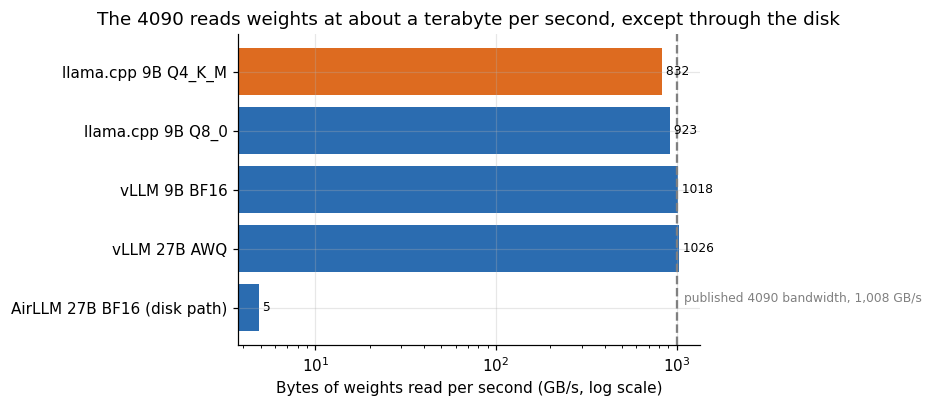

*Figure 7. The 4090 reads weights at about a terabyte per second, except through the disk.*

The four on-card routes imply between 832 and 1,026 gigabytes per second: llama.cpp Q4_K_M 832, Q8_0 923, vLLM with the 9 billion BF16 model 1,018 and vLLM with the 27 billion AWQ build 1,026. The published memory bandwidth of the card is 1,008 gigabytes per second. The last two slightly exceed it, which is within the error of the sizes I used (the 9 billion parameter count and the loaded size of the AWQ build include some structures that need not be read for every token), and shows that vLLM runs the card at its limit. llama.cpp reaches 82 to 92 percent. AirLLM, through the disk, reads 4.9 gigabytes per second, 0.5 percent of the card's rate.

That single scale describes everything in this article. The speed of generation is the speed of reading the weights, and a route is fast if it reads fewer bytes per token or reads them faster. Quantization reduces the bytes. Choosing a smaller model reduces the bytes. Offloading puts the bytes behind a slower link.

## 9. How long would an evaluation take?

The difference between routes becomes concrete when one has to run a fixed job. Take an evaluation of 164 coding problems, each with a 300-token answer, 49,200 tokens in total.

**Table 9.** How long would an evaluation take?

| Route | Tokens per s | Hours | Days |
|---|---|---|---|
| 27B AWQ, 8 users in parallel (3090) | 224.1 | 0.061 | 0.003 |
| 27B AWQ, one stream (3090) | 46.7 | 0.293 | 0.012 |
| 9B BF16, one stream (3090) | 48.2 | 0.284 | 0.012 |
| llama.cpp 9B Q4_K_M, one stream (4090) | 146.8 | 0.093 | 0.004 |
| 27B BF16 via AirLLM (3090) | 0.039 | 350.4 | 14.6 |
| 27B BF16 via AirLLM (4090) | 0.089 | 153.6 | 6.398 |

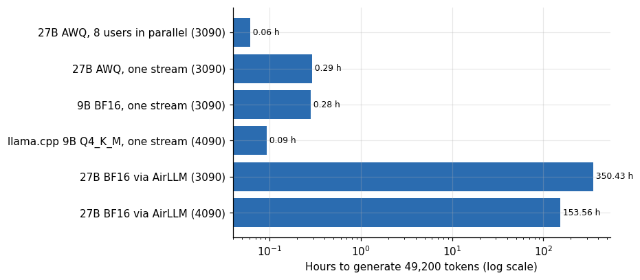

*Figure 8. How long would an evaluation take?*

The 164 answers take 3.7 minutes with eight users in parallel on the 3090, 17.5 minutes as a single stream, 5.6 minutes with llama.cpp on the 4090, 14.6 days with AirLLM on the 3090 and 6.4 days on the 4090. A day of rental on the 3090 costs 5.30 dollars, so the AirLLM evaluation would cost about 77 dollars of rental against about 0.014 dollars for the parallel AWQ run. Neither is a big number in absolute terms. The ratio is 5,000 to 1, and the waiting time is the real cost.

## 10. Could offloading be rescued?

The offload route reads 54.9 gigabytes per token because it streams BF16 weights. Compressing the streamed weights would cut the bytes. AirLLM supports blockwise quantized storage of the layers, and I did not test it. The arithmetic of what it could bring is simple.

**Table 10.** Could offloading be rescued?

|  | 4-bit (assumed) | 8-bit (assumed) | BF16 (measured) |
|---|---|---|---|
| L40S host | 0.144 | 0.1 | 0.05 |
| RTX 3090 host | 0.112 | 0.078 | 0.039 |
| RTX 4090 host | 0.256 | 0.178 | 0.089 |

At the disk speeds implied by the measurements, streaming 4-bit weights would give 0.11 tokens per second on the 3090 host, 0.26 on the 4090 host and 0.14 on the L40S host, still about 100 times too slow for chat and about 200 times slower than keeping the same 4-bit model on the card. The conclusion does not change: offloading a model that could be quantized to fit is the wrong order of operations. It is for models that do not fit even when quantized.

## 11. Context length is the hidden limit on 24 gigabytes

Every number above is for short contexts. The memory left on a 24 gigabyte card after the AWQ weights is a few hundred megabytes to a couple of gigabytes, and the cache for a conversation grows with its length at about 0.1 MiB per token for the 27 billion parameter model, as the quantization article estimated.

**Table 11.** Context length is the hidden limit on 24 gigabytes

| Free memory GB | Approx cached tokens |
|---|---|
| 0.5 | 5,100 |
| 1 | 10,100 |
| 2 | 20,200 |
| 3 | 30,400 |
| 4 | 40,500 |

One to two gigabytes of free memory hold 10,000 to 20,000 tokens of cache for a single conversation, and fewer conversations in parallel share that. This is consistent with the observed behavior: the servers that ran the AWQ build on 24 gigabyte cards rejected the 10,000 token prompt when they were started with a short context limit, and the one 3090 run that accepted it was slow. For a chat of a few hundred tokens a 24 gigabyte card is fine. For a coding assistant that reads whole files, it is a tight fit, and the 9 billion model, which holds more than twice as many tokens in the same memory because its cache costs less per token, is the safer choice.

## 12. The cache, measured instead of estimated

The section above estimated the cache from a rule of thumb. The server logs of the study contain the real figures, because vLLM prints, at every start, how much memory the model took, how much it left for the cache and how many tokens that cache holds. I extracted them for the starts on 24 gigabyte cards.

**Table 12.** The cache, measured instead of estimated

| GPU | Route | Log file | Model loading GiB | GPU memory utilization | Max model len | Available KV GiB | KV cache tokens | Mib per token |
|---|---|---|---|---|---|---|---|---|
| RTX 3090 | 27B, 4-bit AWQ | vllm_plain.log | 17.8 | 0.94 | 12288 | 2.13 | 24,576 | 0.089 |
| RTX 3090 | 27B, 4-bit AWQ | vllm_awq.log | 17.8 | 0.92 | 8192 | 1.66 | 16,384 | 0.104 |
| RTX 3090 | 9B, BF16 | vllm_q9abl.log | 17.66 | 0.92 | 8192 | 1.88 | 43,194 | 0.045 |
| RTX 3090 | 9B, BF16 | vllm_q9base.log | 17.66 | 0.92 | 8192 | 1.88 | 43,194 | 0.045 |
| RTX 3090 | 9B, BF16 | vllm_q9abl.log | 17.66 | 0.9 | 8192 | 1.45 | 33,512 | 0.044 |
| RTX 3090 | 9B, BF16 | vllm_q9base.log | 17.66 | 0.9 | 8192 | 1.45 | 33,512 | 0.044 |
| RTX 3090 | 27B, 4-bit AWQ | vllm_awq27.log | 17.8 | 0.92 | 8192 | 1.66 | 16,384 | 0.104 |
| RTX 3090 | 27B, 4-bit AWQ | vllm_awq27.log | 17.8 | 0.92 | 8192 | 1.7 | 16,865 | 0.103 |
| RTX 3090 | 9B, BF16 | vllm_q9_bf16.log | 17.66 | 0.92 | 8192 | 1.92 | 44,311 | 0.044 |
| RTX 4090 | 27B, 4-bit AWQ | vllm_awq27.log | 17.8 | 0.92 | 8192 | 1.62 | 15,902 | 0.104 |

**Table 13.** The cache, measured instead of estimated (part 2)

|  | Starts | Weights GiB | KV GiB | KV tokens | Mib per token |
|---|---|---|---|---|---|
| 27B, 4-bit AWQ | 5 | 17.8 | 1.66 | 16,384 | 0.104 |
| 9B, BF16 | 5 | 17.66 | 1.88 | 43,194 | 0.044 |

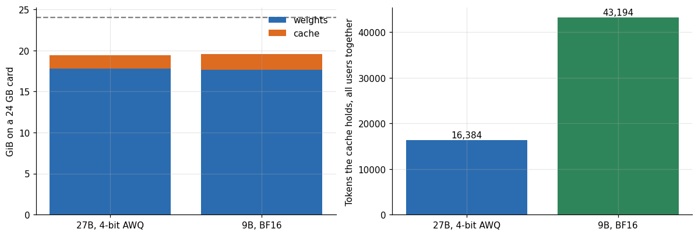

*Figure 9. The cache, measured instead of estimated.*

On the 24 gigabyte cards the 27 billion parameter AWQ build loaded 17.80 GiB of weights and left between 1.62 and 2.13 GiB for the cache, depending on the memory fraction the server was allowed (0.92 to 0.94). That cache held 15,900 to 24,600 tokens in total, shared by every conversation the server held at once. The cost of a token of cache was 0.09 to 0.10 MiB (0.104 in four of the five starts), which agrees with the 0.1012 I took from the quantization article. At the context limits the servers ran with, 8,192 and 12,288 tokens, the server reported room for about 2 full-length conversations at the same time (a maximum concurrency of 1.94 to 2.06 times the limit).

The 9 billion parameter model in BF16 looks different in one respect. Its weights took 17.66 GiB, a hair less than the 27 billion model's quantized weights, so it left about the same room for the cache, 1.45 to 1.92 GiB. A token of its cache costs 0.044 to 0.045 MiB, less than half as much, so the same memory held 33,500 to 44,300 tokens and a maximum concurrency of 4.1 to 5.4 times the 8,192-token limit. My earlier sentence that the smaller model "leaves more memory for the cache" was wrong, since the weights are nearly the same size. What the smaller model has is a cheaper cache per token, and that is worth a factor of 2 to 2.3 in the number of tokens it can hold.

## 13. What a token costs on each route

The speeds in the main table convert to money through the hourly price of the card. For the two vLLM routes I use the highest aggregate throughput each reached on the same 3090, and for the llama.cpp and AirLLM routes the single stream I measured. The 3090 rents at 0.256 dollars per hour in these sessions and the 4090 at 0.37.

**Table 14.** What a token costs on each route

| GPU | Route | Single stream tok/s | Best aggregate tok/s | USD per m single | USD per m best |
|---|---|---|---|---|---|
| RTX 3090 | 27B AWQ, vLLM | 44.9 | 247 | 1.586 | 0.288 |
| RTX 3090 | 9B BF16, vLLM | 47.1 | 544.1 | 1.512 | 0.131 |
| RTX 4090 | 27B AWQ, vLLM | 52.1 | 295.9 | 1.959 | 0.345 |
| RTX 3090 | 27B BF16 offload, AirLLM | 0.039 | 0.039 | 1,825 | 1,825 |
| RTX 4090 | 27B BF16 offload, AirLLM | 0.089 | 0.089 | 1,147 | 1,147 |
| RTX 4090 | 9B Q4_K_M, llama.cpp | 146.8 | 146.8 | 0.695 | 0.695 |

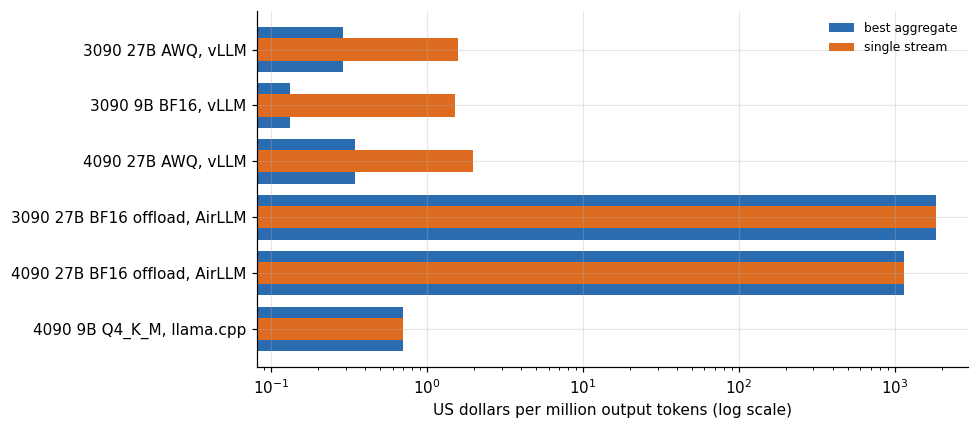

*Figure 10. What a token costs on each route.*

At the aggregate throughput of eight to sixteen users, the 27 billion AWQ build costs 0.29 dollars per million output tokens on the 3090 and 0.35 on the 4090, and the 9 billion BF16 model costs 0.13 on the 3090. With a single user the costs rise to 1.59 and 1.96 dollars for the 27 billion AWQ build on the 3090 and 4090. The llama.cpp route at 147 tokens per second costs 0.70 dollars for one stream on the 4090. The offload route costs 1,825 dollars per million tokens on the 3090 and 1,147 on the 4090.

The order of magnitude between the on-card routes and the offload route is the number to keep: the offloaded model costs over a thousand dollars per million tokens, against cents to a dollar for the other routes, which is a ratio of between 600 and 14,000 depending on the load. The three on-card routes sit within a factor of about 5 of each other, and the cheapest depends on whether the card is shared.

## 14. How many users each route serves

The series uses a service level of at least 20 tokens per second for each user and a 95th percentile first-token time of at most three seconds. I applied it to the two vLLM routes on the 3090 and the 4090.

**Table 15.** How many users each route serves

| GPU | Route | Tested users | Max users meeting sla | Aggregate at that load |
|---|---|---|---|---|
| RTX 3090 | 27B AWQ | [1, 4, 8, 16] | 8 | 224.1 |
| RTX 3090 | 9B BF16 | [1, 8, 16, 32] | 16 | 493.3 |
| RTX 4090 | 27B AWQ | [1, 4, 8, 16] | 8 | 282.7 |

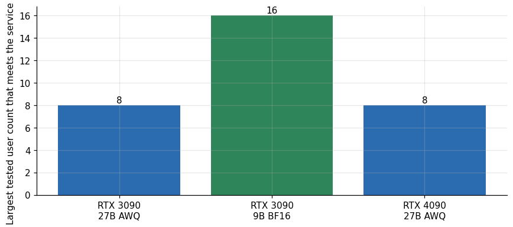

*Figure 11. How many users each route serves.*

On the 3090 the 27 billion AWQ build met the service level up to 8 users in the median of its three sessions (37.8 tokens per second each and a first token in 0.46 seconds) and failed at 16 users, where the first token took 10.6 seconds. The earliest of the three sessions did not meet it at 8 users, as the last section of this part explains. The 9 billion BF16 model met it up to 16 users (41.4 tokens per second, 0.40 seconds) and failed at 32, where the first token took 11.0 seconds. The smaller model therefore served twice as many users on the same card, with 2.2 times the aggregate throughput, 493 tokens per second against 224. On the 4090 only the 27 billion build was tested at 1, 4, 8 and 16 users, and it met the service level up to 8 users (43.1 tokens per second, 0.29 seconds) with 283 tokens per second in aggregate.

The explanation for the cliff is in the cache. At 16 users the 27 billion build holds 16,000 to 24,000 tokens of cache for sixteen conversations, which is 1,000 to 1,500 tokens each, and a conversation longer than that makes the server queue requests until memory is free. The 9 billion model, with a cache 2.3 times more compact per token, reached the same wall at twice the users. That agrees with the first-token times, which jump by an order of magnitude at the same step.

## 15. Spread between sessions

The AWQ build ran on the 3090 in three sessions, so I can see how much the numbers move from host to host.

**Table 16.** Spread between sessions

|  | 20261026T153346Z-g27-3090-3c670e | 20261027T022124Z-all-RTX3090-7a0421 | 20261027T035103Z-all-RTX3090-d57d6e |
|---|---|---|---|
| 1 | 46.7 | 46 | 47.2 |
| 4 | 39.4 | 39.9 | 41 |
| 8 | 19 | 37.8 | 38.4 |
| 16 | 10.4 | 37.6 | 38.3 |

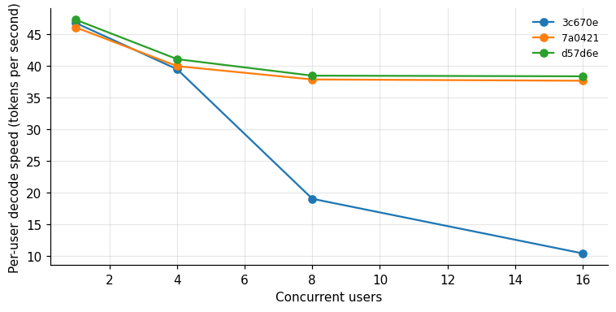

*Figure 12. Spread between sessions.*

Across the three sessions the single-user speed of the AWQ build on the 3090 ranged within 3 percent, and the four-user speed within 4 percent. At 8 and 16 users the spread is 102 and 268 percent, because the earliest session gave 19.0 and 10.4 tokens per second per user where the other two gave about 38. The next section looks at that session. Around any single cell of the tables a reader should assume a few percent of repeat variability for decode speed at low load, and much more for the behavior near the cache limit.

## 16. Why the first session was slower at load

The spread table above has one result that I should not average away. In the earliest of the three sessions, the 27 billion AWQ build ran at 19.0 tokens per second per user with 8 users and 10.4 with 16, while the two later sessions gave 37.8 and 37.6, and 38.4 and 38.3. The single-user and four-user speeds agreed across all three within 4 percent, so the card was not slower in general. Something changed under load.

**Table 17.** Why the first session was slower at load

| Session | Log file | GPU memory utilization | Max model len | Available KV GiB | KV cache tokens | Max concurrency x |
|---|---|---|---|---|---|---|
| 20261026T153346 | vllm_plain.log | 0.94 | 12288 | 2.13 | 24,576 | 2 |
| 20261026T164456 | vllm_awq.log | 0.92 | 8192 | 1.66 | 16,384 | 2 |
| 20261027T022124 | vllm_awq27.log | 0.92 | 8192 | 1.66 | 16,384 | 2 |
| 20261027T035103 | vllm_awq27.log | 0.92 | 8192 | 1.7 | 16,865 | 2.06 |

**Table 18.** Why the first session was slower at load (part 2)

|  | Session | Cache tokens | Context limit | Full length requests that fit |
|---|---|---|---|---|
| 22 | 20261026T153346 | 24,576 | 12288 | 2 |
| 23 | 20261026T164456 | 16,384 | 8192 | 2 |
| 28 | 20261027T022124 | 16,384 | 8192 | 2 |
| 32 | 20261027T035103 | 16,865 | 8192 | 2.06 |

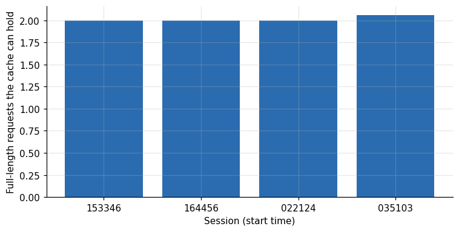

*Figure 13. Why the first session was slower at load.*

The three server starts differ in configuration. The first allowed requests of up to 12,288 tokens and a memory fraction of 0.94, and its cache of 24,576 tokens could hold two full-length requests. The two later sessions allowed 8,192 tokens at a fraction of 0.92, with a cache of 16,384 to 16,865 tokens, which is also two full-length requests. In both cases, then, the server can promise space for only two requests of the maximum length, and what the scheduler does with eight or sixteen shorter requests depends on how long they actually are. The load generator may also have differed between the sessions, since the first one ran an earlier version of the benchmark.

The launch arguments of the three sessions are in the raw server logs. I copied the argument line of each, in the order of the sessions, after removing the process prefix.

```
INFO 10-26 15:51:31 [api_utils.py:286] non-default args: {'model_tag': '/workspace/models/awq', 'host': '127.0.0.1', 'port': 18000, 'model': '/workspace/models/awq', 'max_model_len': 12288, 'served_model_name': ['qwen-abliterated'], 'reasoning_parser': 'qwen3', 'gpu_memory_utilization': 0.94, 'max_num_seqs': 16}
INFO 10-27 02:57:47 [api_utils.py:286] non-default args: {'model_tag': '/workspace/models/awq27', 'host': '127.0.0.1', 'port': 18000, 'model': '/workspace/models/awq27', 'max_model_len': 8192, 'served_model_name': ['m'], 'reasoning_parser': 'qwen3', 'max_num_seqs': 16}
INFO 10-27 04:41:17 [api_utils.py:286] non-default args: {'model_tag': '/workspace/models/awq27', 'host': '127.0.0.1', 'port': 18000, 'model': '/workspace/models/awq27', 'max_model_len': 8192, 'served_model_name': ['m'], 'reasoning_parser': 'qwen3', 'max_num_seqs': 16}
```

The first session passed `'gpu_memory_utilization': 0.94` and a context limit of 12,288 and served the model under the name `qwen-abliterated`. The two later ones carry no memory fraction (the default applied, and the start logs report 0.92) and a context limit of 8,192. All three carry `'max_num_seqs': 16`, so the scheduler could hold 16 sequences in every session. The lines also show a different served model name, which points to a different launch script. They do not show why the first session was slower at load.

I cannot say which of these differences produced the factor of two. What the comparison supports is a caution. A server on a 24 gigabyte card runs close to its cache limit by design, and the same hardware with a slightly different configuration can lose half of its per-user speed at the load it was supposed to carry. The numbers in the main tables are the medians of the three sessions, which is the more favorable of the two behaviors, and a reader planning to run eight users on a 3090 should test their own configuration at that load before relying on 37.8 tokens per second.

## 17. Users times context

The cache capacity turns into a rule of thumb for planning: the number of conversations a server can keep alive multiplied by their length is bounded by the cache in tokens.

**Table 19.** Users times context

|  | 27B AWQ (median 16,400 tokens) | 27B AWQ (best, 24,600 tokens) | 9B BF16 (median 43,200 tokens) |
|---|---|---|---|
| 1,000 tokens | 16 | 24 | 43 |
| 2,000 tokens | 8 | 12 | 21 |
| 4,000 tokens | 4 | 6 | 10 |
| 8,000 tokens | 2 | 3 | 5 |
| 16,000 tokens | 1 | 1 | 2 |

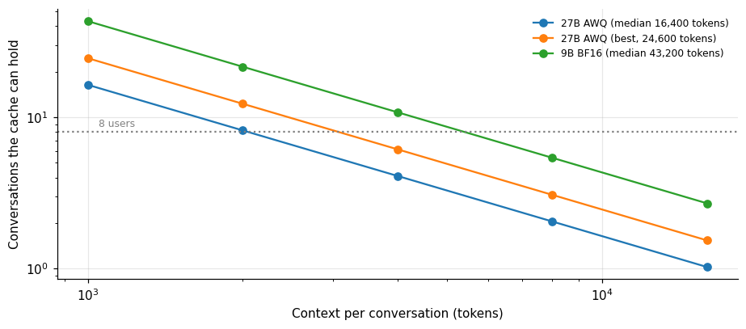

*Figure 14. Users times context.*

With the median cache of the 27 billion AWQ build, 16 conversations of 1,000 tokens fit, 8 of 2,000, 4 of 4,000, 2 of 8,000 and 1 of 16,000. The 9 billion model fits 43, 21, 10, 5 and 2 of the same lengths. These bounds assume that every conversation reaches its full length at the same time, which is pessimistic for a chat in which most conversations are idle, and they ignore the sharing of a common prefix, which the series' article on caching shows can help a great deal when the system prompt is long. For an assistant with short exchanges, both routes serve a handful of users. For one that reads files of several thousand tokens, the 27 billion model on a 24 gigabyte card serves two or three at a time.

## 18. The 3090 or the 4090

The study measured the 27 billion AWQ build on both cards, which allows a direct comparison of the two 24 gigabyte options.

**Table 20.** The 3090 or the 4090

|  | Per user RTX 3090 | Per user RTX 4090 | Agg tok/s RTX 3090 | Agg tok/s RTX 4090 | Speed ratio 4090 over 3090 |
|---|---|---|---|---|---|
| 1 | 46.7 | 53.7 | 44.9 | 52.1 | 1.15 |
| 4 | 39.9 | 46.2 | 137.1 | 161.3 | 1.16 |
| 8 | 37.8 | 43.1 | 224.1 | 282.7 | 1.14 |
| 16 | 37.6 | 42.6 | 247 | 295.9 | 1.13 |

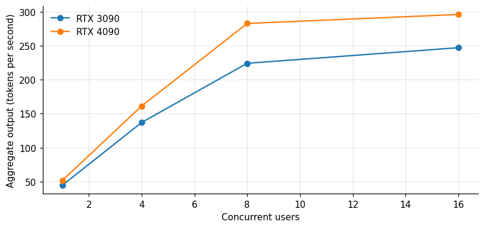

*Figure 15. The 3090 or the 4090.*

The 4090 decoded 15 percent faster than the 3090 for a single user (53.7 against 46.7 tokens per second) and 20 percent faster in aggregate at 16 users (296 against 247). It rented for 43 percent more per hour in these sessions, 0.37 against 0.26 dollars. The cost per token was therefore 14 to 24 percent higher on the 4090 at every load level I measured. The 4090 is a better card, and for this model the 3090 is the better purchase of rented time. The 4090 has one advantage in my data that the table does not show: it had a lower first-token time at 16 users, 8.2 seconds against 10.6, though both are far above the three-second target.

The caveat is the same for any comparison of two cards from the marketplace. The 4090 data come from one session, the 3090 data from three, and the hosts differ. The 15 percent speed advantage is within what I saw between hosts of the same card in other articles of this series, so the safest reading is that the two cards are close for this workload and that price should decide.

## 19. Who should take which route

If you have a 24 gigabyte card and want the larger model: quantize. The AWQ build fits, runs at 47 to 54 tokens per second for one user, serves up to about eight users within the service level, and costs nothing in measurable capability. Its limit is context: with 2.2 gigabytes of headroom the window is short, and a long document needs a bigger card.

If you have a 24 gigabyte card and want to serve many users cheaply: run the smaller model. Twice the throughput and a larger cache, at the price of 5 to 7 points on knowledge and code.

If you have a small card and need the output of the full-precision model for a handful of prompts, once: offload. An evaluation of a model that does not fit, a few answers per day, the ability to say you ran it. Provision a fast NVMe disk and expect minutes per token. It also needs the disk space for a second copy of the weights (the per-layer files), which is another 50 gigabytes.

If you need the full-precision model and interactive speed, rent a card that holds it. The cost article's PRO 6000 numbers apply.

## 20. What I would test next

Four measurements would close the largest gaps in this article, and none of them is expensive on a card at 0.26 to 0.37 dollars per hour.

The first is the configuration of the earliest 3090 session. Running the 27 billion AWQ build twice at 8 and 16 users, once with a context limit of 8,192 tokens and once with 12,288 and the larger memory fraction, would say whether the factor of two at load came from the configuration or from the host. The cost is under an hour of rental, about a quarter of a dollar.

The second is the llama.cpp route at more than one user. I measured a single stream at 147 tokens per second, and the server mode of that engine can batch requests. If it kept a large share of its single-stream speed at four or eight users, it would replace the 9 billion BF16 model on vLLM as the best 24 gigabyte route for small groups, and my measurements cannot tell.

The third is a 27 billion parameter model in a GGUF file at 4 bits on llama.cpp. That is the route most people on a gaming card actually take, and I measured only the 9 billion parameter model on it. The file would be about 16 gigabytes, the cache would be similar to vLLM's, and the speed should follow the bandwidth line, around 50 to 55 tokens per second on a 4090. This prediction rests on the arithmetic of the bandwidth section and not on a run.

The fourth is the quality of the 4-bit builds on the tasks a reader cares about. The capability checks of the series compare the AWQ build with the BF16 original on four public benchmarks and find no detectable gap, which supports the route, but they say nothing about the tasks of a specific product. Ten to twenty real prompts from the intended use, scored by hand, would be a better test than any public benchmark.

## 21. Questions I expect

**Is 4-bit worse than 8-bit?** On the benchmarks I ran, no measurable difference between AWQ and the BF16 original, within the noise of the samples.

**Why does llama.cpp beat vLLM for one stream?** It reads fewer bytes: the GGUF file is smaller than the BF16 weights, and for a single stream the reading is the whole cost. vLLM's strength is many streams.

**Can I split a model between the GPU and system memory?** llama.cpp and similar tools can keep some layers on the CPU. I did not measure that, and the speed would fall toward the system memory's bandwidth for the layers left there.

**Is it worth buying a 24 gigabyte card for this?** For the 9 billion model and for the 27 billion AWQ at short contexts, yes. For long contexts or many users, a larger card is the better purchase.

Before the limitations, the main claims of this article with the evidence behind each and the caveat that goes with it.

**Table 21.** Claims, evidence and caveats

| Claim | Evidence behind it | Caveat |
|---|---|---|
| AWQ 27B serves up to 8 users within the service level on a 3090 or 4090 | Median of three 3090 sessions, one 4090 session | The first 3090 session gave half the per-user speed at 8 users and the cause is unknown |
| The 9 billion BF16 model serves twice the users | 16 users against 8 on the 3090 | Aligned model against abliterated build, so scores are not strictly comparable |
| Offloading is unusable for service | 0.039 to 0.089 tokens per second on four hosts | Missing optional kernels in the run; disk and PCIe speed not recorded |
| llama.cpp is fastest for one stream | 146.8 tokens per second, 9B Q4_K_M, 4090 | One stream, one host, 9B only |
| Decode speed follows bytes read | 832 to 1,026 GB/s implied on the 4090 against 1,008 published | Sizes of the files are approximations of what each token reads |
| Context is the hidden limit | 15,902 to 24,576 tokens of cache in the start logs | Short context throughout |

## 22. Limitations

AirLLM was measured on four hosts with a single run of 8 and 32 tokens, and the speed depends on each host's disk and PCIe, which I did not record. The 5090 run has a console output with a load time of 549 seconds, but its table row has no load or generation columns. The AWQ and 9 billion results come from several sessions and hosts, medians of repeats. The capability scores are from the earlier benchmark harness and have the sample-size limits described in the quantization article. The 27 billion BF16 weight size used for the streaming rate, 54.9 gigabytes, is derived from the measured 51.1 GiB. Context length was short throughout.

## 23. How much it cost

The AirLLM tests were deliberately short, since the method is slow: the 3090 run needed 1,044 seconds of generation plus an 8-minute preparation, about 0.10 dollars of rental on a 0.22 dollar per hour card, and the 4090 run about 0.20. The campaign as a whole cost US$ 50.79. The cheaper routes cost cents.

## 24. Reproducing this analysis

Attach the dataset `gpu-ai-benchmark-campaign-2026`. The AWQ and 9 billion results are in `llm_serving.csv`, the offload runs in `airllm_offload_runs.csv` and the capability checks in `capability_checks.csv` and `quantization_ladder.csv`. The scripts are in the repository `quantization-and-offload-lab`.

## 25. Glossary

- **Quantization**: storing weights with fewer bits.
- **AWQ**: a 4-bit quantization method that protects the most important weights.
- **Offloading**: keeping part of a model outside GPU memory and moving it in as needed.
- **PCIe**: the connection between the CPU and the GPU.
- **NVMe**: a fast solid-state disk interface.
- **BF16**: 16-bit brain floating point.
- **KV cache**: stored attention state for earlier tokens.

Lucas Rangel
