# What runs on an ARM GB10 desk machine

**Lucas Rangel** · [Kaggle writeup](https://www.kaggle.com/writeups/lucasrangelss/what-runs-on-an-arm-gb10-desk-machine) · [Executable notebook](https://www.kaggle.com/code/lucasrangelss/what-runs-on-an-arm-gb10-desk-machine) · [Code and data](https://github.com/LucasRangelSSouza/gpu-ai-benchmark-hub) · [Dataset](https://www.kaggle.com/datasets/lucasrangelss/gpu-ai-benchmark-campaign-2026)

## Abstract

The GB10 is a small ARM computer with an NVIDIA GPU and 121 GB of memory shared between the CPU and the GPU. It is sold as a desktop machine for developers, and its memory is large enough to hold models that no consumer graphics card can. I own one, and I put it through the same battery as the rented cards: language model serving in four precisions, object detection and segmentation, image, video and speech generation, and video encoding. This article reports what ran, what did not, and how the machine's speed follows from one number, its memory bandwidth.

- Of the 18 models and tools in the compatibility grid, 15 ran on the GB10, 2 failed and 1 did not apply (AirLLM offloading is pointless on a card that holds the whole 27 billion parameter model). The two failures are software problems of the ARM platform, a speech model whose Python package was not available and a 3D tool whose build failed.
- It ran every precision of the 27 billion parameter model, including the 51 GiB BF16 build that only the 94 and 96 gigabyte data center cards also hold, at 5 to 27 tokens per second for a single user.
- Language model speed on this machine is set by memory bandwidth. Multiplying each build's single-user decode speed by the size of its weights gives about 240 to 260 gigabytes per second for the AWQ and FP8 builds, 88 to 95 percent of the 273 gigabytes per second that I understand to be the published figure for this machine.
- Speculative decoding helps this machine more than the others. It raised FP8 single-user speed from 8.0 to 26.7 tokens per second, a factor of 3.3, and kept a gain of 1.8 times at 32 users.
- For compute-heavy vision and generation tasks the GB10 delivers between 16 and 41 percent of an RTX 5090's speed, with a few exceptions where it matches or beats it. On a tiny detector at batch 1 it was 10 percent faster than the 5090.

The machine is a good place to run a large model slowly, and a poor place to serve many people. It is a development and edge computer.

> **Code and data.** Everything behind this article is public: the code that ran, the curated data, the analysis that regenerates every figure, and tests that pin the conclusions to the data. Repositories: [llm-serving-engines-bench](https://github.com/LucasRangelSSouza/llm-serving-engines-bench), [vision-detection-tracking-bench](https://github.com/LucasRangelSSouza/vision-detection-tracking-bench). Index of the whole series: [gpu-ai-benchmark-hub](https://github.com/LucasRangelSSouza/gpu-ai-benchmark-hub).

## 1. What the machine is

The GB10 combines an ARM CPU with an NVIDIA Blackwell GPU on one package and gives both access to the same pool of LPDDR5X memory. The consequence for software is that "GPU memory" is system memory: there is no separate 24 or 32 gigabytes that fills up. The consequence for performance is that the memory is much slower than the GDDR7 of a graphics card or the HBM of a data center card, because it is a laptop-class memory with a published bandwidth of 273 gigabytes per second. I have not measured the bandwidth directly, and I use the published figure only as a reference point.

The platform is ARM, not x86. Packages compiled for x86 do not run, and the software ecosystem for ARM with CUDA is thinner. That is the source of both failures below.

I list the machine on a rental marketplace at 0.449 dollars per hour, and I use that figure as a price where a cost comparison needs one. It is the rate at which I list the machine, not an expense I paid.

## 2. What ran and what failed

**Table 1.** What ran and what failed

| Group | State |
|---|---|
| Midia | measured_fail |
| Midia | measured_fail |
| LLM | measured_ok |
| LLM | measured_ok |
| LLM | measured_ok |
| LLM | measured_ok |
| LLM | measured_ok |
| LLM | measured_ok |
| Midia | measured_ok |
| Midia | measured_ok |
| Midia | measured_ok |
| Midia | measured_ok |
| Midia | measured_ok |
| Visao | measured_ok |

*First 14 of 18 rows; the full table is in the executable notebook.*

**Table 2.** What ran and what failed (part 2)

|  | Estimate fits | Measured fail | Measured ok | Not applicable |
|---|---|---|---|---|
| GB10 | 0 | 2 | 15 | 1 |
| H100 NVL | 13 | 0 | 4 | 1 |
| L40S | 0 | 2 | 16 | 0 |
| RTX 3090 | 0 | 6 | 12 | 0 |
| RTX 4090 | 0 | 4 | 14 | 0 |
| RTX 5090 | 0 | 5 | 13 | 0 |
| RTX PRO 6000 | 0 | 1 | 16 | 1 |

Of 18 cells, 15 are measured successes, 2 are measured failures and 1 is not applicable. The successes include every language model build, all four vision models, SDXL-Turbo, LTX-Video, F5-TTS, FFmpeg hardware encoding and FLUX.3 Klein. The failures are NVIDIA's PersonaPlex speech model, which stopped with `No module named moshi.offline`, and the 3D tool SUPRA-Tex, whose native extensions did not build. AirLLM is marked not applicable, since it exists to run models that do not fit in memory and this machine holds the largest build with room to spare.

Both failures left logs. These are lines selected from the PersonaPlex install and run logs and from the SUPRA-Tex install logs of the GB10 session, copied unchanged.

```
error: Failed to build `sphn==0.1.12`
           CMake Error at CMakeLists.txt:1 (cmake_minimum_required):
             Compatibility with CMake < 3.5 has been removed from CMake.
hint: `sphn` (v0.1.12) was included because `moshi-personaplex` (v0.1.0) depends on `sphn`
/workspace/g/pp/.venv/bin/python: No module named moshi.offline

ERROR: The pinned NATTEN 0.17.5 wheel requires Linux x86_64.
/workspace/cuda124.run: 1: eval: ./cuda-installer: Exec format error
```

For the speech model the first error is earlier than the one in the table: the install stopped when `sphn`, a dependency of `moshi-personaplex`, failed to build on the ARM machine, because a bundled CMake project declared a minimum version that the installed CMake no longer accepts. The later `No module named moshi.offline` came from running the example in that environment. I did not test whether the failed install alone explains the missing module. For SUPRA-Tex the two messages say that a pinned attention wheel needs x86 and that the CUDA installer binary cannot execute on this CPU, which matches what the table says.

Success rate is a coarse measure. The 15 successes ran at very different speeds, as the next sections show, and one of them, FLUX.3 Klein, took 101 to 131 seconds per image against 24 to 39 on the discrete cards.

## 3. The language model in four precisions

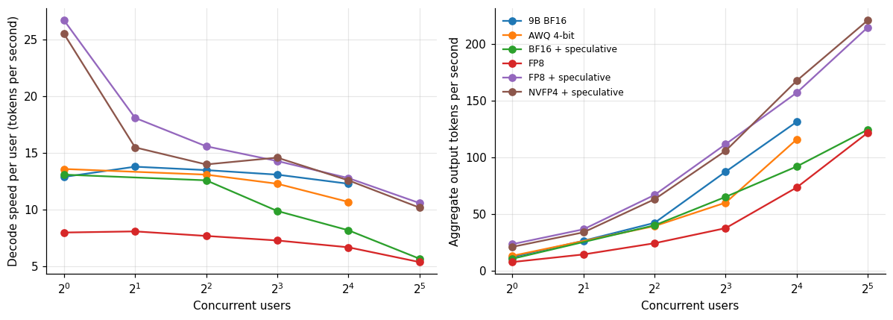

*Figure 1. The language model in four precisions.*

**Table 3.** The language model in four precisions

|  | 9B BF16 | AWQ 4-bit | BF16 + speculative | FP8 | FP8 + speculative | NVFP4 + speculative |
|---|---|---|---|---|---|---|
| 1 | 12.9 | 13.6 | 13.1 | 8 | 26.7 | 25.5 |
| 2 | 13.8 | – | – | 8.1 | 18.1 | 15.5 |
| 4 | 13.5 | 13.1 | 12.6 | 7.7 | 15.6 | 14 |
| 8 | 13.1 | 12.3 | 9.9 | 7.3 | 14.3 | 14.6 |
| 16 | 12.3 | 10.7 | 8.2 | 6.7 | 12.8 | 12.6 |
| 32 | – | – | 5.7 | 5.4 | 10.6 | 10.2 |

For a single user the speeds were 8.0 tokens per second for FP8, 13.1 for BF16 with speculative decoding, 13.6 for AWQ, 12.9 for the 9 billion parameter model, 25.5 for NVFP4 with speculative decoding and 26.7 for FP8 with speculative decoding. Plain FP8 at 8 tokens per second is slow for a chat, and the builds with speculative decoding clear 25. Aggregate throughput at 32 users reached 215 to 221 tokens per second with speculation and 122 for plain FP8.

The service level I use elsewhere in the series, 20 tokens per second per user and a first token in three seconds, is met by two configurations here, FP8 and NVFP4 with speculative decoding, and only for one user (26.7 and 25.5 tokens per second). At two users the per-user speed falls to 18.1 and 15.5. The GB10 serves one person at interactive speed.

## 4. It is memory bandwidth, all the way down

Decoding one token requires reading all the weights once. If the machine reads memory at a rate B, a model whose weights occupy W bytes cannot decode faster than B over W tokens per second. For the plain builds, where no speculative trick changes that arithmetic, the measured single-user speed times the weight size should therefore be roughly constant and equal to the bandwidth.

**Table 4.** It is memory bandwidth, all the way down

| Build | Single user tok/s | Weights GiB | Implied bandwidth GB s | Share of 273 |
|---|---|---|---|---|
| AWQ 4-bit (plain) | 13.6 | 17.8 | 259.9 | 0.95 |
| FP8 (plain) | 8 | 28.06 | 241 | 0.88 |
| 9B BF16 (plain, 9e9 params x 2 bytes) | 12.9 | 16.76 | 232.2 | 0.85 |

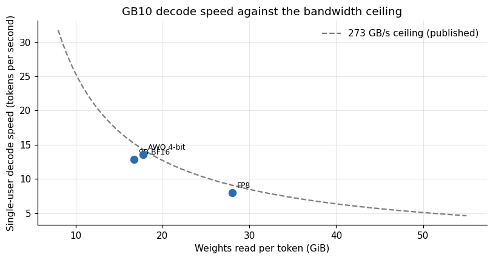

*Figure 2. GB10 decode speed against the bandwidth ceiling.*

The AWQ build at 17.8 GiB decoded at 13.6 tokens per second, which implies 260 gigabytes per second of weight reads. The FP8 build at 28.1 GiB decoded at 8.0, implying 241. The 9 billion parameter BF16 model, taking its size as 9 billion parameters at two bytes each, decoded at 12.9 tokens per second, implying 231. These are 85 to 95 percent of the published 273 gigabytes per second. All three plain builds sit on the same bandwidth line within 12 percent.

The line explains the entire language model table. Halving the weights roughly doubles the speed. The BF16 build, at 51.1 GiB, cannot exceed 5.0 tokens per second at the ceiling. Speculative decoding breaks the rule, because each weight read verifies several tokens, and that is why FP8 with speculation at 26.7 tokens per second exceeds the 9.7 that plain FP8 would reach at 100 percent of the published bandwidth.

## 5. Speculation pays more here

**Table 5.** Speculation pays more here

|  | Plain agg | Spec agg | Plain user | Spec user | Agg gain | User gain |
|---|---|---|---|---|---|---|
| 1 | 7.9 | 23.7 | 8 | 26.7 | 3 | 3.34 |
| 2 | 14.6 | 36.8 | 8.1 | 18.1 | 2.52 | 2.23 |
| 4 | 24.5 | 67.1 | 7.7 | 15.6 | 2.74 | 2.03 |
| 8 | 37.8 | 111.9 | 7.3 | 14.3 | 2.96 | 1.96 |
| 16 | 73.7 | 157.3 | 6.7 | 12.8 | 2.13 | 1.91 |
| 32 | 122 | 215 | 5.4 | 10.6 | 1.76 | 1.96 |

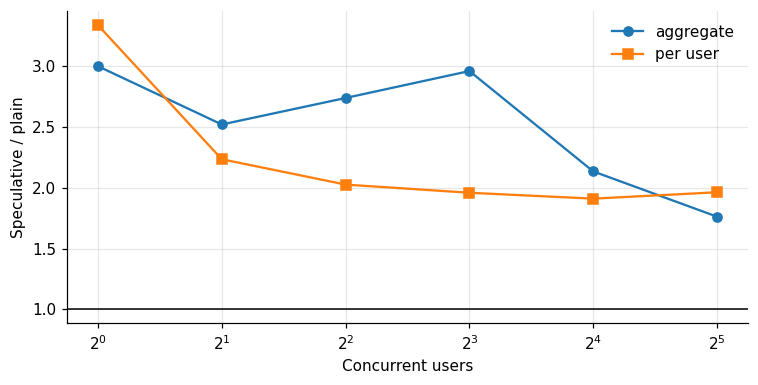

*Figure 3. Speculation pays more here.*

The gain from speculative decoding on FP8 was 3.3 times per user and 3.0 times in aggregate at one user, 2.2 and 2.5 at two users, and stayed at 1.96 per user and 1.76 in aggregate at thirty-two. The article on speculative decoding in this series explains the mechanism. The GB10 sustains the gain longest of the three machines I measured, because its bandwidth is so low relative to its compute that there is always spare arithmetic to spend on verifying drafts. The cost is acceptance: the machine's mean acceptance length was 2.77 with the FP8 build and 3.06 with NVFP4, against about 3.7 to 4.0 on the larger cards, and I do not know why.

## 6. Vision and generation: where it keeps up and where it does not

**Table 6.** Vision and generation: where it keeps up and where it does not

| Workload | Gb10 | Rtx5090 | Gb10 speed vs 5090 |
|---|---|---|---|
| YOLO11n, 1 image | 306.7 | 278.6 | 1.101 |
| YOLO11m, batch 16 | 171.5 | 1,091 | 0.157 |
| YOLO11x, batch 16 | 81.9 | 469.1 | 0.175 |
| SAM 2 large | 92.03 | 21.75 | 0.236 |
| Grounding DINO base | 168.8 | 45.36 | 0.269 |
| Mask R-CNN | 76.84 | 17.73 | 0.231 |
| SDXL-Turbo batch 4 | 0.401 | 0.134 | 0.334 |
| LTX-Video 49 frames | 9.3 | 1.6 | 0.172 |
| F5-TTS medium text | 0.14 | 0.058 | 0.414 |
| NVENC H.264 1080p | 11.34 | 14.2 | 0.799 |

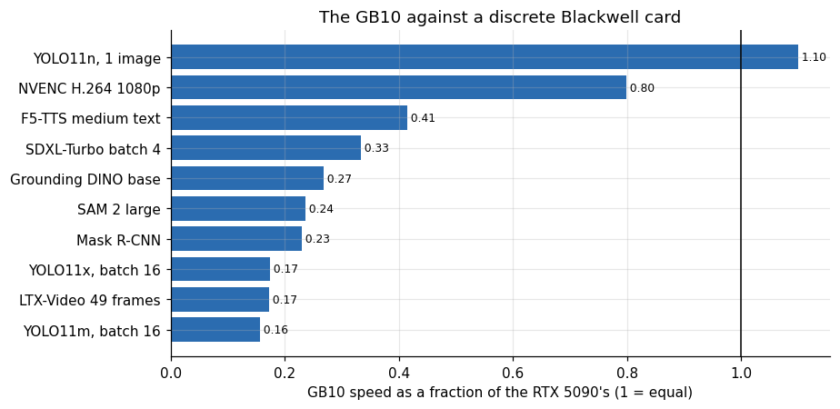

*Figure 4. The GB10 against a discrete Blackwell card.*

Measured as a fraction of an RTX 5090's speed, the GB10 reaches 1.10 on the smallest detector at batch 1, where both machines wait on the host. On larger detector batches it falls to 0.16 to 0.17, on SAM 2, Grounding DINO and Mask R-CNN to 0.23 to 0.27, on SDXL-Turbo at batch 4 to 0.33, on F5-TTS to 0.41, on LTX-Video to 0.17 and on hardware H.264 encoding to 0.80. The pattern is the one the architecture predicts. Tasks limited by arithmetic or bandwidth show the machine's true size, about a fifth to a third of a flagship consumer card. Tasks limited by the host or by fixed-function hardware show something closer to parity.

The detector result is the interesting one. The GB10's ARM host launched kernels about as fast as the 5090's x86 host in the YOLO article, with a single-image latency of 3.3 milliseconds against 3.6, which says that its CPU is not the weak part of the machine.

## 7. Against the big card, build by build

The GB10 ran the same builds of the 27 billion parameter model as the RTX PRO 6000, which makes a direct comparison possible.

**Table 7.** Against the big card, build by build

|  | Single user GB10 | Single user RTX PRO 6000 | Peak GB10 | Peak RTX PRO 6000 | Single user ratio | Peak ratio |
|---|---|---|---|---|---|---|
| BF16 + speculative | 13.1 | 78.7 | 124.7 | 607.5 | 0.17 | 0.21 |
| FP8 | 8 | 45.4 | 122 | 694.3 | 0.18 | 0.18 |
| FP8 + speculative | 26.7 | 173.5 | 215 | 1,039 | 0.15 | 0.21 |
| NVFP4 + speculative | 25.5 | 143.1 | 221.2 | 1,466 | 0.18 | 0.15 |

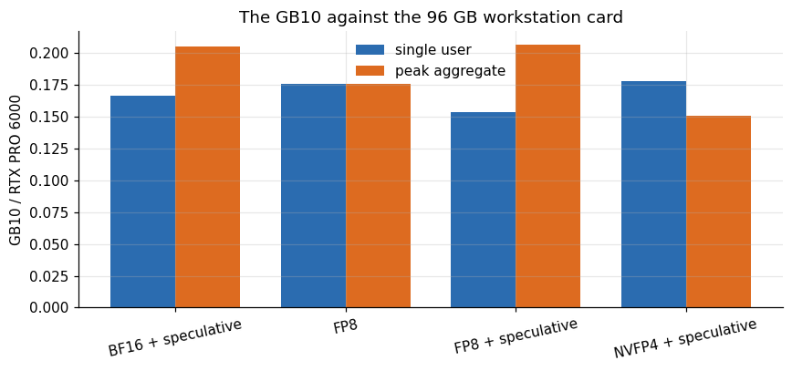

*Figure 5. The GB10 against the 96 GB workstation card.*

The PRO 6000 is faster in every configuration. For a single user, the GB10 reaches 15 to 18 percent of its speed in every configuration (26.7 against 173.5 tokens per second for FP8 with speculation, 25.5 against 143.1 for NVFP4, 8.0 against 45.4 for plain FP8 and 13.1 against 78.7 for BF16 with speculation). At peak aggregate throughput the GB10 reaches 15 to 21 percent: 215 against 1,039 for FP8 with speculation and 221 against 1,466 for NVFP4. The ratio is close to the ratio of memory bandwidth, which for the PRO 6000 is about 1.8 terabytes per second against 273 gigabytes per second, about 6.6 times, a published specification that I did not measure. A language model on these two machines is a bandwidth race, and the GB10 loses it by a factor of five to six.

What the GB10 offers in exchange is capacity per machine: 121 gigabytes against 96, on a computer the size of a book, with a GPU power draw that the sampler trace in the section on load times puts at a median of 34 W over the sweep (I did not meter the machine at the wall).

## 8. What fits, and how fast it could run

Memory capacity and memory bandwidth together decide what the machine is good for. A larger model needs more capacity and, because every token reads all the weights, runs slower.

**Table 8.** What fits, and how fast it could run

|  | AWQ 4-bit | BF16 | FP8 | NVFP4 |
|---|---|---|---|---|
| 24 GB card | 29 | 10 | 19 | 19 |
| 32 GB card | 39 | 14 | 25 | 25 |
| 48 GB card | 59 | 21 | 37 | 38 |
| 96 GB card | 118 | 41 | 75 | 76 |
| GB10 (121 GB) | 149 | 52 | 94 | 96 |

**Table 9.** What fits, and how fast it could run (part 2)

|  | AWQ 4-bit | BF16 | FP8 | NVFP4 |
|---|---|---|---|---|
| 24 GB card | 44.8 | 44.8 | 44.8 | 44.8 |
| 32 GB card | 64.4 | 64.4 | 64.4 | 64.4 |
| 48 GB card | 20.7 | 20.7 | 20.7 | 20.7 |
| 96 GB card | 21.5 | 21.5 | 21.5 | 21.5 |
| GB10 (121 GB) | 2.6 | 2.6 | 2.6 | 2.6 |

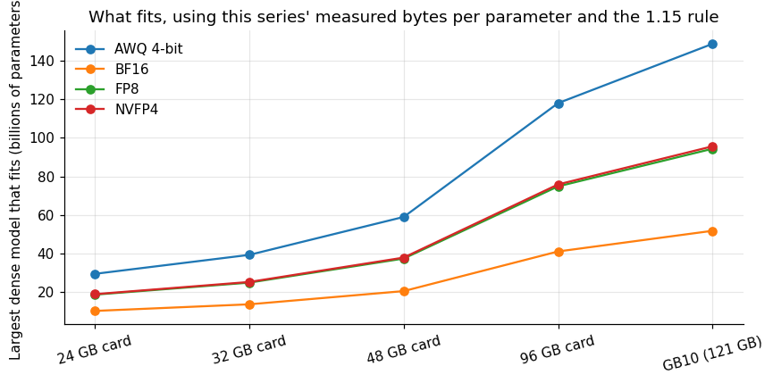

*Figure 6. What fits, using this series.*

Using the sizes measured for the 27 billion parameter model (0.71 bytes per parameter for AWQ, 1.10 for NVFP4, 1.12 for FP8 and 2.03 for BF16) and the 1.15 memory rule from the compatibility article, the GB10 holds a dense model of about 149 billion parameters in AWQ, 94 to 96 billion in FP8 or NVFP4, and 52 billion in BF16. A 24 gigabyte card holds about 29 billion in AWQ, 19 billion in FP8 and 10 billion in BF16; a 96 gigabyte card holds about 118 billion in AWQ and 41 billion in BF16. These are extrapolations of one model family's byte counts, ignoring cache and activation memory, and are an upper bound.

The second table shows what that capacity buys in speed. A model that fills the GB10 decodes at a ceiling of about 2.6 tokens per second (the table reads 2.6 for every precision at the largest fitting size, since the weights always fill the same 105 gigabytes), which is not interactive. A model that fills a 96 gigabyte card with bandwidth of 1.8 terabytes per second reaches about 21 tokens per second at the same fill, and a 24 gigabyte card with 936 gigabytes per second about 45. The GB10 can hold a model about 25 percent larger than the 96 gigabyte card and run it eight times slower. Capacity is not a substitute for bandwidth. For the 27 billion parameter model, where the GB10's ceilings are 14 tokens per second (AWQ), 9.1 (FP8) and 5.0 (BF16), the machine is usable. For a 100 billion parameter model it is a way to look at the output slowly.

## 9. The ARM CPU is a good one

The software video encoder is a CPU benchmark that the series happened to include. FFmpeg's libx264 ran on each machine's host CPU.

**Table 10.** The ARM CPU is a good one

|  | 1080p | 4k |
|---|---|---|
| RTX 5090 | 9.6 | 1.2 |
| GB10 | 8.7 | 2.8 |
| A100 | 7.4 | 3 |
| L40S | 5.9 | 2.6 |
| RTX PRO 6000 | 4.4 | 1.4 |
| RTX 3090 | 3.6 | 1.2 |
| RTX 4090 | 2.6 | 0.8 |

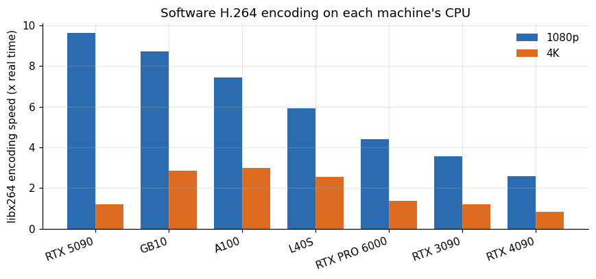

*Figure 7. Software H.264 encoding on each machine.*

At 1080p the GB10's CPU encoded at 8.7 times real time, second only to the 5090 machine's 9.6 and ahead of the A100 host (7.4), the L40S host (5.9), the PRO 6000 host (4.4), the 3090 host (3.6) and the 4090 host (2.6). At 4K it encoded at 2.8 times real time, second to the A100 host's 3.0 and ahead of all the others, which ranged from 0.8 to 2.6. The machines differ by their rented host CPUs, whose core counts I did not record, so this is a comparison of whatever each machine offered. It does show that the ARM CPU in the GB10 holds its own against the server CPUs that the rented machines happened to carry. That fits the detector result, where its single-image latency was the best in the series.

## 10. Operating it

Running a machine like this as a rental host raised operational points that the measurements do not capture but that anyone considering one should know.

The marketplace's SSH proxy did not work for this machine, and I connected by its public address and the mapped port instead. A machine on a home or office network needs a stable address, an open port and a way to keep the network from sleeping.

Idle behavior matters. The machine stays powered when no job runs, and the listing is only useful if the operating system, drivers and container runtime survive restarts without help.

Software for ARM lags. Several of the tools I tried had wheels for x86 only, and the ones that built from source took much longer than on x86 machines. Plan for time to port.

Everything that follows is outside this study's data. The GB10 is the one machine in the series that I did not need to rent, which made it the one for which I did not track time the same way.

## 11. A cache the size of a small server

The strongest property of the machine for language models is not speed. It is that the memory is shared, so the cache that holds the conversations is not squeezed into what the weights leave over. The server logs record how large the cache was on each start.

**Table 11.** A cache the size of a small server

| Build | Model loading GiB | GPU memory utilization | Available KV GiB | KV cache tokens | Mib per token | Max concurrency x | Concurrency ref tokens | Load seconds |
|---|---|---|---|---|---|---|---|---|
| 9B BF16 | 17.66 | 0.4 | 19.51 | 577,910 | 0.035 | 18.06 | 32,000 | 44.6 |
| 9B BF16 | 17.66 | 0.4 | 25.94 | 768,477 | 0.035 | 24.01 | 32,000 | 46.2 |
| 27B AWQ | 17.8 | 0.92 | 90.08 | 906,902 | 0.102 | 110.7 | 8,192 | 114.7 |
| 27B BF16 + speculation | 54.87 | 0.9 | 46.42 | 370,063 | 0.128 | 11.29 | 32,768 | 373.4 |
| 27B FP8 + speculation | 31.83 | 0.85 | 64.82 | 516,696 | 0.128 | 15.77 | 32,768 | 348.7 |
| 27B FP8 | 28.06 | 0.85 | 69.98 | 998,058 | 0.072 | 30.46 | 32,768 | 335.9 |
| 27B NVFP4 + speculation | 31.46 | 0.85 | 63.36 | 505,057 | 0.128 | 15.41 | 32,768 | 177.3 |

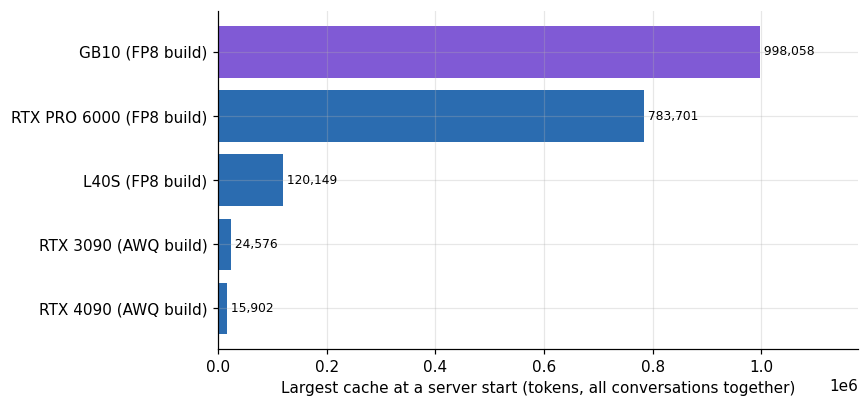

*Figure 8. A cache the size of a small server.*

On the GB10 the plain FP8 build left 69.98 GiB for the cache and held 998,058 tokens. The FP8 build with speculation held 516,696 tokens in 64.82 GiB, and the NVFP4 build with speculation 505,057 in 63.36 GiB. The same FP8 build held 120,149 tokens on the 48 gigabyte L40S and 783,701 on the 96 gigabyte RTX PRO 6000, and no 24 gigabyte card could hold it. The largest caches on the 24 gigabyte cards were 44,311 tokens for the 9 billion model and 24,576 for the 27 billion AWQ build. For the FP8 build, then, the GB10's cache is 8 times the L40S's and 1.3 times the PRO 6000's, and for what a 24 gigabyte card can run it is 23 to 63 times larger.

At 0.10 MiB of cache per token for the 27 billion model, half a million tokens is room for 32 conversations of 15,000 tokens, or 8 of 60,000, simultaneously. That is the combination that a coding agent with a long context and a few parallel sessions needs, and a 24 or 32 gigabyte card cannot supply it with this model at all. The price is speed: a conversation on this machine runs at 8 to 27 tokens per second, as the first sections showed. The machine fits many slow conversations, and the discrete card fits a few fast ones.

## 12. The wait before the first token

The same logs record how long it took to load the weights. The figures differ by an order of magnitude between this machine and the rented cards.

**Table 12.** The wait before the first token

|  | Starts | Median load s | Median weights GiB | Median mib per s |
|---|---|---|---|---|
| RTX PRO 6000 | 12 | 6 | 28.1 | 3,431 |
| A100 | 3 | 7.3 | 17.8 | 2,507 |
| L40S | 8 | 8.4 | 28.1 | 3,052 |
| RTX 4090 | 1 | 9.6 | 17.8 | 1,905 |
| H100 NVL | 2 | 9.7 | 43.3 | 4,770 |
| RTX 3090 | 9 | 10.8 | 17.7 | 1,688 |
| RTX 5090 | 8 | 13.1 | 17.8 | 1,477 |
| GB10 | 7 | 177.3 | 28.1 | 158.9 |

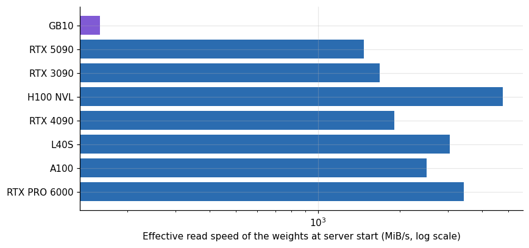

*Figure 9. The wait before the first token.*

On the discrete cards the median start loaded 18 to 43 gigabytes of weights in 6 to 13 seconds, an effective 1.5 to 4.8 gigabytes per second. On the GB10 the median over its 7 starts was 177 seconds at 159 megabytes per second: 45 seconds for the 9 billion BF16 model, 115 for the AWQ build, 177 for the NVFP4 build, 336 to 349 for the FP8 builds and 373 for a 55 gigabyte BF16 build. That is 10 to 30 times slower than the rented cards. I do not know the cause. The weights may come from a slower disk or a network mount on that machine, or the first read of the files may be cold, and the unified memory itself should not be the limit. In practice the cost of starting a large model on the GB10 is five to six minutes, paid once per start, and the machine is meant to hold a model in memory for days. A workflow that starts and stops models often would feel the delay.

The logs of the GB10 starts state the load times directly. These are the loading lines of three of the starts, selected from the curated logs:

```
INFO 10-26 11:30:05 [model_runner.py:428] Model loading took 28.06 GiB memory and 335.890091 seconds
INFO 10-26 12:09:32 [model_runner.py:428] Model loading took 31.83 GiB memory and 348.716922 seconds
INFO 10-26 11:45:20 [model_runner.py:428] Model loading took 31.46 GiB memory and 177.299205 seconds
```

The board's sampler covers those starts. During the 336 seconds of the plain FP8 load it read 1.2 percent GPU utilization and 11.5 W on average (maximum 12.2 W), and the NVFP4 load of 177 seconds and the FP8 plus speculation load of 349 seconds read 1.5 and 1.3 percent at 11.5 W. The effective rates are 86, 182 and 93 MiB per second for the three. The GPU was idle during every load, so the wait was not arithmetic. The sampler cannot say whether the disk, the file system or the loading code was the limit, so my list of guesses stands.

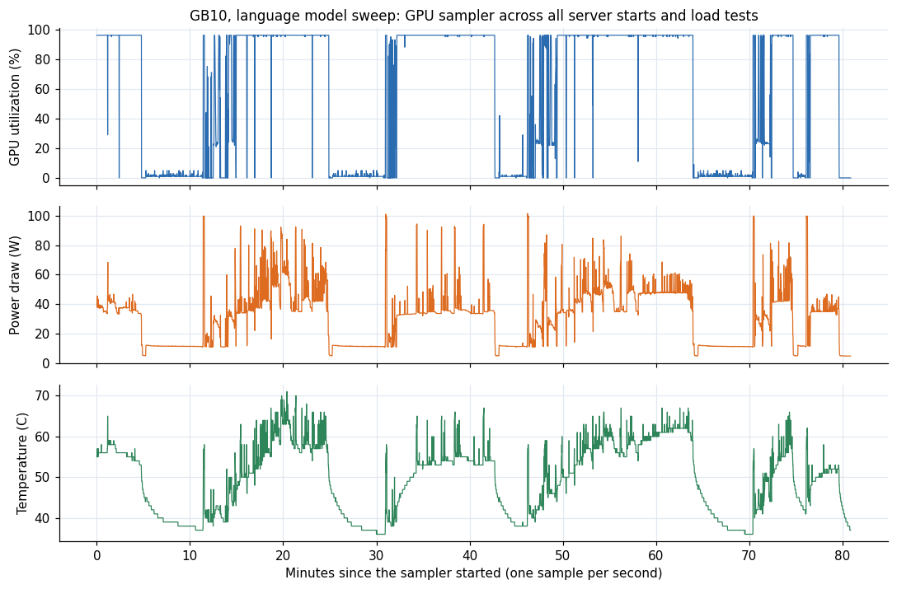

*Figure 10. GB10, language model sweep: GPU utilization, power draw and temperature for 81 minutes at one sample per second.*

Over the whole sweep, the long stretches at about 11.5 W and under 5 percent utilization are the server loads, and the samples under 15 W make up 35 percent of the trace. The median power over the whole sweep was 34 W and 37.4 W over the samples above 15 W, the maximum was 101.5 W with a 99th percentile of 93.1 W, and the temperature ranged from 36 to 71 degrees Celsius.

## 13. Who else runs the FP8 build, and at what price

The FP8 build of the 27 billion parameter model needs about 28 gigabytes for its weights. Four kinds of machine in the study ran it: the GB10, the 48 gigabyte L40S, the RTX PRO 6000 and the H100. This is the one place where the GB10 can be compared with the cards on the same model.

**Table 13.** Who else runs the FP8 build, and at what price

|  | Per user | Agg tok/s | Dph | USD per m | Users | Agg tok/s best | USD per m best |
|---|---|---|---|---|---|---|---|
| GB10 | 26.7 | 23.7 | 0.449 | 5.261 | 32 | 215 | 0.58 |
| L40S | 109.7 | 80 | 0.762 | 2.647 | 32 | 210.5 | 1.006 |
| RTX PRO 6000 | 173.5 | 137 | 1.513 | 3.068 | 32 | 1,039 | 0.405 |

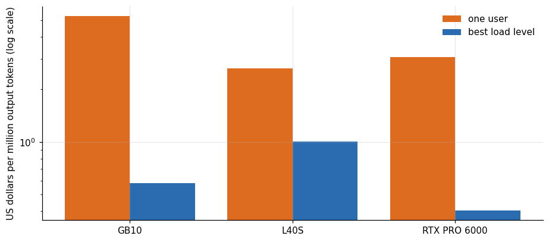

*Figure 11. Who else runs the FP8 build, and at what price.*

For a single user the GB10 produced 26.7 tokens per second against 109.7 on the L40S and 173.5 on the RTX PRO 6000. At its best load, 32 users, the GB10 cost 0.58 dollars per million output tokens at its listing price of 0.449 dollars per hour, the L40S 1.01 and the PRO 6000 0.40. The listing price is what I ask for the machine on the marketplace and not what the machine costs me, and the GB10 line should be read as the price at which it would be competitive and not as a measurement of rented time. At that price the GB10 is cheaper per token than the L40S and dearer than the PRO 6000, and it needs the highest load I tested, 32 users, to get there.

The ranking shifts with the number of users. At one user the GB10 costs 5.3 dollars per million tokens against 2.6 for the L40S and 3.1 for the PRO 6000, since a slow machine with one stream is expensive per token. At 32 users the GB10 costs 0.58 dollars, because its aggregate throughput grew by a factor of 9 while the L40S's grew by 2.6 and the PRO 6000's by 7.6. That leads to the next question.

## 14. Does the aggregate scale better here?

The ratio of the aggregate throughput at 32 users to the throughput of one user says how much of the card's capacity a single stream leaves unused. A card that is fully used by one stream gains nothing from more users; a card that is mostly waiting gains a lot.

**Table 14.** Does the aggregate scale better here?

|  | GPU | Agg 1 user | Agg 32 users | Gain 32 over 1 |
|---|---|---|---|---|
| 0 | GB10 | 23.7 | 215 | 9.07 |
| 2 | RTX PRO 6000 | 137 | 1,039 | 7.58 |
| 1 | L40S | 80 | 210.5 | 2.63 |

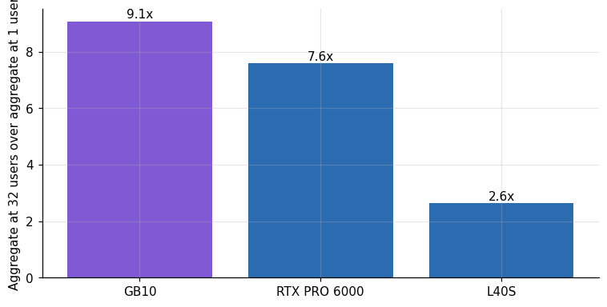

*Figure 12. Does the aggregate scale better here?*

On the GB10 the aggregate rate for the FP8 build with speculation grew from 23.7 tokens per second at one user to 215 at 32, a factor of 9.1. On the RTX PRO 6000 the factor was 7.6, and on the L40S 2.6. A larger factor means that a single stream leaves more of the machine idle: the GB10 spends most of a single-user decode waiting on its memory, and extra users share the same weight reads. This is why its price per token falls so fast with load, and why it serves 32 users at 10.6 tokens per second each rather than collapsing.

## 15. What porting the two failures would take

Two of the 18 cells of the grid failed, and both are software gaps and not hardware limits. A reader who owns such a machine might wonder how far they are from working.

The speech-to-speech model stopped with `No module named moshi.offline`, an import error from the model's own package. The install log shows that a dependency of the package, `sphn`, failed to build on the ARM machine because a bundled CMake project is too old for the installed CMake, so the environment was incomplete when the example ran. A newer release of that dependency, or the CMake policy flag that the error message suggests, might get past the build step. I did not try either. I did not try, since each attempt on that machine costs time but not money and I had other items to complete.

The image-to-3D tool is a harder case. Its installer fetches a pinned build of an attention library that exists only as an x86 Linux wheel and runs a CUDA installer that is an x86 binary. Porting means building the attention library from source against the ARM CUDA toolkit and replacing the installer step with the ARM package of the toolkit. People do both on this machine, and the effort is a matter of hours and not of principle. I counted it as a failure of the platform, which it is today, and not as a limit of the hardware.

## 16. How large a model the bandwidth allows

The first half of this article showed that single-user decode speed on this machine is the memory bandwidth divided by the bytes read per token, at 85 to 95 percent of the published 273 gigabytes per second. That relation can be turned around to answer a purchasing question: for a given speed, how large a model can the machine run? I use the measured efficiency range and the weight size of the model, ignoring speculation, which multiplies the result by a factor that depends on the text.

**Table 15.** How large a model the bandwidth allows

| Model | Weights GiB | Ceiling tok/s 100 | Tok/s low | Tok/s high | Fits 121gb | Measured tok/s |
|---|---|---|---|---|---|---|
| 9B, BF16 | 16.7 | 15.2 | 12.9 | 14.5 | yes | 12.9 |
| 27B, 4-bit (AWQ) | 17.8 | 14.3 | 12.1 | 13.6 | yes | 13.6 |
| 27B, FP8 | 28.1 | 9 | 7.7 | 8.6 | yes | 8 |
| 27B, BF16 | 51.1 | 5 | 4.2 | 4.7 | yes | – |
| 35B, 4-bit | 21 | 12.1 | 10.3 | 11.5 | yes | – |
| 70B, 4-bit | 38 | 6.7 | 5.7 | 6.4 | yes | – |
| 70B, 8-bit | 70 | 3.6 | 3.1 | 3.5 | yes | – |
| 120B, 4-bit | 66 | 3.9 | 3.3 | 3.7 | yes | – |

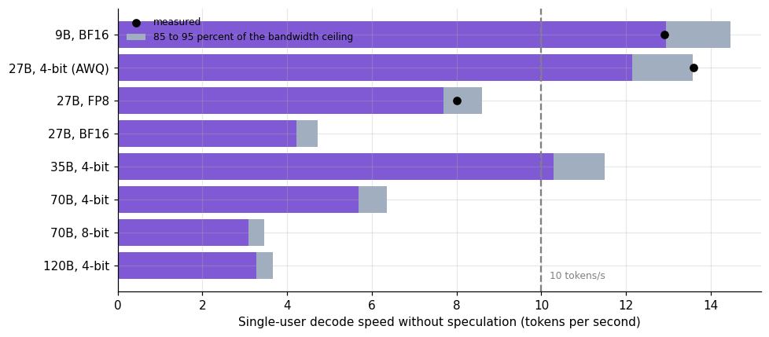

*Figure 13. How large a model the bandwidth allows.*

The first three rows are measured: the 9 billion BF16 model at 12.9 tokens per second, the AWQ build at 13.6 and the FP8 build at 8.0, each within the predicted band. The other rows are predictions that I did not measure, with weight sizes that are my estimates for common 4-bit and 8-bit packings. A 35 billion parameter model in 4 bits, about 21 gigabytes, should reach 10 to 11.5 tokens per second. A 70 billion model in 4 bits, about 38 gigabytes, should reach 5.7 to 6.4 tokens per second, and in 8 bits, about 70 gigabytes, 3.1 to 3.5. A 120 billion model in 4 bits at 66 gigabytes should give about 3.3 to 3.7.

The machine's memory is large enough for all of them. Reading speed is what limits it. Eight tokens per second is slow for chat and acceptable for an agent that works in the background, and 3 tokens per second is a demonstration. The practical limit for interactive use of dense models on this machine is a model of about 30 billion parameters at 4 bits. Models with sparse activation, where each token reads only a fraction of the weights, are the exception, and the machine's large memory is made for them. I did not run one.

## 17. Choosing a precision on this machine

The four precisions measured on the GB10 differ in four ways that matter to a buyer: the speed for one user, the speed at load, the cache they leave and the time they take to load. The table puts them next to each other.

**Table 16.** Choosing a precision on this machine

|  | Single user tok/s | Aggregate 32 users tok/s | Cache tokens | Load s |
|---|---|---|---|---|
| 9B BF16 | 12.9 | – | 768,477 | 45.4 |
| AWQ | 13.6 | – | 906,902 | 114.7 |
| BF16 + speculation | 13.1 | 124.7 | 370,063 | 373.4 |
| FP8 | 8 | 122 | 998,058 | 335.9 |
| FP8 + speculation | 26.7 | 215 | 516,696 | 348.7 |
| NVFP4 + speculation | 25.5 | 221.2 | 505,057 | 177.3 |

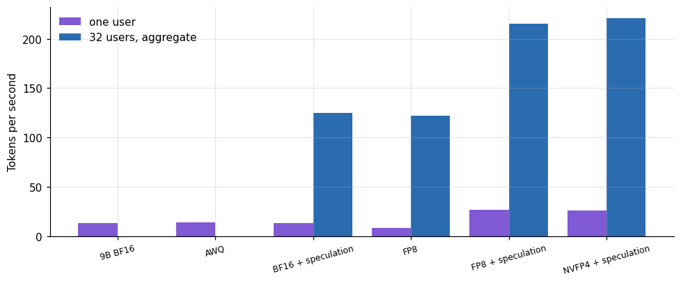

*Figure 14. Choosing a precision on this machine.*

For one user, FP8 with speculation (26.7 tokens per second) and NVFP4 with speculation (25.5) are the only configurations above 20, and they load in 349 and 177 seconds. For many users, FP8 with speculation and NVFP4 with speculation reached 215 and 221 aggregate tokens per second at 32 users, while plain FP8, which has the largest cache, and BF16 with speculation reached 122 and 125. The AWQ build is the compromise for a single user who wants speed without speculation: 13.6 tokens per second, the smallest weights and a 115-second load.

A buyer who wants one answer should read it from the use. For a personal assistant with one user, NVFP4 with speculation, since it is as fast as FP8 with speculation and loads in half the time. For a small team sharing one model with long contexts, plain FP8, whose cache holds about a million tokens. For anything that needs more than 20 tokens per second per user at two users or more, this machine is the wrong tool.

## 18. What it costs, and what it is for

**Table 17.** What it costs, and what it is for

| Build | Best users | Aggregate tok/s | USD per mtok 100pct |
|---|---|---|---|
| FP8 | 32 | 122 | 1.022 |
| FP8 + speculative | 32 | 215 | 0.58 |
| NVFP4 + speculative | 32 | 221.2 | 0.564 |
| AWQ 4-bit | 16 | 116.1 | 1.074 |
| 9B BF16 | 16 | 131.6 | 0.948 |

At the price I list the machine for, the best configurations reach 0.56 dollars per million output tokens at full load, which is not competitive with the discrete cards in the cost article, and which falls to 7.5 to 8.4 dollars per million tokens at the one-user service level. The machine does not make sense as rented serving capacity. It makes sense as a computer you own: a place to run a model that does not fit your other hardware, at a pace one person can read, with no per-hour bill.

Specific uses fit the measurements. Developing against the largest model, because the machine holds the 51 GiB BF16 build and the 27 GiB FP8 one at once, with room for their caches. Offline batch jobs that can wait: 125 tokens per second aggregate for BF16 at 32 users, over 10 million tokens a day. Edge deployments of a few cameras, where the 80 to 170 images per second of the medium and extra-large detectors is enough. Evaluation, where speed matters less than the ability to load the full-precision reference.

Specific uses do not fit. Serving a public chat to more than one or two people at a time. Anything latency-sensitive that needs more than 10 tokens per second per user at a batch above 2. Long agent sessions, whose cost the long-context article analyzed on much faster machines. Generation workloads where a discrete card is three to six times faster at a comparable price.

## 19. What I could not measure on this machine

Several questions about the GB10 are open because I could not or did not measure them. I have one-second GPU power and temperature samples for the first language model sweep, from the board's own sensor, but no meter at the wall, so I did not compute what a token costs in energy. I measured one machine, mine, and every number about its storage, such as the load times, belongs to its disk and not necessarily to the model. I ran one language model family, and the ratios between precisions may differ for other architectures. I did not run sparse models of the mixture-of-experts kind, which are the ones that suit a large, slow memory. I did not test two machines linked together, a configuration that I understand to be possible for larger models, and I did not test long runs: the machine's behavior under hours of load, in noise and heat, is unknown to me beyond the sessions of the study.

The comparison with rented cards has its own limits. The GB10's price is a listing I set, so its cost per token is hypothetical, while the rented cards' prices were paid. And the discrete cards were measured in sessions of minutes on shared hosts, while the GB10 was measured on a machine under my control. Each of these points leans, in one direction or the other, on the comparison of price and speed in the sections above.

## 20. Questions I expect

**Is the GB10 good for running a language model locally?** For one person, with a model of up to about 30 billion parameters in FP8 or 4-bit, yes. Beyond that the bandwidth makes it slow.

**Why not use it for serving?** Its aggregate throughput of about 220 tokens per second is a fifth of the workstation card's, and per user it is slower. The one-user service level is all it meets.

**Is the ARM platform a problem?** For the tools I tried, two of 18 failed because of it. That is a small share, and each failure was a package.

**What would change the picture?** Higher memory bandwidth. The GB10's compute is not the limit; its memory is.

## 21. Limitations

One machine, one software stack (ARM Linux with CUDA), the library versions of the day. Two failures that a different environment or a later release could fix. The bandwidth reference is a published specification that I did not verify with a bandwidth test. The 9 billion parameter weight size is computed from the parameter count. Prices are the rate at which I list the machine. The speculative acceptance results are lower than on the other machines for reasons I did not investigate.

Most cells in the tables come from a single run on this machine, in one of two sessions. The speed of the builds with speculation depends on how predictable the generated text is, since the drafter's guesses are accepted more often for regular text, and my load generator used a fixed set of prompts, so the speeds are specific to that text. A reader whose traffic is more varied should expect the gain from speculation to be smaller than the factor of 3.3 measured here for one user, and larger or smaller at load depending on the mix. The vision and generation timings are medians of a few calls, and the same caution applies to them as in the other articles of the series.

## 22. How much it cost

The GB10 is my own machine, and its sessions cost no rental. Electricity is the only cost, which I did not meter. The GB10 results come from two sessions, a library sweep and a language model sweep, and the comparison cards cost between 0.10 and 1.30 dollars each in rental inside a campaign of US$ 50.79.

## 23. Reproducing this analysis

Attach the dataset `gpu-ai-benchmark-campaign-2026` and filter on the GB10 rows in `llm_serving.csv`, `libs_runs.csv` and `compat_matrix.csv`. The scripts are in the repositories `llm-serving-engines-bench` and `vision-detection-tracking-bench`.

## 24. Glossary

- **Unified memory**: one pool of memory shared by the CPU and the GPU.
- **LPDDR5X**: low-power memory used in laptops and small computers.
- **Memory-bound**: limited by the speed of reading memory.
- **ARM**: the processor architecture used in phones and some servers, as opposed to x86.
- **Speculative decoding**: a draft proposes tokens and the large model verifies several at once.
- **NVENC**: the video encoder in NVIDIA GPUs.

Lucas Rangel
