# From a benchmark to a price per unit

**Lucas Rangel** · [Kaggle writeup](https://www.kaggle.com/writeups/lucasrangelss/from-a-benchmark-to-a-price-per-unit) · [Executable notebook](https://www.kaggle.com/code/lucasrangelss/from-a-benchmark-to-a-price-per-unit) · [Code and data](https://github.com/LucasRangelSSouza/gpu-ai-benchmark-hub) · [Dataset](https://www.kaggle.com/datasets/lucasrangelss/gpu-ai-benchmark-campaign-2026)

## Abstract

A benchmark tells you how fast a card runs a workload. A price needs one more step: the cost of a unit of work that someone can buy, such as a million generated tokens, a thousand segmented images or an hour of synthesized speech, adjusted for the fact that a card is never busy all the time. This article takes the measurements of the study and walks that step with every assumption in the open. It is arithmetic on measured costs and a standard queueing model, written for someone who sells compute or runs it for others. It is not a quote, and the campaign was too small and too short to support one.

- In each of six workloads the dearest card cost 3.6 to 4.9 times as much per unit as the cheapest, so the choice of card is worth a factor of about 4 before any other decision.
- For the 27 billion parameter model with 4-bit weights, the cheapest measured card meeting a three-second first-token target was the RTX 5090 at 0.22 dollars per million output tokens at full utilization. The same model on the L40S cost 1.03 dollars.
- Utilization is the largest lever after the choice of card. A queueing model with the measured service time says that a pool of 32 concurrent slots can run at 79 percent utilization and keep the 95th percentile wait under one second, and a single slot only at 5.5 percent. Price per unit rises by 1/utilization, so the single slot costs 14 times as much per token as the 32-slot pool.
- In this campaign, the reconciled spend (50.79 dollars) was 1.86 times the rental estimated from hourly rates and lifetimes (27.25 dollars). Whatever a production service pays beyond the hourly rate, a price built on the hourly rate alone starts about 46 percent low if it resembles my experience.
- A single RTX 5090 rented around the clock costs about 488 dollars a month and can produce about 2,200 million output tokens in it. At a price of 0.50 dollars per million tokens it breaks even at 44 percent utilization, and the L40S, the A100 and the RTX PRO 6000 cannot break even at that price at any utilization.

> **Code and data.** Everything behind this article is public: the code that ran, the curated data, the analysis that regenerates every figure, and tests that pin the conclusions to the data. Repositories: [vast-gpu-benchmark-harness](https://github.com/LucasRangelSSouza/vast-gpu-benchmark-harness). Index of the whole series: [gpu-ai-benchmark-hub](https://github.com/LucasRangelSSouza/gpu-ai-benchmark-hub).

## 1. Units and what a unit means

A price attaches to something the buyer can count. For the workloads in the study I use six units. For the language model it is a million output tokens, because that is how language model services are usually sold. For image generation it is a thousand 512 by 512 images made by SDXL-Turbo with four denoising steps. For video generation it is a minute of generated video from LTX-Video at 512 by 320 pixels. For speech it is an hour of synthesized audio from F5-TTS. For detection it is a million images through a 640-pixel YOLO11 medium model in batches of 16. For segmentation it is a thousand images through SAM 2 at batch size 1.

Each unit has a hidden condition, and the hidden condition decides whether the number can be compared with others. A language model token has a speed at which it must arrive for the buyer to find the service usable, so I attach a service level (a 95th percentile first-token time of at most three seconds) to the token unit. An image from a diffusion model has a fixed output size and step count. A second of speech has a fixed voice and text type. In every case the unit is defined by the run that produced the measurement, and I report only units for which I have a measured run.

## 2. What each unit costs at full utilization

The cost of a unit at full utilization is the hourly price of the card divided by the units it produces in an hour. Both parts come from the dataset: the hourly price was recorded with each run, and the throughput was measured in it. For the language model the throughput is the aggregate output rate at the load level that gave the lowest cost while meeting the first-token target.

**Table 1.** What each unit costs at full utilization

|  | LLM, USD per million output tokens (first token within 3 s) | Images, USD per 1,000 (SDXL-Turbo 512x512) | Video, USD per generated minute (LTX-Video 512x320) | Speech, USD per audio hour (F5-TTS, warm) | Detection, USD per million images (YOLO11m) | Segmentation, USD per 1,000 images (SAM 2) |
|---|---|---|---|---|---|---|
| A100 | 0.539 | 0.027 | 0.012 | 0.065 | 0.304 | 0.009 |
| GB10 | 1.074 | 0.05 | 0.034 | 0.11 | 0.727 | 0.011 |
| H100 NVL | – | 0.071 | – | – | 0.672 | – |
| L40S | 1.029 | 0.029 | 0.015 | 0.061 | 0.321 | 0.014 |
| RTX 3090 | 0.297 | 0.019 | 0.01 | 0.035 | 0.179 | 0.005 |
| RTX 4090 | 0.361 | 0.024 | 0.008 | 0.039 | 0.162 | 0.006 |
| RTX 5090 | 0.22 | 0.02 | 0.009 | 0.053 | 0.164 | 0.004 |
| RTX PRO 6000 | 0.695 | 0.051 | 0.029 | 0.163 | 0.37 | – |

**Table 2.** What each unit costs at full utilization (part 2)

|  | Cheapest card | Cheapest USD | Dearest USD | Ratio dearest over cheapest |
|---|---|---|---|---|
| LLM, USD per million output tokens (first token within 3 s) | RTX 5090 | 0.22 | 1.074 | 4.882 |
| Images, USD per 1,000 (SDXL-Turbo 512x512) | RTX 3090 | 0.019 | 0.071 | 3.713 |
| Video, USD per generated minute (LTX-Video 512x320) | RTX 4090 | 0.008 | 0.034 | 4.283 |
| Speech, USD per audio hour (F5-TTS, warm) | RTX 3090 | 0.035 | 0.163 | 4.689 |
| Detection, USD per million images (YOLO11m) | RTX 4090 | 0.162 | 0.727 | 4.482 |
| Segmentation, USD per 1,000 images (SAM 2) | RTX 5090 | 0.004 | 0.014 | 3.636 |

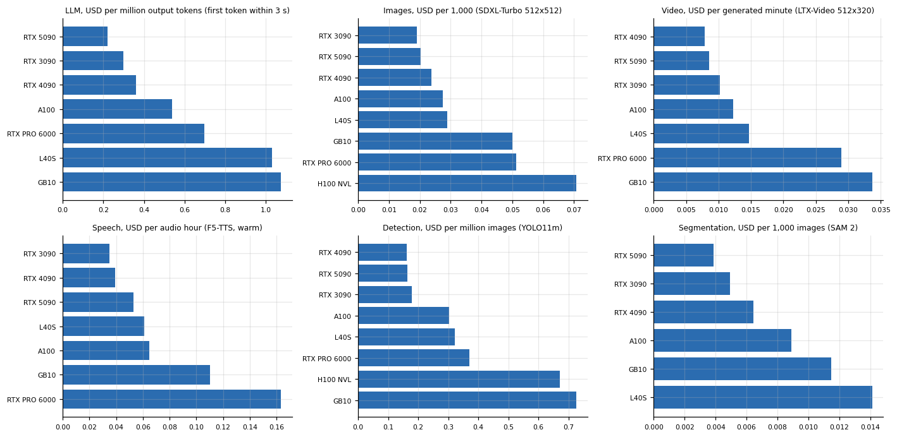

*Figure 1. What each unit costs at full utilization.*

The cheapest card for the language model with the first-token target was the RTX 5090 at 0.22 dollars per million output tokens, then the A100 at 0.54, the RTX PRO 6000 at 0.70, the L40S at 1.03 and the GB10 at 1.07, with the 3090 and the 4090 in between. The RTX 3090 and the RTX 4090 fall between them: 0.30 and 0.36 dollars. At their cheapest load levels (16 users) the 95th percentile first-token time was 10.6 and 8.2 seconds, above the target, so with the target they must run at a lower load, which raises the cost from 0.27 to 0.30 dollars on the 3090 and from 0.35 to 0.36 on the 4090. The service level costs 8 percent on the 3090 and 5 percent on the 4090. A card that is cheapest at saturation may be unusable at the load that makes it cheapest.

For the other workloads the cheapest card differs. Image generation was cheapest on the RTX 3090 (0.019 dollars per thousand images, with the 5090 at 0.020), video on the 4090 (0.008 dollars per generated minute, a figure for 512 by 320 clips that I treat with care, since it depends on clip length), speech on the 3090 (0.035 dollars per audio hour), detection on the 4090 (0.16 dollars per million images) and segmentation on the 5090 (0.004 dollars per thousand images). The cheapest card is not the same for every workload, and a service that mixes workloads on one card pays for the mismatch.

The ratio of the dearest to the cheapest card is the measure of how much the choice of hardware matters per workload. It is 4.9 for the language model at the service level (1.07 against 0.22 dollars per million tokens, counting the GB10), 3.7 for image generation, 4.3 for video, 4.7 for speech, 4.5 for detection and 3.6 for segmentation, so choosing the right card is worth a factor of about 4 to 5 and not a factor of 10.

## 3. Where the difference between cards comes from

The cost of a unit is the price of the hour divided by the units in the hour, so the difference between two cards in cost per unit is the ratio of their hourly prices divided by the ratio of their throughputs. A card can be cheap per unit because the hour is cheap or because the hour is productive, and the two causes lead to different decisions: a cheap hour can disappear when the marketplace moves, a productive hour comes with the hardware.

The division is one function in the analysis code of the harness repository, copied here as it is.

```
def usd_per_million_tokens(dph_usd: float, tokens_per_second: float) -> float:
    """Hourly price divided by tokens produced per hour, per million tokens."""
    return dph_usd / (tokens_per_second * 3600.0) * 1e6
```

With the 5090's recorded hourly price of 0.669 dollars and its 844.4 tokens per second, the function returns 0.2201, which the table shows as 0.22. With the L40S's 0.801 dollars and 216.3 tokens per second it returns 1.0287, shown as 1.03. Everything else in the table is the same division with other inputs.

**Table 3.** Where the difference between cards comes from

|  | USD per hour | Tokens per second | USD per m tokens | Price ratio vs 5090 | Throughput ratio vs 5090 | Cost ratio vs 5090 | Check |
|---|---|---|---|---|---|---|---|
| RTX 5090 | 0.669 | 844.4 | 0.22 | 1 | 1 | 1 | 1 |
| RTX 3090 | 0.254 | 237.1 | 0.297 | 0.379 | 0.281 | 1.351 | 1.351 |
| RTX 4090 | 0.367 | 282.7 | 0.361 | 0.549 | 0.335 | 1.641 | 1.641 |
| A100 | 0.668 | 344.1 | 0.539 | 0.999 | 0.408 | 2.451 | 2.451 |
| RTX PRO 6000 | 1.735 | 693 | 0.695 | 2.594 | 0.821 | 3.16 | 3.16 |
| L40S | 0.801 | 216.3 | 1.029 | 1.198 | 0.256 | 4.678 | 4.678 |
| GB10 | 0.449 | 116.1 | 1.074 | 0.671 | 0.137 | 4.882 | 4.882 |

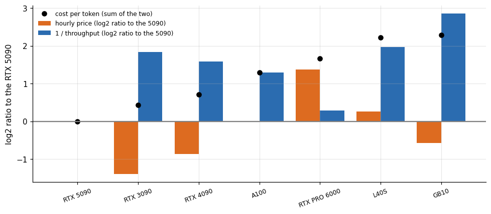

*Figure 2. Where the difference between cards comes from.*

Against the RTX 5090, the L40S has an hour that is 20 percent more expensive (0.80 against 0.67 dollars) and a throughput that is 3.9 times lower in the best case that met the service level (216 against 844 tokens per second), so its cost per token is 4.7 times higher. The RTX PRO 6000 has an hour 2.6 times as expensive and a throughput 18 percent lower, for 3.2 times the cost. The A100 has the same hourly price as the 5090 and 41 percent of its throughput. The 3090 and the 4090 have hours that are 62 and 45 percent cheaper than the 5090's hour and throughputs that are 3.6 and 3.0 times lower, and they end up at 1.35 and 1.64 times the 5090's cost. For the L40S, the A100, the GB10, the 3090 and the 4090 the throughput deficit is larger than the price difference, and for the PRO 6000 the price of the hour is the larger factor.

The decomposition makes a point about the stability of the ranking. The ordering of the cards by cost per token is set mostly by throughput, which does not change from day to day, and only weakly by the hourly price. The hourly price spread seen later in the ledger (a factor of 2.4 for the 5090, from 0.47 to 1.14 dollars) is large. The throughput ratios of the L40S (3.9) and the GB10 (7.3) against the 5090 are larger than that spread, so their ranking would survive any price I recorded. The ranking of the 5090 against the 3090 and the 4090 would not: at its highest recorded hour the 5090 would cost 0.37 dollars per million tokens, above the 3090 (0.30) and the 4090 (0.36) at the prices of their runs.

## 4. Utilization: why the unit price is not the cost at full load

A card that earns money is not busy all the time. Requests arrive at random, and if the card ran at the speed of the benchmark, every request that arrived while it was busy would wait. How much waiting the buyer tolerates sets the highest utilization the seller can run at, and the unit price must cover the hours in which the card is idle. The standard tool for this is the Erlang C model of a queue with several servers: requests arrive at random, each is served in a random time, and a request that finds all servers busy waits.

I take the service time from the study. The queue simulation of this series fed on 223 measured request times from the language model server, and their median was 6.19 seconds. A server runs many requests at once, 32 in the setup of that simulation, so a replica behaves like a queue with 32 servers. The target I use is a 95th percentile wait of at most one second before service begins.

The queueing model is three short functions, copied from the same file. The first gives the chance that a request has to wait, the second the 95th percentile of the wait, and the third searches for the highest utilization at which that wait stays within the target.

```
def erlang_c(c: int, a: float) -> float:
    """Probability that an arriving request must wait: c servers, offered load a erlangs (a < c)."""
    s = sum(a ** k / math.factorial(k) for k in range(c))
    t = a ** c / math.factorial(c) * c / (c - a)
    return t / (s + t)

def p95_wait(c: int, rho: float, mu: float) -> float:
    """95th percentile queueing delay (seconds) at utilization rho with service rate mu per server."""
    a = rho * c
    if a >= c:
        return float("inf")
    pc = erlang_c(c, a)
    return 0.0 if pc <= 0.05 else math.log(pc / 0.05) / (c * mu - a * mu)

def max_utilization(c: int, service_s: float, wait_target_s: float = 1.0, step: float = 0.005) -> float:
    """Highest utilization at which the 95th percentile wait stays within wait_target_s."""
    mu = 1.0 / service_s
    best = 0.0
    for r in np.arange(step, 0.995, step):
        if p95_wait(c, float(r), mu) <= wait_target_s:
            best = float(r)
    return best
```

Run with the measured median service time of 6.1923 seconds, the search returns 0.790 for 32 slots and 0.055 for one slot, the two figures in Table 4. The edge is sharp: at 79 percent utilization the 95th percentile wait of the 32-slot pool is 0.96 seconds, and at 85 percent it is 2.23.

**Table 4.** Utilization: why the unit price is not the cost at full load

| Slots | Max utilization | Price multiplier |
|---|---|---|
| 1 | 0.055 | 18.18 |
| 2 | 0.195 | 5.128 |
| 4 | 0.375 | 2.667 |
| 8 | 0.545 | 1.835 |
| 16 | 0.685 | 1.46 |
| 32 | 0.79 | 1.266 |
| 64 | 0.865 | 1.156 |
| 128 | 0.92 | 1.087 |

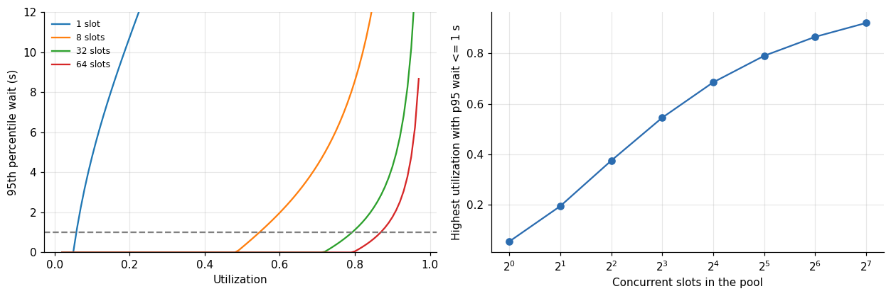

*Figure 3. Utilization: why the unit price is not the cost at full load.*

With one slot the highest utilization that keeps the 95th percentile wait under a second is 5.5 percent: a lone server must be idle 94 percent of the time. With 8 slots it is 55 percent, with 32 slots 79 percent and with 128 slots 92 percent. Pooling is the effect behind the numbers. A pool of many servers absorbs bursts, because the chance that all of them are busy at once falls quickly with the size of the pool.

The price follows by division. If the card's cost at full utilization is 0.22 dollars per million tokens, a pool of 32 slots at 79 percent costs 0.28 dollars per million, and a single slot at 5.5 percent costs 4.0 dollars. The single slot is 14 times as expensive per token as the pool, for the same card and the same model. This is the argument for sharing a model server among many customers, and it has nothing to do with the speed of the card.

The model has limits that I will name. It assumes random arrivals with a constant rate, and real traffic has daily cycles and bursts, which need more headroom. It assumes service times that follow an exponential distribution, while real language model request times are spread differently, with a long tail from long outputs. And it treats the 32 slots as independent servers, while the speed per request falls as more run at once, which the benchmark showed. The result is a first estimate of the utilization ceiling and should be checked with a simulation of real traffic, like the one in the article on cost per user.

## 5. What the study's own sessions say

My own sessions give a rough empirical check on idle time and waste. The 35-minute stability test of the series held the RTX 5090 under a steady load, and the GPU's reported utilization averaged 85.6 percent, which was the highest I measured with a real server. The ledger of rentals shows how the money was used.

**Table 5.** What the study's own sessions say

|  | Sessions | USD | Hours | Share of USD |
|---|---|---|---|---|
| complete | 57 | 23.3 | 37.58 | 0.855 |
| partial | 48 | 3.959 | 5.928 | 0.145 |
| running | 49 | 0 | 0 | 0 |

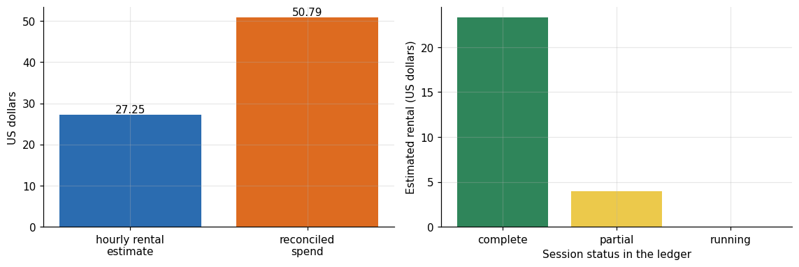

*Figure 4. What the study's own sessions say.*

Of the 27.25 dollars of hourly rental in the ledger, 23.30 belongs to sessions that finished normally and 3.96, 14.5 percent, to sessions marked partial, which ended early because of an error or the budget guard. A further 49 rows are sessions with no recorded duration, and they carry no cost in the estimate. The reconciled spend was 50.79 dollars, 1.86 times the hourly estimate. The article on what a GPU benchmark really costs explains the gap: sessions the event log recorded late, plus download traffic and storage that the hourly rate does not capture.

I take two parameters from this for the price. The fraction of rental lost to sessions that ended in failure, about 15 percent in my campaign, is the retry overhead of a fragile setup, and a production service with automatic recovery would have less. The factor of 1.86 between all spend and hourly rental is the overhead for everything else, and it is the least transferable number in this article, since a benchmark campaign downloads large model files over and over, while a service downloads them once. I use 30 percent as a placeholder for a service and show the sensitivity, because I have no measurement of it.

## 6. The formula

Combining the pieces gives the price per unit. Let c be the cost per unit at full utilization on the chosen card, u the utilization the service runs at, f the share of paid hours lost to failures and restarts, o the overhead beyond the hourly rate as a fraction, and m the target gross margin as a fraction of the price. Then the price p is

price = c divided by (u times (one minus f)), then multiplied by (one plus o) and divided by (one minus m).

Each term has an owner. The card owns c, the queueing model owns u, the quality of the operation owns f, the accounting owns o, and the business owns m. The point of writing it down is that the five can be argued about separately.

The formula is also one function, with the placeholders of the text as default arguments.

```
def unit_price(cost_full: float, utilization: float, failure_share: float = 0.05, overhead: float = 0.30, margin: float = 0.40) -> float:
    """Price per unit from the cost at full load: divide by utilization and (1 - failures), add overhead, gross up for margin."""
    return cost_full / (utilization * (1 - failure_share)) * (1 + overhead) / (1 - margin)
```

For the 5090 at 0.22 dollars per million tokens and 80 percent utilization the function returns 0.627, the 0.63 of the text. At 10 percent utilization it returns 5.02. The defaults are the ones I chose, 5 percent of paid hours lost, 30 percent overhead and a 40 percent margin, and none of them is a measurement.

**Table 6.** The formula

|  | 20% | 30% | 40% | 50% | 60% |
|---|---|---|---|---|---|
| 10% | 3.764 | 4.302 | 5.018 | 6.022 | 7.528 |
| 20% | 1.882 | 2.151 | 2.509 | 3.011 | 3.764 |
| 30% | 1.255 | 1.434 | 1.673 | 2.007 | 2.509 |
| 40% | 0.941 | 1.075 | 1.255 | 1.506 | 1.882 |
| 50% | 0.753 | 0.86 | 1.004 | 1.204 | 1.506 |
| 60% | 0.627 | 0.717 | 0.836 | 1.004 | 1.255 |
| 70% | 0.538 | 0.615 | 0.717 | 0.86 | 1.075 |
| 80% | 0.47 | 0.538 | 0.627 | 0.753 | 0.941 |
| 90% | 0.418 | 0.478 | 0.558 | 0.669 | 0.836 |

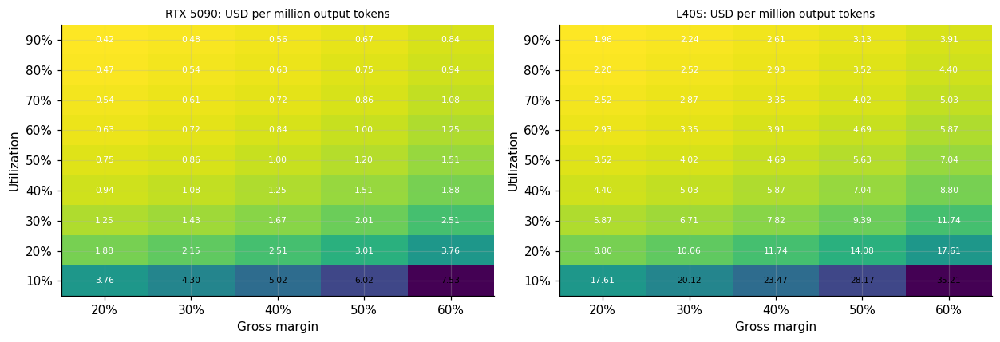

*Figure 5. : USD per million output tokens.*

For the RTX 5090 with 5 percent lost to failures, 30 percent overhead and a 40 percent margin, the price per million output tokens is 0.63 dollars at 80 percent utilization and 5.0 dollars at 10 percent. At 79 percent, the ceiling the queueing model gave for a pool of 32 slots, it is 0.64 dollars. On the L40S the same assumptions give 2.97 dollars at 79 percent. The 5090 therefore sells the same unit at a price about a fifth of the L40S's, which is the hardware choice made visible in the price.

The grid also shows what the margin is worth. Moving the margin from 20 to 60 percent on the 5090 at 80 percent utilization moves the price from 0.47 to 0.94 dollars, a factor of 2, while moving utilization from 80 to 20 percent moves it by a factor of 4. A service that wants to compete on price should work on utilization before it gives up margin.

## 7. One card, one month

A service that rents a card by the month, or reserves it, pays whether or not anyone uses it. The monthly cost of a card at its recorded hourly price is the price times 730 hours, and the number of units it can produce in a month is its throughput times the seconds in the month. The break-even utilization at a given price is the monthly cost divided by the revenue the card would earn at 100 percent utilization.

**Table 7.** One card, one month

| Card | Dph | Monthly rent USD | Capacity million tokens per month | Cost per m full |
|---|---|---|---|---|
| RTX 5090 | 0.669 | 488.3 | 2,219 | 0.22 |
| A100 | 0.668 | 487.7 | 904.3 | 0.539 |
| RTX PRO 6000 | 1.735 | 1,267 | 1,821 | 0.695 |
| L40S | 0.801 | 585.1 | 568.4 | 1.029 |

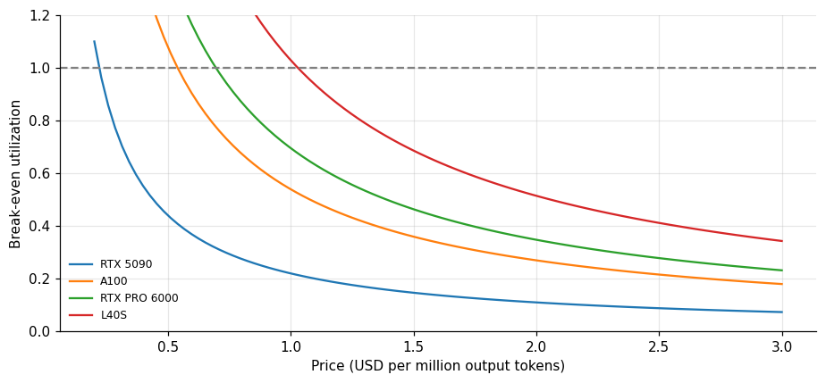

*Figure 6. One card, one month.*

A 5090 at the price I recorded costs about 488 dollars per month and can produce about 2,200 million output tokens in that month at full load. At a price of 0.50 dollars per million tokens it breaks even at 44 percent utilization, and at 1.00 dollars at 22 percent. The L40S costs about 585 dollars per month and produces about 570 million tokens, so at 0.50 dollars per million it cannot break even at any utilization, since its capacity at that price earns 284 dollars. The A100 (108 percent) and the RTX PRO 6000 (139 percent) cannot either. The comparison shows how the choice of card changes the floor on the price: a price that gives the 5090 a comfortable margin is below the cost of the L40S.

Break-even is not profit, and it ignores the overhead and the margin of the formula above. It marks the least a seller must sell before the rent is covered, and the seller must also know how much demand exists. A price that needs 80 percent utilization to break even is a bet on demand that the benchmark cannot evaluate.

## 8. Which assumption moves the price most

To rank the assumptions I varied each one over a plausible range with the others at their central values, for the 5090 at a 40 percent margin.

**Table 8.** Which assumption moves the price most

|  | Assumption | Price at low | Price at high | Spread |
|---|---|---|---|---|
| 4 | card (L40S instead of RTX 5090) | 0.635 | 2.972 | 2.336 |
| 0 | utilization (0.4 to 0.9) | 1.255 | 0.558 | 0.697 |
| 1 | overhead beyond rental (0 to 0.9) | 0.489 | 0.928 | 0.44 |
| 2 | margin (0.2 to 0.5) | 0.476 | 0.762 | 0.286 |
| 3 | failure share (0 to 0.3) | 0.603 | 0.862 | 0.259 |

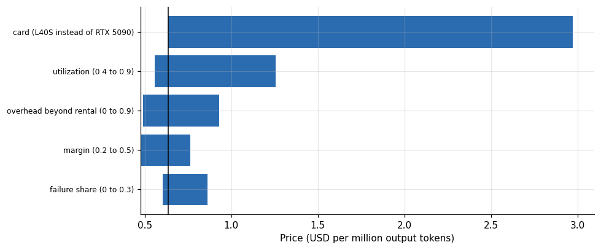

*Figure 7. Which assumption moves the price most.*

The choice of card, within the set I measured, moves the price by the widest margin, from 0.64 to 2.97 dollars per million tokens. Utilization comes second, from 0.64 at 79 percent to 1.26 at 40 percent, then the overhead beyond rental, then the margin and the failure share. The ordering says that the work of the engineer, who picks the card and keeps it busy, outweighs the work of the pricing meeting.

## 9. One card for every workload?

A service that sells more than one kind of unit has to decide whether to buy one kind of card or several. The catalog above answers that question directly. For each workload I divide the cost on every card by the cost on the cheapest card for that workload, which gives a regret: how many times more expensive the unit is on this card than on the best one.

**Table 9.** One card for every workload?

|  | Geometric mean regret | Workloads where cheapest | Workloads measured |
|---|---|---|---|
| RTX 5090 | 1.1 | 2 | 6 |
| RTX 3090 | 1.16 | 2 | 6 |
| RTX 4090 | 1.25 | 2 | 6 |
| A100 | 1.88 | 0 | 6 |
| L40S | 2.35 | 0 | 6 |
| RTX PRO 6000 | 3.2 | 0 | 5 |
| GB10 | 3.63 | 0 | 6 |
| H100 NVL | 3.92 | 0 | 2 |

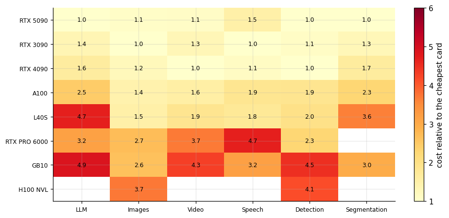

*Figure 8. One card for every workload?*

The RTX 5090 has the lowest average regret, a geometric mean of 1.10 times the best cost across the six workloads, and it is the cheapest card for two of them (the language model with its service level, and segmentation). The RTX 3090 (1.16) and the RTX 4090 (1.25) follow, each the cheapest for two workloads. The data center cards cost more: 1.9 times the best on average for the A100, 2.4 for the L40S and 3.2 for the RTX PRO 6000, and the GB10 costs 3.6 times.

This ranking is specific to what I measured: single workloads, no contention, hourly prices from one marketplace on two days. It does not capture what the data center cards offer that a gaming card cannot, namely more memory (so larger models, longer contexts and more concurrent users), or the reliability of a data center host. For the 27 billion parameter model in 16-bit precision, the cheap cards did not run at all, and the cost per unit for a workload that does not fit is infinite. The table covers workloads that every card ran, and a service that needs a workload outside that set would restrict its choice to the cards that run it.

## 10. Price per user

Customers rarely buy tokens by the million. They buy a seat, and the seat has to be priced from the unit. If a user consumes t million output tokens a month, the cost of the user is t times the price per million tokens. I do not have usage data for any real group of users, so the table below is a calculation with a range of assumed consumption, chosen to span a light chat user to a heavy automation user.

**Table 10.** Price per user

| Million tokens per user per month | Seat price 5090 USD | Seat price l40s USD |
|---|---|---|
| 0.2 | 0.13 | 0.59 |
| 1 | 0.64 | 2.97 |
| 5 | 3.18 | 14.86 |
| 25 | 15.88 | 74.29 |

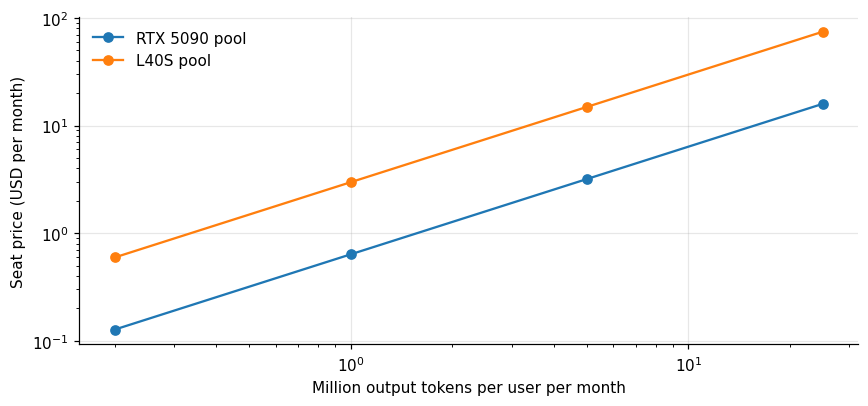

*Figure 9. Price per user.*

**Table 11.** Price per user (part 2)

|  | 0.2 M/user | 1 M/user | 5 M/user | 25 M/user |
|---|---|---|---|---|
| RTX 5090 | 8,765 | 1,753 | 351 | 70 |
| A100 | 3,572 | 714 | 143 | 29 |
| RTX PRO 6000 | 7,194 | 1,439 | 288 | 58 |
| L40S | 2,245 | 449 | 90 | 18 |

At the price from the grid for a pool of 5090 cards, 0.64 dollars per million tokens, a light user of 0.2 million tokens a month costs 13 cents and a heavy user of 25 million costs 16 dollars. On the L40S, with a price of 2.97 dollars, the same users cost 59 cents and 74 dollars. One 5090 at 79 percent utilization could serve about 1,750 users who consume a million tokens a month, 350 who consume 5 million, or 70 of the 25-million kind.

The assumption about usage dominates this table. Real usage distributions are skewed: a minority of users consume most of the tokens, and a flat seat price subsidizes the heavy users with the light ones. A flat price that is safe for the mean user can lose money on the 95th percentile user, and the benchmark has nothing to say about the shape of the distribution.

## 11. Two service levels, two prices

Not every buyer needs the first token in three seconds. A batch job that classifies documents overnight tolerates waits of minutes, and the card can run at its saturation load with the longest queues. The queueing model gives the utilization ceiling for a given wait target, and the benchmark gives the cost per token at the load that has no first-token constraint. Together they price the two tiers.

**Table 12.** Two service levels, two prices

| Card | Interactive cost full | Interactive util | Interactive price | Batch cost full | Batch util | Batch price | Batch over interactive |
|---|---|---|---|---|---|---|---|
| RTX 5090 | 0.22 | 0.79 | 0.635 | 0.22 | 0.998 | 0.503 | 0.792 |
| RTX 3090 | 0.297 | 0.79 | 0.858 | 0.274 | 0.998 | 0.626 | 0.73 |

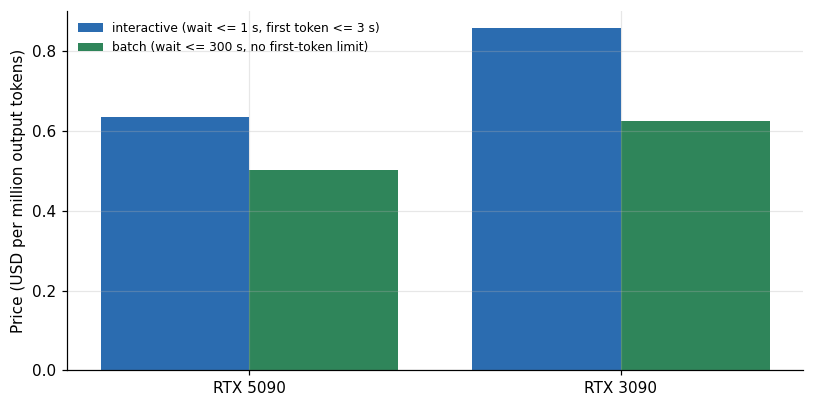

*Figure 10. Two service levels, two prices.*

On the RTX 5090 the batch tier is 21 percent cheaper than the interactive tier. The card's cheapest load level already met the first-token target, so the whole difference comes from the utilization ceiling, which the longer wait raises from 79 to 99.8 percent. On the RTX 3090 the batch tier is 27 percent cheaper, from both effects: the cheapest load level without the first-token limit costs 0.274 dollars per million tokens against 0.297 with it, and the ceiling rises in the same way. The ceiling of 99.8 percent is a limit of the model with an unbounded queue and a five-minute wait allowed, and a real batch tier would keep a margin below it. A tier structure makes the most sense for cards whose cheapest load is also their slowest in first-token time.

## 12. How much the rental price itself moves

All of the above used the hourly price recorded with each run. The marketplace does not hold a fixed price, and the same model of card was rented at different prices on different hosts and times. The ledger shows the spread.

**Table 13.** How much the rental price itself moves

|  | Count | Min | Median | Max | Max over min |
|---|---|---|---|---|---|
| GTX 1080 Ti | 14 | 0.056 | 0.065 | 0.069 | 1.239 |
| RTX 3060 | 13 | 0.059 | 0.07 | 0.088 | 1.492 |
| RTX 3090 | 30 | 0.154 | 0.221 | 0.868 | 5.652 |
| RTX 4090 | 29 | 0.367 | 0.496 | 0.804 | 2.188 |
| RTX 5090 | 39 | 0.47 | 0.609 | 1.135 | 2.412 |
| L40S | 10 | 0.735 | 0.802 | 0.869 | 1.182 |
| RTX PRO 6000 | 15 | 1.136 | 1.513 | 2.536 | 2.233 |

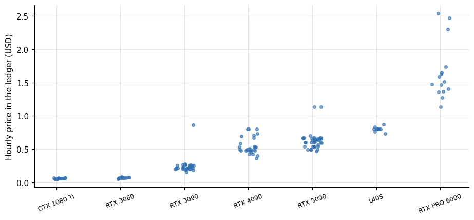

*Figure 11. How much the rental price itself moves.*

Across the cards with at least five rentals, the ratio between the highest and the lowest hourly price recorded for the same model of card ranges from 1.2 (the L40S) to 5.7 (the RTX 3090, whose highest recorded price of 0.87 dollars was a single host far above its median of 0.22). For the 5090 the lowest recorded price is 0.47 dollars per hour and the highest 1.14, with a median of 0.61. A cost per unit derived from one rental could be off by that much, in either direction, and a price list should say which hourly price it assumed.

## 13. A recipe for another workload

To price a workload that I did not measure, the steps are the same as the ones above, in order. Define the unit the buyer will count and the condition that makes it usable, such as a latency target. Run the workload on the cards you can rent, at several load levels, and record throughput and the latency metric at each. Keep the load levels that meet the condition. Divide the hourly price by the hourly throughput at each level, take the cheapest, and write down the card, the level and the date. Estimate the arrival pattern and the service time, and use a queueing model to find the utilization the pool can run at under the wait target. Apply the failure share, the overhead and the margin, and publish the assumptions together with the price.

Each step corresponds to a table or figure above, and each has a way to go wrong that I met in this study: a unit without a latency condition hides a card that is only cheap when it is slow; a throughput measured at one load level may not be the best level; a queueing model fit to the wrong service time gives a false ceiling; an overhead taken from a benchmark campaign does not carry over to a service.

## 14. The unit leaves out the prompt

Every price in this article counts output tokens. A request also carries input tokens, the prompt, and the card spends compute on those as well. Prompt tokens are cheaper, since the card reads them all at once instead of one by one, and the long-context article of this series measured how much on a PRO 6000 serving the NVFP4 build.

**Table 14.** The unit leaves out the prompt

|  | Phase ctx | Prefill | Prefix | Cached over cold | Output USD per m | Output over cold prompt |
|---|---|---|---|---|---|---|
| RTX 5090 + AWQ 27B | 8,000 | 0.0515 | 0.0067 | 0.1301 | 0.22 | 4.273 |
| RTX 5090 + AWQ 27B | 32,000 | 0.055 | 0.0017 | 0.0302 | 0.22 | 3.999 |
| RTX 5090 + AWQ 27B | 64,000 | 0.1049 | 0.0121 | 0.1155 | 0.22 | 2.097 |
| RTX PRO 6000 + NVFP4 27B | 8,000 | 0.0409 | 0.0176 | 0.4305 | 0.6954 | 17.02 |
| RTX PRO 6000 + NVFP4 27B | 32,000 | 0.0432 | 0.0069 | 0.1606 | 0.6954 | 16.11 |
| RTX PRO 6000 + NVFP4 27B | 64,000 | 0.0484 | 0.0052 | 0.1068 | 0.6954 | 14.35 |
| RTX PRO 6000 + NVFP4 27B | 100,000 | 0.055 | 0.0041 | 0.075 | 0.6954 | 12.64 |

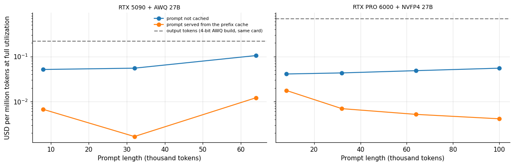

*Figure 12. The unit leaves out the prompt.*

On the PRO 6000, at an hourly price of 1.51 dollars, an uncached prompt was read at 7,600 to 10,300 tokens per second, which is 0.041 to 0.055 dollars per million prompt tokens at full utilization, and a prompt served from the prefix cache at 24,000 to 102,000 tokens per second, 0.004 to 0.018 dollars. Output tokens on the same card cost 0.70 dollars per million, so a cold prompt token is 13 to 17 times cheaper than an output token, and a cached one 40 to 170 times cheaper. On the RTX 5090 with the AWQ build, at 0.67 dollars per hour, the cold prompt cost 0.052 to 0.105 dollars per million and the cached prompt 0.002 to 0.012, against 0.22 for output tokens: 2 to 4 times cheaper when cold and 18 to 130 times when cached.

For a request with a long prompt and a short answer, such as classification or extraction, the prompt side can matter as much as the output side. A request with 6,000 prompt tokens and 100 output tokens costs about 0.00025 dollars for the prompt and 0.00007 for the output on the PRO 6000, so the prompt is 78 percent of the compute; on the 5090 it is 0.00031 against 0.00002 dollars, 93 percent. A price that counts only output tokens undercharges such a customer by a large factor. I measured prefill on these two configurations only, and I would measure it on the chosen card before pricing a prompt-heavy workload.

## 15. The fixed cost that a unit price hides

A unit price assumes that the capacity scales smoothly with demand. A card does not. The smallest deployment is one card, and a service that wants to survive the failure of a card needs two. At low volume the cost per request is set by the fixed cost of the smallest deployment and not by the cost per token.

**Table 15.** The fixed cost that a unit price hides

| Documents million per month | Output million tokens | Cards | Rent USD | Cost per document USD | Unit price per document USD | Fixed over unit |
|---|---|---|---|---|---|---|
| 0.1 | 5 | 2 | 976.6 | 0.009766 | 3.2e-05 | 307.5 |
| 0.5 | 25 | 2 | 976.6 | 0.001953 | 3.2e-05 | 61.49 |
| 2 | 100 | 2 | 976.6 | 0.000488 | 3.2e-05 | 15.37 |
| 10 | 500 | 2 | 976.6 | 9.8e-05 | 3.2e-05 | 3.075 |
| 50 | 2,500 | 2 | 976.6 | 1.9e-05 | 3.2e-05 | 0.6149 |
| 200 | 10,000 | 6 | 2,930 | 1.5e-05 | 3.2e-05 | 0.4612 |

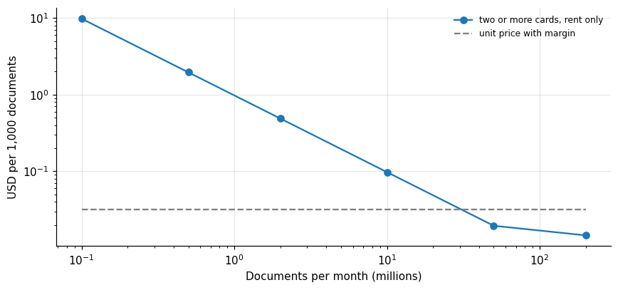

*Figure 13. The fixed cost that a unit price hides.*

As an illustration, take a classification service that answers each document with 50 output tokens, a number I chose, with two RTX 5090 cards as the smallest deployment. At 100,000 documents a month the rent of the two cards, 977 dollars, is 0.0098 dollars per document, 307 times the 0.000032 dollars that the unit price of 0.64 dollars per million tokens implies. At 2 million documents it is 15 times and at 10 million 3 times. At 50 million documents the two cards are still enough, since one card handles about 35 million of these documents a month at 79 percent utilization (1,750 million tokens divided by 50), and the rent per document is 0.6 times the unit price. At 200 million documents six cards are needed and the ratio is 0.46. The fixed cost stops mattering about where the demand reaches the capacity of the minimum deployment.

The lesson is not that the unit price is wrong. It describes a service that is already large enough to keep its cards busy. Below that size the seller has to price a minimum, such as a monthly fee, and the unit price applies to the volume above it. The benchmark gives the size at which the switch happens: the monthly capacity of the smallest deployment, times the utilization ceiling.

The claims of the article, with what each rests on:

**Table 15a.** Claims of the article, their evidence and their caveats

| Claim | Evidence | Caveat |
|---|---|---|
| The cheapest card per million tokens is the RTX 5090 at 0.22 dollars | Hourly price divided by the peak speed that met the first-token target | Speed from one session per card; the hourly price moves from 0.47 to 1.14 dollars |
| A pool of 32 slots can run at 79 percent utilization | Erlang C with the measured median service time of 6.19 seconds | Random arrivals and exponential service times assumed |
| The overhead beyond rental is 30 percent | None | A placeholder; the campaign's 1.86 does not transfer |
| The L40S cannot break even at 0.50 dollars per million tokens | Monthly rent 585 dollars against 568 million tokens of capacity | Capacity at full load; one workload |
| The fixed cost dominates until demand fills the smallest deployment | Rent per document is 307 times the unit price at 0.1 million documents and 0.6 times at 50 million | Documents of 50 output tokens, a number I chose |

## 16. What this arithmetic leaves out

Several items that a real price must cover are absent from my measurements. Network traffic out of the data center is billed by the gigabyte and I did not measure the response sizes that would drive it. Storage for model files, logs and customer data is a monthly cost. Redundancy, meaning a second card so that one failure does not stop the service, doubles the fixed cost of a small service. Support, monitoring and the engineering time to operate the service are real costs that the rental price does not contain. Moderation and safety checks consume compute that the benchmark did not include. Taxes and the cost of payment processing depend on where the seller and the buyer are.

The measurements are also a snapshot. The marketplace prices I recorded change from hour to hour, and the hosts differ, as the segmentation and 3D articles of this series showed. A price list built on these numbers would need to be rebuilt whenever the rental market moved by more than the margin.

## 17. Questions I expect

**Can I sell at the cost per million tokens in your table?** No. That is the cost at full utilization with no overhead, and no service runs there. Divide by the utilization the queue allows and add what the formula lists.

**Why is the utilization ceiling so low for a single server?** Because a lone server has no one to absorb a burst. A random arrival that lands while the server is busy waits, and the 95th percentile wait grows quickly with load.

**Is the cheapest card always the best?** Not once you apply the service level. Two cards that were cheap at saturation failed the first-token target at the load that made them cheap.

**What does a faster model cost me?** It depends on the unit. For tokens, a faster server lowers c in proportion. For images and speech the cost scales with the time per output and the card's price.

**Can I rely on the 30 percent overhead?** No. It is a placeholder. Measure your own, and expect a service that downloads models once to have less than a benchmark campaign.

## 18. How much it cost

The numbers behind this article come from every session of the campaign, so the cost of producing them is the cost of the campaign: 50.79 dollars reconciled, about 253 reais at the exchange rate the budget used, over 166 ledger rows and 43.5 hours of recorded rental. Nothing in this article required a new rental. It is arithmetic on measurements that already existed, plus a queueing model that runs in a fraction of a second.
