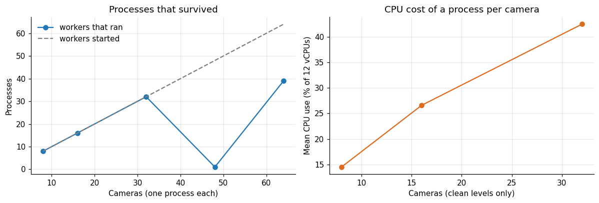
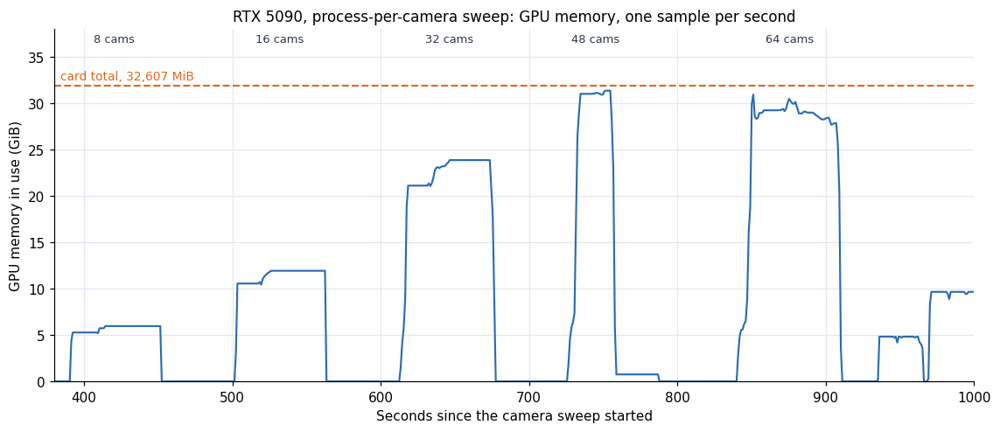
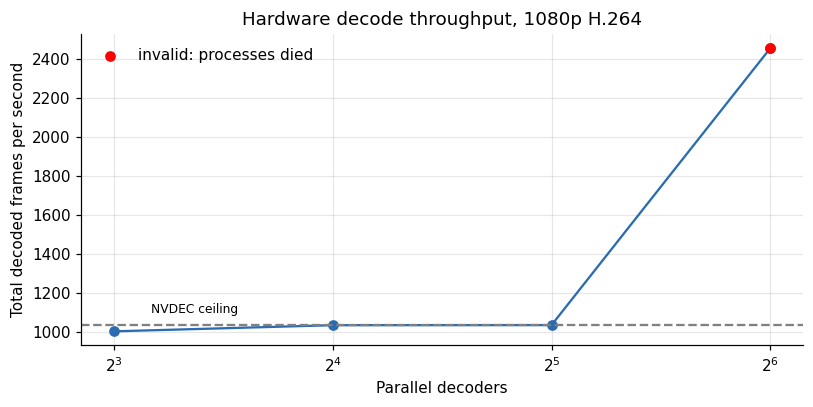
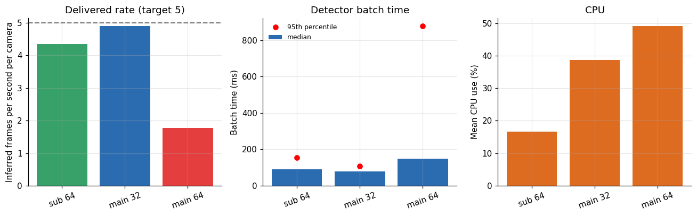
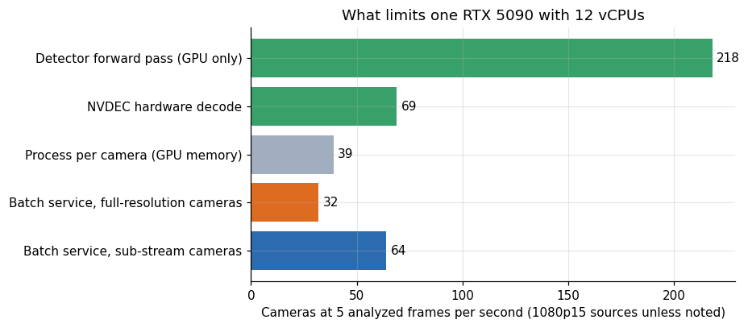
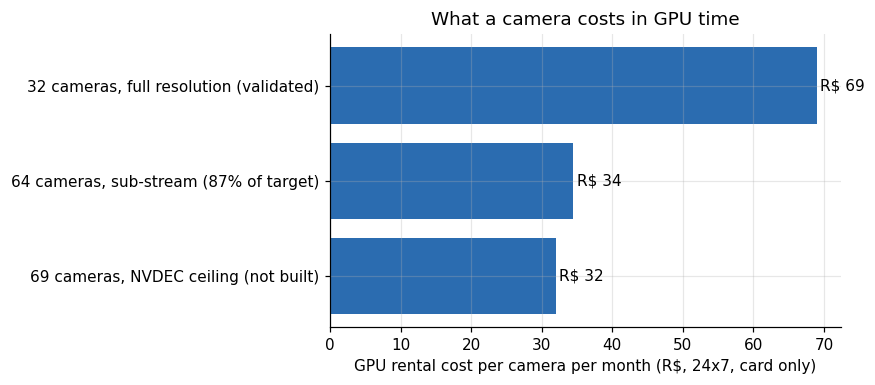
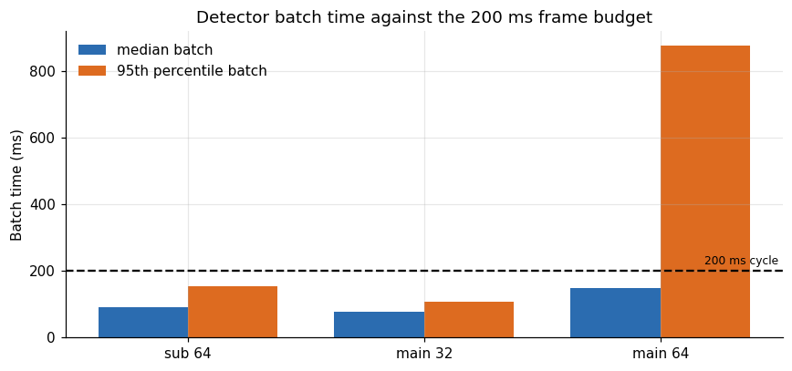
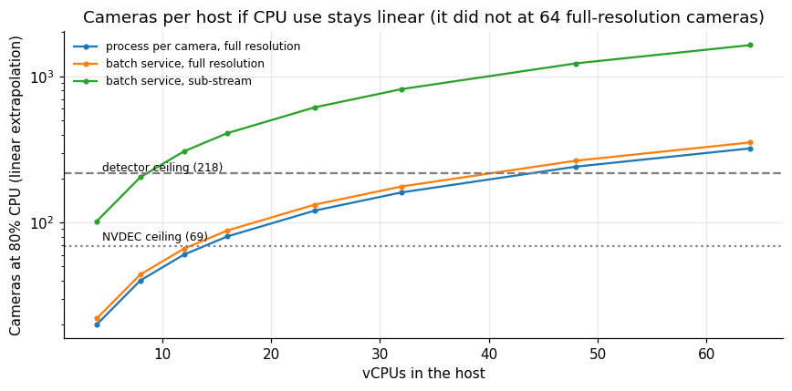
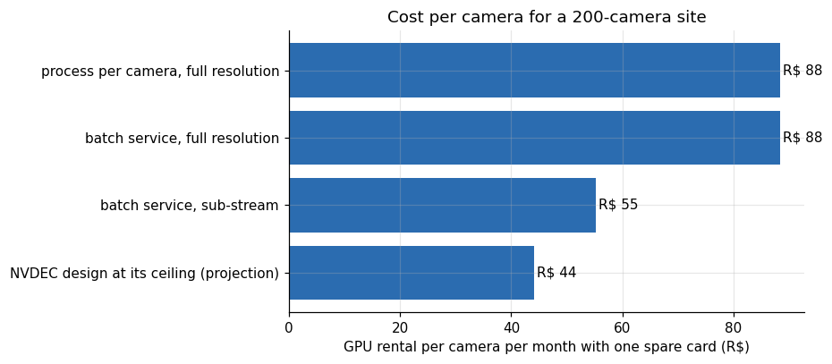

# How many cameras can one RTX 5090 serve

**Lucas Rangel** · [Kaggle writeup](https://www.kaggle.com/writeups/lucasrangelss/how-many-cameras-can-one-rtx-5090-serve) · [Executable notebook](https://www.kaggle.com/code/lucasrangelss/how-many-cameras-can-one-rtx-5090-serve) · [Code and data](https://github.com/LucasRangelSSouza/gpu-ai-benchmark-hub) · [Dataset](https://www.kaggle.com/datasets/lucasrangelss/gpu-ai-benchmark-campaign-2026)

## Abstract

A security-camera analytics product has one number that decides its price: how many cameras a single GPU can watch. Vendors quote large figures, often by dividing the speed of the detector by the frame rate of a camera. I measured the real thing on one RTX 5090 with a 12 vCPU host, using 1080p H.264 streams delivered over RTSP, YOLO11m detection and ByteTrack tracking, at a target of 5 analyzed frames per second per camera.

The answer depends on how the software is built, and the GPU is rarely the limit.

- The detector alone could handle about 218 cameras at 5 frames per second. That is the number a spec sheet would give.
- The hardware video decoder (NVDEC) topped out at about 1,035 frames per second, which is 69 streams at the 15 frames per second the cameras send.
- With one Python process per camera, 32 cameras ran cleanly at 5.07 inferred frames per second each, using 42.5 percent of the CPU. At 48 and 64 cameras most processes crashed because each one opens its own CUDA context and the card ran out of memory.
- With one process serving all cameras in batches, 32 full-resolution cameras got 4.90 inferred frames per second each (98 percent of the target), and 64 got 1.77. The same 64 cameras at a 640 by 360 sub-stream resolution got 4.35 per camera (87 percent of the target) with the CPU at 17 percent.
- Priced at the rental rate I paid, a camera costs about R$ 69 per month in GPU time at 32 cameras per card and about R$ 32 at 69 cameras per card, before storage, network, support and margin.

So the range for one card is roughly 32 to 69 full-resolution cameras, or about 64 or more sub-stream cameras, and the difference between the ends is software architecture. The GPU's raw detector capacity of 218 is a ceiling that this host never approached.

> **Code and data.** Everything behind this article is public: the code that ran, the curated data, the analysis that regenerates every figure, and tests that pin the conclusions to the data. Repositories: [multi-camera-rtsp-capacity](https://github.com/LucasRangelSSouza/multi-camera-rtsp-capacity), [vision-detection-tracking-bench](https://github.com/LucasRangelSSouza/vision-detection-tracking-bench). Index of the whole series: [gpu-ai-benchmark-hub](https://github.com/LucasRangelSSouza/gpu-ai-benchmark-hub).

## 1. What a camera costs the machine

A camera does not send frames to a detector. It sends a compressed video stream. Before the detector sees anything, the machine has to receive the stream, decode the compressed frames into pixels, convert them to the size and format the model expects, run the model, post-process the output, update the tracker and, if the product records video, write it to disk. Each step uses a different resource: network for reception, decode hardware or CPU cores for decoding, memory bandwidth for conversion, the GPU for the model, CPU cores for tracking.

A 1080p camera at 15 frames per second is 31 million pixels per second to decode. Analyzing only 5 of those 15 frames per second saves the detector two thirds of its work, and saves the decoder nothing, because a compressed stream cannot be sampled without decoding the frames in between. That asymmetry is why decoding, and not detection, is the cost that scales with the number of cameras.

## 2. The test bench

The test machine was a rented RTX 5090 with 12 virtual CPUs. The cameras were simulated on the same machine, and the setup was as follows:

- A 1080p, 15 frames per second H.264 clip of people, bicycles and cars was looped by `ffmpeg` with stream copy (no re-encoding) into a MediaMTX RTSP server, one stream path per simulated camera.
- Each analysis worker connected to its stream over TCP on the loopback interface, so no network was involved.
- The model was YOLO11m with ByteTrack tracking at 640 pixels input, in half precision.
- The target was 5 analyzed frames per second per camera, reached by taking every third frame from the 15 fps stream (a stride of 3).

Two lines of the harness (`cameras.sh`) define the test: the one that publishes a looped file as a stream, and the one in the worker that reads it. Both are copied unchanged.

```
    (ffmpeg -loglevel error -re -stream_loop -1 -i sample.mp4 -c copy -f rtsp -rtsp_transport tcp rtsp://127.0.0.1:8554/cam$i >/dev/null 2>&1 &)
    for r in m.track(source=url, stream=True, vid_stride=stride, tracker="bytetrack.yaml", verbose=False, imgsz=640, device=dev, half=(dev != "cpu")):
```

The stream address is the loopback interface, the copy is `-c copy` and the stride is passed from the script. The same script falls back to a generated test pattern if the sample video cannot be downloaded, and the saved logs of this session do not record which of the two was used, so the description of the clip above comes from the script's first choice.

Two software architectures were tested. In the first, each camera has its own Python process that calls the Ultralytics tracker on the stream. This is the simplest thing to build. In the second, a single process holds one decoding thread per camera, keeps the latest frame from each stream, and every 200 milliseconds gathers the new frames from all cameras into one batch for the detector. I call it the batch service.

Run lengths were 45 to 60 seconds per level, after a warm-up. The simulation is generous in some ways and harsh in others. It is generous because the loopback network is perfect, the streams are identical (so the decoder sees the same content 32 times) and the scene is simple. It is harsh because every stream is 1080p, while many installed cameras send 720p or lower.

## 3. Architecture one: a process per camera

**Table 1.** Architecture one: a process per camera

| Streams | Workers ok | Workers err | Err sample | Fps mean | Fps min | Fps agg | Target fps | CPU pct mean |
|---|---|---|---|---|---|---|---|---|
| 8 | 8 | 0 | – | 5.06 | 5.06 | 40.5 | 5 | 14.5 |
| 16 | 16 | 0 | – | 5.05 | 5.04 | 80.8 | 5 | 26.6 |
| 32 | 32 | 0 | – | 5.07 | 5.04 | 162.1 | 5 | 42.5 |
| 48 | 1 | 47 | RuntimeError('CUDA error: CUBLAS_STATUS_ALLOC_... | 5.05 | 5.05 | 5 | 5 | 29.2 |
| 64 | 39 | 21 | AcceleratorError("CUDA error: out of memory\nS... | 14.41 | 1.5 | 561.9 | 5 | 56.2 |



*Figure 1. Processes that survived.*

At 8, 16 and 32 cameras, every worker ran, and every camera received between 5.04 and 5.07 inferred frames per second against the target of 5, a miss of nothing. The CPU averaged 14.5, 26.6 and 42.5 percent of the 12 vCPUs, which is close to linear at about 1.3 percent of the machine, or 0.16 of a vCPU, per camera. If the trend continued, 64 cameras would have used about 85 percent of the CPU.

At 48 cameras the picture collapsed: one worker out of 48 ran, and the other 47 died with `CUDA error: CUBLAS_STATUS_ALLOC_FAILED when calling cublasCreate(handle)`. At 64 cameras 39 workers ran and 21 died with `CUDA error: out of memory`. The failures are memory failures on the GPU. Each Python process that uses CUDA creates its own context, which on this card and driver takes several hundred megabytes before the model is loaded, and then the model weights and activations are added on top. The 5090 has 32 GB. The 39 workers that survived at 64 cameras put the ceiling at roughly 800 megabytes per process on average (32,607 MiB divided by 39), and 48 simultaneous starts exceeded it.

The failure at 48 deserves a note. It is stranger than the arithmetic suggests, since 39 processes fit in the 64-camera run. The likely reason is that processes starting at the same moment allocate their cuBLAS workspaces together, and the peak during startup is higher than the steady state. I did not investigate it beyond the memory trace above, and the safe reading is that the process-per-camera design has a ceiling in the mid-thirties on this card, and that the ceiling moves with startup timing.

The sampler on that machine recorded the GPU memory once per second through the sweep, so I can look at the failure. Each level shows up as one block between two idle stretches.



*Figure 2. RTX 5090, process-per-camera sweep: GPU memory in use, one sample per second, for 8, 16, 32, 48 and 64 cameras.*

The peaks were 6,111 MiB at 8 cameras, 12,220 at 16 and 24,437 at 32, which is 764 MiB per process each time. At that rate 48 processes would need 36,672 MiB and the card has 32,607. At 48 the memory reached 32,107 MiB, 500 MiB short of the total, and it fell to about 0.7 GiB when the 47 failed workers exited and one remained. At 64 the peak was 31,673 MiB and 39 workers survived, which is 29,796 MiB at 764 MiB each. The sampler therefore shows a full card at 48 and does not show which processes started first.

The throughput numbers also show a hidden cost. A fleet of 32 independent processes each loads its own copy of the model and runs it on batches of one image, which is the launch-bound regime described in the article on YOLO speed. The GPU was far from busy, and the design still reached the target frame rate on the CPU it had.

## 4. The decoder on its own

To separate decoding from everything else, I measured how fast the machine can decode 1080p H.264 with the NVDEC hardware, with no inference at all. Several decoders ran in parallel on the clip, and I counted the frames per second summed over all of them.

**Table 2.** The decoder on its own

| Parallel | Frames total | Secs | Decode fps total | Streams equiv at input fps |
|---|---|---|---|---|
| 8 | 32,360 | 32.3 | 1,003 | 66.9 |
| 16 | 64,720 | 62.6 | 1,035 | 69 |
| 32 | 129,440 | 125 | 1,035 | 69 |
| 64 | 258,880 | 105.4 | 2,456 | 163.7 |



*Figure 3. Hardware decode throughput, 1080p H.264.*

With 8 parallel decoders the total was 1,003 frames per second, and with 16 and 32 it was 1,035, so the decoder saturates at about 1,035 frames per second. At 15 frames per second per camera that is 69 streams. The figure for 64 parallel decoders, 2,456 frames per second, is not valid, because most of those processes died and the survivors decoded freely; I list it in the table and do not use it.

This is a hard limit for any design that decodes on the GPU's NVDEC unit: about 69 cameras at 1080p15 for this card. It is an upper bound for the whole system, since inference and everything else must also fit. Designs that decode on the CPU, as the batch service below does, do not hit the NVDEC ceiling and hit the CPU ceiling instead.

## 5. Architecture two: one process, batches

The batch service separates the three jobs. A thread per camera decodes continuously and keeps only the newest frame. A single loop wakes every 200 milliseconds, collects the cameras whose newest frame is new, and sends them as one batch to the detector. Because the detector sees batches of 30 or more images, it runs in the efficient regime.

This is the inference loop of the batch service (`batchsvc.py`), copied unchanged; the comment in it is in Portuguese in the original.

```
while time.time() - t0 < dur:
    batch, idx = [], []
    for i in range(N):
        if last[i] is not None and cnt[i] > seen[i]:
            batch.append(last[i]); idx.append(i)
    if batch:
        s = time.time()
        m.predict(batch, imgsz=640, device=dev, half=(dev != "cpu"), verbose=False)
        lat.append(time.time() - s)
        for i in idx:
            dropped += cnt[i] - seen[i] - 1  # decodificados e nunca inferidos (so o ultimo entra no lote)
            seen[i] = cnt[i]
        processed += len(batch)
    nxt += period
    sl = nxt - time.time()
    if sl > 0:
        time.sleep(sl)
    else:
        nxt = time.time()
```

The loop takes only the cameras whose counter moved, predicts on their latest frames and sleeps until the next 200 ms tick. The counter `cnt[i]` rises on every successful read of the stream, and `dropped` adds what was read and never inferred. That explains the caveat in the section below: in the 64-camera main-stream run, 83,639 dropped plus 4,544 inferred frames in 40.1 seconds is 34.4 reads per camera per second, and the cameras send 15. The counter cannot be counting unique frames, so I should not use it as a decode rate.

**Table 3.** Architecture two: one process, batches

| Feed | Streams | Ready | Open s | Fps per stream inferred | Batch p50 ms | Batch p95 ms | CPU pct mean |
|---|---|---|---|---|---|---|---|
| sub | 64 | 64 | 114 | 4.35 | 91.5 | 153.6 | 16.7 |
| main | 32 | 32 | 53.5 | 4.9 | 77.7 | 106.6 | 38.7 |
| main | 64 | 64 | 107 | 1.77 | 149.7 | 876.9 | 49.1 |



*Figure 4. Delivered rate (target 5).*

With 32 main-stream cameras the batch service delivered 4.90 frames per second to each camera, 98 percent of the target, with a median batch time of 77.7 milliseconds and a 95th percentile of 106.6 and the CPU at 38.7 percent. At 64 main-stream cameras the rate fell to 1.77 per camera, the batch time rose to 149.7 milliseconds at the median and 876.9 at the 95th percentile, and the CPU was at 49.1 percent. With 64 sub-stream cameras, 640 by 360 pixels, the rate was 4.35 per camera (87 percent of the target) at a batch time of 91.5 milliseconds and a CPU use of 16.7 percent.

Opening the streams took 53.5 seconds for 32 main-stream cameras, 107 seconds for 64 and 114 seconds for 64 sub-streams, about 1.7 seconds per camera in every case. Opening streams in a loop is slow, and a product that reconnects cameras after a network fault should expect a restart of several dozen cameras to take minutes.

## 6. Where the 64-camera main-stream run broke

The batch time of 150 milliseconds for a batch of up to 64 images is not slow for the GPU. The detector's own speed is 1,091 images per second at batch 16 for this model, which is under a tenth of a second for 64 images. So the detector was not the bottleneck. The inference loop fell short because it had few new frames to process. At 64 main-stream cameras the decode threads managed to refresh far fewer than 5 frames per second per camera, and the loop could only analyze what had arrived.

**Table 4.** Where the 64-camera main-stream run broke

| Feed | Streams | Processed frames | Decoded not inferred | Secs | Decoded unique per s | Expected decode per s |
|---|---|---|---|---|---|---|
| sub | 64 | 11156 | 83247 | 40.1 | 2,354 | 960 |
| main | 32 | 6272 | 24614 | 40 | 772.2 | 480 |
| main | 64 | 4544 | 83639 | 40.1 | 2,199 | 960 |

The logs also record frames that were decoded but not inferred. In the 64-camera main-stream run they were 83,639 over a 40-second run, against 4,544 frames inferred, so the decoders were producing far more frames than the inference loop consumed, with the loop analyzing only the occasional newest frame. I do not read this count as a clean measure of decoding speed, because I am not sure how the counters treat repeated reads of an unchanged frame; the rate it implies is more than twice what 64 real-time streams would send. The conclusion I draw is narrower. At 64 main-stream cameras something other than the detector limited the rate at which fresh frames reached it, and the CPU averaged only 49 percent, so the limit was not all cores being busy. A single Python process serving 64 decode threads is a plausible culprit (the interpreter lock and the memory bandwidth of copying 64 frames of 6 megabytes each), but I did not profile it.

The sub-stream result is the cleaner evidence for decoding as the cost. Cutting each stream to 640 by 360 pixels removes about 89 percent of the pixels. The same 64 cameras that managed 1.77 frames per second at full resolution managed 4.35, and the CPU fell from 49 to 17 percent. Most IP cameras offer a second, lower-resolution stream for exactly this purpose, and analytics that does not need the full frame (counting, presence, motion) can use it.

## 7. The ceilings, side by side

**Table 5.** The ceilings, side by side

| Limit | Cameras | Note |
|---|---|---|
| Detector forward pass (GPU only) | 218 | upper bound, no decoding |
| NVDEC hardware decode | 69 | decode only |
| Process per camera (GPU memory) | 39 | processes that survived at 64 starts |
| Batch service, full-resolution cameras | 32 | 98% of target at 32, collapses at 64 |
| Batch service, sub-stream cameras | 64 | 87% of target at 64, not pushed further |



*Figure 5. What limits one RTX 5090 with 12 vCPUs.*

Putting the limits on one chart: the detector could do 218 cameras, the hardware decoder 69, the process-per-camera design about 39 before running out of GPU memory, and the batch service delivered the target for 32 full-resolution cameras and nearly for 64 sub-stream ones. The binding constraint is always one of the three that is not the GPU's arithmetic. Buying a bigger GPU does not move any of the measured limits except the detector's.

The 32-camera figure is the number I would put in a plan, since it was measured at the target rate in two different designs. The 69-camera figure is a ceiling that I would only reach with a design that decodes on NVDEC and that I did not build. The 64 sub-stream figure came within 13 percent of the target and I did not push it further because the run budget ended.

## 8. From cameras per card to cost per camera

**Table 6.** From cameras per card to cost per camera

| Scenario | Cameras per card | USD per camera month | BRL per camera month |
|---|---|---|---|
| 32 cameras, full resolution (validated) | 32 | 13.89 | 68.98 |
| 64 cameras, sub-stream (87% of target) | 64 | 6.95 | 34.49 |
| 69 cameras, NVDEC ceiling (not built) | 69 | 6.44 | 31.99 |



*Figure 6. What a camera costs in GPU time.*

A card rented for 730 hours at the median price of 0.609 dollars per hour costs 444.57 dollars, or about R$ 2,207 at 4.9652 reais per dollar. Spread over 32 cameras that is R$ 69.0 per camera per month, over 64 sub-stream cameras R$ 34.5 and over 69 cameras R$ 32.0. These figures are the GPU alone. A real product adds the CPU share of the host (the rented machine includes its 12 vCPUs in the price), storage for the video if it records, bandwidth, payment fees and taxes, support, and a margin. As a rule of thumb for a first estimate, I would multiply the GPU cost per camera by three to four to get a price floor, and that multiplier is a judgment and not a measurement.

Analyzing at 5 frames per second is itself a choice. At 15 frames per second per camera the detector work triples and the number of cameras per card drops accordingly, unless the detector is so far below its limit that it does not matter. At 2 frames per second the detector work falls by more than half, and the decoder stays the same. Because decoding is the cost that does not scale with the analysis rate, lowering the analysis rate does little for the number of cameras per card.

## 9. The frame budget

The batch service works in a fixed rhythm: every 200 milliseconds (the inverse of the 5 frames per second target) it gathers the new frames and runs one batch. That gives a clean budget. If the batch finishes in less than 200 milliseconds, the loop sleeps and the target is met. If it takes longer, the loop falls behind and cameras lose frames.

**Table 7.** The frame budget

| Label | Batch p50 ms | Batch p95 ms | Duty cycle median | Duty cycle p95 |
|---|---|---|---|---|
| sub 64 | 91.5 | 153.6 | 0.46 | 0.77 |
| main 32 | 77.7 | 106.6 | 0.39 | 0.53 |
| main 64 | 149.7 | 876.9 | 0.75 | 4.38 |



*Figure 7. Detector batch time against the 200 ms frame budget.*

At 32 main-stream cameras the median batch took 77.7 milliseconds, 39 percent of the cycle, and even the 95th percentile (106.6 milliseconds) fit inside it. The detector was busy a bit more than a third of the time and could have taken about two and a half times the load. At 64 sub-stream cameras the median was 91.5 milliseconds, 46 percent of the cycle, and the 95th percentile of 153.6 was still inside it. At 64 main-stream cameras the median of 149.7 milliseconds used 75 percent of the cycle and the 95th percentile of 876.9 milliseconds was more than four cycles long. A batch that takes four cycles means the loop skips three rounds of frames, and every camera loses them.

The surprising number is how long a batch takes. A batch of 32 images through YOLO11m should take under 40 milliseconds on this card, judging by the 1,091 images per second measured for batches of 16 in the speed article. The measured median of 77.7 milliseconds includes copying 32 frames of 1080p from the decode threads, resizing each to 640 pixels on the CPU, converting them to tensors, and post-processing. The detector's own time is roughly half of the batch. That is useful to know when planning: moving the resize onto the GPU would shave the other half.

The batch time at 64 main-stream cameras jumps from 78 to 150 milliseconds for double the images, and the 95th percentile jumps eightfold. A time that grows faster than the work is the signature of contention: for the memory bus, for the interpreter, for the cores. This is consistent with a CPU-side limit and says nothing about the GPU.

## 10. A resource model for sizing hosts

The measurements allow a rough model of how much CPU a camera takes, which is what a buyer of a bigger or smaller host wants.

**Table 8.** A resource model for sizing hosts

| Design | Cameras | CPU pct of 12 vcpu | Vcpu used | Vcpu per camera | Cameras per vcpu |
|---|---|---|---|---|---|
| process per camera, full resolution | 32 | 42.5 | 5.1 | 0.159 | 6.275 |
| batch service, full resolution | 32 | 38.7 | 4.644 | 0.145 | 6.891 |
| batch service, sub-stream | 64 | 16.7 | 2.004 | 0.031 | 31.94 |



*Figure 8. Cameras per host if CPU use stays linear (it did not at 64 full-resolution cameras).*

The process-per-camera design used 5.1 vCPUs for 32 cameras, 0.16 of a core each, or 6.3 cameras per core. The batch service on main streams used 4.6 vCPUs for 32 cameras, 0.145 each, 6.9 cameras per core. The batch service on sub-streams used 2.0 vCPUs for 64 cameras, 0.031 each, 32 cameras per core. The ratio of 4.7 between main and sub-stream per-camera cost is smaller than the ninefold ratio of their pixels, which is expected when part of the per-frame cost does not scale with resolution.

If the model were linear, a 32-vCPU host would take 150 or more full-resolution cameras, which would exceed both the NVDEC and the GPU ceilings of this card. The 64 main-stream result on 12 vCPUs shows the model is not linear. That run should have needed 9.3 vCPUs by the model, within the 12 available, and it collapsed instead, with the CPU at 49 percent. So the model is an optimistic upper bound for this design. The extra cores of a bigger host would help only if the single process can use them, and a single Python process with a thread per camera cannot. The right way to use a 32-core host is several batch-service processes, each handling a group of cameras, which I did not test.

## 11. How old is a detection?

A detection is only useful if it arrives soon enough to act on. In this design the age of the frame at the moment of detection is at most one 200 millisecond cycle plus the batch time.

For 32 main-stream cameras that is up to 200 plus 78 milliseconds at the median, under 0.3 seconds, plus the delay inside the camera and the network, which the loopback test does not include. For a camera that should trigger an alert when a person enters a zone, that is fast. For a vehicle at highway speed it is not, and such use needs a higher analysis rate. The age grows if the loop falls behind. At 64 main-stream cameras, with a 95th percentile batch of 877 milliseconds, a frame can be a second old before the detector sees it, and the newest-frame design silently discards the ones in between.

The newest-frame policy is the right one for monitoring, because it never builds a backlog, and it is the wrong one for forensic analysis, where every frame matters. A system that must analyze every frame needs a queue, enough capacity to drain it and a plan for what to do when it fills.

## 12. What a better design would look like

Combining what was measured suggests a design I did not build.

Receive and decode on the GPU's NVDEC units, which handled 1,035 frames per second in these tests and left the CPU free. Keep the decoded frames on the GPU, resize them there, and hand them straight to the detector without a trip through system memory. Run the detector in one process with batches of dozens. Run tracking on the CPU, since the tracker works on a few boxes per frame and not on pixels. Use the camera's sub-stream where the task allows.

The ceilings of such a design are NVDEC at about 69 full-resolution cameras per card and the detector at 218. NVDEC would be the binding limit, and a second card or a sub-stream would lift it. In cost terms, 69 cameras per card is R$ 32 per camera per month in GPU rental, against R$ 69 for the 32 cameras that I validated. The difference is a factor of 2.2 that comes entirely from software.

I stress that this is a projection. The numbers for decode and for detection are measured separately, and I have not measured them together. A system that shares one card between decoding, resizing and inference will lose something to contention.

## 13. A protocol for testing your own cameras

Start with the real streams if you have them, or simulate with the same codec, resolution and frame rate as your cameras. Looping a file through a local RTSP server with stream copy is cheap and a reasonable stand-in.

Measure decode alone first: run the decoders with no inference and find where the total frames per second stops growing. That is your decode ceiling.

Measure the detector alone on tensors that are already in memory, at the batch sizes you will use. That is your detector ceiling.

Then measure the whole pipeline at increasing camera counts, and record for every level the delivered frames per second per camera, the minimum across cameras (so that a few starved cameras do not hide in an average), the CPU use, the GPU memory and the batch time.

Define success before you start. I used 90 percent of the target rate for every camera. Stop at the first level that fails, and take the last level that passed as the capacity, with a margin.

Run the winning level for half an hour and watch for drift, since a pipeline that holds for a minute may not hold for an hour.

## 14. A planning example: a customer with 200 cameras

A concrete customer makes the numbers easier to use. Suppose a site has 200 cameras and wants each analyzed at 5 frames per second, with one spare card so that a failure does not blind the site.

**Table 9.** A planning example: a customer with 200 cameras

| Design | Cameras per card | Cards needed | Cards with spare | USD per month | BRL per month | BRL per camera month |
|---|---|---|---|---|---|---|
| process per camera, full resolution | 32 | 7 | 8 | 3,557 | 17,659 | 88.3 |
| batch service, full resolution | 32 | 7 | 8 | 3,557 | 17,659 | 88.3 |
| batch service, sub-stream | 64 | 4 | 5 | 2,223 | 11,037 | 55.2 |
| NVDEC design at its ceiling (projection) | 69 | 3 | 4 | 1,778 | 8,830 | 44.1 |



*Figure 9. Cost per camera for a 200-camera site.*

With the validated figure of 32 cameras per card, 200 cameras need 7 cards and 8 with a spare. That is 3,556 dollars a month at the median price, or about R$ 17,660, which is R$ 88 per camera per month. With sub-streams at 64 cameras per card the site needs 4 cards and 5 with a spare, R$ 11,040 a month and R$ 55 per camera. With the projected NVDEC design at 69 cameras per card, 3 cards and 4 with a spare, R$ 8,830 a month and R$ 44 per camera.

The spare card is expensive at small scale: for 200 cameras it adds one eighth to one quarter of the bill, depending on the design. A larger site spreads it thinner, and a small site of 20 cameras on one card would pay for a second card that doubles its cost. For a small site, the cheaper path is often a lower tier of redundancy, such as a cold spare that is started in minutes when a card fails, which the rental model makes easy and the numbers above do not capture.

The three designs differ by a factor of two in cost per camera, and the difference was measured as software, not hardware. Building the batch service instead of the process-per-camera design changes nothing in the validated 32-camera figure, since both reached it. Moving to sub-streams doubles the cameras per card. Moving decoding to NVDEC, if it works as the separate measurements suggest, adds a further eight percent over sub-streams in this arithmetic, at 69 against 64, but at full resolution and with the CPU free for tracking and storage.

## 15. What the 48-camera failure teaches about process design

The collapse at 48 processes is worth one more look, because it is the kind of failure that appears in production at the worst moment: when a customer adds cameras past a threshold nobody tested.

The error, `CUBLAS_STATUS_ALLOC_FAILED` raised while creating a cuBLAS handle, is a GPU memory allocation failure. It happened in 47 of 48 processes at the moment they started, and the one that survived was the first. At 64 processes, 39 survived. If memory were the only variable, 64 starts should have fared worse than 48. They did better. The difference, I believe, is timing: the 48-process level started all processes within a second or two, so that all their startup allocations overlapped, while the 64-process level followed a longer run in which memory from earlier processes had been released and the startup was staggered by the time it took to open streams. That is a hypothesis. The one-second GPU memory trace in section 3 shows the card full at 48 processes, but it does not show the order in which the processes started.

The practical rule is independent of the explanation. A design that starts many CUDA processes at once has a failure mode that depends on timing and is hard to reproduce. Start processes one at a time with a pause, cap the number per GPU with a margin below the highest number that has ever worked, and have the supervisor restart failed workers with backoff.

A single process with threads avoids the problem entirely. It opens one CUDA context, and the memory per camera becomes the memory of a frame buffer, about 6 megabytes for a 1080p frame in 8-bit RGB, so 64 cameras hold 400 megabytes of latest frames.

## 16. What the numbers do not say

They do not say the detections are good. I measured speed and the number of workers, not precision or recall. A detector that runs at 5 frames per second on a looped clip of people and cars says nothing about night scenes, rain, small objects or crowded rooms.

They do not include recording. A product that stores 7 days of continuous video needs disk and write bandwidth for every camera, and the encoding or re-muxing that goes with it.

They do not include a real network. RTSP over loopback never drops a packet, and real cameras on a Wi-Fi link do, which triggers reconnects and keyframe waits.

They use one clip. Thirty-two copies of the same video are easier on the decoder's memory caches than thirty-two different scenes, though I would expect the effect to be modest.

They are for one host. The CPU count (12 vCPUs) and the CPU speed set the full-resolution limit, and the same card in a machine with 32 cores would serve more cameras through a CPU-decoding design.

## 17. Design advice that follows

Use the camera's sub-stream for analysis whenever the task allows it. In this test it multiplied the number of cameras the same machine could serve by two or more and cut the CPU use by two thirds.

Do not run a process per camera beyond a few dozen. The memory per CUDA context is a hard cap, and every process runs the model on batches of one.

Batch across cameras in one process, with a decode thread per camera, and analyze the newest frame of each at the rate you need. Skip frames that you do not need to analyze, and do it after decoding, since a compressed stream cannot skip.

Consider hardware decoding for main streams. The NVDEC ceiling of 69 streams at 1080p15 is higher than what the CPU path delivered, and it leaves the CPU for tracking and application logic. I did not build and measure the combination of NVDEC decoding with batch inference, and it is the most promising next step.

Measure on your hardware. The relation between CPU speed, core count and decode capacity varies by a factor of several across machines, as the YOLO article showed for launch overhead.

## 18. Questions I expect

**Why not use a bigger GPU to serve more cameras?** The measured limits were decoding and Python-side processing, not the detector. A bigger GPU lifts the detector ceiling that was already four times higher than the decode ceiling.

**Is 5 frames per second enough?** It depends on the task. People moving at walking speed are tracked well at 5 frames per second. Fast vehicles or sports are not. The cost of a higher rate is in the detector and the tracker, not the decoder.

**Does a different codec change the result?** H.265 compresses better and costs more to decode on the CPU. Recent NVIDIA decoders support it, and I tested only H.264.

**What about 4K cameras?** A 4K frame has four times the pixels of a 1080p frame. Decode capacity falls by about the same factor. The NVDEC ceiling for 4K would be around 17 streams at 15 frames per second, extrapolating linearly, which I did not test.

**Can I trust the 32 camera figure for my site?** Treat it as an estimate for a host like this one and streams like these. Test your host and your streams before you promise a number.

## 19. Limitations

Each level is a single run of 45 to 60 seconds on one host. The simulation uses identical looped streams over loopback. The batch service's counters for decoded frames are ambiguous for repeated reads, and I do not use them quantitatively. The failure at 48 processes is not explained. Costs ignore everything but the card rental. I did not measure detection quality. The ByteTrack tracker ran inside the process-per-camera design and was not part of the batch service, which only detected.

## 20. How much it cost

The camera studies ran on three RTX 5090 sessions: the process-per-camera and NVDEC study in a session that cost 0.82 dollars, the first batch harness (whose numbers I discarded because it counted repeated frames) in a session that cost 1.32 dollars together with the stability test, and the final batch service in a session that cost 0.65 dollars. The campaign as a whole cost US$ 50.79. Discarding the first harness cost about an hour of 5090 time, roughly 0.60 dollars, and the lesson that a harness must count unique frames.

## 21. Reproducing this analysis

Attach the dataset `gpu-ai-benchmark-campaign-2026`. The files `cameras_process_per_stream.csv`, `cameras_nvdec.csv` and `cameras_rtsp_5090.csv` hold the three experiments. The scripts `cameras.sh`, `cameras_svc.sh` and `batchsvc.py` are in the repository `multi-camera-rtsp-capacity`.

## 22. Glossary

- **RTSP**: the streaming protocol most IP cameras use.
- **H.264**: the video compression format of most cameras.
- **NVDEC**: the fixed-function video decoder in NVIDIA GPUs.
- **Sub-stream**: a second, lower-resolution stream that many cameras provide.
- **Stride**: analyzing every n-th frame.
- **CUDA context**: the per-process state the driver keeps for a GPU, which uses memory.
- **Batch**: several images sent to the detector in one call. vCPU: a virtual CPU core.
- **ByteTrack**: a tracker that assigns identities to detections across frames.

Lucas Rangel
