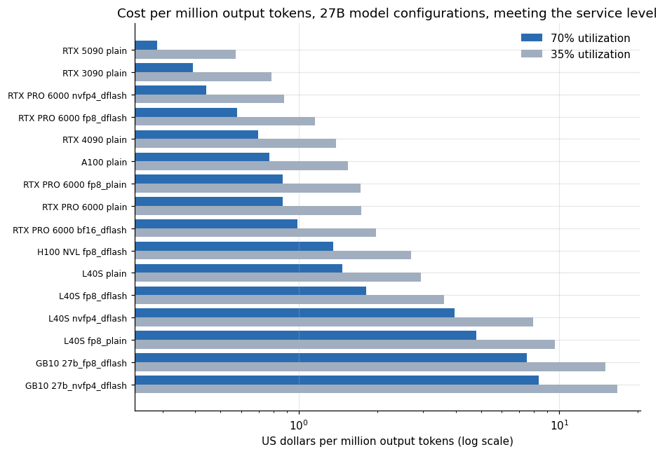
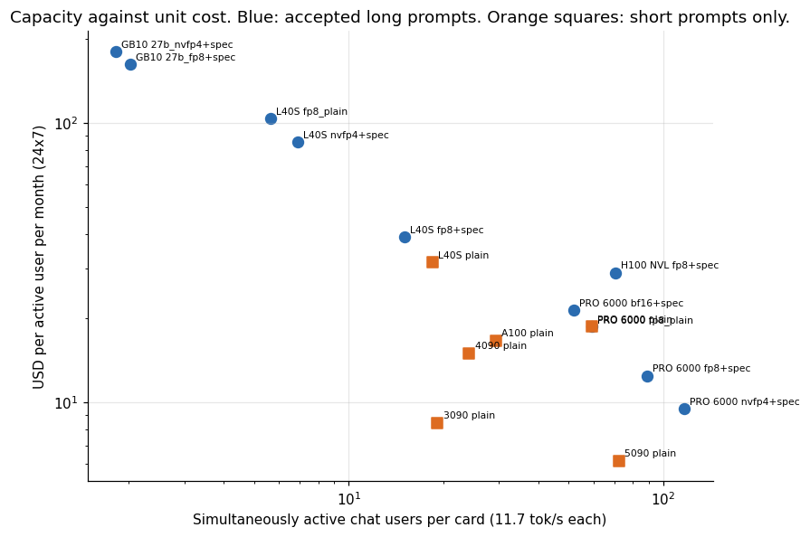
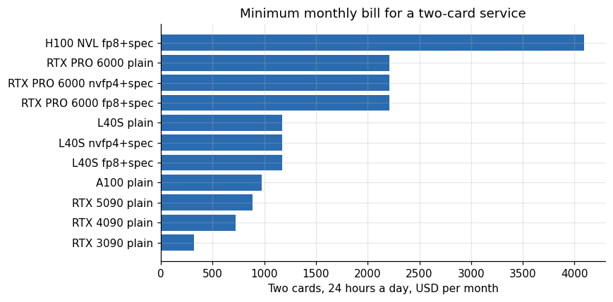
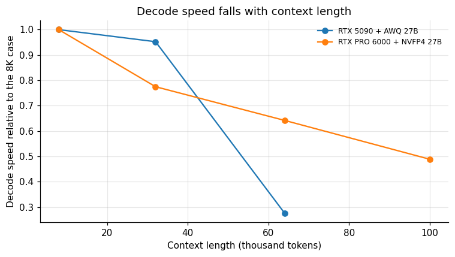
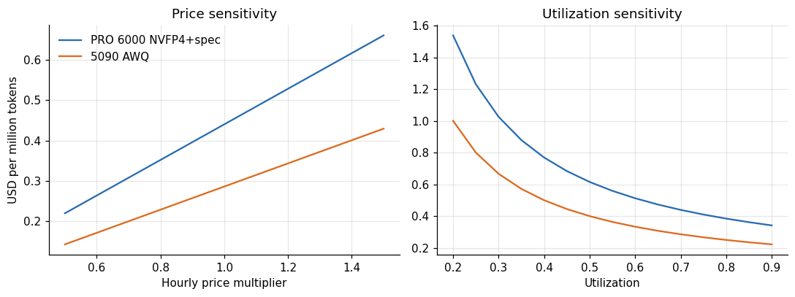
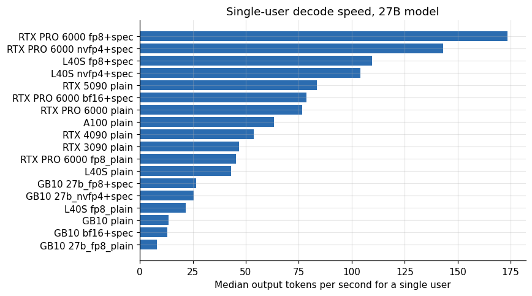
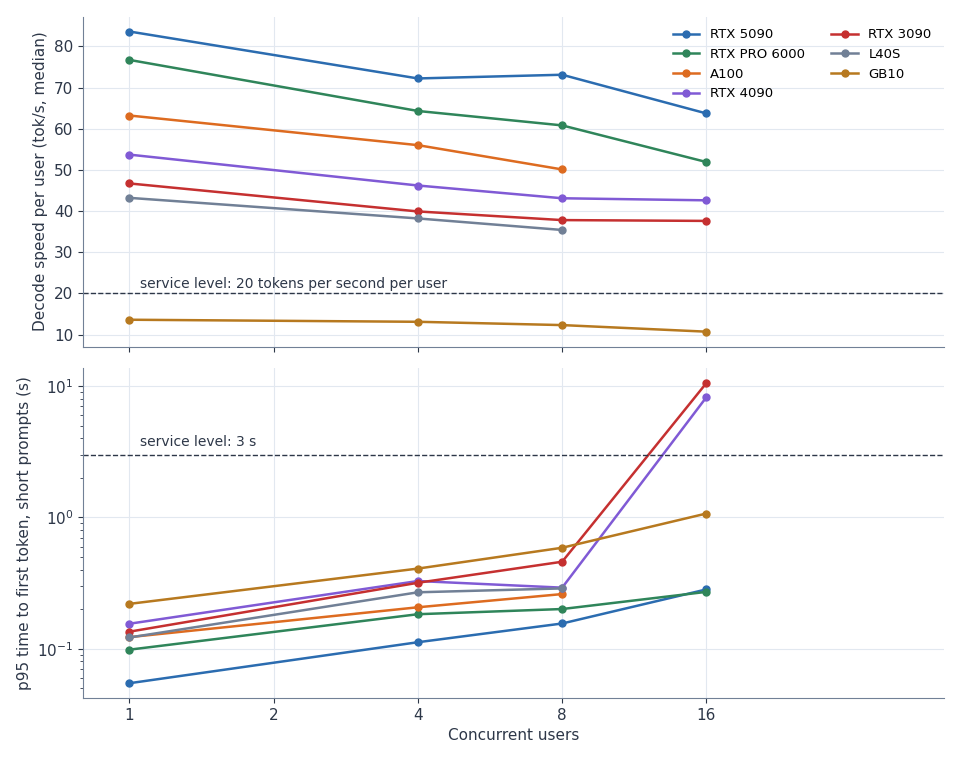
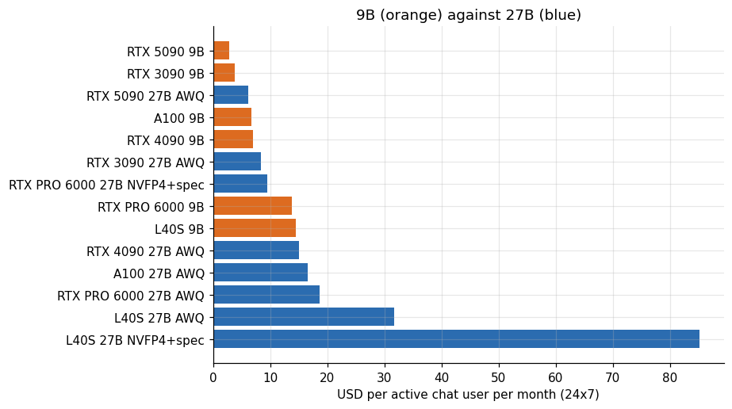
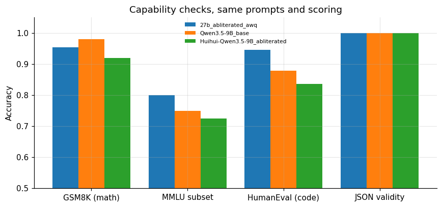
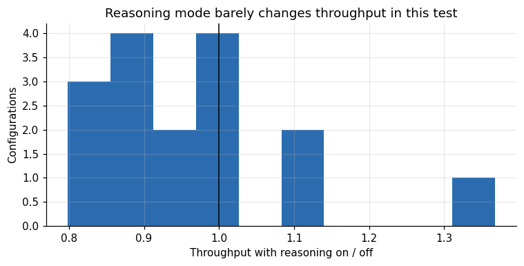

# Cost per token and cost per user for a 27B model

**Lucas Rangel** · [Kaggle writeup](https://www.kaggle.com/writeups/lucasrangelss/cost-per-token-and-cost-per-user-for-a-27b-model) · [Executable notebook](https://www.kaggle.com/code/lucasrangelss/cost-per-token-and-cost-per-user-for-a-27b-model) · [Code and data](https://github.com/LucasRangelSSouza/gpu-ai-benchmark-hub) · [Dataset](https://www.kaggle.com/datasets/lucasrangelss/gpu-ai-benchmark-campaign-2026)

## Abstract

If you want to serve a 27 billion parameter language model to people, the question that decides the business is what one user costs per month. I measured the model on seven GPUs under a fixed load test, applied one service level to every result, priced each card at what I actually paid for it on a rental marketplace, and computed cost per million output tokens, cost per concurrent user and cost per active chat user.

The answer depends on the quality of service you promise, and the ranking changes when you add a context requirement. Here are the headline results, all computed from the attached dataset:

- The cheapest way to serve the 27 billion model is a single RTX 5090 running the 4-bit AWQ build: 0.286 dollars per million output tokens at 70 percent utilization, and about 6.16 dollars per month for each simultaneously active chat user. The catch is that this configuration rejected prompts of about ten thousand tokens, so it is a short-chat machine.
- The cheapest configuration that accepted long prompts is the RTX PRO 6000 running the NVFP4 build with speculative decoding: 0.440 dollars per million tokens and 9.47 dollars per active user per month, with 117 simultaneously active chat users on one card.
- A 24 gigabyte RTX 3090 serves the AWQ build for 0.391 dollars per million tokens, nearly as cheap as the 5090 per token, but with a capacity of only 19 active chat users per card.
- The L40S and the GB10 are poor value for this model. The L40S costs 1.47 to 4.82 dollars per million tokens and the GB10 7.52 to 8.37, because they meet the service level with only one to eight concurrent users.
- Doubling the hardware for redundancy doubles every fixed monthly figure. The minimum bill for a highly available service on the best long-context configuration is two PRO 6000 cards: about 2,209 dollars a month at 24 hours a day.

I also test how fragile these numbers are. Halving utilization doubles the cost per token. Long conversations cut decode speed by 23 to 51 percent. A 50 percent change in the hourly price moves every figure by the same 50 percent. Each of these is larger than most of the gaps between neighboring configurations, so I treat the ranking as indicative and the order of magnitude as solid.

> **Code and data.** Everything behind this article is public: the code that ran, the curated data, the analysis that regenerates every figure, and tests that pin the conclusions to the data. Repositories: [llm-serving-engines-bench](https://github.com/LucasRangelSSouza/llm-serving-engines-bench). Index of the whole series: [gpu-ai-benchmark-hub](https://github.com/LucasRangelSSouza/gpu-ai-benchmark-hub).

## 1. The question and who asks it

A team that wants to offer a chat or agent product on an open-weights model needs a number to put in a spreadsheet: cost per user. Cloud API prices give one for hosted models. For a model you host, the number comes from three inputs that are easy to get wrong: how many users a GPU can serve, how much the GPU costs, and how well you keep it busy.

Published benchmarks usually report tokens per second at one concurrency level, which is a partial answer. A server can produce a high aggregate throughput by making every user wait. What matters for a product is throughput while each user still gets a response that feels interactive. So I define the capacity of a configuration as the number of concurrent users it serves while meeting a stated service level, and everything else follows from that.

## 2. The service level

I used two conditions, both measured on the short prompts in the load test:

- The 95th percentile of time to first token must be at most 3 seconds.
- Each user must receive at least 20 output tokens per second at the median.

These are my choices. They are not a customer contract, and a coding assistant, a voice agent and a batch summarizer would each pick different ones. Twenty tokens per second is faster than most people read, so it is lenient for chat and strict for an agent that waits on the model. Three seconds to first token is tolerable for chat and slow for voice. If your service level is looser, every configuration serves more users and the ranking tightens. If it is stricter, the small cards drop out first.

The load test is the same for every row. Each simulated user sends requests back to back with no pause: a mix of chat questions, a code refactoring task, a structured JSON generation and, for 15 percent of requests, a long-document summary. The test steps through concurrency levels of 1, 2, 4, 8, 16 and 32 users, and the larger machines also ran 64 and 128. For each configuration I take the highest level that still meets the service level, and I use the median of repeated runs at that level when there were several.

## 3. The data and the price of an hour

Each card is priced at the median hourly price I paid, from the lease ledger: 0.221 dollars for the RTX 3090, 0.496 for the 4090, 0.609 for the 5090, 0.802 for the L40S, 1.513 for the PRO 6000, 2.803 for the H100 NVL, 0.668 for the A100 and 0.449 for the GB10. The GB10 is my own machine, listed at that price, so its figure is the price I would charge a stranger, which is an opportunity cost and not an outlay. These are medians over a few rentals each, from a spot-like marketplace on one week of October 2026. They will drift.

Now the capacity table.

**Table 1.** The data and the price of an hour

| GPU | Variant | Users | Tok/s | Dec | Price | USD per mtok 0.7 | USD per mtok 0.35 | Active chat users |
|---|---|---|---|---|---|---|---|---|
| RTX 5090 | b9speed | 32 | 1,802 | 65.1 | 0.609 | 0.134 | 0.268 | 154 |
| RTX 3090 | qwen9b_bf16 | 16 | 493.3 | 41.4 | 0.221 | 0.178 | 0.356 | 42.16 |
| RTX 5090 | plain | 16 | 844.4 | 63.7 | 0.609 | 0.286 | 0.572 | 72.17 |
| A100 | qwen9b_bf16 | 16 | 846.9 | 62.2 | 0.668 | 0.313 | 0.626 | 72.39 |
| RTX 4090 | b9speed | 16 | 604.8 | 45.5 | 0.496 | 0.325 | 0.651 | 51.69 |
| RTX 3090 | plain | 8 | 224.1 | 37.8 | 0.221 | 0.391 | 0.783 | 19.15 |
| RTX PRO 6000 | nvfp4_dflash | 32 | 1,364 | 48.8 | 1.513 | 0.44 | 0.88 | 116.6 |
| RTX PRO 6000 | fp8_dflash | 32 | 1,039 | 38.4 | 1.513 | 0.578 | 1.156 | 88.8 |
| RTX PRO 6000 | qwen9b_bf16 | 16 | 937.3 | 69.1 | 1.513 | 0.641 | 1.281 | 80.11 |
| L40S | qwen9b_bf16 | 16 | 474.4 | 39.15 | 0.802 | 0.671 | 1.342 | 40.55 |
| RTX 4090 | plain | 8 | 282.7 | 43.1 | 0.496 | 0.696 | 1.392 | 24.16 |
| A100 | plain | 8 | 344.1 | 50.1 | 0.668 | 0.77 | 1.541 | 29.41 |
| RTX PRO 6000 | fp8_plain | 32 | 694.3 | 30.2 | 1.513 | 0.865 | 1.73 | 59.34 |
| RTX PRO 6000 | plain | 16 | 693 | 51.9 | 1.513 | 0.866 | 1.733 | 59.23 |

*First 14 of 22 rows; the full table is in the executable notebook.*

Two assumptions turn tokens into users. A chat user who is active sends one message every 30 seconds and reads a reply of about 350 tokens, which is 11.7 output tokens per second on average. Dividing a configuration's aggregate throughput at the service level by 11.7 gives the number of simultaneously active chat users it can carry. This is a premise, not a measurement, and I flag it as the weakest link in the per-user numbers. Real users pause longer than 30 seconds, and a real service has many registered users for each active one.

The second assumption is utilization. A rented GPU costs the same whether it is busy or idle, and no service keeps it saturated. I compute cost per token at 70 percent utilization as the main case and 35 percent as the realistic one for a service with daily peaks.

## 4. Cost per million output tokens



*Figure 1. Cost per million output tokens, 27B model configurations, meeting the service level.*

The figure covers the 27 billion parameter configurations only. At 70 percent utilization the order from cheapest is: 5090 with AWQ at 0.286 dollars per million, 3090 with AWQ at 0.391, PRO 6000 with NVFP4 and speculative decoding at 0.440, PRO 6000 with FP8 and speculative decoding at 0.578, 4090 with AWQ at 0.696, A100 with AWQ at 0.770, PRO 6000 FP8 without speculative decoding and PRO 6000 AWQ at 0.865 and 0.866, PRO 6000 BF16 at 0.988, H100 NVL FP8 with speculative decoding at 1.351 and the L40S AWQ at 1.471. The weakest entries are the L40S with NVFP4 and speculative decoding at 3.958, the L40S with FP8 at 4.815 and the GB10 at 7.518 and 8.365.

Notice what moves the order. The price per hour of the PRO 6000 is 2.5 times that of the 5090, and yet its NVFP4 configuration lands only 54 percent above the 5090's AWQ on cost per token, because it produces 1,364 tokens per second against 844 at the service level. Speculative decoding and the 4-bit format are doing the work. The H100 NVL costs 1.85 times the PRO 6000 per hour and delivered 823 tokens per second in the configuration I measured, so its cost per token is more than three times higher. The sample for the H100 is small, a single 28 minute rental, and a tuned configuration might close some of the gap, but I would not expect all of it.

At 35 percent utilization every cost per token doubles. The 5090 AWQ goes to 0.572 dollars per million and the PRO 6000 NVFP4 to 0.880.

## 5. What each configuration can carry

Cost per token hides capacity. A configuration that is cheap per token but serves 19 users needs many cards to serve 500.



*Figure 2. Capacity against unit cost. Blue: accepted long prompts. Orange squares: short prompts only.*

The scatter has a lower-left frontier with two members. The 5090 with AWQ is cheapest per active user (72 users at 6.16 dollars each per month) and the PRO 6000 with NVFP4 and speculative decoding carries the most (117 users at 9.47). The PRO 6000 with FP8 and speculative decoding (89 users at 12.44) sits behind the NVFP4 point on both axes. The 3090 with AWQ is the cheapest card to start with (19 users at 8.42 dollars each), which makes it a good starting point for a small product and a poor one for growth. Everything above 20 dollars per user per month, the L40S and GB10 entries and the H100, is dominated by a configuration with both lower cost and higher capacity.

An orange square matters here. The 5090 AWQ point has the best price per user and the weakest context support. It rejected the long-document request in every run, and in the long-context study I measured it at a median 11.35 seconds to first token under a multi-session agent load, compared with 0.81 seconds on the PRO 6000. For a customer-support chatbot with short messages, the 5090 is the right answer. For an agent that carries tens of thousands of tokens of context per session, it is not on the menu at any price.

## 6. Pareto view: what is never the best choice

A configuration is dominated if another one has both lower cost per active user and higher capacity. Listing them is a way to cut the menu.

**Table 2.** Pareto view: what is never the best choice

| GPU | Variant | Active chat users | USD per active user month | Accepts long prompts | Dominated |
|---|---|---|---|---|---|
| RTX 5090 | plain | 72.17 | 6.16 | no | no |
| RTX 3090 | plain | 19.15 | 8.42 | no | yes |
| RTX PRO 6000 | nvfp4_dflash | 116.6 | 9.47 | yes | no |
| RTX PRO 6000 | fp8_dflash | 88.79 | 12.44 | yes | yes |
| RTX 4090 | plain | 24.16 | 14.99 | no | yes |
| A100 | plain | 29.41 | 16.58 | no | yes |
| RTX PRO 6000 | fp8_plain | 59.34 | 18.61 | yes | yes |
| RTX PRO 6000 | plain | 59.23 | 18.65 | no | yes |
| RTX PRO 6000 | bf16_dflash | 51.92 | 21.27 | yes | yes |
| H100 NVL | fp8_dflash | 70.35 | 29.09 | yes | yes |
| L40S | plain | 18.49 | 31.67 | no | yes |
| L40S | fp8_dflash | 15.03 | 38.96 | yes | yes |
| L40S | nvfp4_dflash | 6.87 | 85.2 | yes | yes |
| L40S | fp8_plain | 5.65 | 103.6 | yes | yes |

*First 14 of 16 rows; the full table is in the executable notebook.*

Of the 27 billion configurations that meet the service level, the frontier has two members: the 5090 with AWQ, which wins on cost, and the PRO 6000 with NVFP4 and speculative decoding, which wins on capacity. The 3090 with AWQ is cheapest per card but is dominated, because the 5090 offers more capacity for a lower cost per active user. The notebook prints the exact list. Everything else loses on both axes. The dominated set includes all L40S and GB10 entries, the H100, the PRO 6000 BF16 and the PRO 6000 configurations without speculative decoding.

This is a short list, and it hides an important choice: if a requirement for long contexts removes the 5090 and 3090 from the list, only the PRO 6000 NVFP4 configuration remains. That is the real answer for an agent product, and it is also the answer for a chat product that expects to grow beyond a hundred active users per card.

## 7. What redundancy costs

A single GPU is a single point of failure. A service that promises availability needs at least two. That doubles the fixed cost, and for a small product it dominates the unit economics.

**Table 3.** What redundancy costs

|  | GPU | Variant | One card USD month | Two cards USD month | Two cards BRL month | Active chat users |
|---|---|---|---|---|---|---|
| 70 | RTX 3090 | plain | 161 | 323 | 1,602 | 19 |
| 82 | RTX 4090 | plain | 362 | 724 | 3,596 | 24 |
| 91 | RTX 5090 | plain | 445 | 889 | 4,415 | 72 |
| 2 | A100 | plain | 488 | 975 | 4,842 | 29 |
| 46 | L40S | fp8_dflash | 585 | 1,171 | 5,814 | 15 |
| 56 | L40S | nvfp4_dflash | 585 | 1,171 | 5,814 | 7 |
| 63 | L40S | plain | 585 | 1,171 | 5,814 | 18 |
| 103 | RTX PRO 6000 | fp8_dflash | 1,104 | 2,209 | 10,968 | 89 |
| 114 | RTX PRO 6000 | nvfp4_dflash | 1,104 | 2,209 | 10,968 | 117 |
| 121 | RTX PRO 6000 | plain | 1,104 | 2,209 | 10,968 | 59 |
| 42 | H100 NVL | fp8_dflash | 2,046 | 4,092 | 20,319 | 70 |



*Figure 3. Minimum monthly bill for a two-card service.*

At the medians I paid, two RTX 3090 cards cost about 323 dollars a month running around the clock, two 5090s 889, two L40S cards 1,171 and two PRO 6000 cards 2,209. The two-card PRO 6000 service with NVFP4 carries about 117 active chat users per card. If you divide the monthly bill by the number of active users it can handle, the redundancy premium disappears at scale and is brutal at small scale: a product with 20 active users on two PRO 6000 cards pays about 110 dollars per user per month, and with 200 users about 11.

That is the strongest argument for starting small. A product with a few dozen active users belongs on a cheaper card, or on a hosted API, until the user base fills a PRO 6000. I did not price a hosted API, because I have no measured data for one and will not invent prices.

## 8. The effect of long conversations

The load test uses short prompts. Agent workloads keep a growing history, and decode speed falls as the history grows because every new token attends to more context.

**Table 4.** The effect of long conversations

|  | Config | Ctx | Prompt tokens | TTFT s | Prefill tok s | Decode tok s | Decode rel |
|---|---|---|---|---|---|---|---|
| 117 | RTX 5090 + AWQ 27B | 8,000 | 6,100 | 1.69 | 3,608 | 82 | 1 |
| 119 | RTX 5090 + AWQ 27B | 32,000 | 24,589 | 7.28 | 3,377 | 78.1 | 0.95 |
| 121 | RTX 5090 + AWQ 27B | 64,000 | 49,050 | 27.7 | 1,771 | 22.6 | 0.28 |
| 1 | RTX PRO 6000 + NVFP4 27B | 8,000 | 6,100 | 0.59 | 10,286 | 73.7 | 1 |
| 3 | RTX PRO 6000 + NVFP4 27B | 32,000 | 24,589 | 2.53 | 9,737 | 57.1 | 0.77 |
| 5 | RTX PRO 6000 + NVFP4 27B | 64,000 | 49,050 | 5.65 | 8,677 | 47.3 | 0.64 |
| 7 | RTX PRO 6000 + NVFP4 27B | 100,000 | 76,458 | 10 | 7,642 | 36 | 0.49 |



*Figure 4. Decode speed falls with context length.*

On the PRO 6000 with NVFP4, decode speed at 8,000 tokens of context was 73.7 tokens per second. At 32,000 it was 57.1 (77 percent of the first), at 64,000 it was 47.3 (64 percent), and at 100,000 it was 36.0 (49 percent). The 5090 with AWQ held 95 percent at 32,000 and fell to 28 percent at 64,000 (22.6 tokens per second). That is why I apply a derate of 0.6 to the PRO 6000's capacity when I price agent workloads: it covers the range from 20,000 to 60,000 tokens of context and the extra prefill work.

Applying the 0.6 derate to the table, the PRO 6000 NVFP4 configuration carries about 70 active chat-equivalent users in agent mode instead of 117, and its cost per active user rises from 9.47 to about 15.8 dollars a month. The 5090 has no meaningful agent mode.

## 9. Sensitivity: which assumption matters most



*Figure 5. Price sensitivity.*

Price and utilization act the same way on every row: cost per token is inversely proportional to utilization and proportional to the hourly price. A drop in utilization from 70 to 35 percent doubles every row, and it matters more than the difference between the PRO 6000 and the 5090 per token (54 percent). A price change of plus or minus 50 percent moves each figure by the same percentage. A configuration that is 30 percent cheaper per token than its neighbor will switch places with it if the marketplace price of the card moves by 30 percent, which on a marketplace is normal over a month.

Throughput is the third driver, and it is the one a configuration controls. Speculative decoding raised the PRO 6000's FP8 throughput at the service level from 694 to 1,039 tokens per second, a 50 percent increase that cut cost per token by a third for the same hardware. Tuning a deployment can move cost more than choosing between neighboring cards.

## 10. Single-user speed: the other half of quality

Cost per token ignores latency for one user. An agent that runs a chain of tool calls cares about decode speed for a single stream.

**Table 5.** Single-user speed: the other half of quality

|  | GPU | Variant | Decode tok/s per user p50 |
|---|---|---|---|
| 20 | RTX PRO 6000 | fp8_dflash | 173.5 |
| 22 | RTX PRO 6000 | nvfp4_dflash | 143.1 |
| 8 | L40S | fp8_dflash | 109.7 |
| 10 | L40S | nvfp4_dflash | 104.1 |
| 18 | RTX 5090 | plain | 83.6 |
| 19 | RTX PRO 6000 | bf16_dflash | 78.7 |
| 23 | RTX PRO 6000 | plain | 76.7 |
| 0 | A100 | plain | 63.2 |
| 16 | RTX 4090 | plain | 53.7 |
| 13 | RTX 3090 | plain | 46.7 |
| 21 | RTX PRO 6000 | fp8_plain | 45.4 |
| 11 | L40S | plain | 43.2 |
| 2 | GB10 | 27b_fp8_dflash | 26.7 |
| 4 | GB10 | 27b_nvfp4_dflash | 25.5 |

*First 14 of 18 rows; the full table is in the executable notebook.*



*Figure 6. Single-user decode speed, 27B model.*

The fastest single stream was the PRO 6000 with FP8 and speculative decoding at 174 tokens per second, followed by the PRO 6000 NVFP4 at 143, the L40S with FP8 and speculative decoding at 110 and the L40S NVFP4 at 104. The H100 does not appear because I ran it only at eight users and above, where it gave each user 118 tokens per second. The AWQ build on the 5090 delivers 84 tokens per second to one user, and the same build on the 3090 about 47. For an interactive product these are all above reading speed. For an agent that makes dozens of sequential calls, the factor of three between the PRO 6000 and the 3090 is the difference between a task that takes a minute and one that takes three.

## 11. Putting it together: a decision table

I will turn the numbers into recommendations for four products, with the conditions that would change each.

A support chatbot with short messages and up to 70 active users per card belongs on an RTX 5090 with the AWQ build: 6.16 dollars per active user per month, one card at 444 dollars a month or two at 889 for redundancy. It stops being the right choice if conversations need long context or if you need more than about 70 simultaneous active users per card.

A product with up to 20 active users, still in validation, can run on a single RTX 3090 with AWQ at about 161 dollars a month for 19 active users (221 dollars per hour times 730 hours is 161 dollars) and accept that nothing about it is highly available. This is the cheapest ticket into the 27 billion model.

An agent product with long sessions should use the PRO 6000 with NVFP4 and speculative decoding. Count about 70 simultaneous agent sessions per card after the derate, 1,104 dollars a month for one card and 2,209 for two.

A research or personal setup on an ARM machine like the GB10 is fine for development and nothing else: one user at a time at 26 tokens per second. At 7.52 dollars per million tokens its economics do not work for rent, but if you already own it, the marginal cost is electricity.

## 12. How the load test works, and what it leaves out

Every number above comes from one load generator, so its design decides what the numbers mean. It is a small asynchronous program that opens a streaming connection to an OpenAI-compatible endpoint for each simulated user. A simulated user sends a request, reads the stream until the end, records the time to the first token and the arrival time of every later token, and immediately sends the next request. There is no think time. At a concurrency of 16, sixteen requests are in flight at every moment for the duration of the level, which was 60 seconds for most runs.

Requests are drawn from four kinds with fixed weights: 35 percent short chat questions with a cap of 256 output tokens, 30 percent code refactoring with a cap of 512, 20 percent structured JSON generation, and 15 percent long-document summaries, whose input is about 30,000 characters of code and whose output is capped at 256 tokens. The caps matter. They bound how long any request can run, which keeps the test short and repeatable. They also mean that the test cannot reproduce the cost of a model that rambles, because no request is allowed to produce more than 512 tokens.

The definition is short enough to quote. These lines are selected from the load generator: the mix, the request body and the way the long document is built.

```
        body = (FILL * 180)[:30000]
MIX = [("chat", .35), ("code", .30), ("json", .20), ("long8k", .15)]
    body = {"model": args.model, "messages": msgs, "max_tokens": maxt, "temperature": 0.7, "stream": True,
            "stream_options": {"include_usage": True}, "chat_template_kwargs": {"enable_thinking": think}}
```

The weights are the 35, 30, 20 and 15 percent of the text. Every request streams, asks for usage in the last chunk and sets a temperature of 0.7, and the thinking switch is a template argument that the script flips between runs. The long document is the same 30,000 characters in every request, which is why the prefix cache serves it after the first.

Three consequences follow for the cost figures.

First, the test measures decode throughput under a steady closed loop. Real traffic arrives in bursts, with idle gaps. A server that handles a burst of 16 requests at once will, on average over an hour, be much less busy than the test, and the utilization parameter is how I account for that.

Second, the time-to-first-token figure in the service level is the 95th percentile over the short prompts only. The long-document requests have their own first-token times, kept in `ttft_p95_long8k_s` next to `ttft_p95_short_s`. One caution applies to them: the document text is identical in every request, so after the first one a prefix cache serves most of it from memory. In the 35-minute stability test the long request took a median 0.15 seconds to the first token and 1.5 seconds in total, with a median reply of 86 tokens. The long-document requests in the load test therefore measure a warm-cache case and understate what a user pasting a fresh document would see. The long-context article in this series measures the cold case. The service level here describes the experience of someone sending a short message.

Third, I ran each level once or twice. The repeated runs in the table are repeats of the same level on the same configuration, taken on different days or hosts, and the medians I use smooth some noise. They do not give a confidence interval. In the rows with repeats, the throughput at the same level differed by up to roughly 10 percent, so I treat any gap smaller than 10 percent between two configurations as a tie.

## 13. Reading the table card by card

The summary names the winners. This section walks through each card to explain why it lands where it does, with the numbers.

The two limits of the service level can be read straight off the load-test rows for the 27 billion AWQ build, one line per card.



*Figure 7. 27B AWQ build under load, median of repeated runs: decode speed per user and p95 first-token time against concurrent users, with the two service-level limits.*

At 16 users the 5090 gave each user 63.7 tokens per second and a p95 first token of 0.28 seconds, and the PRO 6000 51.9 and 0.27. The 3090 and the 4090 kept 37.6 and 42.6 tokens per second per user at 16 users, and their p95 first-token time went from 0.46 and 0.29 seconds at 8 users to 10.55 and 8.23 at 16, so it is the first-token limit that stops them and not the decode speed. The GB10 never reaches 20 tokens per second with this build (13.6 at one user, 10.7 at 16). The lines for the A100 and the L40S stop at 8 users because I did not run them higher.

The RTX 5090 is the best value for this model because of its memory bandwidth and its price together. At 0.609 dollars per hour, it produced 844 output tokens per second at 16 users with the AWQ build while every user still received 64 tokens per second. That is a lot of headroom over the 20 tokens per second I required, which suggests the card could serve more than 16 users. My 27 billion sweep on the 5090 stopped at 16 users, so the table understates the 5090: the capacity I report is the highest level I tested, not the highest the card can carry. For the 9 billion model, the 5090 did test 32 users and still met the service level, with 65 tokens per second per user.

The start line of the 5090 server in that sweep, with the cache lines that follow it, selected from the log:

```
INFO 10-27 06:39:27 [api_utils.py:286] non-default args: {'model_tag': '/workspace/models/awq27', 'host': '127.0.0.1', 'port': 18000, 'model': '/workspace/models/awq27', 'max_model_len': 8192, 'served_model_name': ['m'], 'reasoning_parser': 'qwen3', 'max_num_seqs': 16}
INFO 10-27 06:42:33 [gpu_worker.py:640] Available KV cache memory: 8.7 GiB
INFO 10-27 06:42:33 [kv_cache_utils.py:2395] GPU KV cache size: 87,220 tokens, Maximum concurrency for 8,192 tokens per request: 10.65x
```

The server was started with a limit of 16 sequences, and the sweep stopped at 16 users. A level above 16 would have put the extra users in a queue, as the engine comparison in this series shows. I do not know whether that limit was the reason I stopped at 16. The cache was not the constraint: it had room for 87,220 tokens.

The RTX 3090 is the cheapest card per hour, 0.221 dollars, and its AWQ result of 224 tokens per second at 8 users is modest. At 16 users it produced a higher aggregate (257 tokens per second), but the 95th percentile of first-token time for short prompts rose to about 10 seconds, so 16 users fall outside the service level. The card also shows how much a long context window costs. The first 3090 run, configured to accept ten thousand token prompts, gave 88.6 tokens per second at 8 users with a 3.9 second first-token time. The two later runs, configured with a smaller window, gave 224 and 237 tokens per second at 8 users with 0.45 second first-token times. I use the median of the three runs in the table, which is the short-window figure, and I mark the configuration as short-prompt only. Its strength is price: for a small service of about 19 active users it is hard to beat.

The first and the third 3090 runs differ in the start-up lines. These are selected from their logs:

```
INFO 10-26 15:51:31 [api_utils.py:286] non-default args: {'model_tag': '/workspace/models/awq', 'host': '127.0.0.1', 'port': 18000, 'model': '/workspace/models/awq', 'max_model_len': 12288, 'served_model_name': ['qwen-abliterated'], 'reasoning_parser': 'qwen3', 'gpu_memory_utilization': 0.94, 'max_n
INFO 10-26 15:54:51 [gpu_worker.py:640] Available KV cache memory: 2.13 GiB
INFO 10-26 15:54:51 [kv_cache_utils.py:2395] GPU KV cache size: 24,576 tokens, Maximum concurrency for 12,288 tokens per request: 2.00x
INFO 10-27 04:41:17 [api_utils.py:286] non-default args: {'model_tag': '/workspace/models/awq27', 'host': '127.0.0.1', 'port': 18000, 'model': '/workspace/models/awq27', 'max_model_len': 8192, 'served_model_name': ['m'], 'reasoning_parser': 'qwen3', 'max_num_seqs': 16}
INFO 10-27 04:44:41 [gpu_worker.py:640] Available KV cache memory: 1.7 GiB
INFO 10-27 04:44:41 [kv_cache_utils.py:2395] GPU KV cache size: 16,865 tokens, Maximum concurrency for 8,192 tokens per request: 2.06x
```

The first run had a context limit of 12,288 tokens and a cache of 24,576 tokens, and the last one 8,192 and 16,865. The request rows show the difference in what was served: the first run completed 17 long-document requests and rejected none, and the two later runs completed none and rejected between 1 and 6 at each level. So the slower first run was also the one doing the long prefills. The logs do not show how much of the 88.6 against 224 tokens per second those prefills explain.

The RTX 4090 sits between them. It costs 0.496 dollars an hour and delivered 283 tokens per second at 8 users, which makes it more expensive per token than the 3090 (0.696 against 0.391 dollars per million). The 4090 costs more than twice as much per hour as the 3090 on this marketplace, and it delivers only about 26 percent more aggregate throughput on this workload, because decoding is limited by memory bandwidth more than by raw compute. On this evidence the 4090 is not the right card to rent for serving this model. It makes more sense in workloads where compute matters more than bandwidth.

The A100 PCIE with 40 gigabytes produced 344 tokens per second at 8 users on the AWQ build, at 0.668 dollars an hour, for 0.770 dollars per million tokens. It is an older architecture and has no FP8 or NVFP4 path, so it is limited to the formats that the older kernels support. It appears once in my ledger, so its row is a single sample.

The L40S, with 48 gigabytes, is the card I wanted to like. It can hold FP8 and NVFP4 builds that the 24 and 32 gigabyte cards cannot, and it did serve them. Its problem is bandwidth. With speculative decoding and FP8 it met the service level at 4 users and 176 tokens per second, and with NVFP4 at a single user. Its memory bandwidth is much lower than the 5090's, and decode is bandwidth-bound. The L40S is a good card for graphics and vision workloads and a mediocre one for serving a 27 billion parameter model to several people at once.

The RTX PRO 6000 is the capacity card. Its 96 gigabytes hold the NVFP4 build with room for a large cache, and its bandwidth carries 32 users at the service level with 1,364 tokens per second (median of repeated runs), rising to 1,466 at 128 users if the first-token limit is relaxed. At 1.513 dollars per hour it is the most expensive card among the ones that scale, and it earns that on the strength of throughput.

The H100 NVL with 94 gigabytes is the only Hopper card in the set. It served the FP8 build with speculative decoding at 118 tokens per second for each of eight users, 823 tokens per second in aggregate, and its 94 gigabytes would allow much larger caches. At 2.803 dollars an hour it was the most expensive card per hour and fell behind on cost per token. My conclusion is limited by having one 28 minute session on it.

The GB10 is an ARM machine with 121 gigabytes of unified memory and low memory bandwidth. It runs every build of the model, which no other card here does, and does so at 20 to 27 tokens per second for a single user. Eight users on it fall below the 20 tokens per second line. It is a development and edge machine.

## 14. The 9 billion parameter alternative

For some products the 27 billion parameter model is more than the job requires. The load test also measured a 9 billion parameter model in BF16, and the cost difference is large.

**Table 6.** The 9 billion parameter alternative

|  | Label | USD per mtok 0.7 | USD per active user month | Active chat users |
|---|---|---|---|---|
| 87 | RTX 5090 9B | 0.13 | 2.89 | 154 |
| 74 | RTX 3090 9B | 0.18 | 3.83 | 42.16 |
| 91 | RTX 5090 27B AWQ | 0.29 | 6.16 | 72.17 |
| 5 | A100 9B | 0.31 | 6.74 | 72.38 |
| 78 | RTX 4090 9B | 0.33 | 7 | 51.69 |
| 70 | RTX 3090 27B AWQ | 0.39 | 8.42 | 19.15 |
| 114 | RTX PRO 6000 27B NVFP4+spec | 0.44 | 9.47 | 116.6 |
| 124 | RTX PRO 6000 9B | 0.64 | 13.79 | 80.11 |
| 66 | L40S 9B | 0.67 | 14.44 | 40.55 |
| 82 | RTX 4090 27B AWQ | 0.7 | 14.99 | 24.16 |
| 2 | A100 27B AWQ | 0.77 | 16.58 | 29.41 |
| 121 | RTX PRO 6000 27B AWQ | 0.87 | 18.65 | 59.23 |
| 63 | L40S 27B AWQ | 1.47 | 31.67 | 18.49 |
| 56 | L40S 27B NVFP4+spec | 3.96 | 85.2 | 6.87 |



*Figure 8. 9B (orange) against 27B (blue).*

On the 5090 the 9 billion model serves 154 simultaneously active chat users per card at 2.89 dollars each per month, against 72 users at 6.16 for the 27 billion AWQ build. On the 3090 it serves 42 users at 3.83 against 19 at 8.42. The smaller model is about twice as cheap per active user wherever both ran.

What do you give up? The capability checks I ran on both families give one answer, with a caution about what was compared.

**Table 7.** The 9 billion parameter alternative (part 2)

| Model | Gsm8k acc | Mmlu acc | Humaneval acc | Json acc | Gsm8k n | Mmlu n | Humaneval n | Json n |
|---|---|---|---|---|---|---|---|---|
| 27b_abliterated_awq | 0.953 | 0.8 | 0.945 | 1 | 150 | 200 | 164 | 24 |
| Qwen3.5-9B_base | 0.98 | 0.75 | 0.878 | 1 | 150 | 200 | 164 | 24 |
| Huihui-Qwen3.5-9B_abliterated | 0.92 | 0.725 | 0.835 | 1 | 150 | 200 | 164 | 24 |



*Figure 9. Capability checks, same prompts and scoring.*

The 27 billion AWQ build scored 0.953 on 150 grade-school math problems, 0.800 on a 200-question general knowledge subset, 0.945 on 164 coding problems and 1.0 on 24 JSON tasks. The 9 billion base model scored 0.980, 0.750, 0.878 and 1.0. So the larger model is 5 points better on knowledge and 6.7 points better on code, and slightly worse on the math set, where the smaller model scored higher by 2.7 points. The comparison has a flaw I must state: the 27 billion model in the check is an abliterated build, which has had its refusal behavior modified, and the 9 billion base model is a standard aligned one. Modification of that kind can change benchmark scores in either direction, and I did not control for it. There is also an abliterated 9 billion model in the table, which scored 0.920, 0.725, 0.835 and 1.0, below its base on every row but JSON.

Run-to-run noise sets the scale for reading these gaps. The same AWQ build, run twice on two hosts with the same harness, scored 0.953 and 0.947 on math and 0.945 and 0.933 on code. A gap of one point is noise; the 6.7 point code gap between the larger and smaller family is not. The cost-benefit reading is that the 9 billion model is the cheaper choice for tasks that fit its capability, such as short question answering, classification and extraction, and the 27 billion model earns its price on code and knowledge-heavy tasks. For a product that must write code, the 6.7 point gap on HumanEval is the number to weigh against a price that doubles.

## 15. Reasoning mode and what the test cannot see

Some models produce a hidden chain of thought before answering. The load test ran a subset of configurations with this mode on and off.

**Table 8.** Reasoning mode and what the test cannot see

| GPU | Variant | Users | Agg0 | Ttft0 | Agg1 | Ttft1 | Throughput ratio |
|---|---|---|---|---|---|---|---|
| GB10 | 27b_fp8_dflash | 1 | 23.7 | 0.4 | 20.6 | 0.42 | 0.87 |
| GB10 | 27b_fp8_dflash | 8 | 111.9 | 1.94 | 99.4 | 2.23 | 0.89 |
| GB10 | 27b_fp8_plain | 1 | 7.9 | 0.33 | 7.9 | 0.31 | 1 |
| GB10 | 27b_fp8_plain | 8 | 37.8 | 1.36 | 51.7 | 2.85 | 1.37 |
| GB10 | 27b_nvfp4_dflash | 1 | 21.3 | 0.32 | 18.9 | 0.34 | 0.89 |
| GB10 | 27b_nvfp4_dflash | 8 | 106.1 | 1.26 | 84.7 | 1.17 | 0.8 |
| H100 NVL | bf16_dflash | 8 | 625.1 | 3.06 | 681.3 | 0.59 | 1.09 |
| H100 NVL | fp8_dflash | 8 | 823.1 | 0.91 | 922.9 | 0.45 | 1.12 |
| L40S | fp8_plain | 1 | 20.85 | 0.15 | 20.6 | 0.13 | 0.99 |
| L40S | fp8_plain | 8 | 126.5 | 0.63 | 125.6 | 0.72 | 0.99 |
| RTX PRO 6000 | bf16_dflash | 1 | 85.3 | 0.14 | 72.4 | 0.15 | 0.85 |
| RTX PRO 6000 | bf16_dflash | 8 | 402.1 | 3.18 | 366.4 | 0.83 | 0.91 |
| RTX PRO 6000 | fp8_dflash | 1 | 137 | 0.12 | 111.7 | 0.12 | 0.82 |
| RTX PRO 6000 | fp8_dflash | 8 | 582.8 | 2.91 | 550.4 | 0.56 | 0.94 |

*First 14 of 16 rows; the full table is in the executable notebook.*



*Figure 10. Reasoning mode barely changes throughput in this test.*

In the 16 paired comparisons the throughput with reasoning on was between 0.80 and 1.37 times the throughput with it off, and most pairs sat within 15 percent of 1.0. That sounds like reasoning is free. It is not. The test caps every request at 256 to 512 output tokens, so a model that wants to think for 4,000 tokens is cut off. The caps hide the cost that matters, which is that reasoning mode makes each answer longer and so multiplies the tokens billed to produce it. If your product uses reasoning mode, multiply the output tokens per answer by the observed ratio in your own traffic before you use any cost per token in this article. I did not measure that ratio.

## 16. From cost per token to a price per subscriber

A cost per token becomes a price once you know how many tokens a subscriber uses. I do not have measured subscriber behavior, so I use three illustrative profiles, labeled as assumptions: a light user at 1.5 million output tokens a month, a medium user at 6 million and a heavy user at 20 million.

**Table 9.** From cost per token to a price per subscriber

| Config | Profile | USD per month | BRL per month |
|---|---|---|---|
| 5090 AWQ | light (1.5M tok) | 0.86 | 4.26 |
| 5090 AWQ | medium (6M tok) | 3.43 | 17.05 |
| 5090 AWQ | heavy (20M tok) | 11.45 | 56.84 |
| PRO 6000 NVFP4+spec | light (1.5M tok) | 1.32 | 6.55 |
| PRO 6000 NVFP4+spec | medium (6M tok) | 5.28 | 26.22 |
| PRO 6000 NVFP4+spec | heavy (20M tok) | 17.6 | 87.4 |

At the 35 percent utilization case, serving a medium subscriber on the 5090 costs about 3.43 dollars a month (17.0 reais), a heavy one 11.45 dollars (56.8 reais), and a light one 0.86 dollars. On the PRO 6000 with NVFP4 the same profiles cost 5.28, 17.60 and 1.32 dollars. Add the other costs a service carries, which the load test says nothing about: payment fees, taxes, support, storage for conversation logs and the engineering time to run it.

The practical point is a ratio, not a price. A subscription priced at a multiple of three to five times the compute cost of the heavy profile survives a misjudged usage mix. At two times it does not.

## 17. Questions I expect

**Why not pick the configuration with the largest throughput?** Because aggregate throughput measured with users who wait is a measure of how long you can make people wait. The service level is what turns throughput into a product.

**Is the 5090 really better than the PRO 6000 per token?** On the short-prompt load, yes, by a third at 70 percent utilization. On any workload with long prompts, the comparison is moot because the 5090 configuration does not accept them.

**What about renting by the hour versus by the month?** I only have hourly marketplace prices. A monthly commitment would usually be cheaper per hour and would change every cost figure proportionally. The ranking does not depend on it.

**Should I trust a single H100 row?** Treat it as a hint. It tells me the H100 was not a bargain in the configuration I ran, and nothing about what a tuned deployment would do.

**What does the AWQ model's quality cost?** In the quantization ladder on the PRO 6000, the 4-bit AWQ build scored 0.947 on math, 0.800 on knowledge and 0.933 on code, against 0.953, 0.820 and 0.921 for BF16, all within two points on samples of 150 to 200 questions. The AWQ build also ran earlier on a different host and scored 0.953, 0.800 and 0.945, which tells you the size of the run-to-run noise: about one point. The quantization article in this series gives the details.

| Claim in this article | Evidence behind it | Caveat |
|---|---|---|
| The 5090 with AWQ is the cheapest per token and per active user | Table 1 and Table 2, from the load test at 16 users and median rental prices | Prices are medians of a few rentals in one week, and the 5090 sweep stopped at 16 users |
| The 5090 and 3090 AWQ builds cannot take long prompts | 29 and 34 long-document requests rejected with status 400 in the valid 5090 and 3090 rows | The first 3090 run, with a larger window, accepted 17 and was much slower |
| The PRO 6000 with NVFP4 is the cheapest that accepts long prompts | Tables 1 and 2 | A different build and speculative decoding together, one rental for most rows |
| Active users are throughput divided by 11.7 tokens per second | A premise of 350 tokens every 30 seconds | Not measured, and the weakest link in the per-user figures |
| The H100 NVL is not a bargain | One 28-minute rental | A tuned deployment might close part of the gap |
| The derate of 0.6 for agent workloads | Decode speed against context in Table 4, two configurations | Applied to other cards by analogy |

## 18. Limitations

The prices are medians of a few rentals from one marketplace in one week. The service level and the chat user model are my assumptions and are not measurements of a customer. The load test uses continuous users, so it measures a harder case than a real chat, and the conversion to active users divides by 11.7 tokens per second, which is a premise. The H100 NVL row rests on a single rental. The GB10 is priced at what I list it for, not at what I paid. The speculative decoding results use one drafting model and one set of flags. The long-context derate was measured on two configurations and is applied to others by analogy. Cards were rented at the host's declared performance, and a different host could differ by several percent. The model files for every row are variants of one family, and nothing here says anything about the quality of the outputs. A cheaper configuration with worse answers is not cheaper.

## 19. How much it cost

This analysis cost nothing beyond the original measurements. The measurements behind it used the rentals listed in the lease ledger, which came to 27.25 dollars of itemized hourly rental inside a campaign total of US$ 50.79. The serving rows alone came from the sessions on the 3090, 4090, 5090, L40S, A100, H100, PRO 6000 and GB10. The two cards that carry the conclusions cost 8.54 dollars (5090, 12.44 hours across 39 rentals) and 5.71 dollars (PRO 6000, 3.67 hours across 15 rentals) of itemized rental, so reproducing the serving sweeps for those two cards from scratch would cost on the order of a few dollars each plus model downloads, which is the part the ledger cannot price.

## 20. Reproducing this analysis

Attach the dataset `gpu-ai-benchmark-campaign-2026` and run the cells in order. The repository `llm-serving-engines-bench` publishes the load generator and the result rows. The repository `quantization-and-offload-lab` publishes the quantization ladder with the same method.

## 21. Glossary

- **Service level**: the conditions a configuration must meet to count a user as served (here, time to first token and tokens per second).
- **Aggregate throughput**: output tokens per second summed over all users.
- **Active user**: a user who is currently exchanging messages, as opposed to a registered one.
- **Utilization**: the fraction of the rented time the GPU does useful work.
- **Derate**: a multiplier that reduces measured capacity to account for a harder workload.
- **Pareto frontier**: configurations not beaten on both cost and capacity by any other.
- **Speculative decoding**: a draft model proposes tokens and the large model verifies several at once.

Lucas Rangel
