# Eighty-three open tools in a disposable sandbox

**Lucas Rangel** · [Kaggle writeup](https://www.kaggle.com/writeups/lucasrangelss/eighty-three-open-tools-in-a-disposable-sandbox) · [Executable notebook](https://www.kaggle.com/code/lucasrangelss/eighty-three-open-tools-in-a-disposable-sandbox) · [Code and data](https://github.com/LucasRangelSSouza/gpu-ai-benchmark-hub) · [Dataset](https://www.kaggle.com/datasets/lucasrangelss/gpu-ai-benchmark-campaign-2026)

## Abstract

I wanted to know, for 83 open source tools that I might put into a data and automation stack, whether each one installs and does something useful on a small, disposable machine without a GPU, and what it costs in time, memory and disk. I wrote a test script for each tool and ran them in an isolated environment on rented machines over two days. The suite produced 217 attempts. Most of the failures that I first read as tool failures were my own harness failing, and the way the failures changed from session to session is the most useful result.

- Of 83 tools, 80 had at least one successful attempt and 3 never did: a speech-to-text package that failed in all twelve of its attempts, and two GPU serving engines that were killed by signal 15.
- Of the 217 attempts, 110 succeeded. The first session had 105 attempts, 56 of which failed because the sandbox had no command called `python`, only `python3`. The fourth session, the second full run, lost 18 more to a system Python that refused to install packages. Together these 74 attempts are 34 percent of everything I ran, and none of them says anything about the tools.
- I allowed two attempts per tool in each session. In 50 tool and session pairs where the first attempt failed, the second attempt also failed every time. A retry is useless when the failure is deterministic, and nearly all of mine were.
- A typical tool that installed used 88 megabytes of memory at its peak, 102 megabytes of disk and 12 seconds. The tail is long: the heaviest ten tools used between 4 and 22 gigabytes of disk each, and one used 9.4 gigabytes of memory.
- The whole CPU sandbox campaign cost 0.18 dollars of rental over 2.75 hours of instance time.

> **Code and data.** Everything behind this article is public: the code that ran, the curated data, the analysis that regenerates every figure, and tests that pin the conclusions to the data. Repositories: [web-automation-lab](https://github.com/LucasRangelSSouza/web-automation-lab), [agent-tooling-token-savings](https://github.com/LucasRangelSSouza/agent-tooling-token-savings), [app-platforms-smoke-tests](https://github.com/LucasRangelSSouza/app-platforms-smoke-tests). Index of the whole series: [gpu-ai-benchmark-hub](https://github.com/LucasRangelSSouza/gpu-ai-benchmark-hub).

## 1. What the sandbox is, and what a success means

The tools came from a list of open source projects that I wanted to evaluate for a data and automation stack: browsers and crawlers, speech and image generation tools, media tools, local model servers, agent skills, trading and finance toys, messaging libraries, small web applications. For each I wrote a short shell script that installs the tool in a private directory with its own home folder, exercises it in the simplest meaningful way, and prints a few `METRIC` lines. A harness runs each script with a time limit, measures wall time, the peak resident memory of the process tree and the disk that the tool's directory and its private home folder occupy, and records the exit status.

A success in this article means that the script exited with status 0. That is a weak claim, and for part of the suite it is weaker still: 14 of the scripts only clone the project's repository and report its size, because the full installation (a Rails application with its database and search server, a console emulator, a mobile build chain) did not make sense on a small machine without a GPU. For a browser automation tool the script opens a page and prints the time. For an agent skill, which is a folder of instructions for a coding assistant, the script counts the files and estimates the size in tokens. For a web application it starts the server and checks that it answers. No test judges quality, licensing or security, and a tool that fails here may work in the environment its authors intended.

The suite has three tiers. T1 is a light check: clone or download, count, parse, at most start something small. T2 installs the tool and runs it. T2-GPU is the same on a rented GPU machine. Among the 217 attempts, 115 belong to T1, 81 to T2 and 21 to T2-GPU.

**Table 1.** What the sandbox is, and what a success means

|  | Attempts | Tools | Ok | Success rate |
|---|---|---|---|---|
| T1 | 115 | 55 | 67 | 0.583 |
| T2 | 81 | 19 | 29 | 0.358 |
| T2-GPU | 21 | 9 | 14 | 0.667 |

By tier, the success rate of an attempt was 58 percent for T1, 36 percent for T2 and 67 percent for T2-GPU. The T2 tier is the one that installs and runs a tool, so a lower rate is what I would have predicted. The T2-GPU rate comes from 21 attempts on tools I had already debugged on cheaper machines, and I would not read it as evidence that GPU tools are easier.

## 2. What each failure was

Exit statuses carry information if you read them, and I classified every failed attempt from the end of its log into a handful of causes. The classification is mine, made by matching phrases in the log text, and I checked a sample by hand.

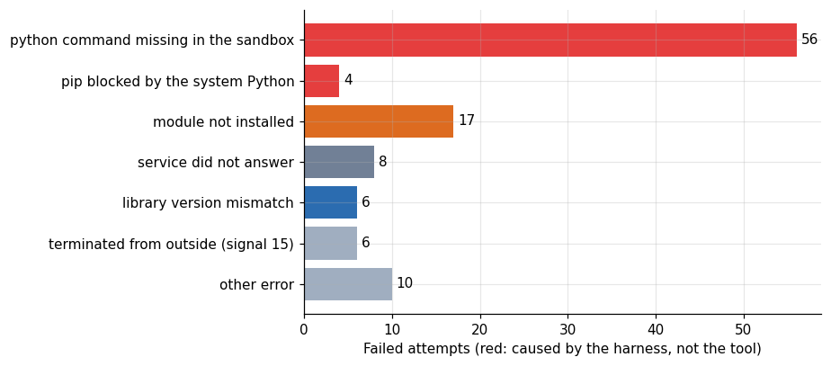

*Figure 1. What each failure was.*

**Table 2.** What each failure was

|  | Library version mismatch | Module not installed | Other error | Pip blocked by the system Python | Python command missing in the sandbox | Service did not answer | Terminated from outside (signal 15) |
|---|---|---|---|---|---|---|---|
| 20261026T180911 | 0 | 0 | 4 | 0 | 56 | 2 | 0 |
| 20261026T185012 | 0 | 1 | 0 | 0 | 0 | 0 | 1 |
| 20261026T185033 | 0 | 0 | 0 | 0 | 0 | 0 | 0 |
| 20261026T190134 | 0 | 14 | 2 | 4 | 0 | 2 | 0 |
| 20261026T191503 | 0 | 0 | 0 | 0 | 0 | 0 | 0 |
| 20261026T193655 | 0 | 0 | 0 | 0 | 0 | 0 | 2 |
| 20261026T193740 | 0 | 0 | 0 | 0 | 0 | 0 | 0 |
| 20261026T194402 | 2 | 0 | 4 | 0 | 0 | 2 | 0 |
| 20261026T201405 | 2 | 0 | 0 | 0 | 0 | 2 | 0 |
| 20261026T203203 | 0 | 2 | 0 | 0 | 0 | 0 | 0 |
| 20261026T203819 | 2 | 0 | 0 | 0 | 0 | 0 | 0 |
| 20261027T121935 | 0 | 0 | 0 | 0 | 0 | 0 | 2 |
| 20261027T131943 | 0 | 0 | 0 | 0 | 0 | 0 | 0 |
| 20261027T134349 | 0 | 0 | 0 | 0 | 0 | 0 | 0 |

*First 14 of 15 rows; the full table is in the executable notebook.*

Of the 107 failed attempts, 56 failed because the command `python` did not exist. The sandbox image has Python 3.12 installed as `python3`, and my scripts, written on a laptop, called `python`. The shell answered "command not found" with status 127. This accounts for more than half of the failures. Eighteen more attempts, in the fourth session (the second full run), failed because the installs that should have created a module were refused by the system. A Python installed by the operating system's package manager marks itself as externally managed and rejects `pip install` outside a virtual environment, as the standard behind that message (PEP 668) prescribes. Four of those attempts printed the refusal itself, and 14 failed a moment later with "no module named" because the package was never installed. In total, 74 of the 107 failed attempts are harness failures, 69 percent.

The two big harness causes each fit in a few lines of the logs. In the first session, the runner line for a tool that failed at once, and the first line of the tool's own log, read as follows (lines selected from the runner log and from one tool log):

```
playwright exit_127 1 s 3 MB {}
crawl4ai exit_127 1 s 2 MB {}
obscura exit_127 4 s 20 MB {}
bash: line 1: python: command not found
```

Status 127 after one second, 2 or 3 megabytes of memory, nothing measured. In the fourth session the same tools reached the install step and met the refusal of the system Python, whose first lines of the log of one tool are:

```
error: externally-managed-environment
× This environment is externally managed
```

Neither text says anything about Playwright or Crawl4AI. Both are messages of the environment I put them in.

What remains are 33 attempts that failed for reasons that belong to the tools or their environment: 3 times a module was still missing, 8 times a service did not answer, 6 times a library version mismatch, 6 times a process was killed and 10 for causes I could not classify with a phrase. The next sections look at those.

## 3. The learning curve of the harness

The sessions come in an order, and the failure causes change as I fixed things. The first session ran the 74 tools in the suite that I had written by then, with a second attempt for each tool that failed. The fourth session, the second full run, reran 46 tools, including the 31 that had not succeeded, after I changed `python` to `python3`.

**Table 3.** The learning curve of the harness

|  | Attempts | Tools | Ok | Success rate |
|---|---|---|---|---|
| 20261026T180911 | 105 | 74 | 43 | 0.41 |
| 20261026T185012 | 5 | 5 | 3 | 0.6 |
| 20261026T185033 | 1 | 1 | 1 | 1 |
| 20261026T190134 | 57 | 46 | 35 | 0.614 |
| 20261026T191503 | 1 | 1 | 1 | 1 |
| 20261026T193655 | 5 | 5 | 3 | 0.6 |
| 20261026T193740 | 1 | 1 | 1 | 1 |
| 20261026T194402 | 23 | 19 | 15 | 0.652 |
| 20261026T201405 | 6 | 4 | 2 | 0.333 |
| 20261026T203203 | 3 | 2 | 1 | 0.333 |
| 20261026T203819 | 2 | 1 | 0 | 0 |
| 20261027T121935 | 5 | 5 | 3 | 0.6 |
| 20261027T131943 | 1 | 1 | 1 | 1 |
| 20261027T134349 | 1 | 1 | 1 | 1 |

*First 14 of 15 rows; the full table is in the executable notebook.*

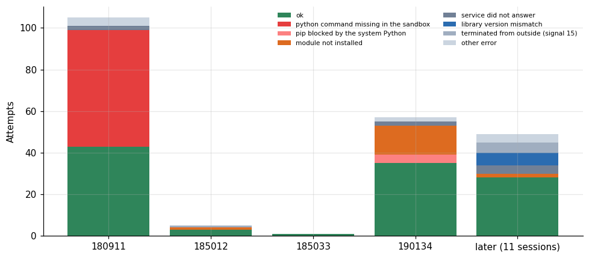

*Figure 2. The learning curve of the harness.*

**Table 4.** The learning curve of the harness (part 2)

|  | Ok | Python command missing in the sandbox | Pip blocked by the system Python | Module not installed | Service did not answer | Library version mismatch | Terminated from outside (signal 15) | Other error |
|---|---|---|---|---|---|---|---|---|
| 20261026T180911 | 43 | 56 | 0 | 0 | 2 | 0 | 0 | 4 |
| 20261026T185012 | 3 | 0 | 0 | 1 | 0 | 0 | 1 | 0 |
| 20261026T185033 | 1 | 0 | 0 | 0 | 0 | 0 | 0 | 0 |
| 20261026T190134 | 35 | 0 | 4 | 14 | 2 | 0 | 0 | 2 |
| later (11 sessions) | 28 | 0 | 0 | 2 | 4 | 6 | 5 | 4 |

The first session had a success rate of 41 percent and the fourth, the second full run with the interpreter fixed, 61 percent. The eighth session reached 65 percent, over a much smaller set of tools that had survived the earlier filters. After that, each session contained only a handful of attempts on stubborn tools, and the success rates of 33 percent, 33 percent and 0 percent describe the hard cases and not the suite.

Reading the table as a user of the suite, the point is how an apparent failure rate of 59 percent in the first run shrinks to a failure rate attributable to tools of 15 percent (33 of 217 attempts) once the harness is fixed. Twenty-eight tools failed with status 127 at least once, and 27 of them succeeded later. A reader who stopped at the first run, or who published a table of "which tools work", would have called most of those 28 broken. The corrected view required rerunning, and rerunning required me to read the logs.

## 4. Retries, and when they help

The suite gave each tool two attempts per session, on the theory that a flaky download or a race at start-up would pass the second time. I can test that theory with the data, since 50 tool and session pairs have two attempts.

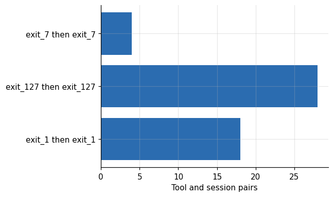

*Figure 3. Retries, and when they help.*

The second attempt failed in all 50 pairs where the first had failed, and in every one of them it failed with the same exit status. No pair recovered. With zero recoveries in 50 trials, the rule of three puts the upper end of a 95 percent interval for the recovery rate at about 6 percent. For deterministic failures, such as a missing command or a library that does not match its dependency, the second attempt runs the same script in the same state and reproduces the failure. The only failures where a retry could plausibly help are the network ones (an unreachable service or a download that stalls), and the data contain too few of them to say.

The second attempts cost time without adding information. In the first session the second attempts were half of the work. A harness that stops after the first failure and spends the saved time on a diagnosis would have found the interpreter problem sooner.

## 5. How many sessions until a tool worked

Each tool has a first session in which it succeeded. The distribution of that number says how much work the 83 tools needed from me.

**Table 5.** How many sessions until a tool worked

|  | First ok session | Failed attempts before | Tool |
|---|---|---|---|
| taipy | 10 | 8 | Taipy |
| camoufox_detect | 9 | 6 | Camofox browser |
| trail_graft | 9 | 6 | Graft |
| crawl4ai | 8 | 4 | Crawl4AI |
| headroom | 8 | 4 | Headroom |
| gepa | 8 | 4 | GEPA |
| otel | 8 | 4 | OpenTelemetry (python) |
| playwright | 8 | 4 | Playwright |
| nautilus | 8 | 4 | NautilusTrader |
| onvif_zeep | 8 | 4 | onvif-zeep |

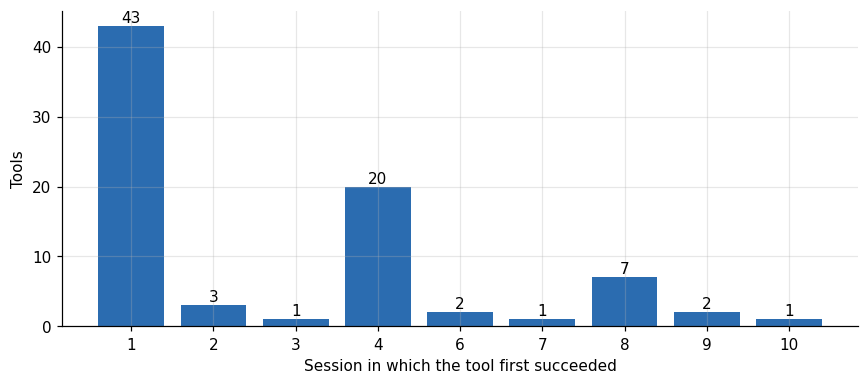

*Figure 4. How many sessions until a tool worked.*

Forty-three tools succeeded in the first session. Twenty more succeeded in the fourth, which was the rerun after the first harness fix, and the remaining 17 first succeeded in the second, third or sixth to tenth session. The tools with the most failed attempts before their first success were a web application framework (Taipy, 8 failed attempts, first success in the tenth session), a Firefox-based browser (Camofox) and a tool that records learnings from coding-agent sessions (Graft) with 6 each, and then seven Python packages with 4 each: Playwright, Crawl4AI, Headroom, OpenTelemetry, GEPA, NautilusTrader and onvif-zeep. Those seven failed twice for the missing `python` and twice for the blocked `pip`, and passed in the eighth session, after the harness was changed to let `pip` install into the system Python (the current script sets the environment variable that allows it). They are harness failures that took two fixes to clear.

The three tools that never succeeded are worth describing. The CPU test of a speech-to-text package failed in all twelve attempts, in six sessions. The later logs show a library version mismatch, where the audio decoding package it depends on rejected an argument that the speech package passed. My own script caused it: it asked `pip` for the decoding package at version 15 or newer, and that line is the one that failed, a typical failure of a dependency that moved while its dependent did not. The two GPU serving engine tests were killed by signal 15 in five attempts across three sessions, and the article on serving engines in this series explains how the same engines ran on a different setup.

## 6. What the tools cost in time, memory and disk

For the tools that succeeded, the harness measured how long the script took, the peak memory of its process tree and the size of the directory it created. I use each tool's last successful attempt.

**Table 6.** What the tools cost in time, memory and disk

|  | Wall s | Peak rss MB | Disk MB |
|---|---|---|---|
| count | 80 | 80 | 80 |
| mean | 60.7 | 645.4 | 1,895 |
| std | 150.6 | 1,606 | 4,695 |
| min | 0.5 | 2 | 0 |
| 10% | 1.5 | 24.9 | 1.9 |
| 25% | 2.5 | 32.8 | 16 |
| 50% | 11.6 | 88.5 | 102 |
| 75% | 64.1 | 429.2 | 682.2 |
| 90% | 133 | 1,178 | 4,765 |
| max | 1,178 | 9,442 | 22,350 |

**Table 7.** What the tools cost in time, memory and disk (part 2)

|  | Wall s | Peak rss MB | Disk MB |
|---|---|---|---|
| T1 | 4 | 35 | 50 |
| T2 | 62.4 | 287 | 362 |
| T2-GPU | 122.3 | 3,502 | 14,899 |

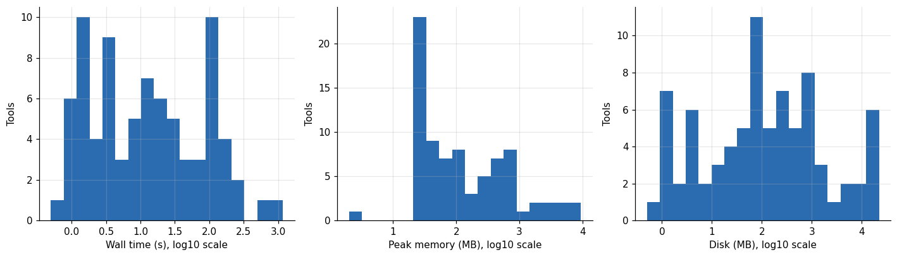

*Figure 5. What the tools cost in time, memory and disk.*

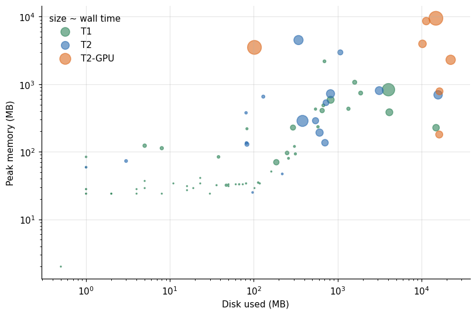

*Figure 6. What the tools cost in time, memory and disk.*

Across the 80 tools that succeeded, the median script took 11.6 seconds, used 88.5 megabytes of peak memory and left 102 megabytes on disk. The quartiles run from 2.5 to 64 seconds, from 33 to 429 megabytes and from 16 to 682 megabytes. The tails are heavy: the largest wall time was 1,178 seconds, the largest memory 9.4 gigabytes and the largest disk use 22.4 gigabytes. By tier, T1 tools have a median of 4 seconds, 35 megabytes of memory and 50 megabytes of disk, T2 tools 62 seconds, 287 megabytes and 362 megabytes, and the GPU tools 122 seconds, 3.5 gigabytes and 14.9 gigabytes.

The relation between the three measures is loose. Disk and memory correlate in the scatter plot, but with outliers on both sides: a language-model-adjacent tool with a large model on disk and a small memory footprint at the time of measurement, and a browser-based diagram editor with 2.2 gigabytes of memory and under 700 megabytes of disk. Time depends on how much the script does, so it says more about my test than about the tool.

## 7. Packing tools onto one machine

A sandbox like this invites the question of how many of the tools one modest server could host at once. I can answer a version of it from the memory and disk columns, with the usual warning that peak memory during a test is not the memory of a service under load.

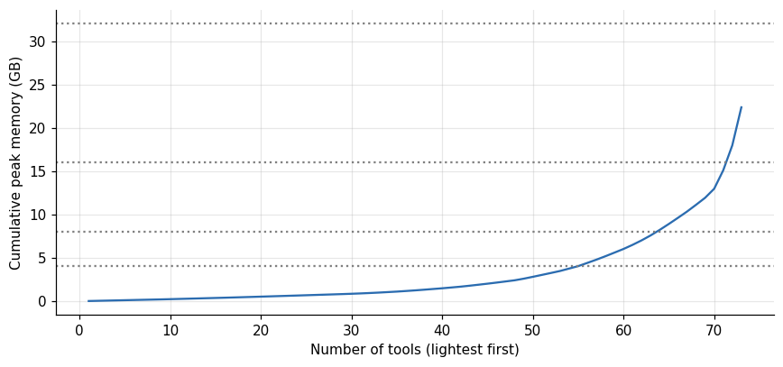

*Figure 7. Packing tools onto one machine.*

A machine with 4 gigabytes of memory holds the lightest 54 of the 73 CPU tools at their measured peaks, 8 gigabytes holds 63, 16 gigabytes holds 71 and 32 gigabytes holds all 73. The sum of all the peaks is 22.4 gigabytes, which assumes every tool peaks at once, and none would. The disk footprints add up to 58.4 gigabytes, and six tools carrying model weights or browser engines account for 43 of them; without those six the rest fit in 15.4 gigabytes. These numbers describe a test, and a production deployment would need monitoring that I did not build.

## 8. The cost of the sandbox

The CPU sandbox sessions ran on the cheapest rentals I could find, small machines at 0.06 to 0.08 dollars per hour.

The sandbox rows of the ledger come to 2.75 hours of instance time and 0.18 dollars. At that price the 217 attempts cost under a tenth of a cent each, and the 83 tools cost about 0.2 cents each. The money was the least expensive resource of this exercise. My time reading logs and rewriting scripts was the expensive one, and the harness failures that took it were avoidable with a first test of the harness on two or three tools before the full run.

## 9. Coverage over time

A different way to see the same story is the cumulative number of tools that had worked at least once, session by session. It shows when the suite became useful and how long the tail of hard cases lasted.

**Table 8.** Coverage over time

| Session | Tools tried | Tools ok so far | Hours since start |
|---|---|---|---|
| 20261026T180911 | 74 | 43 | 0 |
| 20261026T185012 | 79 | 46 | 0.68 |
| 20261026T185033 | 80 | 47 | 0.77 |
| 20261026T190134 | 80 | 67 | 0.8 |
| 20261026T191503 | 80 | 67 | 1.37 |
| 20261026T193655 | 83 | 69 | 1.63 |
| 20261026T193740 | 83 | 70 | 1.48 |
| 20261026T194402 | 83 | 77 | 1.55 |
| 20261026T201405 | 83 | 79 | 2.04 |
| 20261026T203203 | 83 | 80 | 2.3 |
| 20261026T203819 | 83 | 80 | 2.41 |
| 20261027T121935 | 83 | 80 | 18.59 |
| 20261027T131943 | 83 | 80 | 19.39 |
| 20261027T134349 | 83 | 80 | 19.56 |

*First 14 of 15 rows; the full table is in the executable notebook.*

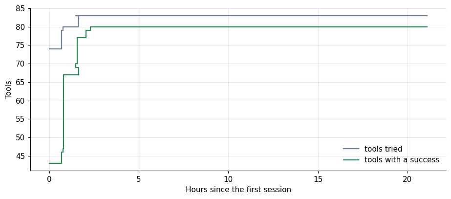

*Figure 8. Coverage over time.*

After the first session, 43 of the 74 tools tried had worked. After the fourth, the session that followed the interpreter fix, 67 of the 80 tried had. The count of tools with a success reached 80 in the tenth session, 2.3 hours after the first, and the three failures stayed where they were through the GPU sessions of the next day. Most of the coverage arrived in the first four sessions, and the last 13 tools took most of the sessions and most of my effort.

## 10. Where the time went

Counting attempts treats a fast failure and a slow one alike. The wall time of each attempt is in the data, and it shows where the machine-hours were spent.

**Table 9.** Where the time went

|  | Attempts | Seconds | Share of attempts | Share of seconds |
|---|---|---|---|---|
| success | 110 | 9,095 | 0.507 | 0.635 |
| terminated from outside (signal 15) | 6 | 4,349 | 0.028 | 0.304 |
| service did not answer | 8 | 385.4 | 0.037 | 0.027 |
| other error | 10 | 200.1 | 0.046 | 0.014 |
| module not installed | 17 | 132.2 | 0.078 | 0.009 |
| library version mismatch | 6 | 81.8 | 0.028 | 0.006 |
| python command missing in the sandbox | 56 | 65 | 0.258 | 0.005 |
| pip blocked by the system Python | 4 | 3 | 0.018 | 0 |

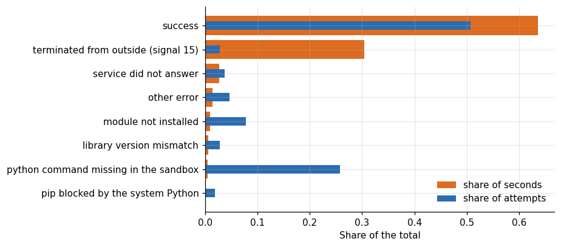

*Figure 9. Where the time went.*

The 56 attempts that failed for the missing `python` were 26 percent of the attempts and took 0.5 percent of the time, 65 seconds in all, since a shell that cannot find a command fails at once. The 6 attempts that were killed by signal 15 were under 3 percent of the attempts and took 30 percent of all script time, 4,349 of 14,312 seconds. The successes took 64 percent. In terms of machine-hours, the most expensive failure mode was the slowest, not the most frequent. The harness failures that dominated my reading of the logs cost almost nothing to run, and their price was my attention.

## 11. How repeatable are the footprints?

Many tools succeeded in more than one session, with scripts that I changed between sessions, so a tool's measurements can be compared across its successful attempts. Where the script and environment were stable, the spread is a measure of noise. Where I changed the script, the spread measures the change.

**Table 10.** How repeatable are the footprints?

|  | Wall ratio | Rss ratio | Disk ratio |
|---|---|---|---|
| count | 19 | 19 | 19 |
| mean | 41.1 | 25.56 | 682.7 |
| std | 145.2 | 62.9 | 2,033 |
| min | 1 | 1.04 | 1 |
| 25% | 1.94 | 1.18 | 1.48 |
| 50% | 2.83 | 3.91 | 5 |
| 75% | 13.23 | 20.64 | 42.46 |
| max | 639.2 | 276 | 8,164 |

**Table 11.** How repeatable are the footprints? (part 2)

|  | Tool | N | Wall ratio | Rss ratio | Disk ratio |
|---|---|---|---|---|---|
| 17 | sglang | 3 | 639.2 | 276 | 4,052 |
| 13 | mcptoon | 3 | 34.2 | 36.5 | 3 |
| 1 | autohedge | 3 | 30.2 | 28 | 38 |
| 16 | pixelrag | 3 | 17.07 | 4.39 | 5 |
| 0 | agent_reach | 3 | 15.4 | 4.19 | 2.67 |
| 18 | vibe_trading | 3 | 11.06 | 5.18 | 1.88 |
| 2 | bitnet | 2 | 6.75 | 2.27 | 1.01 |
| 3 | codebase_memory | 2 | 4.33 | 1.12 | 24.25 |

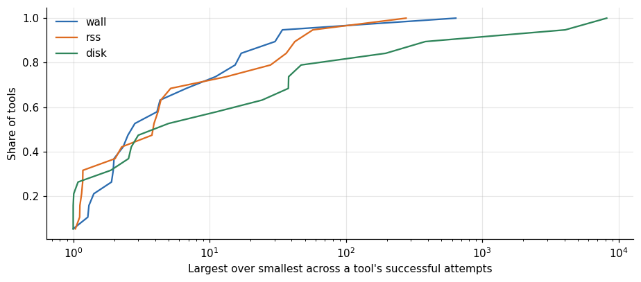

*Figure 10. How repeatable are the footprints?*

Nineteen tools had at least two successful attempts. For them, the median ratio between the largest and the smallest value was 2.8 for wall time, 3.9 for memory and 5.0 for disk, and for a quarter of the tools the ratios were above 13, 21 and 42. The largest spreads come from the tools whose scripts I extended between sessions: the SGLang test went from a half-second check to a full install that took 320 seconds and left 4 gigabytes on disk, a ratio of 639 in time. Other spreads may be real variation of the machines, such as the BitNet build that took 548 seconds in one session and 81 in another, for a reason I did not record. The footprints in this article should therefore be read as measurements of the last version of each script, one run each, and not as properties of the tools that would reproduce within a few percent.

## 12. By kind of tool

The 83 tools fall into groups with different habits. I assigned each to one of ten groups by what it is for, which is a judgment of mine, and the groups are small enough that I treat the comparison as descriptive.

**Table 12.** By kind of tool

|  | Tools | Attempts | Success rate | Share of tools that ever succeeded | Median wall s | Median rss MB | Median disk MB |
|---|---|---|---|---|---|---|---|
| Agent skills | 18 | 54 | 0.33 | 1 | 1.75 | 29 | 24.5 |
| Agent tooling | 10 | 36 | 0.5 | 1 | 13.55 | 93 | 9.5 |
| Speech and voice | 6 | 23 | 0.43 | 0.83 | 104.8 | 695 | 15,829 |
| Web apps and platforms | 11 | 22 | 0.64 | 1 | 13 | 192 | 306 |
| Model serving and inference | 10 | 21 | 0.71 | 0.8 | 147.5 | 2,165 | 611.5 |
| Browsers and crawlers | 4 | 20 | 0.2 | 1 | 101.5 | 627 | 776 |
| Devices and cameras | 9 | 15 | 0.6 | 1 | 4 | 34 | 50 |
| Finance and decisions | 4 | 12 | 0.67 | 1 | 21.85 | 90 | 144 |
| Media and creative | 8 | 11 | 1 | 1 | 22.3 | 260 | 627 |
| Messaging | 3 | 3 | 1 | 1 | 40.8 | 587 | 827 |

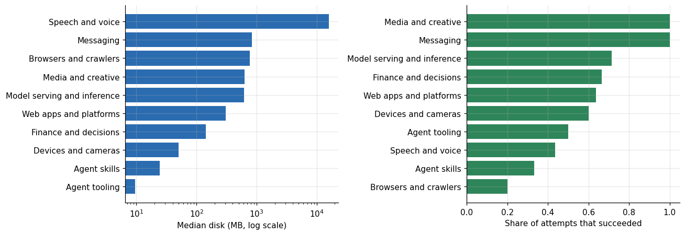

*Figure 11. By kind of tool.*

The group with the most attempts is agent skills, 18 tools with 54 attempts, which succeeded in only 18 of those attempts because every skill failed twice in the first session for the missing `python` and succeeded in the second. Once the harness was fixed, all 18 skills passed on the first attempt. Skills are among the lightest groups, with a median of 29 megabytes of memory, 24.5 megabytes of disk and 1.8 seconds of run time, since they are folders of text.

The groups that carry weight are the speech and voice tools, with a median of 15.8 gigabytes of disk, 695 megabytes of memory and 105 seconds, and the model serving tools, with a median of 2.2 gigabytes of memory and 148 seconds. The browser and crawler group is a middle weight, with a median of 776 megabytes of disk and 627 megabytes of memory for the browser engines that they download. The success rate per attempt says little by group, since it is dominated by when in the sequence each group was first run, but the share of tools that ever succeeded is 100 percent in all groups except speech and voice (5 of 6) and model serving (8 of 10).

## 13. What an agent skill costs in context

Agent skills deserve a longer look, because they have a cost in a place the other tools do not: the context window of a language model. A skill is a set of instructions that a coding assistant loads when it decides the skill is relevant, and the loaded text occupies tokens that the model must read on every request in the session. The harness estimated the tokens of each skill's main instruction file from its size.

**Table 13.** What an agent skill costs in context

| Tool | ID | Tokens | Files | Markdown kchars |
|---|---|---|---|---|
| universal-modder | skill_15 | 25,317 | 685 | 4,510 |
| Claude Ads | skill_10 | 21,952 | 414 | 603 |
| UI/UX Pro Max | skill_02 | 11,329 | 412 | 681 |
| Taste Skill | skill_00 | 9,884 | 65 | 386 |
| Diagram Design | skill_03 | 7,705 | 627 | 1,053 |
| Impeccable | skill_01 | 5,922 | 3,120 | 3,082 |
| REA (Reverse Engineer Anything) | skill_13 | 5,192 | 391 | 507 |
| motionmaxxing | skill_08 | 5,149 | 104 | 564 |
| brag | skill_12 | 4,645 | 357 | 130 |
| animate (cth9191) | skill_09 | 4,557 | 111 | 136 |
| get-brolls | skill_14 | 3,927 | 185 | 540 |
| Design DNA | skill_06 | 2,107 | 17 | 74 |
| lemo-opuscar | skill_11 | 1,897 | 2,296 | 1,999 |
| SwiftUI Pro | skill_07 | 1,504 | 20 | 79 |

*First 14 of 18 rows; the full table is in the executable notebook.*

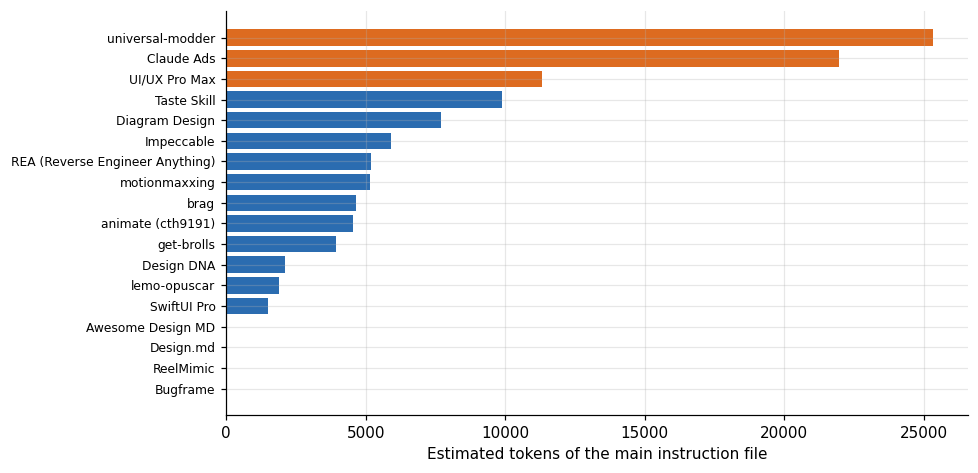

*Figure 12. What an agent skill costs in context.*

Of the 18 skills, 14 have a main instruction file whose size the harness could estimate, and the other four are collections of reference documents without one. The median estimate for the 14 is about 5,200 tokens, the mean 7,900 and the maximum 25,300. The largest skills, at 21,952 and 25,317 tokens, would occupy about a tenth of a 200,000-token context window if loaded in full, and three quarters of a 32,768-token window, which is the window of the local server configurations used in this study.

The cost of those tokens in compute follows from the prefill measurements of the long-context article. With a cold prompt on an RTX PRO 6000 the card read about 8,000 to 10,000 tokens per second, so a 25,000-token skill adds roughly 2.5 to 3 seconds of waiting before the first output token. If the prefix cache holds the skill, the same tokens are read at 24,000 to 100,000 tokens per second and add about 0.25 to 1.1 seconds. In money, at the prompt prices computed in the pricing article, 25,000 tokens cost about 0.001 to 0.0014 dollars cold on that card and 0.0001 to 0.0004 dollars cached. For a service that loads a large skill at the start of every conversation, the cost of the skill is therefore the latency of the first turn, and the money is small.

The practical consequence for skill authors is that the size of the main file matters twice, once as latency and once as space in the window, and that a skill kept at the beginning of the prompt, unchanged between turns, is the cheap configuration, because the cache can hold it. Edits in the middle of a long instruction file invalidate the cache from the point of the edit onward.

## 14. The web tools, and what their numbers mean

A few tools in the suite produce numbers that could be mistaken for benchmarks. I want to say what each measures.

**Table 14.** The web tools, and what their numbers mean

| Tool | What the number is | Value | Unit |
|---|---|---|---|
| Playwright | median of 5 page loads of example.com, the loa... | 24 | ms |
| Obscura | median fetch of example.com by a headless brow... | 290 | ms |
| Crawl4AI | one crawl of example.com to markdown | 710 | ms |
| Crawl4AI | one crawl of a documentation page to 46,073 ch... | 980 | ms |
| Headroom | compressing a 3,001-line log in one call, incl... | 2,740 | ms |
| MediaMTX | probing an RTSP stream until the first answer | 5,328 | ms |

**Table 15.** The web tools, and what their numbers mean (part 2)

|  | Tool | Metric | Value |
|---|---|---|---|
| 17 | Obscura | fetch_ms_median | 290 |
| 18 | MediaMTX | probe_ms | 5,328 |
| 115 | Playwright | goto_ms_median | 24 |
| 116 | Crawl4AI | example_com_s | 0.71 |
| 117 | Crawl4AI | md_chars | 46,073 |
| 118 | Crawl4AI | docs_python_org_s | 0.98 |
| 119 | Headroom | compress_s | 2.74 |

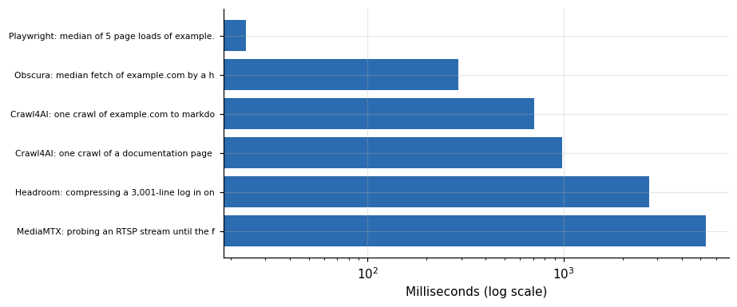

*Figure 13. The web tools, and what their numbers mean.*

Playwright's 24 milliseconds is the median of five loads of `example.com`, a trivial page, and it should not be compared with the 290 milliseconds of a different client doing a different job, or with the 710 milliseconds of a crawler that also converts the page to markdown. The three numbers are in the same unit and answer three different questions. The only comparison the data support is within a tool: Crawl4AI took 0.71 seconds for the trivial page and 0.98 for a documentation page of 46,073 characters of markdown, so crawl time grew by 38 percent while the output grew 48-fold (953 against 46,073 characters).

For the context compression library, the time I measured, 2.74 seconds, includes importing the library and compressing a synthetic log of 3,001 lines in one call. I did not record the token counts before and after, so the sandbox cannot say how much it saves, and it also cannot say that its overhead is negligible: 2.74 seconds is long next to a 50 millisecond model call, even if most of it is the import. A claim about token savings needs a before and after count on real inputs, which this study does not have.

## 15. Time to a running service

Some tools are services, and what matters about them is how long they take to answer. The suite recorded the time to readiness or a first successful request for several.

**Table 16.** Time to a running service

|  | Tool | ID | Metric | Value | Wall s |
|---|---|---|---|---|---|
| 0 | Litpage | litpage | http_code | 200.0 | 53.8 |
| 1 | Open WebUI | open_webui | ready_s | $((i*5))"; | 257 |
| 2 | ComfyUI | comfyui_cpu | http_code | 200.0 | 90.9 |
| 10 | ComfyUI | gpu_comfyui | ready_s | 27.0 | 185 |
| 16 | Qwen3.5-9B (velocidade por GPU) | gpu_9b_speed | ready_s | 335.0 | 1,178 |
| 122 | Taipy | taipy | http_code | 200.0 | 111.5 |

Open WebUI needed 257 seconds of total script time to answer, ComfyUI on CPU 90.9, Taipy 111.5 and Litpage 53.8, and MediaMTX 15.6. These are the whole script, install included, and the install dominates. The Open WebUI readiness metric itself is a harness bug: the script printed a shell template where the number belonged, so the table above shows text in that cell and I use the script time instead. On the GPU machine, ComfyUI answered 27 seconds after launch, with the install and model download already done. The service start-up cost is therefore small compared with the install cost, and a deployment that bakes the install into an image removes most of the wait.

The runner line from the fourth session shows what the harness recorded for Open WebUI, and the first line of the tool's own log shows where I think it came from. The script ends with a `ps` listing, and that listing contains the command line of the shell that is running the script. The command line contains the text of the `echo "METRIC ready_s=..."` line. I did not confirm that this is how the harness picked it up, but the runner value matches that text.

```
open_webui ok 201 s 5 MB {'ready_s': '$((i*5))";'}
 3628 bash -lc pip install -q open-webui >/dev/null 2>&1; (DATA_DIR=$PWD/data timeout 240 open-webui serve --port 4020 >serve.log 2>&1 &); for i in $(seq 1 40); do sleep 5; c=$(curl -s -o /dev/null -w '%{http_code}' http://127.0.0.1:4020/health); [ "$c" = 200 ] && { echo "METRIC ready_s=$((i*5))"; break; }; done; ps -eo rss,cmd | grep -i open-webui | sort -rn | head -2; du -sh $(python -c "import open_webui,os;print(os.path.dirname(open_webui.__file__))")
```

The script line in the suite file, shortened at the end where it continues with a `du` command:

```
t("open_webui", "Open WebUI", """pip install -q open-webui >/dev/null 2>&1; (DATA_DIR=$PWD/data timeout 240 open-webui serve --port 4020 >serve.log 2>&1 &); for i in $(seq 1 40); do sleep 5; c=$(curl -s -o /dev/null -w '%{http_code}' http://127.0.0.1:4020/health); [ "$c" = 200 ] && { echo "METRIC ready_s=$((i*5))"; break; }; done; ps -eo rss,cmd | grep -i open-webui | sort -rn | head -2; du -sh $(python -c "import open_webui,os;print(os.path.dirname(open_webui.__file__))")""", 1200, "T2")
```

## 16. An anatomy of the stubborn failures

Three tools resisted every attempt in at least one tier, and each shows a different way for a tool to fail.

The speech recognition package failed twelve times on the CPU, in six sessions. The first attempts failed because the package was not installed, which was the harness. The later ones failed with an error from the audio decoding library it depends on: the package called a function with an argument that the installed version of the decoder did not accept. The test script itself had requested the decoding library at version 15 or newer, to avoid building an older release, and that newer version rejected the call, so this failure is a flaw in my script and not a verdict on the package. Dropping the requirement, or pinning the decoder below 15, would probably fix it. I did not test either.

The error of the later attempts and the line of my script that asked for the decoder:

```
    audio = decode_audio(audio, sampling_rate=sampling_rate)
  File "/usr/local/lib/python3.12/dist-packages/faster_whisper/audio.py", line 46, in decode_audio
    with av.open(input_file, mode="r", metadata_errors="ignore") as container:
TypeError: open() got an unexpected keyword argument 'metadata_errors'

t("faster_whisper_cpu", "faster-whisper", """python3 -m venv vw && . vw/bin/activate && pip install -q faster-whisper "av>=15" >/dev/null 2>&1; curl -sLo jfk.wav https://github.com/ggerganov/whisper.cpp/raw/master/…
```

The traceback ends inside the speech package, which passes `metadata_errors` to `av.open`, and the decoder rejects it. The script line shows `"av>=15"`, the requirement I added. That a newer decoder dropped the argument is my reading of the error message, and I did not look up the release notes.

The two GPU serving engines in this tier ran a full model server, and their attempts ended with status -15 after 223 to 1,160 seconds, which is a process terminated by signal 15 from outside. The harness's own time limit would have recorded a different status, and none of the 217 attempts has it, so something else ended these runs: a stop that I issued, a shutdown of the machine or a time limit inside the script. The status does not tell me which. These were the heaviest scripts of the suite, since they download a 9 billion parameter model and compile kernels. The same engines ran in the dedicated engine comparison, so these failures belong to the way the runs ended and not to the engines.

The service that did not answer, Taipy, failed eight times with a status from the check that means the connection could not be made, and succeeded in the tenth session. The pattern, a server that is slow to start and a check that gives up too early, is the same as the one the first attempts of other services showed, and I fixed it by waiting longer.

## 17. A checklist for the next sandbox

A reader building a similar suite can avoid most of my losses with a short list. Run the harness on two or three trivial tools first, and read their logs, before launching the full set. Use `python3` explicitly, and either create a virtual environment for every tool or allow `pip` to install into the system Python, so that system package rules do not block installs. Stop after the first failed attempt and classify the failure from its log before spending a second attempt. Record the library versions of the environment with every attempt. Give heavy tools their own time limit, and log who ended every run that did not finish by itself. Keep the status, the time, the memory and the disk, and decide in advance what each tool's script must print to count as a success.

## 18. A screen for light tools

A team choosing tools for a small shared server wants a screen: which of the tools that worked are light enough? The screen depends on thresholds the team sets, and the data can show how sensitive the answer is to them.

**Table 17.** A screen for light tools

|  | 100 | 500 | 1000 | 5000 |
|---|---|---|---|---|
| 100 | 33 | 42 | 42 | 42 |
| 250 | 38 | 49 | 52 | 52 |
| 500 | 39 | 50 | 57 | 59 |
| 1000 | 39 | 51 | 60 | 63 |
| 2000 | 39 | 51 | 60 | 64 |

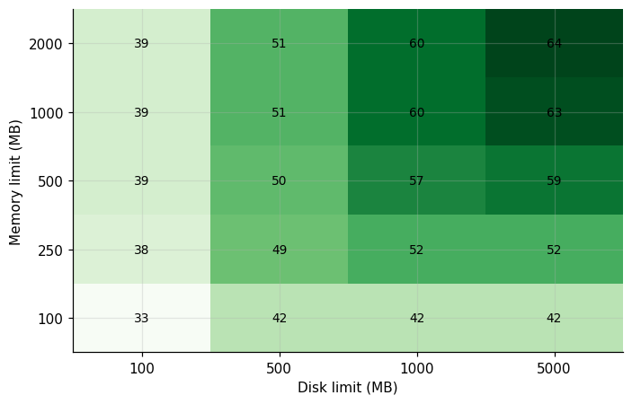

*Figure 14. A screen for light tools.*

Among the 73 CPU tools that succeeded, 42 fit a screen of 100 megabytes of memory, 500 megabytes of disk and 120 seconds of script time, and 52 fit 250 megabytes, 1 gigabyte and the same time. Relaxing the memory limit from 250 to 1,000 megabytes at that disk limit adds 8 tools, and relaxing the disk limit from 1 to 5 gigabytes at a memory limit of 1 gigabyte adds only 3. The count flattens at the top of the grid: 63 or 64 tools fit within 1 to 2 gigabytes of memory and 5 gigabytes of disk, and 9 tools are heavier than that. The tools are therefore a light majority and a heavy minority, and the thresholds matter little as long as they leave out the minority.

## 19. The GPU tier

Nine tools had a GPU test, and the outcomes make a small table of their own.

**Table 18.** The GPU tier

| Tool ID | Tool name | Attempts | Successes | Best wall s | Disk GB | Rss GB |
|---|---|---|---|---|---|---|
| gpu_9b_speed | Qwen3.5-9B (velocidade por GPU) | 2 | 2 | 507.1 | 0.1 | 4 |
| gpu_comfyui | ComfyUI | 1 | 1 | 185 | 21.8 | 2.2 |
| gpu_detectron2 | Detectron2 | 2 | 1 | 117.7 | 11.2 | 8.4 |
| gpu_engine_sglang | SGLang (9B) | 2 | 0 | 245 | 20.4 | 0.3 |
| gpu_engine_vllm | vLLM (9B, comparacao de engine) | 3 | 0 | 222.6 | 15.8 | 3 |
| gpu_faster_whisper | faster-whisper | 1 | 1 | 122.3 | 10.1 | 3.9 |
| gpu_llamacpp | llama.cpp | 3 | 3 | 450.3 | 14.5 | 9.2 |
| gpu_openvoice | OpenVoice | 5 | 4 | 83.9 | 16.1 | 0.8 |
| gpu_vtuber | Open-LLM-VTuber | 2 | 2 | 104.8 | 15.9 | 0.2 |

Five of the nine ran every time they were tried (the 9 billion parameter speed test, the image generation server, the speech recognition package, the language model runner and the voice character server). The object detection library needed a second attempt (1 of 2 succeeded) and the voice cloning tool succeeded in 4 of 5, and the two engine tests never succeeded, as described above. The GPU tools are the heavy ones: the image generation server left 21.8 gigabytes on disk, two voice tools 16 gigabytes each, and the language model runner peaked at 9.2 gigabytes of memory. For these tools the time to download weights was most of the wall time, and it depends on the host's network more than on the tool.

The runner log of the session that ran the two engine tests on the 3090 shows both ending with the same status. The tool logs differ: SGLang printed an error about the model path before the runner ended it, and vLLM's log ends with its level lines. Lines selected from the runner log and from the two tool logs.

```
gpu_engine_vllm exit_-15 821 s 723 MB {}
gpu_engine_sglang exit_-15 1160 s 239 MB {}

OSError: Repo id must be in the form 'repo_name' or 'namespace/repo_name': '/workspace/models/q9'. Use `repo_type` argument if needed.
dl_ok
vllm 0.30.0
level 1 think off wall 25.0
level 8 think off wall 25.0
level 16 think off wall 25.0
```

The SGLang error says that `/workspace/models/q9` is not a valid repository identifier, so that start did not find a model directory it could read. The log does not say whether that error ended the run or only preceded it, and the three level lines that follow are the same 25.0 seconds for each load level in both logs. I cannot tell from these files why the runner ended them with signal 15.

## 20. How the measurements were taken

The harness is a short Python program. For each test it creates a private directory and a private home folder, writes the script to a file and starts it in a shell. While the script runs, the harness adds up the resident memory of the shell and all its descendants every half second and keeps the largest total. When the script exits, the harness measures the size of the test directory and of the private home folder, and records the exit status, the elapsed time and the lines of the form `METRIC name=value` that the script printed. If a script ran past its limit the harness would kill it and record a timeout, and no attempt in the data has that status.

Each of these choices has a consequence for how to read the numbers. Sampling every half second can miss a short spike, so the memory values are lower bounds on the true peaks, most of all for tools that allocate briefly. The disk figure counts what the tool wrote under its own directory and home, and not what it installed into system locations: a Python package installed with `pip` into the system Python goes outside the measured folders, so the disk numbers of such tools are undercounted. The elapsed time includes the install, the download and the test itself, and the three are mixed in one number. The isolation of the home folder means that a second run of the same test does not reuse caches from the first, and it is also why the numbers are not what a user who already has the tool installed would see.

The suite reads only the exit status for the success flag. A script that catches its own error and exits with 0 would count as a success, and I wrote the scripts to let errors propagate, but I did not audit all 83 for that. A tool that printed the metric lines I expected is the strongest evidence in the data that it did something, and 34 of the 80 tools with a success printed at least one metric.

The limits that follow, claim by claim:

**Table 18a.** Claims of the article, their evidence and their caveats

| Claim | Evidence | Caveat |
|---|---|---|
| 74 of 107 failures are harness failures | Runner and tool logs, `sandbox_attempts.csv` | Classification by phrases in logs; a missing system library could be either |
| A retry never helped | 50 pairs, all failed twice with the same status | Network failures are too few to say |
| Footprints of a typical tool: 88 MB, 102 MB, 12 s | Last successful attempt of 80 tools | One run each; memory sampled every half second, disk undercounts system installs |
| The speech package failure is my script's | Script line with `av>=15` and the traceback | I did not test a pin below 15 |
| The signal 15 runs say nothing about the engines | The same engines ran in the engine comparison | Who ended these runs is not recorded |

## 21. What this does not show

A success here means exit status 0 from a script I wrote. It says nothing about whether the tool is good, safe or suitable. Some scripts do a real check, such as fetching a page and printing the time. Others only count files. A tool with a trivial test passes easily, and a tool with a demanding test fails for reasons that may be mine. The classification of causes is based on phrases in logs, and the line between a harness failure and a tool failure is a judgment: a missing system library could be called either.

The sessions ran on a handful of machines, all Linux with the same base image, and the network at the time. A failure caused by a mirror outage on one afternoon would have been counted against a tool. Nothing was measured under load. Security and licensing were not examined, and neither was the quality of the code or its documentation.

Finally, the tools change. The repositories I installed were at their latest commits on 26 October 2026, and some would fail or pass differently a month later.

## 22. Questions I expect

**Which tools are the best?** This study does not rank them, and the question has no answer in a smoke test.

**Why not run everything once and report?** The first run would have reported 59 percent of attempts failing, and most of that was the harness.

**Should I retry failed installs automatically?** Not as the first measure. In 50 pairs a retry never helped. Retry network steps with backoff and diagnose the rest.

**How much memory should I plan for a tool?** The median was 88 megabytes at the peak of a short test, and a tenth of the tools needed more than a gigabyte. Measure the real workload.

**Is a sandbox on a rented machine worth it?** For 0.18 dollars, yes. The value is in finding out which tools install at all before building anything on them.
