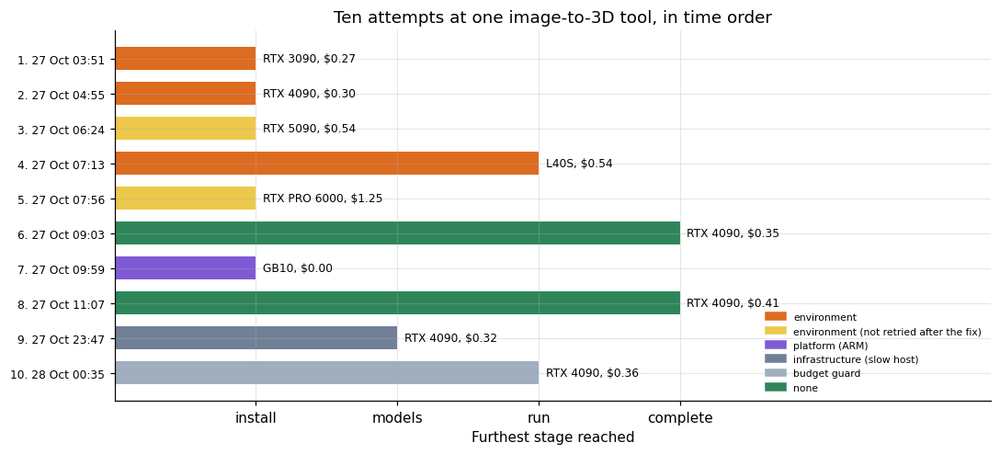
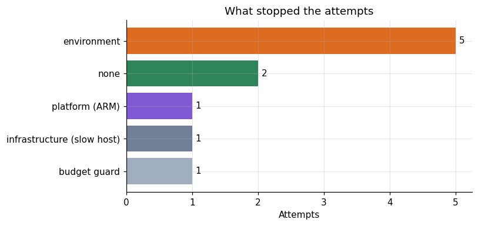
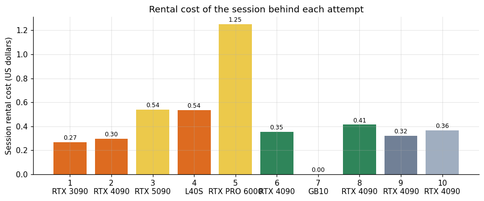
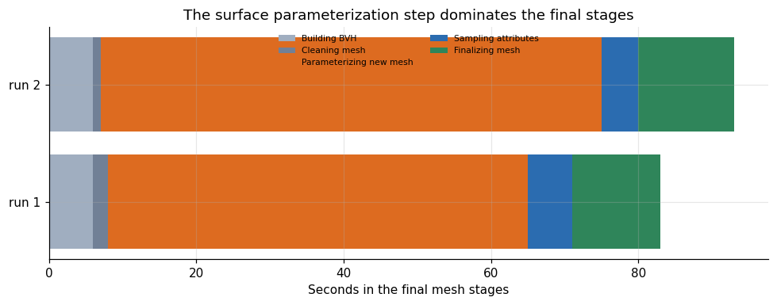
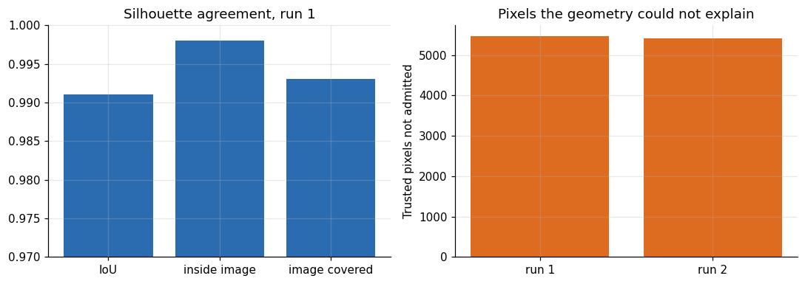
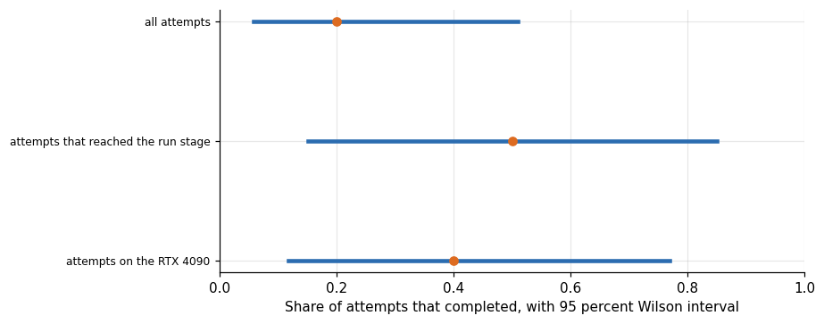
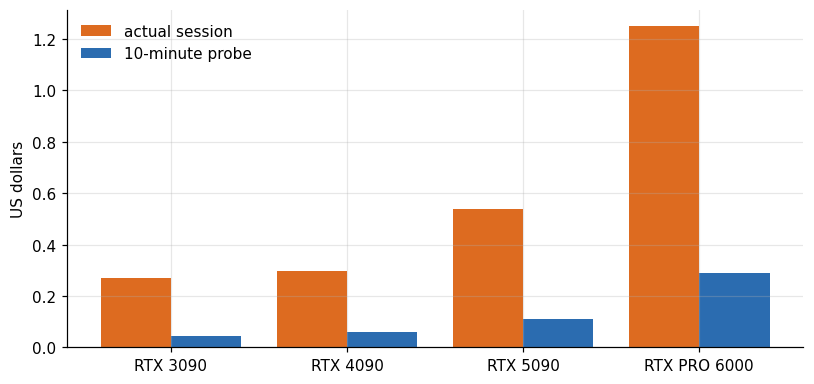
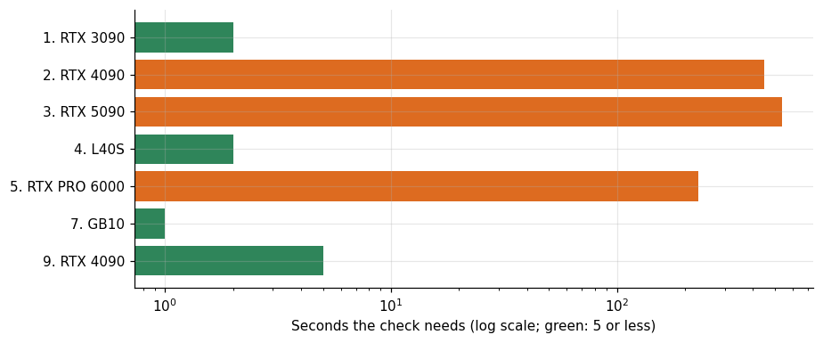
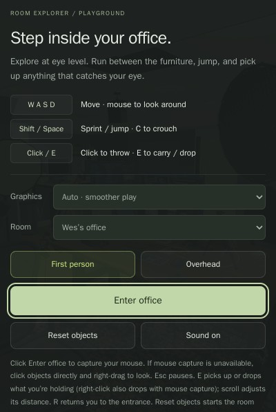

# Ten attempts to run an image-to-3D tool

**Lucas Rangel** · [Kaggle writeup](https://www.kaggle.com/writeups/lucasrangelss/ten-attempts-to-run-an-image-to-3d-tool) · [Executable notebook](https://www.kaggle.com/code/lucasrangelss/ten-attempts-to-run-an-image-to-3d-tool) · [Code and data](https://github.com/LucasRangelSSouza/gpu-ai-benchmark-hub) · [Dataset](https://www.kaggle.com/datasets/lucasrangelss/gpu-ai-benchmark-campaign-2026)

## Abstract

I tried to run one open image-to-3D tool, SUPRA-Tex, ten times on rented and owned machines over two days. It finished twice, both times on an RTX 4090, and it failed eight times for six different reasons, five of them technical and one a budget stop. Only one of the eight failures belongs to the hardware platform. This article lists every attempt, says what failed at which stage, prices the failures and describes the two runs that worked, because the way a fragile tool fails is more useful to the next person than the single sentence "it did not run on my machine".

- Of 10 attempts, 2 completed, 5 stopped at the install stage, 2 stopped at the run stage and 1 stopped while the models were still downloading. The tenth was destroyed by my own budget guard before it produced anything.
- The five causes were a missing compiler toolkit, a native extension that failed to build, a missing imaging library, an x86-only wheel on an ARM machine, and a slow model download. The budget guard accounts for the last attempt.
- The rental cost of all attempts was 4.34 dollars, of which 0.77 dollars paid for the two sessions that produced a result. The other 3.57 dollars went to sessions that ended in an error, and most of those sessions also ran other tests.
- On the two completed runs the final mesh stages took 83 and 93 seconds, and 69 to 73 percent of that was a single step, the parameterization of the surface for texturing. The reconstructed silhouette overlapped the input image with an intersection over union of 0.991 in both runs.
- I did not copy the finished 3D file off the rented machine before destroying it. The evidence that the runs finished is the log, and the log ends with the path of the file. That is a weaker kind of evidence than the file, and the article says so wherever it matters.

> **Code and data.** Everything behind this article is public: the code that ran, the curated data, the analysis that regenerates every figure, and tests that pin the conclusions to the data. Repositories: [image-to-3d-and-digital-twin](https://github.com/LucasRangelSSouza/image-to-3d-and-digital-twin). Index of the whole series: [gpu-ai-benchmark-hub](https://github.com/LucasRangelSSouza/gpu-ai-benchmark-hub).

## 1. Why this tool, and why ten attempts

Image-to-3D tools turn one photograph of an object into a textured mesh. For a company that sells products online, or one that builds a digital replica of a warehouse or a shop, a pipeline like this decides how much a catalog entry costs. I included SUPRA-Tex in the study as the representative of the class, since it is open, its authors report running it on a 24 gigabyte card, and it produces a textured file in the common GLB format. The compatibility grid of the series has one row for it, and that row is where this article starts.

The row looks bad. Of the seven cards, five show a measured failure for this tool and one shows a success. The article on the compatibility grid warned that a red cell records an attempt more than a verdict, and this tool is where that warning matters most. An attempt that stops after nine seconds with a missing compiler says nothing about whether the model runs on that card. So I went through the session logs of every attempt, classified each stop, and wrote down what I know and what I do not.

I used the same rules as in the rest of the series. Every number below comes from a file in the public dataset, the file is named in brackets after the paragraph, and where a statement rests on a log line that is not in the dataset I say so. The cost of each session is the rental estimate from the lease ledger, which multiplies the hourly price by the time the instance existed. For most of these sessions the instance also ran other tests, so the cost of a session is an upper bound on the cost of the attempt.

## 2. The ten attempts

**Table 1.** The ten attempts

| N | When | GPU | Stage reached | Cause class | Session cost USD |
|---|---|---|---|---|---|
| 1 | 2026-10-27 03:51:03 | RTX 3090 | install | environment | 0.268 |
| 2 | 2026-10-27 04:55:17 | RTX 4090 | install | environment | 0.296 |
| 3 | 2026-10-27 06:24:44 | RTX 5090 | install | environment (not retried after the fix) | 0.538 |
| 4 | 2026-10-27 07:13:30 | L40S | run | environment | 0.535 |
| 5 | 2026-10-27 07:56:32 | RTX PRO 6000 | install | environment (not retried after the fix) | 1.25 |
| 6 | 2026-10-27 09:03:19 | RTX 4090 | complete | none | 0.353 |
| 7 | 2026-10-27 09:59:40 | GB10 | install | platform (ARM) | 0 |
| 8 | 2026-10-27 11:07:28 | RTX 4090 | complete | none | 0.414 |
| 9 | 2026-10-27 23:47:00 | RTX 4090 | models | infrastructure (slow host) | 0.321 |
| 10 | 2026-10-28 00:35:29 | RTX 4090 | run | budget guard | 0.365 |

The table shows the attempts in time order. The first was on an RTX 3090 on the morning of the 27th, the last on an RTX 4090 after midnight, about twenty hours later. In between were an RTX 4090, an RTX 5090, an L40S, an RTX PRO 6000, a second RTX 4090 that finished, the GB10 desk machine, a third RTX 4090 that finished and a fourth that stalled on a download.

The column "stage reached" needs a definition. I use four stages. Install means the tool's installer ran and stopped before the environment was complete. Models means the environment was ready and the model weights were still downloading. Run means the example script started and failed or was interrupted. Complete means the log ends with the path of the output file. The stages are ordered, and an attempt that stops at a later stage has solved more problems than one that stops earlier. By that measure the attempts improved over time: the first four attempts reached install, install, install and run, and the two that completed came on the sixth and eighth attempts.



*Figure 1. Ten attempts at one image-to-3D tool, in time order.*

Read from the top of the figure, the first attempt, on the RTX 3090, ended after 9 seconds because the CUDA 12.4 toolkit that the tool's installer expects was not available from the machine's package sources, and the installer stopped at its check for the compiler. The second, on an RTX 4090, ran for 449 seconds and stopped when a native extension called CuMesh failed to build. The third, on an RTX 5090, ran for 543 seconds and stopped at the same extension. The fourth, on the L40S, got past the install, which is the first time the environment came up complete. Its example script then failed on a missing imaging library.

The fifth attempt, on the RTX PRO 6000, stopped at the CuMesh build after 231 seconds. The next attempt on a 4090 finished, after I had changed how the toolkit was installed. I did not go back to the 5090 and the PRO 6000 to apply the same change, because the study was ordered by card and those sessions were already closed, and I cannot tell from the logs whether that change alone would have been enough on those two cards, which have the newest architecture. I come back to that decision in the section on what I would do differently.

The GB10 attempt is of a different kind. On this ARM machine the installer fetched a pinned wheel of an attention library that exists only for Linux on x86 processors, and the CUDA installer it tried to run is an x86 binary. No amount of retrying fixes that, and no change of the toolkit would either. It is the only one of the ten attempts whose cause belongs to the platform.

The ninth attempt, on a fourth RTX 4090, started the run while the model download was still going, with 14 of 24 files in place. The host was slow, the run began without the model manifest, and the session ended on the check. The tenth attempt, on yet another 4090, got as far as the start of inference and was destroyed by the credit guard that I run on every session, before it produced anything. The guard worked as designed, and it cost me the chance of a third completed run.

## 3. Five causes, one platform limit



*Figure 2. What stopped the attempts.*

Counting the attempts by cause gives 5 environment problems, 2 of which I did not retry after the fix was known, 2 successes, 1 platform limit, 1 slow host and 1 budget stop. Environment problems dominate. They are the kind of failure that a better setup script prevents, and they say very little about the tool's quality or about the card.

This is the point where the compatibility grid of the series is least reliable. In that grid, five of the six cards where I tried the tool show a red cell. The attempts behind those cells were an RTX 3090 that stopped on the toolkit, a 5090 and a PRO 6000 that stopped on a build I later learned how to fix, an L40S that stopped on a missing imaging library and a GB10 that stopped on a platform limit. Four of the five look repairable on the same card (a toolkit install, a build that worked on another card after a change, a missing library). I did not make the repairs for the 3090, the 5090, the L40S and the PRO 6000, so the grid should read "not reached" for them and not "fails".

I corrected the grid article to say so. The conclusion for a reader who wants to run this tool is narrow: the one card where I got a result is an RTX 4090 with the CUDA 12.4 toolkit installed in the way that worked, and the one machine where it cannot work as published is an ARM computer, until someone ports two dependencies.

## 4. What the failures cost

**Table 2.** What the failures cost

|  | Sum | Count |
|---|---|---|
| ended in an error | 3.573 | 8 |
| produced a result | 0.767 | 2 |



*Figure 3. Rental cost of the session behind each attempt.*

The sessions behind the attempts cost 4.34 dollars in total. The two that produced a result cost 0.35 and 0.41 dollars, 0.77 together. The eight that ended in an error cost 3.57 dollars, which is 82 percent of the total. The most expensive single session was the RTX PRO 6000 at 1.25 dollars, because that card rents for the most, and it was also one of the attempts that ended on a repairable build error.

The sum overstates the price of the attempts, since most of these sessions were the "all" sessions of the study, which ran the whole battery on a card and then destroyed it. To estimate the share that belongs to the tool, I take the item time of the two completed runs, 421 and 414 seconds, and compare it with the lifetime of their instances.

**Table 3.** What the failures cost (part 2)

| Session | GPU | Item s | Instance life s | Share of life | Dph | Item cost USD | Session cost USD |
|---|---|---|---|---|---|---|---|
| 20261027T090319 | RTX 4090 | 421 | 2563 | 0.164 | 0.496 | 0.058 | 0.353 |
| 20261027T110728 | RTX 4090 | 414 | 2531 | 0.164 | 0.589 | 0.068 | 0.414 |

The tool's own item time was 16 percent of the lifetime of each instance: 421 of 2,563 seconds in the first session and 414 of 2,531 in the second. At the hourly prices of 0.4956 and 0.5889 dollars, the rental behind the item itself was 0.058 and 0.068 dollars. So the working time that produced a textured 3D model cost about six or seven cents of rented GPU, and the rest of the 0.77 dollars paid for the other tests that shared the machine and for the time the instance took to start and to be destroyed.

That ratio matters for anyone planning a production use. The compute of a single model on a mid-range card is cheap, and the cost of the whole project was the cost of getting the environment right. The 3.57 dollars I spent on sessions that ended in an error paid for the fixes, and the lesson I take from them is about process, which the later sections cover.
## 5. The two runs that finished

The two completed runs used the same input image, a photograph of a spiny whelk shell, and the same RTX 4090 model on different rented machines, 2 hours apart. Each wrote a textured GLB file on the remote disk and logged its path. The log of the tool prints a progress bar for the final mesh stage with a stage label and an elapsed time, and the elapsed time is cumulative across the six steps of the bar. To get the duration of each step I take the differences between successive readings.

The input is the example photograph that ships with the tool's repository: a spiny whelk shell on a black background, shown here at 640 by 640 pixels (the original is 1024 by 1024). Both finished runs reconstructed this one object, so everything in this section and the next describes one photograph, not a range of inputs.


*Figure 4. The input image of both finished runs: the example photograph from the SUPRA-Tex repository, a spiny whelk shell.*

**Table 4.** The two runs that finished

|  | 20261027T090319 | 20261027T110728 | Share run1 | Share run2 |
|---|---|---|---|---|
| Building BVH | 6 | 6 | 0.072 | 0.065 |
| Cleaning mesh | 2 | 1 | 0.024 | 0.011 |
| Parameterizing new mesh | 57 | 68 | 0.687 | 0.731 |
| Sampling attributes | 6 | 5 | 0.072 | 0.054 |
| Finalizing mesh | 12 | 13 | 0.145 | 0.14 |



*Figure 5. The surface parameterization step dominates the final stages.*

The first run spent 6 seconds building the acceleration structure for the mesh, 2 seconds cleaning it, 57 seconds parameterizing the surface for texturing, 6 seconds sampling attributes and 12 seconds finalizing the mesh, 83 seconds in all. The second spent 6, 1, 68, 5 and 13 seconds, 93 in all. Parameterization took 69 percent of the final stages in the first run and 73 percent in the second.

The two runs differ by 10 seconds in total and by 11 seconds in the one step that matters, so I read the step as the variable part of the pipeline. The other four steps agree within 1 second between the runs. I do not know why the parameterization varied. The two machines had different hourly prices (0.4956 and 0.5889 dollars) and probably different host processors, and that step runs on the processor, so the host is my first guess, but I did not measure it.

The final stages are a small part of the item. The whole item took 421 and 414 seconds, so the 83 and 93 seconds of mesh finishing were 20 and 22 percent of it, and the rest was model loading and the first stage of the pipeline, which generates the geometry. I did not instrument the first stage, so I cannot split the remaining 320 to 340 seconds further.

## 6. What the overlap score says

The tool prints a quality line after it finishes. It compares the silhouette of the reconstructed geometry, projected back into the camera of the input photograph, with the silhouette of the object in the photograph. The intersection over union of the two silhouettes was 0.991 in both runs. The log splits that into two ratios: the share of the geometry that falls inside the image, 0.998, and the share of the image that the geometry covers, 0.993.

This is what that output looks like. The excerpt below is the log of the first finished run, with the repeated progress bar, the PyTorch deprecation warning and one path line removed. The overlap, pixel and face counts quoted for the first run in the next paragraphs were read from these lines; the second run's log has the same layout.

```
[Supra-Tex inference] attention=sdpa; sparse_attention=sdpa; low_vram=True
[1/2] Foreground, MoGe-2, geometry, material maps -> /workspace/g/st/outputs/spiny_whelk_shell_work/input
[2/2] Surface observations, PBR completion, GLB export -> /workspace/g/st/outputs/spiny_whelk_shell.glb
[SPARSE] Conv backend: flex_gemm; Attention backend: sdpa; Batch broadcast: direct
Floaters: removed 0 of 5 components (0 of 11408604 faces)
Completion low VRAM: sequential models, CPU handoffs, decoder layer offload
Observation: silhouette IoU 0.991 (geometry inside image 0.998, image covered 0.993); admitted 311576 of 317044 trusted pixels (missed geometry 26, depth edge 5442)
Observation cache: disabled (low VRAM)
Finalizing mesh: 100%|██████████| 6/6 [01:23<00:00, 13.86s/it]
Textured mesh: /workspace/g/st/outputs/spiny_whelk_shell.glb
```

**Table 5.** What the overlap score says

| Session start utc | Silhouette iou | Geometry inside image | Image covered | Admitted pixels | Rejected pixels | Trusted pixels | Admitted share | Intermediate faces |
|---|---|---|---|---|---|---|---|---|
| 20261027T090319 | 0.991 | 0.998 | 0.993 | 311576 | 5468 | 317044 | 0.9828 | 11408604 |
| 20261027T110728 | 0.991 | 0.998 | 0.993 | 311631 | 5413 | 317044 | 0.9829 | 11417778 |



*Figure 6. Silhouette agreement, run 1.*

In pixel terms, the tool admitted 311,576 of 317,044 trusted pixels in the first run and 311,631 in the second, 98.3 percent in both. The rejected pixels were 5,468 and 5,413. The log attributes almost all of them to depth edges, and in both runs fewer than 40 pixels were missed by the geometry (this split comes from the log lines and is not in the dataset).

An overlap of 0.991 says that, seen from the camera that took the photograph, the reconstructed object has almost exactly the outline of the original. It says nothing about the side of the object that the camera did not see, nothing about the sharpness of the texture, and nothing about whether the mesh is usable for a purpose such as printing or a game engine. A model can match one silhouette perfectly and be wrong everywhere else. I consider the number a sanity check that the pipeline did not produce a blob, and I do not use it as a measure of fidelity.

Two further numbers from the log characterize the intermediate geometry. The mesh before simplification had 11,408,604 faces in the first run and 11,417,778 in the second, so the generator produced the same amount of geometry to within 0.1 percent. The tool also removes floating fragments, and it removed none in either run. The first run contained 5 separate connected components and the second contained 1, so the generator's output is not identical between runs, even though none of the fragments needed removing and the overlap score agreed to three decimals.

Eleven million faces is too many for any real use. A shop viewer would want 50,000 to 200,000. The tool's last stage reduces the mesh, but the log I have does not print the final face count, so I cannot report the size of the delivered file. That is another consequence of not retrieving it.

## 7. The file I did not bring home

The decisive weakness of the evidence is the one I described at the start: I did not copy the GLB file off the rented machine. The sessions ran unattended under a script that collected a fixed list of output files at the end, and the GLB was not on the list, because I wrote the collection list before I knew the tool existed. The instances were then destroyed, as the budget rules require, and the file went with them.

What I can claim is therefore the following. The log of each run shows a stage-by-stage progress through the end of the pipeline, a quality line with the overlap numbers above, and a final line with the output path. A tool that writes that path after exporting the file has, with high probability, written the file. The probability is not one, and I cannot show the file to anyone. If a reader needs a 3D result for a decision, this article is a record of feasibility and cost, and the rerun that would produce a file costs about 0.4 dollars on a 4090 once the environment is right.

I tried that rerun twice more. The ninth attempt started the inference before the model download had finished and ended without output, since the host was slow. The tenth was destroyed by the guard. These two attempts cost 0.69 dollars and added no evidence, and the second one made me look at the guard itself: it destroys instances when the remaining credit drops under a threshold, with no knowledge of how close a run is to finishing. With 3 minutes of inference left, a guard that waited would have produced a file, and with 30 minutes left it would have been right to destroy.

## 8. How uncertain is a success rate of 2 in 10?

The raw success rate is 2 of 10 attempts, and any reader's first reaction is that the tool is unreliable. That conclusion mixes up two things, as the classification showed: the attempts differ in what was tried, and the first four were the first contact with an unfamiliar build. I compute interval estimates on three denominators to show how much the answer depends on the choice.

**Table 6.** How uncertain is a success rate of 2 in 10?

| Denominator | Successes | N | Rate | Wilson low | Wilson high |
|---|---|---|---|---|---|
| all attempts | 2 | 10 | 0.2 | 0.057 | 0.51 |
| attempts that reached the run stage | 2 | 4 | 0.5 | 0.15 | 0.85 |
| attempts on the RTX 4090 | 2 | 5 | 0.4 | 0.118 | 0.769 |



*Figure 7. How uncertain is a success rate of 2 in 10?*

On all ten attempts the rate is 0.20 and the 95 percent Wilson interval runs from 0.06 to 0.51. Among the 4 attempts that got as far as the run stage, 2 completed, a rate of 0.50 with an interval from 0.15 to 0.85. On the 5 attempts on the RTX 4090, 2 completed, a rate of 0.40 with an interval from 0.12 to 0.77.

The intervals are wide because n is small, and they overlap each other almost completely. The data do not distinguish between a tool that works one time in five and one that works one time in two. What they do support is the narrower statement that the attempts that failed early are explained by causes that I know, and that none of the 4 attempts that reached the run stage failed because of the tool's own code. The two failures at the run stage were a missing library and the guard.

## 9. What a cheap probe would have saved

The install failures cost the most, so I priced the alternative: a probe that runs only the installer and a build check, with a time cap, on a cheap card, before committing the whole battery to an expensive one. The longest install failure in the data took 543 seconds, so I use a 10 minute cap.

**Table 7.** What a cheap probe would have saved

|  | GPU | Actual session USD | Probe USD |
|---|---|---|---|
| 0 | RTX 3090 | 0.268 | 0.043 |
| 1 | RTX 4090 | 0.296 | 0.061 |
| 2 | RTX 5090 | 0.538 | 0.111 |
| 4 | RTX PRO 6000 | 1.25 | 0.289 |



*Figure 8. What a cheap probe would have saved.*

For the four install-stage attempts that have a rental price, the sessions cost 2.35 dollars, and a 10 minute probe at the same hourly prices would have cost 0.50 dollars. The probe would not have fixed anything, but it would have told me four things in 40 minutes of rental: the toolkit problem on the 3090, the extension build on the 4090, and the same build on the 5090 and the PRO 6000. The fix on the 4090 would then have been tested on the cheapest card before any of the expensive ones was rented. The saving is about 1.85 dollars, a small amount, and a large part of what I spent on this tool was a lesson about order, which I should have applied to the whole campaign.

## 10. Which check catches which failure

A probe is a set of checks, and each check has its own cost and its own coverage. I mapped every failed attempt to the cheapest check that would have exposed its cause before the full session started. The mapping is my judgment from the logs, so it is a design argument and not a measurement.

**Table 8.** Which check catches which failure

| Attempt | GPU | Check | Seconds to run |
|---|---|---|---|
| 1 | RTX 3090 | run the compiler version command (nvcc --versi... | 2 |
| 2 | RTX 4090 | build the CuMesh extension alone and read the ... | 450 |
| 3 | RTX 5090 | build the CuMesh extension alone and read the ... | 540 |
| 4 | L40S | import the imaging library in the same interpr... | 2 |
| 5 | RTX PRO 6000 | build the CuMesh extension alone and read the ... | 230 |
| 7 | GB10 | print the machine architecture (uname -m) and ... | 1 |
| 9 | RTX 4090 | count the downloaded model files against the m... | 5 |



*Figure 9. Which check catches which failure.*

Four of the eight failures have a check that takes 5 seconds or less: the missing compiler, the missing imaging library, the architecture of the machine and the incomplete download. These are not the failures that cost the most. The three that cost the most were the builds of the native extension, which a build check can expose only by doing the build, a 4 to 9 minute step. The eighth failure, the guard, is a policy and has no check.

This split suggests a two-level probe. The first level is a script of one-second checks that every session runs before anything else and that stops the session with a clear message. The second level is the build of the fragile extensions on the cheapest card of the right architecture, run once, with its log kept and the working recipe written down. Once the recipe exists, the expensive cards need only the first level. In this campaign I ran the second level four times on four different cards, and in the end the recipe was found only on the one that finished.

The time to failure carries a second lesson. The install failures that took the longest (543 seconds on the 5090 and 449 on the 4090) are also the ones where the card was probably idle, since compilation uses the processor, so a GPU rental paid for a task that does not need a GPU. The three failed builds lasted 449, 543 and 231 seconds, 20 minutes in all, and at the hourly price of each card they cost 0.05, 0.10 and 0.11 dollars, 0.26 dollars together. A build done once on a cheap processor machine and copied to the GPU machine as a wheel would have avoided that spend, but the amount is small, and what a wheel would really have saved is the three sessions' worth of waiting.

## 11. COLMAP: installed, not run

The study also had a classic photogrammetry tool in its list, COLMAP, which reconstructs a 3D scene from many photographs by matching points between them. It needs a set of overlapping images and I did not have a dataset in the rented environments. The raw logs of the run on the RTX 5090 show a version report, COLMAP 4.2.1 with CUDA support, followed 71 seconds later by a line that skipped the test with the reason that the dataset was unavailable.

**Table 9.** COLMAP: installed, not run

|  | GPU | VRAM GB | Status | Total s | Dph USD |
|---|---|---|---|---|---|
| 34 | RTX 4090 | 24 | done | 10.4 | 0.4289 |
| 60 | RTX 3090 | 24 | done | 11.5 | 0.2163 |
| 128 | RTX 5090 | 31.8 | done | 599.1 | 0.6422 |

Three rows of the libraries table carry the name of the tool, for the RTX 4090, the RTX 3090 and the RTX 5090, with a field called total seconds of 10.4, 11.5 and 599.1. Those numbers are not reconstruction times. They are the wall time of the block that checked the tool in each session, which includes installing the package and then skipping the test. On the 5090 the install was long, and 71 of the 599.1 seconds lie between the version report and the skip, so the rest of that time came before the version check, which is consistent with a build from source. I did not verify what the long step was.

The honest summary is that COLMAP 4.2.1 installed with GPU support on three cards and I have no measurement of its reconstruction speed. I mention it because an earlier internal summary of the study listed COLMAP timings, and I found while writing this article that the numbers behind them are the install and skip times. The repository for this part of the project says the same.

## 12. A 3D viewer on my own computer

The last piece is a different kind of test. The room viewer is an open web application that loads 3D models of furniture and rooms in the browser and lets a visitor move through them. I wanted to know whether the kind of 3D files that this class of tool produces can be shown on a phone or a laptop without a server GPU, and I built the viewer from its public source on my own computer, not on a rented machine.

**Table 10.** A 3D viewer on my own computer

| Check | Value | Unit |
|---|---|---|
| node_version | v22.23.4 | – |
| repository_commit_date | 2026-10-22 | – |
| npm_ci_packages_added | 32 | packages |
| npm_ci_seconds | 5 | s |
| vite_build_modules_transformed | 115 | modules |
| vite_build_seconds | 1.493 | s |
| preview_http_status | 200 | – |
| pages_screenshotted | 2 | pages |
| bad_vertices_fixed_in_one_shelf_model | 312 | vertices |
| convex_decomposition_parts_one_chair | 13 | parts |
| convex_decomposition_ms_one_chair | 675 | ms |

The repository snapshot I used is dated 22 October 2026. With Node.js version 22.23.4 the dependency install added 32 packages in 5 seconds, the production build transformed 115 modules in 1.493 seconds, and a local preview server answered with HTTP status 200. I took screenshots of 2 pages, the home page and the page where a visitor walks around a room.

The picture below is the only one I include from the viewer: its start panel, which is interface text and controls and contains none of the demo rooms, models or textures. It is the page where a visitor chooses how to enter the room, with the keyboard and mouse controls listed at the top.



*Figure 10. The start panel of the open-source room viewer, built and served on my own computer (interface only; the demo data belong to the viewer's author).*

The browser console showed three kinds of message. One debug line reported that the code repaired 312 bad vertices in a shelf model while loading it. One warning said that a browser extension for parallel shader compilation was not supported by the headless browser I used. One information line said that the physics layer decomposed a lounge chair into 13 convex parts in 675 milliseconds and cached the result. The decomposition is a practical figure for the use case: it is the one-time cost of making a mesh solid for collisions, paid in the browser.

The viewer's repository is licensed under the MIT license for its code, but the license excludes the demo data, which belong to the repository's author, and the author asks that they not be redistributed or sold as standalone assets. For that reason I publish no model, no texture and no picture of the author's rooms; the start panel above is interface only. The evidence is the build record and the numbers in the table, and the full logs stay on my machine. I read the asset terms before writing this section and I follow them in the public repository as well.

This test does not show that the tool in this article can feed such a viewer. It shows that the viewer builds and runs in a few seconds on a laptop-class computer, which is a prerequisite for any plan that depends on showing the results to a customer.

## 13. How the matrix changes

The first article of this group counted the red cells of the compatibility grid as measured failures. Reading the attempts again, I classify them in three tiers. A failure that I can attribute to a platform limit is the GB10 with this tool and the GB10 with a speech model, and I leave them as failures. A failure of an environment that I did not retry after I knew the fix is a gap in my work. A failure of an infrastructure or budget kind says nothing about the card. The SUPRA-Tex row contributes 1 platform failure, 4 environment failures of which 2 were not retried, and one success. The cells for the 5090, PRO 6000, 3090 and L40S should read "not reached" in a future version of the grid.

A reader who only looks at the grid sees a tool that works on one card of seven. A reader who looks at the attempts sees a tool that needed one specific toolkit installation, that built its extensions on the card where I fixed it, and that fails by design on ARM. Those are different conclusions, and the second is the one I would act on.

## 14. What I would do differently

I would run an install-only probe on the cheapest card in the list before I touch any other, with a cap of 10 minutes, and keep its log as a first-class result. I would write the fix into the setup script instead of applying it by hand, so that every later session starts from the working state. I would put the output files of any new tool on the collection list before the first run, and copy them off the machine before the destroy call. I would let the guard read a progress marker from the run, and delay the destroy call by a few minutes when the marker says the run is in its last stage and the credit allows it.

I would also record the toolkit and driver versions in every attempt record. For two of the failures I can only say that the build failed, and the reader cannot reconstruct which compiler version was present. That gap makes the failures hard to reproduce, which makes them less useful than they could be.

## 15. Questions I expect

**Does the tool work on an RTX 4090?** It completed twice, and the second run repeated the first within a few seconds on every stage but one. The evidence is the log and not the output file.

**Can it run on an ARM desk machine such as the GB10?** Not as published, because a pinned dependency exists only for x86 Linux and the CUDA installer is an x86 binary. Porting those two pieces is a software project, and I did not attempt it.

**How much does one model cost?** The working time of one run was about 7 minutes on a 4090, which is 6 to 7 cents of rental at the prices I paid. Including the time to start and tear down the instance, a session of about 43 minutes cost between 0.35 and 0.41 dollars.

**Is an overlap of 0.991 good?** It means the outline matches the photograph. It says little about the back of the object or about the texture, and I do not use it to rank tools.

**Why not retry until I had the file?** The budget guard stopped the last attempt, and I decided that a third run, which would add a file but no new information about speed or cost, was not worth another session's rental.

## 16. How much it cost

The whole benchmark campaign cost 50.79 dollars in rental. The sessions behind the ten attempts cost 4.34 dollars, 8.5 percent of that. Of the 4.34 dollars, 0.77 went to the sessions that produced a result, 1.5 percent of the campaign, and the rest went to sessions that stopped on an error. Because most of these sessions also ran other tests, the share of the campaign that this tool caused is smaller than 8.5 percent. The GB10 attempt cost nothing in rental, since I own the machine.

The attempts also cost my time. I spent more of it on this tool than on any other item of the study, and the compatibility grid, which counts each attempt as one cell, hides that. A future grid should have a second column with the number of attempts and a third with the dollars spent before the first success, 2.89 dollars here, the sum of the five sessions that came before the first completed run.
