# Image and video generation cost per output

**Lucas Rangel** · [Kaggle writeup](https://www.kaggle.com/writeups/lucasrangelss/image-and-video-generation-cost-per-output) · [Executable notebook](https://www.kaggle.com/code/lucasrangelss/image-and-video-generation-cost-per-output) · [Code and data](https://github.com/LucasRangelSSouza/gpu-ai-benchmark-hub) · [Dataset](https://www.kaggle.com/datasets/lucasrangelss/gpu-ai-benchmark-campaign-2026)

## Abstract

Generative media is priced by the output: an image, a second of video. For a team that wants to offer it, or to run it internally, the question is what one output costs in GPU time, and how that changes with the model, the card and whether the model is already loaded. I measured four generators on up to eight rented GPUs: SDXL-Turbo for fast small images, FLUX.3 Klein for 1024-pixel images, LTX-Video for short clips, and a ComfyUI workflow, and I timed hardware video encoding with FFmpeg for the step after generation.

What the measurements show:

- SDXL-Turbo at 512 by 512 pixels and four steps produced an image in 0.09 to 0.47 seconds, depending on the card and the batch size. At batch 4 the cost was between 0.017 dollars per thousand images on the RTX 3090 and 0.071 on the H100.
- Batching four images together made each image 1.2 to 3.0 times cheaper, with the largest gains on the newest cards.
- FLUX.3 Klein at 1024 by 1024 pixels took 23.6 to 39.1 seconds per image on the 4090, 5090, L40S and PRO 6000, including loading the weights on every call, and 101 to 131 seconds on the ARM machine. It did not run on the RTX 3090 at all, because its FP8 matrix multiplications need a newer instruction set. A FLUX image cost 0.005 to 0.013 dollars of compute, about 200 to 260 times an SDXL-Turbo image on the same card.
- LTX-Video generated a 2-second clip at 512 by 320 pixels in 1.6 to 9.3 seconds, a cost of about 0.0001 to 0.0006 dollars per second of video. The model took 153 to 276 seconds to load before the first clip.
- The load time dominates any on-demand service. Loading LTX costs 0.01 to 0.07 dollars of rental, which is 16 to 120 times the cost of generating one clip. A pay-per-job service must keep the model in memory.

None of this measures how good the images or clips are. These are speed and cost figures for the settings stated. I did look at the saved outputs: the FLUX.3 Klein images match their prompts, while the SDXL-Turbo image and the LTX-Video clips, both prompted in Portuguese, do not show the scene that was asked for.

> **Code and data.** Everything behind this article is public: the code that ran, the curated data, the analysis that regenerates every figure, and tests that pin the conclusions to the data. Repositories: [image-video-generation-bench](https://github.com/LucasRangelSSouza/image-video-generation-bench). Index of the whole series: [gpu-ai-benchmark-hub](https://github.com/LucasRangelSSouza/gpu-ai-benchmark-hub).

## 1. What is being priced

Three things go into the cost of a generated image. Generation itself, which is the arithmetic of the denoising steps. Loading the model into GPU memory, which happens once if the model stays resident and on every request if it does not. And the fixed overhead of the pipeline: text encoding, decoding the latent into pixels, saving the file.

A fast model with a resident model amortizes everything to a small number per image. A large model loaded from disk for each request pays its load time on every image, and that time can be larger than the generation. The measurements below separate these where the harness allowed.

## 2. The models and settings

SDXL-Turbo is a distilled version of Stable Diffusion XL that produces an image in one to four denoising steps, using adversarial diffusion distillation (Sauer and colleagues, 2024). I ran it with the diffusers library at 512 by 512 pixels, four steps, in half precision, with batch sizes 1 and 4.

FLUX.3 Klein is a distilled image model released with an official command-line tool. I ran the tool's default distilled configuration at 1024 by 1024 pixels with 16 steps, and the harness recorded the wall time of each call. Each call loads the weights, because the tool runs as a fresh process.

LTX-Video is a video diffusion transformer built for fast generation (HaCohen and colleagues, 2024). I ran it with diffusers at 512 by 320 pixels and 25 denoising steps, generating 25 frames (1.04 seconds of video) and 49 frames (2.04 seconds), and recorded the model load time and the generation time separately.

ComfyUI is a node-based workflow application with an HTTP interface. I ran a default image workflow through its API on an RTX 3090 and recorded the time to become ready, the first call, and the time per image for batches of 1 and 4.

FFmpeg encodes video on the CPU with libx264 or on the GPU's NVENC unit. I encoded 20-second test clips at 1080p and 4K.

## 3. SDXL-Turbo across eight cards

**Table 1.** SDXL-Turbo across eight cards

|  | Batch1 s per image | Batch4 s per image | Gain from batching |
|---|---|---|---|
| H100 | 0.268 | 0.091 | 2.945 |
| RTX PRO 6000 | 0.361 | 0.122 | 2.959 |
| L40S | 0.298 | 0.134 | 2.228 |
| RTX 5090 | 0.392 | 0.134 | 2.925 |
| A100 | 0.359 | 0.148 | 2.426 |
| RTX 4090 | 0.584 | 0.2 | 2.92 |
| RTX 3090 | 0.442 | 0.268 | 1.649 |
| GB10 | 0.467 | 0.401 | 1.165 |

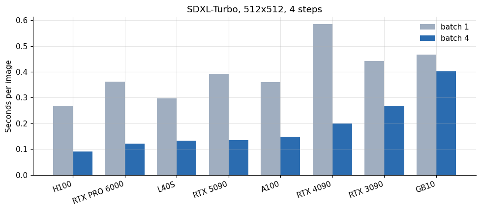

*Figure 1. SDXL-Turbo, 512x512, 4 steps.*

At batch 4 the H100 produced an image in 0.091 seconds, the PRO 6000 in 0.122, the L40S in 0.134, the 5090 in 0.134, the A100 in 0.148, the 4090 in 0.200, the 3090 in 0.268 and the GB10 in 0.401. At batch 1 the order shifts: the H100 takes 0.268, the L40S 0.298, the A100 0.359, the PRO 6000 0.361, the 5090 0.392, the 3090 0.442, the GB10 0.467 and the 4090 0.584. The 4090 is the slowest at batch 1 and the sixth at batch 4, the same host-dependence that showed in the detection benchmark: small, quick operations are held back by how fast the machine issues work.

The gain from batching ranges from 1.16 on the GB10 (its GPU is the limit at any batch size) to 2.95 on the PRO 6000 and the H100. A batch of four images costs about 1.4 times the time of one on the fast cards. That is the efficient way to run the model for any service that can gather a few requests, and the gain is free in memory terms: peak memory rose from 7.7 gigabytes at batch 1 to 10.5 at batch 4.

Timings say how fast an image arrives, not what it shows, so I kept the first image of each batch and looked at it. The prompt in this test was written in Portuguese: "foto de uma padaria artesanal ao amanhecer, luz suave, alta qualidade", a photograph of an artisan bakery at dawn in soft light. The image from the 5090 session, below on the left for a batch of one and on the right for a batch of four, is a harbor at sunset with baskets of nuts and spices in the foreground. There is no bakery in it.

*Figure 2. SDXL-Turbo on the RTX 5090, 512x512, 4 steps: first image of a batch of 1 and of a batch of 4 for the same Portuguese bakery prompt.*

The two images share the scene and differ in detail (mean absolute difference of 7.4 gray levels out of 255), so batching changed the pixels slightly and not the subject. I did not run an English version of the prompt, so I cannot say whether the language explains the missing bakery. What the picture does show is that a cost per thousand images is a cost of producing images, and that checking whether they are the images you asked for is a separate step.

## 4. What an image costs

**Table 2.** What an image costs

|  | Batch1 | Batch4 |
|---|---|---|
| RTX 3090 | 0.0271 | 0.0165 |
| RTX 5090 | 0.0663 | 0.0227 |
| A100 | 0.0666 | 0.0275 |
| RTX 4090 | 0.0805 | 0.0276 |
| L40S | 0.0663 | 0.0297 |
| GB10 | 0.0582 | 0.05 |
| RTX PRO 6000 | 0.1517 | 0.0513 |
| H100 | 0.2087 | 0.0709 |

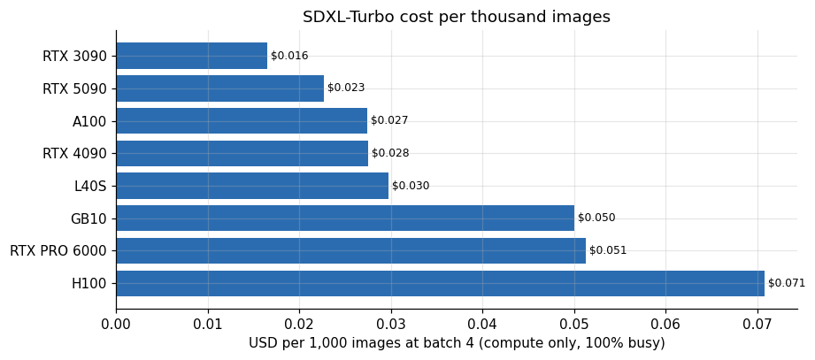

*Figure 3. SDXL-Turbo cost per thousand images.*

At batch 4 and full utilization, a thousand images cost 0.017 dollars on the 3090, 0.023 on the 5090, 0.028 on the 4090 and A100, 0.030 on the L40S, 0.050 on the GB10 (at the price I list it), 0.051 on the PRO 6000 and 0.071 on the H100. A thousand small images cost between 1.7 cents on the 3090 and 7.1 cents on the H100. For this model the choice of card is a matter of cents. A service whose bill matters would take the 3090 or the 5090 and let the faster cards go.

## 5. FLUX.3 Klein: much more per image, and a hardware requirement

**Table 3.** FLUX.3 Klein: much more per image, and a hardware requirement

|  | Runs | Median s | Min s | Max s | USD per image |
|---|---|---|---|---|---|
| L40S | 3 | 27.22 | 26.77 | 27.29 | 0.0061 |
| RTX 5090 | 3 | 27.43 | 23.63 | 31.07 | 0.0046 |
| RTX PRO 6000 | 3 | 27.64 | 27.52 | 28.31 | 0.0116 |
| RTX 4090 | 2 | 39.1 | 39.09 | 39.11 | 0.0054 |
| GB10 | 3 | 102.8 | 101.4 | 130.9 | 0.0128 |

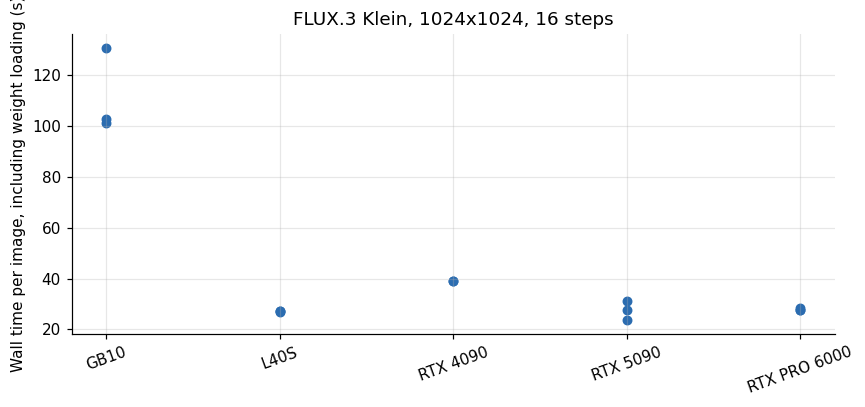

*Figure 4. FLUX.3 Klein, 1024x1024, 16 steps.*

The official tool took a median 23.6 to 27.4 seconds per image on the 5090, L40S and PRO 6000, 39.1 seconds on the 4090 and 102.8 on the GB10, with the repeated runs on the same card agreeing within 15 percent except on the 5090 (23.6 to 31.1) and the GB10 (101.4 to 130.9). These times include loading the weights, which are about 26 to 31 gigabytes, because the tool starts a new process for each image.

The tool saves its images, and I kept them. Each card ran the same two prompts with the same seed (7), at 1024 by 1024 pixels and 16 steps, with the FP8 weights variant: "A cozy artisan bakery at dawn, warm light" and "Isometric illustration of a small data center with glowing servers". The first strip shows the bakery from the five cards that ran the tool.

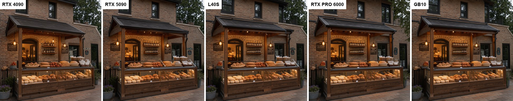

*Figure 5. FLUX.3 Klein, seed 7: "A cozy artisan bakery at dawn, warm light" on five GPUs.*

All five images show the same scene: a brick storefront with a wooden awning, a glass counter of bread and pastries, and a hanging sign. They are not identical. Against the 4090 image, the mean absolute pixel difference is 8.4 gray levels for the 5090, 10.2 for the L40S, 12.1 for the PRO 6000 and 11.2 for the GB10, and the contents of the shelves and the shape of the roof differ from card to card. The signs carry letter-like marks that do not spell words, in every image. The second prompt gives the same kind of result.

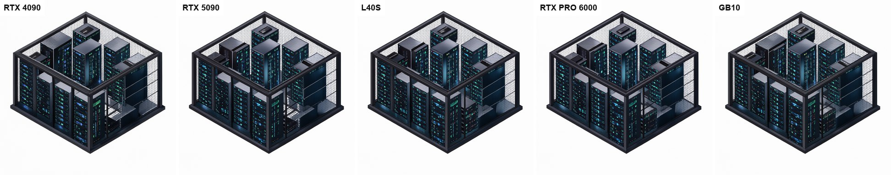

*Figure 6. FLUX.3 Klein, seed 7: "Isometric illustration of a small data center with glowing servers" on five GPUs.*

Here the differences against the 4090 are smaller, 5.2 to 6.9 gray levels, because the white background is most of the picture. A fixed seed on different GPUs gave the same composition and not the same pixels, which matters for anyone who wants to test a service by comparing outputs byte for byte: a tolerance is needed. This is five cards and one seed, so I read it as an observation and not as a rule.

On the RTX 3090 the tool crashed with `RuntimeError: torch._scaled_mm is only supported on CUDA devices with compute capability >= 9.0 or 8.9`. The model's weights are stored in FP8 and the matrix multiplication kernel needs a card of the Ada generation or newer. The 3090 is Ampere, compute capability 8.6, so it cannot run this model as shipped, whatever its memory.

At the median wall times, an image cost 0.0046 dollars on the 5090, 0.0054 on the 4090, 0.0061 on the L40S, 0.0116 on the PRO 6000 and 0.0128 on the GB10. That is about 200 to 260 times the cost of an SDXL-Turbo image at batch 4 and full utilization on the same card. The 1024-pixel image has four times the pixels of the 512 one, which explains a factor of four. The rest is the model: more steps, a bigger network, and the loading of its weights on every call. If the process stayed resident, the per-image time would fall, though I did not measure by how much.

## 6. LTX-Video: fast to generate, slow to load

**Table 4.** LTX-Video: fast to generate, slow to load

|  | Gen 25 frames s | Gen 49 frames s | Load s |
|---|---|---|---|
| RTX 5090 | 1 | 1.6 | 158.4 |
| RTX PRO 6000 | 1.1 | 2.1 | 164 |
| RTX 4090 | 6.2 | 2.2 | 178.8 |
| A100 | 1.6 | 2.3 | 155.5 |
| L40S | 1.7 | 2.3 | 276 |
| RTX 3090 | 2.8 | 4.8 | 164 |
| GB10 | 7.1 | 9.3 | 153.3 |

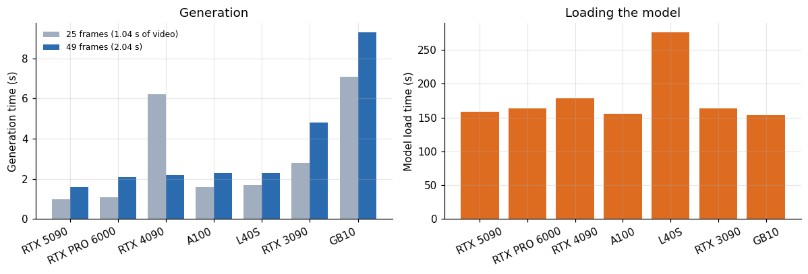

*Figure 7. Generation.*

Generating a clip of 2.04 seconds (49 frames) took 1.6 seconds on the 5090, 2.1 on the PRO 6000, 2.2 on the 4090, 2.3 on the A100 and the L40S, 4.8 on the 3090 and 9.3 on the GB10. That is faster than the length of the video on every card but the GB10, at 512 by 320 pixels. The shorter 25-frame clips took 1.0 to 7.1 seconds, and two cards show a warm-up effect: the 4090 needed 6.2 seconds for the 25-frame clip, which it generated first, and 2.2 seconds for the longer 49-frame clip afterwards. The first generation of a loaded model is slower.

Loading the model took 153 seconds on the GB10, 156 on the A100, 158 on the 5090, 164 on the 3090 and the PRO 6000, 179 on the 4090 and 276 on the L40S. These loads include reading the weights from disk and moving them to the GPU on a rented machine, and depend on that machine's disk and network.

I also opened the clips. The prompt was Portuguese again, "padeiro tirando pães frescos do forno, plano médio, luz quente" (a baker taking fresh bread out of the oven, medium shot, warm light), with a negative prompt asking against blur and low quality. The strips below show six frames of the 49-frame clip from the 4090 and from the GB10.

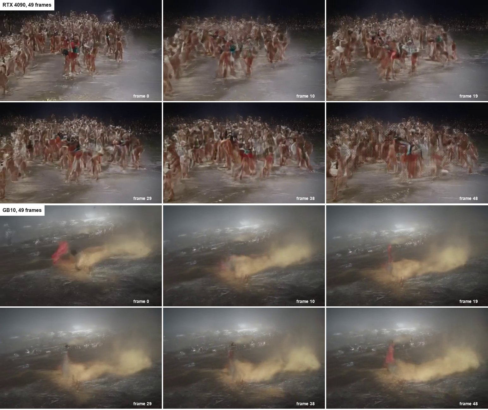

*Figure 8. LTX-Video, 49 frames at 512x320: six frames of the clip from the RTX 4090 (top) and from the GB10 (bottom).*

Neither clip shows a baker or an oven. On the 4090 the frames are a blurred crowd of figures on a wet, dark surface, and on the GB10 they are a cloud of golden dust over dark water with a red object in the first frame. The two cards ran the same seed and the same settings and produced different clips. I do not know why. The language of the prompt, the low resolution, the 25 steps and the bfloat16 pipeline are candidates, and I tested none of them. The speed and cost figures in this section are therefore the cost of producing video-shaped output at these settings, and I have not shown that this output is useful.

## 7. The load time decides the business model

**Table 5.** The load time decides the business model

|  | Load USD | Gen USD per clip | Load over generation |
|---|---|---|---|
| A100 | 0.02885 | 0.00043 | 67.61 |
| GB10 | 0.01912 | 0.00116 | 16.48 |
| L40S | 0.06149 | 0.00051 | 120 |
| RTX 3090 | 0.01007 | 0.00029 | 34.17 |
| RTX 4090 | 0.02463 | 0.0003 | 81.27 |
| RTX 5090 | 0.0268 | 0.00027 | 99 |
| RTX PRO 6000 | 0.06893 | 0.00088 | 78.1 |

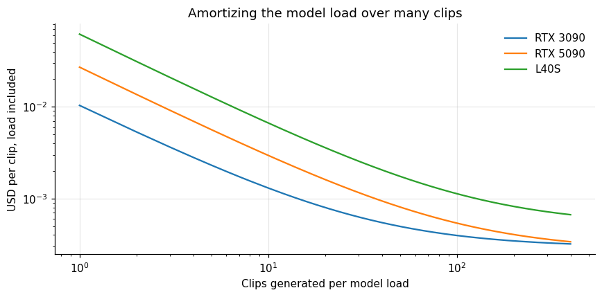

*Figure 9. Amortizing the model load over many clips.*

For a 2-second clip, the load cost is 0.010 dollars on the 3090 and 0.027 on the 5090 against a generation cost of 0.0003 and 0.0003 dollars: a ratio of 34 and 99 times, and across the seven cards from 16 to 120 times. If a service loaded the model for every request, a clip would cost 0.01 to 0.07 dollars and take three to five minutes to appear. If the model is kept in memory, the clip costs a tenth to a hundredth of a cent and appears in seconds.

The difference is why on-demand generation services keep a warm pool. The economics are simple: a GPU held warm costs its hourly price whether or not anyone is generating. At 0.221 dollars an hour a 3090 held warm for a day costs 5.30 dollars, which pays for about 18,000 clips of generation compute at the measured rate. Unless the service sees fewer than a few dozen clips a day, a warm card beats loading on demand, and when the traffic is bursty the answer is a small warm pool and a queue.

## 8. ComfyUI as a service

On the 3090, ComfyUI became ready 27 seconds after launch and the first call took 10.9 seconds. After that a batch of one image took 1.415 seconds and a batch of four took 1.82 seconds, which is 0.455 seconds per image. The gain from batching four images is a factor of 3.1, a stronger gain than SDXL-Turbo showed on the same card (1.65). The workflow was the default one, and I did not record which model it loaded, so these numbers describe the application's overhead and a typical diffusion workload and do not belong in the cards comparison above.

The cost of such an image on the 3090 at batch 4 is about 0.221 dollars an hour times 0.455 seconds, or 0.028 dollars per thousand images.

## 9. Pixels per dollar

Comparing a 512-pixel image, a 1024-pixel image and a video clip needs a common unit. Pixels delivered per dollar of compute is a crude one, since a pixel from a bigger model is worth more, but it exposes the order of magnitude of the gap.

**Table 6.** Pixels per dollar

|  | FLUX.3 Klein 1024x1024 (per call) | LTX-Video 512x320 x 49 frames | SDXL-Turbo 512x512 (batch 4) |
|---|---|---|---|
| L40S | 173 | 15,668 | 8,814 |
| RTX 3090 | – | 27,245 | 15,934 |
| RTX 4090 | 195 | 26,486 | 9,513 |
| RTX 5090 | 226 | 29,661 | 11,564 |

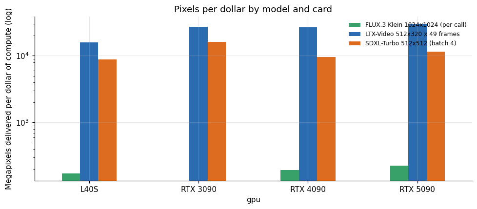

*Figure 10. Pixels per dollar by model and card.*

On the 5090, SDXL-Turbo delivers about 11,600 megapixels per dollar, LTX-Video about 29,700 (counting every pixel of every frame) and FLUX.3 Klein about 226, with the FLUX call including its weight loading. The 3090 is the best card for SDXL-Turbo at 15,900. The video number is large because a clip is 49 small frames produced in one pass. These orders of magnitude say the cost per image is not about pixels alone. It is about steps and parameters, and about whether the model is loaded.

## 10. Images per hour from one card

For capacity planning a service wants outputs per hour per card.

**Table 7.** Images per hour from one card

|  | Sdxl turbo images per hour | Ltx 2s clips per hour |
|---|---|---|
| H100 | 39,560 | – |
| RTX PRO 6000 | 29,508 | 1,714 |
| L40S | 26,966 | 1,565 |
| RTX 5090 | 26,866 | 2,250 |
| A100 | 24,324 | 1,565 |
| RTX 4090 | 18,000 | 1,636 |
| RTX 3090 | 13,433 | 750 |
| GB10 | 8,978 | 387 |

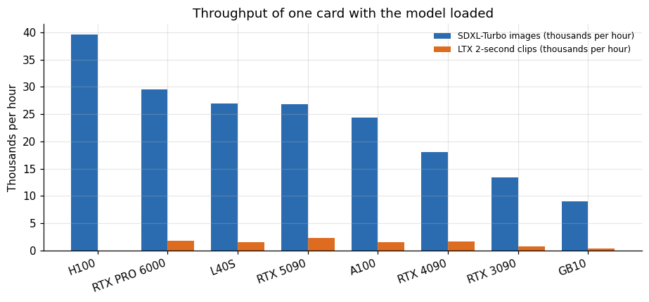

*Figure 11. Throughput of one card with the model loaded.*

With the model resident, one RTX 5090 can produce about 26,900 SDXL-Turbo images an hour at batch 4, or about 2,250 two-second clips. A 3090 produces 13,400 images and 750 clips. The H100 makes 39,600 images. These are saturated figures that ignore queueing, uploading and everything outside the model, so I would plan at half of them.

## 11. What fits on one card at once

A card can host several models if their memory fits. SDXL-Turbo peaked at 7.7 gigabytes at batch 1 and 10.5 to 10.8 at batch 4, and LTX-Video at 13.7 to 14.1 gigabytes.

**Table 8.** What fits on one card at once

|  | LTX-Video (49 frames) | SDXL-Turbo (batch 4) | Both |
|---|---|---|---|
| L40S (48 GB) | yes | yes | yes |
| PRO 6000 (96 GB) | yes | yes | yes |
| RTX 3090 / 4090 (24 GB) | yes | yes | no |
| RTX 5090 (32 GB) | yes | yes | yes |

On a 24 gigabyte card, either model fits alone and both together do not (24.9 gigabytes of peak memory, 28.6 with a 15 percent margin). A 32 gigabyte card holds both with the margin, with 3.4 gigabytes to spare. A 48 gigabyte card hosts both and has room for a language model's cache. For a single-purpose service this is irrelevant. For a small team that wants one card to serve image and video requests, a 48 gigabyte or larger card avoids swapping models in and out, which at 150 to 280 seconds per load would be ruinous.

## 12. When the first request arrives

**Table 9.** When the first request arrives

| Service | Seconds |
|---|---|
| SDXL-Turbo, first call after load (median over... | 1.3 |
| ComfyUI, ready plus first image (RTX 3090) | 37.9 |
| FLUX.3 Klein, any call (RTX 5090) | 27.4 |
| LTX-Video, load plus first clip (median over c... | 166.3 |

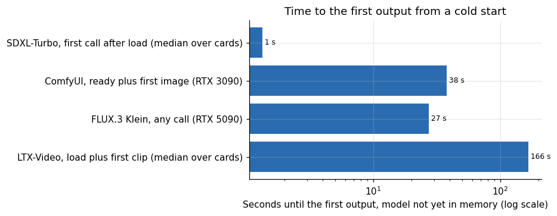

*Figure 12. Time to the first output from a cold start.*

From a cold start, a first SDXL-Turbo image arrives in about 1.3 seconds once the weights are in memory, a ComfyUI instance gives its first image after about 38 seconds, a FLUX call takes about 27 seconds every time, and the first LTX clip needs about 170 seconds. The numbers separate services into those you can start per request (none of these but the smallest) and those you must keep running.

## 13. How many workers for a given load

A video service that must keep up with a stated load needs enough workers that requests do not queue for long. The standard multi-server queue model gives the answer from the service time.

**Table 10.** How many workers for a given load

| Clips per hour | Workers for mean wait under 1s | Monthly USD rental |
|---|---|---|
| 100 | 1 | 444.6 |
| 500 | 1 | 444.6 |
| 1,000 | 2 | 889.1 |
| 2,000 | 3 | 1,334 |
| 4,000 | 4 | 1,778 |

If a clip takes 2.1 seconds of service (the 1.6 seconds of generation on the 5090 plus half a second for encoding and delivery, an assumption), then 100 clips an hour is served by one worker, 1,000 clips an hour by two, and 4,000 an hour by four, with a mean wait under a second. The rental of those cards around the clock is 445, 889 and 1,778 dollars a month. The monthly cost per clip then falls from about 0.6 cents at 100 clips an hour to about 0.06 cents at 4,000. The price per clip is not the model's compute cost, which is a few hundredths of a cent. It is the cost of keeping a card warm divided by the clips it serves.

## 14. From encoder to delivery: video encoding

Generation produces frames. Delivering them as a video file takes an encode, and the encode runs either on the CPU or on the GPU's hardware encoder.

**Table 11.** From encoder to delivery: video encoding

|  | GPU res | A100 | GB10 | L40S | RTX 3090 | RTX 4090 | RTX 5090 | RTX PRO 6000 |
|---|---|---|---|---|---|---|---|---|
| h264_nvenc | 1080p | – | 11.3 | 10.7 | 8.7 | 10.2 | 14.2 | 12.1 |
| h264_nvenc | 4k | – | 4.2 | 3.5 | 2.8 | 3.7 | 4.8 | 3.9 |
| hevc_nvenc | 1080p | – | 11.7 | 10.9 | 9 | 10.3 | 14 | 11.6 |
| hevc_nvenc | 4k | – | 4 | 3.4 | 3 | 3.7 | 4.6 | 3.7 |
| libx264 | 1080p | 7.4 | 8.7 | 5.9 | 3.6 | 2.6 | 9.6 | 4.4 |
| libx264 | 4k | 3 | 2.8 | 2.6 | 1.2 | 0.8 | 1.2 | 1.4 |

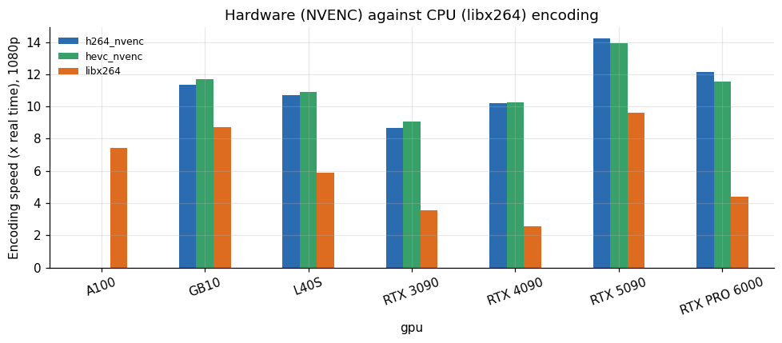

*Figure 13. Hardware (NVENC) against CPU (libx264) encoding.*

At 1080p, hardware H.264 encoding ran at 8.7 to 14.2 times real time on the six cards where the encoder was exposed, against 2.6 to 9.6 times for the CPU encoder, which depends heavily on the host. At 4K the hardware encoder ran at 2.8 to 4.8 times real time and the CPU encoder at 0.8 to 3.0. Encoding the 2-second clip from LTX at 1080p takes under a quarter of a second on the hardware encoder, so it adds nothing to the cost. On a slow CPU the software encoder can take longer than generating the clip.

One caveat belongs next to these speeds. The clips that were encoded are not footage: they are the synthetic test pattern that FFmpeg generates (testsrc2), a fixed picture of colour bars, a moving gradient line, a counter and a checkerboard, at 30 frames per second and a target of 6 megabits per second. The frame below is frame 100 of the 1080p clip from the 4090 session.

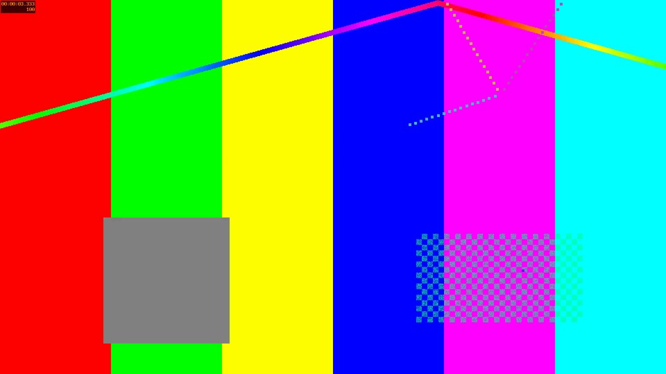

*Figure 14. Frame 100 of the 1080p test clip used for the encoding speeds (FFmpeg testsrc2 pattern, not real footage).*

On the 4090 session the six 20-second files came out between 14.8 and 16.6 megabytes, so the encoders were held near the same bitrate and the speeds are comparable with each other. A test pattern is easier to predict than camera footage with motion, noise and cuts, and I would expect real content to encode more slowly, on the CPU path more than on the hardware one. I did not measure that.

The next article in this series, on CPU against GPU, compares the two paths in detail.

## 15. A pricing view

To turn compute into a price per output, add the costs that the GPU time does not cover. A common approach is to price at a multiple of the compute: a multiple of three to five covers idle time, the warm pool, storage, bandwidth, payment fees and support, and leaves a margin. I treat the multiple as a judgment.

**Table 12.** A pricing view

| Output | Compute USD | Price floor USD | Price floor BRL |
|---|---|---|---|
| SDXL-Turbo image, 512 px, batch 4, RTX 3090 | 2e-05 | 7e-05 | 0.00033 |
| SDXL-Turbo image, 512 px, batch 4, RTX 5090 | 2e-05 | 9e-05 | 0.00045 |
| FLUX.3 Klein image, 1024 px, RTX 5090 | 0.00464 | 0.01854 | 0.09206 |
| LTX-Video, 1 s of video at 512x320, RTX 5090 | 0.00013 | 0.00053 | 0.00264 |

With a multiple of four, an SDXL-Turbo image has a price floor of about 0.0001 dollars (0.0004 reais), a FLUX image about 0.019 dollars (0.09 reais) and a second of LTX video about 0.0005 dollars. The FLUX figure is a hundred times the SDXL-Turbo figure, and that is a fair reflection of the larger model and the larger image. A price list should reflect it. The video figure is for a very small clip; a clip at a higher resolution or with more steps would cost many times as much, and I did not measure that.

## 16. Which hardware property sets the speed of image generation

Two other articles of this series found that small workloads at batch size 1 are limited by how fast the host issues kernel launches, and that large batches are limited by the GPU's arithmetic. SDXL-Turbo at batch 1 and at batch 4 gives a natural test of that idea on a third workload, using the YOLO measurements as yardsticks for the two properties: the time of the smallest detector at batch 1 for the launch speed, and the throughput of the largest detector at batch 16 for arithmetic.

**Table 13.** Which hardware property sets the speed of image generation

|  | Sdxl batch1 s | Sdxl batch4 s | Yolo x images per s batch16 | Yolo n ms batch1 |
|---|---|---|---|---|
| A100 | 0.359 | 0.148 | 277.2 | 9.56 |
| GB10 | 0.467 | 0.401 | 81.9 | 3.26 |
| H100 NVL | 0.268 | 0.091 | 521.3 | 6.35 |
| L40S | 0.298 | 0.134 | 310.5 | 4.48 |
| RTX 3090 | 0.442 | 0.268 | 165.1 | 10.14 |
| RTX 4090 | 0.584 | 0.2 | 322.5 | 16.29 |
| RTX 5090 | 0.392 | 0.134 | 469.1 | 3.59 |
| RTX PRO 6000 | 0.361 | 0.122 | 509.4 | 9.22 |

**Table 14.** Which hardware property sets the speed of image generation (part 2)

| Sdxl | Yardstick | Property | Spearman | P value |
|---|---|---|---|---|
| sdxl_batch4_s | yolo_x_images_per_s_batch16 | arithmetic | -0.881 | 0.004 |
| sdxl_batch1_s | yolo_x_images_per_s_batch16 | arithmetic | -0.476 | 0.233 |
| sdxl_batch1_s | yolo_n_ms_batch1 | launch speed | 0.214 | 0.61 |
| sdxl_batch4_s | yolo_n_ms_batch1 | launch speed | 0.095 | 0.823 |

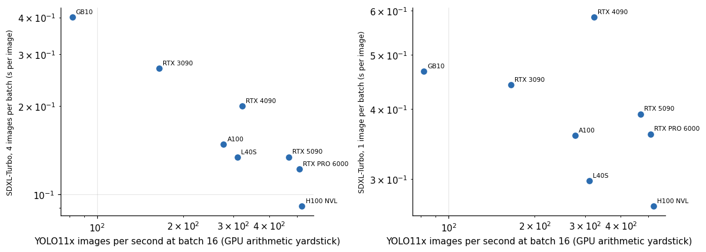

*Figure 15. Which hardware property sets the speed of image generation.*

Over the eight cards that have all four measurements, the time per image at batch 4 is strongly tied to the arithmetic yardstick: the rank correlation with the YOLO throughput is minus 0.88 (a p-value of 0.004), which means the cards that detect more images per second also generate faster. The time per image at batch 1 is not: its rank correlation with the arithmetic yardstick is minus 0.48 and with the launch yardstick 0.21, neither distinguishable from zero with eight points. The batch-1 time depends on both properties and on the software stack, and in my data it does not line up with either alone.

The practical reading is the same as for the other workloads. If you generate images one at a time, the card matters less than you would expect from its price, and the host matters more. If you can batch four images, the card's arithmetic decides, and the expensive cards earn their price. The difference also explains the batching gains reported above: the cards whose batch-4 speed is set by arithmetic, the newest ones, gain the most from batching, because batching moves them from a launch-limited regime into an arithmetic-limited one where they are strong.

## 17. Questions I expect

**Which card should I rent for image generation?** For small fast models, the cheapest one that fits, the 3090. For FLUX, a card of the Ada generation or newer with at least 32 gigabytes. For video, a card with 24 gigabytes and a fast disk.

**Why is the 3090 so cheap per image and so slow per image?** Its hourly price is a third of the 5090's and its speed is half, so the product is lower. The same holds for most of the models here.

**Can I run FLUX on the 3090 with other settings?** The shipped tool cannot, because of the FP8 kernel. A build with 16-bit weights might, if the memory allows, and I did not test it.

**Is the LTX load time inherent?** It reflects the size of the weights and the speed of the disk and network of the host. A host with a fast local NVMe would load faster. The cure in a service is not a faster load but never reloading.

## 18. Does the same host effect show up here?

The YOLO article found that single-image latency of a small network splits into a machine factor and a model factor, and that some machines launch kernels several times slower than others. SDXL-Turbo at batch 1 is also a small, quick workload on a few hundred milliseconds. If the same machines are slow here, the effect belongs to the machine and not to the model.

**Table 15.** Does the same host effect show up here?

|  | Yolo11n b1 ms | Sdxl b1 ms | Sdxl b4 ms | Sdxl b1 over yolo | Sdxl b4 over yolo |
|---|---|---|---|---|---|
| A100 | 9.56 | 359 | 148 | 37.55 | 15.48 |
| GB10 | 3.26 | 467 | 401 | 143.2 | 123 |
| H100 | 6.35 | 268 | 91 | 42.2 | 14.33 |
| L40S | 4.48 | 297.5 | 133.5 | 66.41 | 29.8 |
| RTX 3090 | 10.14 | 442 | 268 | 43.59 | 26.43 |
| RTX 4090 | 16.29 | 584 | 200 | 35.85 | 12.28 |
| RTX 5090 | 3.59 | 392 | 134 | 109.2 | 37.33 |
| RTX PRO 6000 | 9.22 | 361 | 122 | 39.15 | 13.23 |

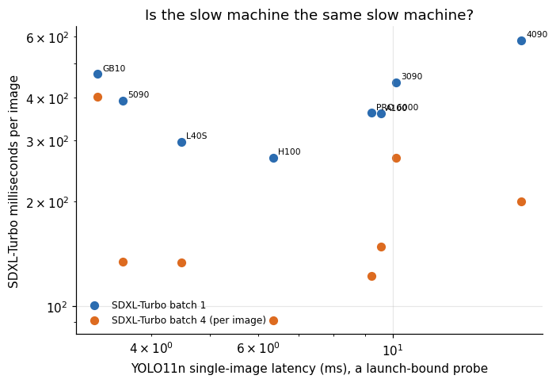

*Figure 16. Is the slow machine the same slow machine?*

The agreement is weak. The Spearman rank correlation between the YOLO latency and the SDXL-Turbo time per image is 0.21 at batch 1 (p = 0.61) and 0.10 at batch 4 (p = 0.82) across the eight machines. The machines that launch fastest are not the fastest at SDXL-Turbo: the 5090 and the GB10 have the best YOLO latencies (3.6 and 3.3 ms) and middling or poor SDXL times (392 and 467 ms), while the H100 has a mediocre YOLO latency (6.4 ms) and the best SDXL batch-1 time (268 ms). Only the 4090 is slow on both, with 16.3 ms for YOLO and 584 ms for SDXL at batch 1. At batch 4 it moves to the middle of the field at 200 ms per image.

That is a useful negative result. The slow-launch effect is specific to tiny workloads, networks that finish in a few milliseconds. SDXL-Turbo spends hundreds of milliseconds per image, the GPU's arithmetic dominates, and the ranking of cards follows the hardware. The lesson for benchmarking is the same in both directions: check which regime a workload is in before you read a ranking, and expect the ranking to differ between a tiny model and a large one on the same machines.

## 19. Video cost per frame

LTX-Video generated 25 or 49 frames per call. The cost per frame shows how generation time grows with clip length.

**Table 16.** Video cost per frame

|  | Ms per frame 25 | Ms per frame 49 | Longer clip cheaper per frame |
|---|---|---|---|
| A100 | 64 | 46.9 | yes |
| GB10 | 284 | 189.8 | yes |
| L40S | 68 | 46.9 | yes |
| RTX 3090 | 112 | 98 | yes |
| RTX 4090 | 248 | 44.9 | yes |
| RTX 5090 | 40 | 32.7 | yes |
| RTX PRO 6000 | 44 | 42.9 | yes |

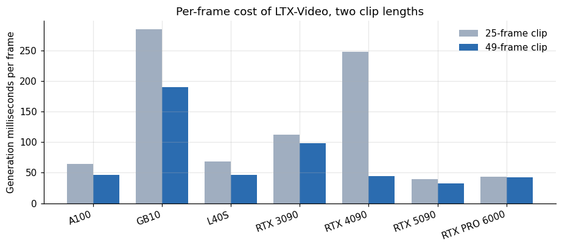

*Figure 17. Per-frame cost of LTX-Video, two clip lengths.*

On the 5090 the cost per frame was 40 milliseconds in the 25-frame clip and 33 in the 49-frame one. On the 4090 it was 248 milliseconds against 45, a sixfold difference that is the warm-up of the first call. On the GB10 the figures were 284 and 190, and on the 3090 112 and 98. The longer clip is cheaper per frame on all seven cards, by a margin that ranges from 2 percent on the PRO 6000 to 82 percent on the 4090, which tells me that a fixed cost per call (text encoding, the first denoising step's setup, decoding) is being spread over more frames. A service that generates clips of a few seconds will pay for that fixed cost on every clip, and the right unit for pricing video is the clip with a length range, not the second.

## 20. Runs get slower?

FLUX.3 Klein ran three times on several cards, and the successive wall times are worth a look.

**Table 17.** Runs get slower?

|  | 1 | 2 | 3 |
|---|---|---|---|
| GB10 | 101.4 | 102.8 | 130.9 |
| L40S | 26.8 | 27.2 | 27.3 |
| RTX 4090 | 39.1 | 39.1 | – |
| RTX 5090 | 23.6 | 27.4 | 31.1 |
| RTX PRO 6000 | 27.5 | 27.6 | 28.3 |

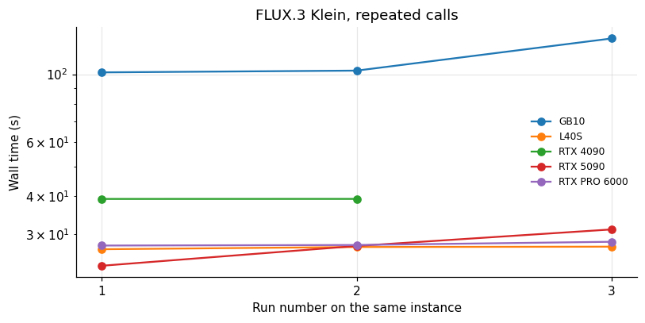

*Figure 18. FLUX.3 Klein, repeated calls.*

On the 5090 the three calls took 23.6, 27.4 and 31.1 seconds, each slower than the previous. On the GB10 they took 101.4, 102.8 and 130.9. On the L40S, 26.8, 27.2 and 27.3, and on the PRO 6000 27.5, 27.6 and 28.3, nearly flat. The 5090 trend is a 32 percent rise over two repetitions. I can think of three explanations: the card warmed up and lowered its clock, the host's disk cache or memory behaved differently as the runs went on, or the process was competing with other work on the machine. I have no telemetry for these runs to decide among them. The soak test on the same card model, which ran for 35 minutes with telemetry, showed no throttling, so I would not lean on the thermal explanation without evidence. The practical point is that three runs are not enough to give a stable figure for FLUX on a shared machine, and the 25 to 30 second figure I report is a range.

## 21. A price list for a media job

To put these numbers together, here is the compute cost of a representative job, a batch of 1,000 images and 100 two-second clips, on each of three cards.

**Table 18.** A price list for a media job

|  | Sdxl 1000 images s | Ltx 100 clips s | Flux 100 images s | USD sdxl 1000 | USD ltx 100 | USD flux 100 |
|---|---|---|---|---|---|---|
| RTX 3090 | 268 | 480 | – | 0.016 | 0.029 | – |
| RTX 5090 | 134 | 160 | 2,743 | 0.023 | 0.027 | 0.464 |
| L40S | 133.5 | 230 | 2,722 | 0.03 | 0.051 | 0.606 |

A thousand SDXL-Turbo images take between 2.2 and 4.5 minutes of GPU time and cost 0.016 to 0.030 dollars. A hundred two-second clips take 2.7 to 8 minutes and cost 0.03 to 0.05 dollars on the cards that ran them. A hundred FLUX images take about 45 minutes and cost 0.46 to 0.61 dollars. FLUX dominates any mixed job, as the per-image comparison suggested, and the cheapest way to cut a mixed bill is to move work to the smaller model wherever the quality is acceptable.

## 22. Choosing between the models

The three generators sit at very different points on the cost scale, and the choice should follow the use.

SDXL-Turbo suits cases where volume matters more than detail: thumbnails, drafts, variations to choose from, previews that a user will refine, product mockups at small sizes. At a few hundredths of a cent per image it can be given away. At 512 pixels it is small, and I did not evaluate how it looks.

FLUX.3 Klein suits cases where one image has to be good: marketing visuals, covers, illustrations that go into a product. At roughly half a cent to a cent of compute per image it is still cheap in absolute terms, and the constraints are practical: it needs a card of the Ada generation or newer, and the official tool pays the model load on every call, so a service would wrap it in a resident process.

LTX-Video suits short clips, and at the resolution I tested it is a draft quality medium. Two seconds of 512 by 320 video in under two seconds of compute is fast enough for interactive previews. Its cost problem is not the generation but the 150 to 280 seconds of loading, which forces a warm pool.

A product can use more than one. A common pattern is to generate a handful of cheap drafts with the small model, let the user pick one, and render the final with the large model. Under the measured costs, ten drafts at 0.00002 dollars each and one final at 0.0046 dollars cost 0.0048 dollars, nearly all of it the final. The drafts are free for practical purposes, which is the argument for offering many of them.

## 23. How to evaluate what comes out

I did not run a quality evaluation, and a generation service cannot skip it. The only check I made was to look at the saved outputs, and it found what timings cannot: an image that ignored its prompt and clips that showed no baker. A minimal evaluation has three layers.

Automatic metrics for screening. Prompt-image alignment scores based on joint text-image embedding models can flag outputs that ignore the prompt, and distribution metrics can detect a regression between two versions of a pipeline. Both are poor judges of whether a person will like the picture, and I would use them only to catch large failures.

Pairwise human preference. Show raters two outputs for the same prompt, from two systems, in random order, and ask which they prefer. A few hundred comparisons give a usable estimate of a preference rate with an interval. This is the standard way to compare generative systems and it measures what matters.

Task-specific checks. For a product, the right test is the task: does the generated product photo get approved by the brand team, does the thumbnail get clicked. These cost the most to run and tell you the most.

Whatever the method, use the same prompts for every system, fix the seeds, and keep the settings (steps, size, guidance) in the record. A comparison of speed that ignores quality can be won by a model that produces nothing useful.

## 24. Licensing and responsible use

The tools in this study have different licenses, and I treat them as constraints on what I publish and on what a reader may do. I published timings and aggregate numbers only. I did not publish generated images or clips from the models whose licenses restrict redistribution of outputs or weights, and the sample outputs I looked at stay on my machine.

Generative media also carries the usual obligations. Do not generate images of real people without their consent. Label synthetic media when it could be mistaken for real, and follow the rules of the platforms where you publish. Filter prompts and outputs for content the law prohibits. The cost figures above show that producing a large volume of synthetic media is cheap, which raises the stakes of getting these practices right. I am not giving legal advice, and the rules differ by country.

## 25. What to measure next

The first gap is resident-process timing for FLUX. A wrapper that loads the weights once and serves repeated requests would show the true per-image time, probably much below the 25 to 30 seconds measured here, and would change the cost comparison.

The second is larger sizes for the fast models: SDXL-Turbo at 1024 pixels and LTX-Video at 768 by 512 or higher, which are the sizes people would use. Costs would rise, and the scaling is worth measuring.

The third is concurrency. Several requests at once on one card, with and without batching, would show whether the warm-pool arithmetic above is conservative.

The fourth is the same measurement on a card I did not test with LTX: the H100.

The fifth is quality: a pairwise preference test, even a small one, between the three generators on a fixed prompt set.

## 26. Limitations

Each cell is one session on one host, with a handful of repeats at most. The 4090 and 3090 hosts were slow launchers, which affects the small-model figures. FLUX timings include model loading on every call and so describe the official tool, not an optimized server. The LTX settings are low resolution, 512 by 320, chosen to run on every card, and the cost of useful resolutions would be higher. The ComfyUI workflow is unspecified. Quality was not assessed: I looked at samples and did not score them. Peak memory for SDXL-Turbo and LTX is a measurement of the process, while the other tools' memory columns record card capacity and are not used here. Prices are marketplace medians, and the GB10's is the rate at which I list the machine.

## 27. How much it cost

These measurements came from the per-card library sweeps and the media sessions, each between 0.10 and 1.30 dollars of itemized rental, within a campaign that cost US$ 50.79. The single most expensive item was model loading, which is also the lesson of the article.

## 28. Reproducing this analysis

Attach the dataset `gpu-ai-benchmark-campaign-2026`. Use `libs_runs.csv` for SDXL-Turbo, LTX-Video and FFmpeg, `media_gated_runs.csv` for FLUX.3 Klein and `sandbox_metrics.csv` for ComfyUI. The harness is `libs.py` in the repository `image-video-generation-bench`.

## 29. Glossary

- **Denoising step**: one iteration of the diffusion process that turns noise into an image.
- **Distilled model**: a model trained to produce a result in fewer steps.
- **NVENC**: the hardware video encoder in NVIDIA GPUs.
- **Warm pool**: GPUs kept running with the model loaded.
- **Compute capability**: NVIDIA's version number for a GPU's instruction set.
- **Latent**: the compressed internal representation a diffusion model works in.
- **Batch**: several images generated in one call.

Lucas Rangel
