# Long context and prefix caching for agents

**Lucas Rangel** · [Kaggle writeup](https://www.kaggle.com/writeups/lucasrangelss/long-context-and-prefix-caching-for-agents) · [Executable notebook](https://www.kaggle.com/code/lucasrangelss/long-context-and-prefix-caching-for-agents) · [Code and data](https://github.com/LucasRangelSSouza/gpu-ai-benchmark-hub) · [Dataset](https://www.kaggle.com/datasets/lucasrangelss/gpu-ai-benchmark-campaign-2026)

## Abstract

Most language model benchmarks use short prompts. An agent does not. A coding or support agent carries a system prompt, tool descriptions and the history of what it has done, and it sends all of that again at every step. After a few turns the prompt is twenty thousand tokens long, and the cost of a turn is dominated by reading that prompt, not by writing the reply.

I measured this on two setups running the same 27 billion parameter model: an RTX 5090 with a 4-bit AWQ build and an RTX PRO 6000 with an NVFP4 build. The measurements cover three things: how long a cold prompt of 6,000 to 76,000 tokens takes before the first token appears, how much a prefix cache saves when the prompt repeats, and what happens when one, four and eight concurrent agent sessions each run eight turns with a growing history.

Results:

- Cold prefill is fast on the larger card and slow on the smaller one. The PRO 6000 processed a prompt at 7,600 to 10,300 tokens per second, so a 76,000-token prompt took 10.0 seconds to the first token. The 5090 ran at 1,800 to 3,600 tokens per second, and a 49,000-token prompt took 27.7 seconds.
- A warm prefix cache is worth between 2 and 33 times, growing with prompt length. On the PRO 6000 the first token for a 76,000-token prompt arrived in 0.75 seconds when the prefix was cached, against 10.0 seconds cold, a factor of 13.
- In the agent workload with eight concurrent sessions, the PRO 6000 kept the median first-token time under one second for every turn after the first (0.79 to 0.92 seconds), and finished all 64 turns in 33 seconds. The 5090 finished the same 64 turns in 527 seconds, with a median first-token time of 17 to 39 seconds from the third turn on.
- Per agent turn, the cheaper-per-hour card is the expensive one. At the median prices I paid, 1,000 turns cost about 0.22 dollars on the PRO 6000 and about 1.39 dollars on the 5090 in the eight-session test.
- A back-of-the-envelope calculation of cache memory first seemed to explain the 5090's collapse. Eight sessions of this workload need about 11.4 GiB of cache by my count, and my estimate of the 5090's free cache was about 7 GiB. The server's own start log later showed 8.66 GiB, enough on paper, so I report the cache explanation as unconfirmed.

This article measures speed. It does not measure whether a model answers correctly at long context, which is a separate and necessary test.

> **Code and data.** Everything behind this article is public: the code that ran, the curated data, the analysis that regenerates every figure, and tests that pin the conclusions to the data. Repositories: [llm-serving-engines-bench](https://github.com/LucasRangelSSouza/llm-serving-engines-bench). Index of the whole series: [gpu-ai-benchmark-hub](https://github.com/LucasRangelSSouza/gpu-ai-benchmark-hub).

## 1. Why the prompt dominates

When a model generates a reply, it first reads the whole prompt in one parallel pass (prefill) and then writes tokens one at a time (decode). Prefill is compute-heavy and fast per token, decode is memory-heavy and slow per token. For a chat message of 100 tokens, prefill is negligible. For an agent turn with a 20,000-token prompt and a 24-token reply, prefill is the whole cost: reading 20,000 tokens at 3,000 tokens per second takes almost seven seconds, while writing 24 tokens at 20 per second takes about one.

A prefix cache changes this. The inference server keeps the attention state for tokens it has already processed. When a new request starts with the same tokens as an earlier one, the server reuses the stored state for that shared prefix and processes only the new part. Kwon and colleagues (2023) describe the paged memory scheme behind vLLM that makes sharing the state between sequences practical. For an agent whose system prompt and history repeat from turn to turn, almost the whole prompt can come from the cache.

The cache is stored in GPU memory, so its size is bounded by what is left after the weights are loaded. That bound is the second theme of this article.

## 2. What I ran

A small load generator, `longctx.py`, runs three phases against an OpenAI-compatible endpoint with streaming and records, for each request, the time to first token, the total time, the prompt and completion token counts from the server's usage report, and derived prefill and decode speeds.

The cold-prefill phase sends one prompt at a time, of nominal 8,000, 32,000, 64,000 and 100,000 tokens, built from random words so that nothing is cached. The nominal sizes overshoot the real ones: the server reported 6,100, 24,589, 49,050 and 76,458 prompt tokens. I use the reported counts in every table.

The prefix phase then sends the same prompt with a short new suffix, which a prefix cache should serve almost entirely from memory.

The agent phase runs N concurrent sessions. Every session starts with a shared 12,000-token system prefix, adds a task, and then runs eight turns. At each turn the session sends the entire history so far, and the history grows by about 1,200 tokens per turn. The first two turns ask for replies of up to 300 tokens, and later turns ask for short replies of 24 tokens, the kind of tool-call acknowledgement an agent loop produces. I ran 1, 4 and 8 sessions.

The text is synthetic, made of a fixed vocabulary of technical words. That keeps the experiment repeatable and removes any chance that the content helps compression or prediction. It also means I cannot say anything about answer quality.

## 3. Cold prefill

**Table 1.** Cold prefill

|  | Config | Prompt tokens | TTFT s | Prefill tok s | Decode tok s |
|---|---|---|---|---|---|
| 117 | RTX 5090 + AWQ 27B | 6,100 | 1.69 | 3,608 | 82 |
| 119 | RTX 5090 + AWQ 27B | 24,589 | 7.28 | 3,377 | 78.1 |
| 121 | RTX 5090 + AWQ 27B | 49,050 | 27.7 | 1,771 | 22.6 |
| 1 | RTX PRO 6000 + NVFP4 27B | 6,100 | 0.59 | 10,286 | 73.7 |
| 3 | RTX PRO 6000 + NVFP4 27B | 24,589 | 2.53 | 9,737 | 57.1 |
| 5 | RTX PRO 6000 + NVFP4 27B | 49,050 | 5.65 | 8,677 | 47.3 |
| 7 | RTX PRO 6000 + NVFP4 27B | 76,458 | 10 | 7,642 | 36 |

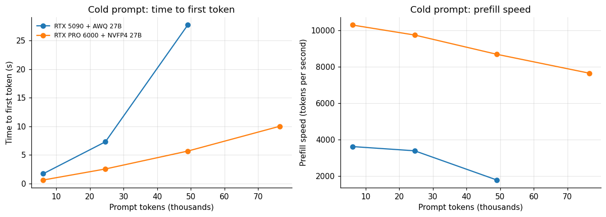

*Figure 1. Cold prompt: time to first token.*

On the PRO 6000 a cold prompt of 6,100 tokens produced its first token after 0.59 seconds, 24,589 tokens after 2.53, 49,050 after 5.65 and 76,458 after 10.00. Prefill speed fell gently with length, from 10,286 to 7,642 tokens per second, because attention costs grow with the square of the length.

On the 5090 the same prompts took 1.69 seconds at 6,100 tokens, 7.28 at 24,589 and 27.70 at 49,050, at 3,608, 3,377 and 1,771 tokens per second. The 100,000-token prompt was not run on this card. At 49,000 tokens, prefill speed had already dropped to half of its short-prompt value, and decode speed had fallen from 82 to 22.6 tokens per second, which I first read as the card running out of cache memory. The server log shown in section 9 does not show a full cache, so I do not know the cause.

The ratio between the cards is 2.9 times at 6,100 tokens and 4.9 times at 49,050. The gap widens with length, as you would expect when memory pressure begins to bite on the smaller card.

## 4. What a warm prefix cache is worth

**Table 2.** What a warm prefix cache is worth

| Config | Prompt tokens cold | TTFT s cold | TTFT s warm | Speedup |
|---|---|---|---|---|
| RTX PRO 6000 + NVFP4 27B | 6,100 | 0.59 | 0.26 | 2.32 |
| RTX PRO 6000 + NVFP4 27B | 24,589 | 2.53 | 0.41 | 6.23 |
| RTX PRO 6000 + NVFP4 27B | 49,050 | 5.65 | 0.6 | 9.36 |
| RTX PRO 6000 + NVFP4 27B | 76,458 | 10 | 0.75 | 13.33 |
| RTX 5090 + AWQ 27B | 6,100 | 1.69 | 0.22 | 7.69 |
| RTX 5090 + AWQ 27B | 24,589 | 7.28 | 0.22 | 33.06 |
| RTX 5090 + AWQ 27B | 49,050 | 27.7 | 3.2 | 8.66 |

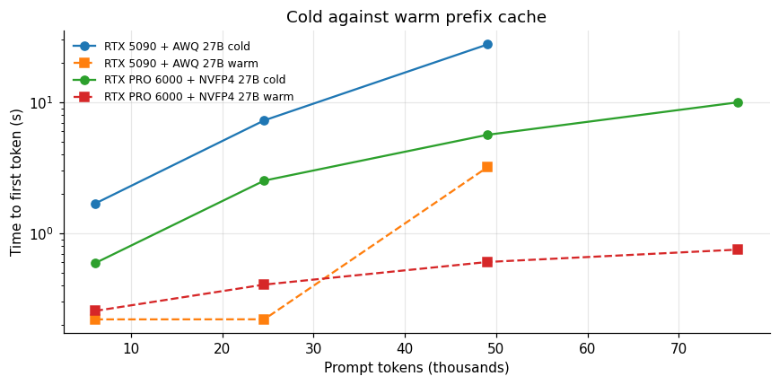

*Figure 2. Cold against warm prefix cache.*

When the same prompt returned with a short new suffix, the first token came back much faster. On the PRO 6000: 0.26 seconds against 0.59 at 6,100 tokens (2.3 times), 0.41 against 2.53 at 24,589 (6.2 times), 0.60 against 5.65 at 49,050 (9.4 times) and 0.75 against 10.00 at 76,458 (13.3 times). The warm time grows slowly with length because the server still has to attend over the cached tokens when it processes the new suffix.

On the 5090 the warm times were 0.22 seconds at 6,100 and 24,589 tokens, and 3.20 at 49,050, a speedup of 7.7, 33 and 8.7 times. The jump from 0.22 to 3.20 between 24,000 and 49,000 tokens looked like a memory limit to me, and the server counters below do not show one.

The server prints a cumulative prefix-cache hit rate every ten seconds, and I kept its log. These are the lines for the single-prompt phase on the 5090, selected from the first cold prompt to the end of the 49,000-token warm request.

```
INFO 10-27 22:19:25 [loggers.py:315] Engine 000: Avg prompt throughput: 506.2 tokens/s, Avg generation throughput: 16.2 tokens/s, Running: 1 reqs, Waiting: 0 reqs, GPU KV cache usage: 15.0%, Prefix cache hit rate: 14.9%
INFO 10-27 22:19:35 [loggers.py:315] Engine 000: Avg prompt throughput: 2487.4 tokens/s, Avg generation throughput: 24.3 tokens/s, Running: 1 reqs, Waiting: 0 reqs, GPU KV cache usage: 12.8%, Prefix cache hit rate: 27.0%
INFO 10-27 22:19:45 [loggers.py:315] Engine 000: Avg prompt throughput: 0.0 tokens/s, Avg generation throughput: 0.0 tokens/s, Running: 1 reqs, Waiting: 0 reqs, GPU KV cache usage: 26.1%, Prefix cache hit rate: 27.0%
INFO 10-27 22:20:05 [loggers.py:315] Engine 000: Avg prompt throughput: 4903.7 tokens/s, Avg generation throughput: 11.3 tokens/s, Running: 0 reqs, Waiting: 0 reqs, GPU KV cache usage: 0.0%, Prefix cache hit rate: 27.0%
INFO 10-27 22:20:15 [loggers.py:315] Engine 000: Avg prompt throughput: 44.5 tokens/s, Avg generation throughput: 12.8 tokens/s, Running: 0 reqs, Waiting: 0 reqs, GPU KV cache usage: 0.0%, Prefix cache hit rate: 49.2%
```

The phase sent 159,505 prompt tokens in seven requests. The counter reads 49.2 percent after the last one, which is 78,500 tokens served from the cache. If each of the three warm prompts had been served in full, the figure would be 79,700 tokens (6,100, 24,589 and 49,050). The difference of about 1,200 tokens is within what rounding to the server's 784-token blocks would cost on three prompts, so the counter says the 49,000-token warm prompt was read from the cache, with the caveat that the last sample falls in the same second as the start of the next phase, so the match is approximate. The 3.2 seconds it took is therefore not explained by a recomputed prefix, and I do not know what the time was spent on.

These two phases are single requests. The warm phase is also best-case, because the prompt is exactly the one just sent. A real service gets some hits and some misses, and its latency is a mixture.

## 5. Decode speed falls as the context grows

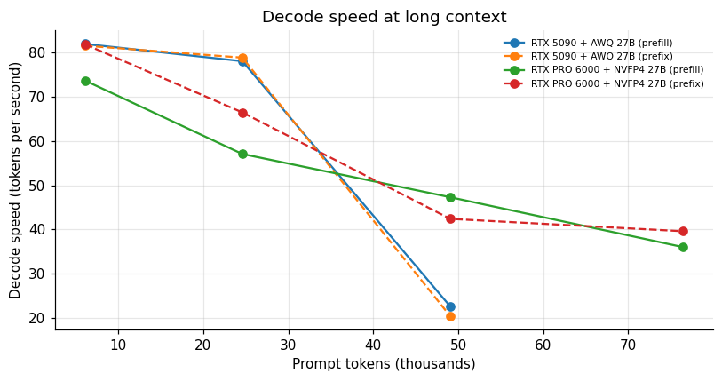

*Figure 3. Decode speed at long context.*

Each new token must attend over every token before it, so decode slows as the context grows. On the PRO 6000, decode speed was 73.7 tokens per second at 6,100 tokens of context, 57.1 at 24,589, 47.3 at 49,050 and 36.0 at 76,458, which is 49 percent of the first value at the longest context. The warm requests decoded at similar speeds (81.9, 66.5, 42.4 and 39.6), so the cache saves prefill time without affecting the per-token cost.

On the 5090 decode speed held at 82, then 78 at 24,589 tokens, and then fell to 22.6 at 49,050, a factor of 3.6 down. The shape is a cliff and not a slope. I first tied it to the card running low on memory, and the server log in section 9 does not support that.

## 6. Anatomy of an agent session

The next phase simulates what an agent does. Before looking at the timings, it helps to see what the requests look like.

**Table 3.** Anatomy of an agent session

| Turn | Prompt tokens | Completion tokens |
|---|---|---|
| 0 | 16,511 | 300 |
| 1 | 17,703 | 242 |
| 2 | 18,913 | 24 |
| 3 | 20,120 | 24 |
| 4 | 21,325 | 24 |
| 5 | 22,535 | 24 |
| 6 | 23,738 | 24 |
| 7 | 24,943 | 24 |

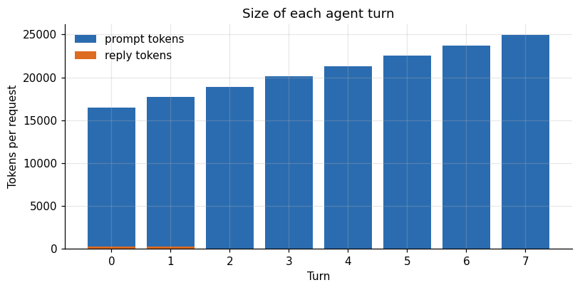

*Figure 4. Size of each agent turn.*

The first turn sends about 16,500 tokens: the shared 12,000-token system prefix plus the task. Every later turn adds about 1,200 tokens, up to 24,950 at the eighth turn. The replies are at most 300 tokens on the first two turns and 24 tokens afterwards. The ratio of prompt to reply is between 55 and 1,000 to one. That is the shape that makes prefill the cost of an agent, and the shape that rewards a cache.

## 7. Time to first token by turn

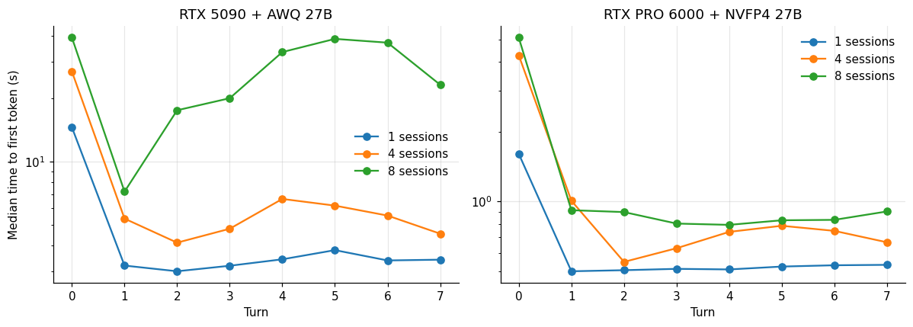

*Figure 5. Time to first token by turn.*

**Table 4.** Time to first token by turn

|  | Turn sessions | 0.0 | 1.0 | 2.0 | 3.0 | 4.0 | 5.0 | 6.0 |
|---|---|---|---|---|---|---|---|---|
| RTX 5090 + AWQ 27B | 1 | 14.58 | 3.2 | 3 | 3.19 | 3.43 | 3.79 | 3.38 |
| RTX 5090 + AWQ 27B | 4 | 26.9 | 5.36 | 4.11 | 4.79 | 6.65 | 6.18 | 5.54 |
| RTX 5090 + AWQ 27B | 8 | 39.04 | 7.2 | 17.6 | 20.09 | 33.35 | 38.55 | 36.99 |
| RTX PRO 6000 + NVFP4 27B | 1 | 1.61 | 0.5 | 0.51 | 0.51 | 0.51 | 0.52 | 0.53 |
| RTX PRO 6000 + NVFP4 27B | 4 | 4.28 | 1.01 | 0.55 | 0.63 | 0.74 | 0.79 | 0.75 |
| RTX PRO 6000 + NVFP4 27B | 8 | 5.1 | 0.92 | 0.9 | 0.8 | 0.79 | 0.83 | 0.83 |

On the PRO 6000 the first turn is the expensive one: 1.61 seconds for one session, 4.28 for four and 5.10 for eight, because the 12,000-token system prefix has to be computed once and the first requests wait for it. After that the first-token time falls to about half a second for a single session (0.50 to 0.53) and stays under one second for eight sessions (0.79 to 0.92 seconds across turns 1 to 7). Adding sessions barely moved the later turns.

On the 5090 the first turn took 14.58 seconds with one session, 26.90 with four and 39.04 with eight. With one session the later turns were steady at 3.0 to 3.8 seconds. With four sessions they were 4.1 to 6.7 seconds. With eight sessions they climbed to 17.6, 20.1, 33.4, 38.6 and 37.0 seconds on turns 2 to 6, and came back to 23.3 on turn 7.

That climb looks like the signature of a cache that is too small. A session's later turns are only fast if its history is still in the cache when it comes back. With eight sessions each holding about 25,000 tokens, my first reading was that the sum exceeds the capacity of the card, so the server evicts old entries and every turn pays much of the cost of prefill again. The prompts are the same size as before, so the turns are not slow because each request is bigger. The server counters below show that fewer prompt tokens came from the cache.

The server logged running requests, waiting requests, cache usage and hit rate for this whole phase. The figure follows the 5090 from the single prompts through one, four and eight sessions.

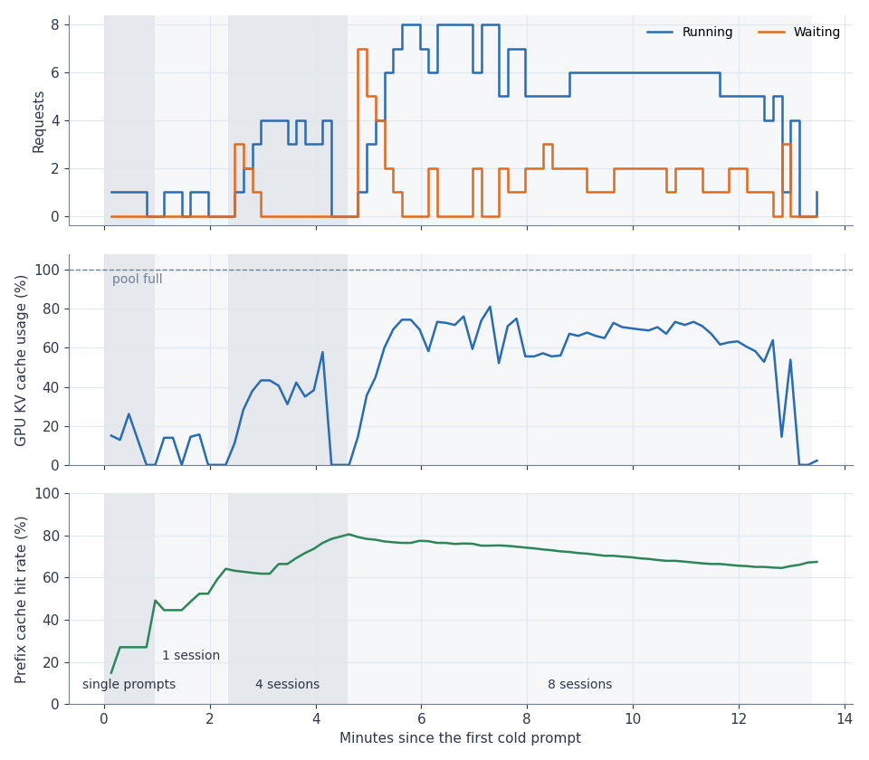

*Figure 6. vLLM on an RTX 5090, 27B AWQ, long-context study: running and waiting requests, KV cache usage and prefix cache hit rate from the server log, by phase.*

With eight sessions the server ran up to 8 requests with up to 7 waiting, and cache usage rose to 81 percent and sat around 66 percent for most of the phase, so the pool did not fill. The hit rate did fall. Differencing the cumulative counter between the ends of the phases gives about 82 percent of prompt tokens served from the cache with one session, 87 with four and 59 with eight. I take these as rough, because the prompt tokens are counted at the time each request started. Eight sessions therefore recomputed about four tokens in ten, which fits the long first-token times, and the log does not say why the hits fell while the pool had room.

## 8. How many turns per minute, and at what cost

**Table 5.** How many turns per minute, and at what cost

|  | Config | Sessions | Wall s | Turns | Turns per minute | USD per 1000 turns |
|---|---|---|---|---|---|---|
| 131 | RTX 5090 + AWQ 27B | 1 | 82.9 | 8 | 5.79 | 1.753 |
| 164 | RTX 5090 + AWQ 27B | 4 | 135.7 | 32 | 14.15 | 0.717 |
| 229 | RTX 5090 + AWQ 27B | 8 | 527.3 | 64 | 7.282 | 1.394 |
| 17 | RTX PRO 6000 + NVFP4 27B | 1 | 12.9 | 8 | 37.21 | 0.678 |
| 50 | RTX PRO 6000 + NVFP4 27B | 4 | 22.9 | 32 | 83.84 | 0.301 |
| 115 | RTX PRO 6000 + NVFP4 27B | 8 | 33.2 | 64 | 115.7 | 0.218 |

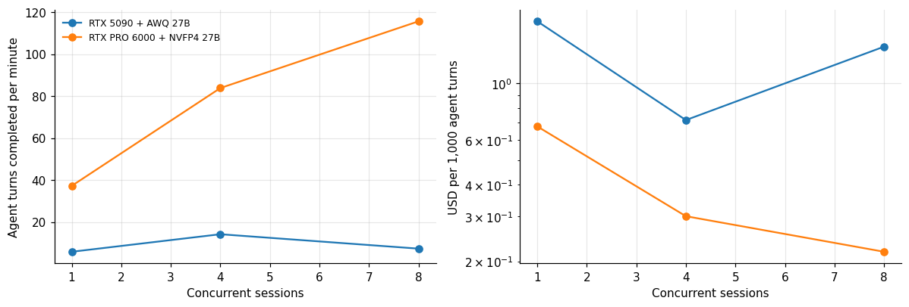

*Figure 7. How many turns per minute, and at what cost.*

Throughput in turns per minute tells the capacity story directly. The PRO 6000 completed 8 turns in 12.9 seconds with one session (37 turns per minute), 32 turns in 22.9 seconds with four (84 per minute) and 64 turns in 33.2 seconds with eight (116 per minute). It scaled with concurrency. The 5090 completed 8 turns in 82.9 seconds with one session (5.8 per minute), 32 in 135.7 with four (14 per minute) and 64 in 527.3 with eight (7.3 per minute). Past four sessions its throughput fell.

Cost per turn follows. Using the median rental prices from the ledger (0.609 dollars per hour for the 5090 and 1.513 for the PRO 6000), the eight-session test cost about 1.39 dollars per thousand turns on the 5090 and 0.22 on the PRO 6000, a factor of 6.4 in favor of the more expensive card. For a single session the 5090 cost 1.75 dollars per thousand turns and the PRO 6000 0.68, a factor of 2.6. The 5090 is cheaper by the hour and several times more expensive per unit of work that includes long prompts.

## 9. The cache arithmetic

Is the explanation of the 5090's collapse consistent with the memory numbers? I can check the order of magnitude with the cost per token of cache that I estimated in the quantization article, 0.1012 MiB per token, and the free memory estimate for the AWQ build on a 32 gigabyte card.

**Table 6.** The cache arithmetic

| Sessions | Cache tokens needed | Cache GiB needed |
|---|---|---|
| 1 | 24,950 | 2.5 |
| 2 | 37,900 | 3.7 |
| 4 | 63,800 | 6.3 |
| 8 | 115,600 | 11.4 |
| 12 | 167,400 | 16.5 |
| 16 | 219,200 | 21.7 |
| 24 | 322,800 | 31.9 |
| 32 | 426,400 | 42.1 |

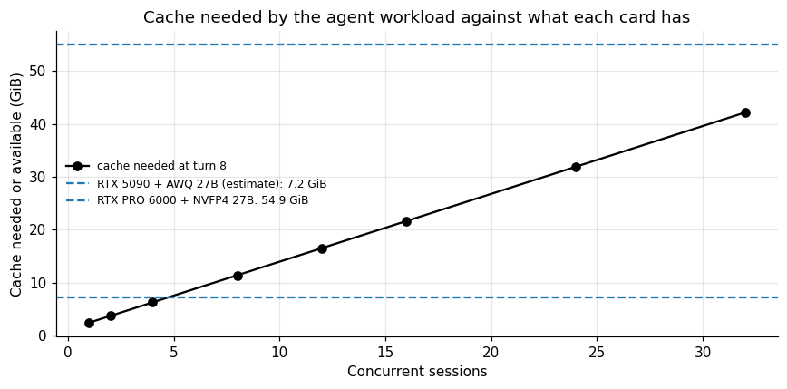

*Figure 8. Cache needed by the agent workload against what each card has.*

At the eighth turn a session holds about 24,950 tokens, of which 12,000 are the shared prefix. Eight sessions therefore need 12,000 plus eight times 12,950, which is about 115,600 tokens, or 11.4 GiB of cache at 0.1012 MiB per token. A 32 gigabyte card running the AWQ build, at 90 percent memory use and about 3.8 GiB of overhead, had an estimated 7.2 GiB left, room for about 73,000 tokens, which would be enough for four sessions (63,000 tokens) and not for eight. That was my estimate before I read the server log, which is shown below. The PRO 6000 running NVFP4 has an estimated 54.9 GiB of cache, 555,000 tokens, which holds the eight sessions many times over and would hold roughly 40 sessions of this size.

The start log of the 5090 server in this study has the figures that I had estimated. These lines are selected from it:

```
INFO 10-27 22:13:47 [api_utils.py:286] non-default args: {'model_tag': '/workspace/models/awq', 'host': '127.0.0.1', 'port': 18000, 'model': '/workspace/models/awq', 'trust_remote_code': True, 'max_model_len': 98304, 'served_model_name': ['qwen-abliterated'], 'reasoning_parser': 'qwen3', 'max_num_se
INFO 10-27 22:14:50 [model_runner.py:428] Model loading took 17.8 GiB memory and 11.891527 seconds
INFO 10-27 22:18:57 [gpu_worker.py:640] Available KV cache memory: 8.66 GiB
INFO 10-27 22:18:57 [kv_cache_utils.py:2395] GPU KV cache size: 134,795 tokens, Maximum concurrency for 98,304 tokens per request: 1.37x
```

The server had 8.66 GiB for the cache and room for 134,795 tokens, against my estimate of 7.2 GiB and 73,000 tokens. It was started with a context limit of 98,304 tokens, which is why it reports a concurrency of 1.37 for requests of that length. The ratio of the two figures is 0.066 MiB per token, against the 0.1012 I took from the quantization article. Eight sessions need 115,600 tokens by my count, 86 percent of that pool, and the counters peaked at 81 percent. On paper the eight sessions fit, so the explanation I give in the next paragraph rests on an estimate that the log contradicts. Table 6 and Figure 7 still use my earlier figure of 0.1012 MiB per token.

The estimate seemed to line up with what happened. At four sessions the 5090 worked, slowly, with first-token times of 4 to 7 seconds. At eight, where my estimate had demand exceeding supply by more than half, it degraded to 20 to 39 seconds. The estimate is crude, because it ignores the engine's block granularity and any memory the 5090 run reserved differently, and given the start log below I no longer claim that the location of the cliff follows from it.

## 10. What this means for sizing an agent service

Three quantities decide the card: the prompt length per session, the number of sessions you want in memory at once, and how much of the prompt is shared.

Cache per session is about 0.1 MiB per token. A 25,000-token session costs 2.5 GiB; a 100,000-token session costs about 10 GiB. A card with 55 GiB of free cache holds about 22 sessions at 25,000 tokens, or 5 at 100,000 tokens.

Shared prefixes cost memory once. If every session begins with the same 12,000-token system prompt, as in this test, that prefix is stored once, and each session pays only for its own history. In the test, sharing saved about 8.3 GiB across eight sessions.

When memory runs out, the cache stops working, and the symptom is not an error but a latency cliff that looks like a slow model. If you see median first-token time jump as sessions increase while GPU utilization looks normal, check the cache first.

## 11. Writing prompts that cache well

Prefix caching only helps if the start of the prompt does not change. Put stable content first: system prompt, tool definitions, reference documents. Put the changing content last: the newest user message. Do not put a timestamp, a request identifier or a random example at the top of the prompt, because any difference in the first tokens invalidates everything after them. Append to the history instead of rewriting it, so that the previous turn's prompt is a prefix of the next. These are practical recommendations that follow from how a prefix cache works, and I did not run an experiment on each.

## 12. A model of cold prefill time

The four cold-prefill points per card are enough to fit a simple cost model. Attention work grows with the square of the prompt length while the feed-forward work grows linearly, so prefill time should follow a quadratic: a linear term for the layers that touch each token once, and a squared term for attention.

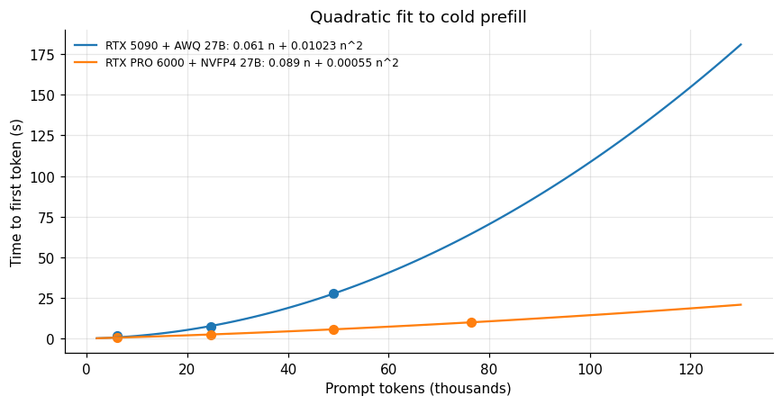

*Figure 9. Quadratic fit to cold prefill.*

**Table 7.** A model of cold prefill time

|  | 25 | 50 | 100 | 128 |
|---|---|---|---|---|
| RTX 5090 + AWQ 27B | 7.9 | 28.6 | 108.4 | 175.4 |
| RTX PRO 6000 + NVFP4 27B | 2.6 | 5.8 | 14.4 | 20.4 |

For the PRO 6000 the fit is close to linear. It predicts 2.6 seconds at 25,000 tokens, 5.8 at 50,000, 14.4 at 100,000 and 20.4 at 128,000, and the 10.0 seconds measured at 76,458 tokens sits on the curve. For the 5090 the squared term is far larger, and the fit predicts 7.9 seconds at 25,000 tokens, 28.6 at 50,000, 108 at 100,000 and 175 at 128,000. Four points per card fit a two-parameter curve well but say little about extrapolation, and I do not take the 128,000-token predictions as numbers. The fit is useful as a statement of shape: on the larger card prefill scales almost linearly through the range I tested, and on the smaller one it is dominated by the quadratic term, which I first read as a card operating under memory pressure, and the server log does not confirm that.

## 13. The spread and the median

A median hides the bad turns, and in an agent loop one slow turn stalls the whole task. The distribution of first-token times across all requests shows how often that happens.

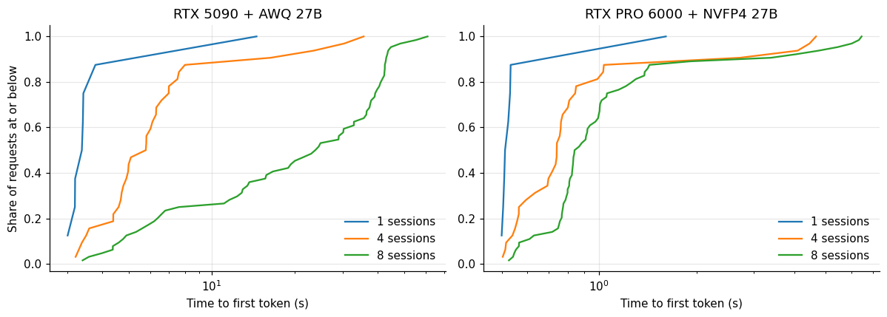

*Figure 10. The spread and the median.*

**Table 8.** The spread and the median

|  | Sessions | P50 | P90 | P95 | Max |
|---|---|---|---|---|---|
| RTX 5090 + AWQ 27B | 1 | 3.4 | 7.03 | 10.8 | 14.58 |
| RTX 5090 + AWQ 27B | 4 | 5.79 | 15.55 | 26.56 | 35.71 |
| RTX 5090 + AWQ 27B | 8 | 24.16 | 43.04 | 44.65 | 60.9 |
| RTX PRO 6000 + NVFP4 27B | 1 | 0.52 | 0.86 | 1.23 | 1.61 |
| RTX PRO 6000 + NVFP4 27B | 4 | 0.74 | 2.55 | 4.26 | 4.67 |
| RTX PRO 6000 + NVFP4 27B | 8 | 0.85 | 2.94 | 5.34 | 6.45 |

On the PRO 6000 with eight sessions the median was 0.85 seconds, the 95th percentile 5.34 and the maximum 6.45, and the slowest requests were the first turns, where the shared prefix is being computed. Every request after the first turn stayed under about 1.5 seconds in the one-session case, and the slowest requests in the eight-session case were the first-turn ones. The tail is the cold start, and it is predictable.

The 5090 tells a different story. With eight sessions the median was 24.16 seconds and the 95th percentile 44.65. Half of all requests waited longer than 24 seconds for the first token, which is not a tail problem but a regime change. Even with four sessions the 95th percentile was 26.56 seconds against a median of 5.79, so about one request in twenty took more than four times the typical wait.

## 14. Where the time goes within a turn

A turn has a prefill part, ending at the first token, and a decode part, from the first token to the last. For short replies the decode part is small, so the share of the turn spent waiting is a way to see how much a faster decode could help.

**Table 9.** Where the time goes within a turn

|  | 1.0 | 4.0 | 8.0 |
|---|---|---|---|
| RTX 5090 + AWQ 27B | 0.74 | 0.64 | 0.56 |
| RTX PRO 6000 + NVFP4 27B | 0.83 | 0.84 | 0.84 |

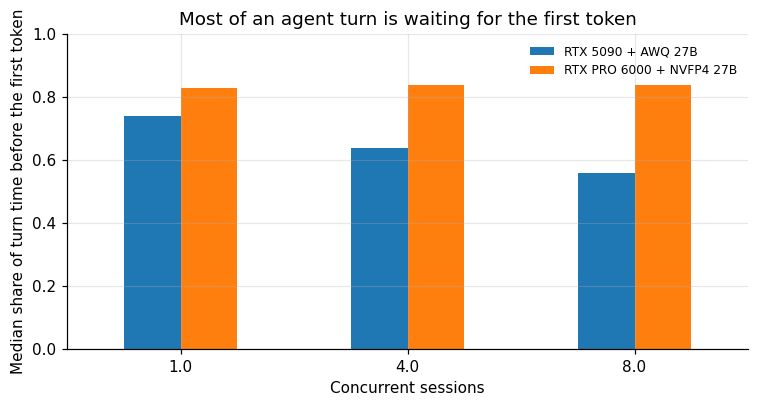

*Figure 11. Most of an agent turn is waiting for the first token.*

In these turns, which are mostly 24-token replies, the median turn on the PRO 6000 spent 83 to 84 percent of its time before the first token at every load. On the 5090 the share was 74 percent with one session and fell to 56 percent with eight. The 5090's share fell because its decode slowed to under 10 tokens per second at eight sessions, so even a 24-token reply took seconds, and decode became a larger part of an already long turn. For the PRO 6000, a faster decode would barely change an agent that writes short replies. The only levers that matter for it are prefill speed, cache hit rate and cache capacity, and the speculative decoding that helps chat does very little here, a point I made with measurements in the article on speculation.

## 15. Sessions per card and cost per session-hour

Combining the cache arithmetic with the prices gives a capacity-based comparison that does not depend on how fast each card runs a turn.

**Table 10.** Sessions per card and cost per session-hour

|  | 16500 | 25000 | 50000 | 100000 |
|---|---|---|---|---|
| RTX 5090 + AWQ 27B (estimate) | 13 | 4 | 1 | 0 |
| RTX PRO 6000 + NVFP4 27B | 120 | 41 | 14 | 6 |

**Table 11.** Sessions per card and cost per session-hour (part 2)

|  | 16500 | 25000 | 50000 | 100000 |
|---|---|---|---|---|
| RTX 5090 + AWQ 27B (estimate) | 0.047 | 0.152 | 0.609 | – |
| RTX PRO 6000 + NVFP4 27B | 0.013 | 0.037 | 0.108 | 0.252 |

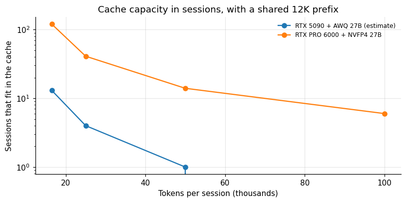

*Figure 12. Cache capacity in sessions, with a shared 12K prefix.*

At 25,000 tokens per session, the cache of the PRO 6000 holds about 41 sessions and that of the 5090 about 4. At 50,000 tokens the counts are about 14 and 1. At 100,000 tokens they are about 6 and 0. In price terms, a session-hour costs about 0.037 dollars on the PRO 6000 at 25,000 tokens and about 0.15 dollars on the 5090, and at 100,000 tokens about 0.25 dollars on the PRO 6000 while the 5090 cannot hold one session in the way this workload keeps its history.

The caveat is that a session held in cache is not a session being served. A card that holds 42 sessions in memory may be unable to serve them all at once, and the turns per minute figures above show how throughput scales. Capacity in memory and capacity in compute are two limits, and the smaller is the real one. On the PRO 6000 the compute limit was not reached at eight sessions (116 turns per minute and still rising). On the 5090 something other than compute limited throughput, and I attributed it to memory before the server log showed a pool larger than my estimate.

## 16. What longer contexts would cost

The test stops at about 25,000 tokens per session. Products that hand a model whole documents or repositories reach 100,000 tokens or more, and the numbers extend in a predictable way.

**Table 12.** What longer contexts would cost

| Session tokens | Cache GiB per session | Pro6000 cold TTFT s linear fit |
|---|---|---|
| 25,000 | 2.47 | 2.56 |
| 50,000 | 4.94 | 5.81 |
| 100,000 | 9.88 | 14.37 |
| 128,000 | 12.65 | 20.36 |

A 100,000-token session needs about 9.9 GiB of cache, the same as the weights of a mid-sized model, so a card with 55 GiB free holds about five of them. The cold first token for such a prompt takes about 10 seconds at 76,000 tokens on the PRO 6000 and a fitted 14 seconds at 100,000, which a prefix cache brings to under a second on later turns, but only for as long as the session stays in cache. A service that offers long contexts has to decide what happens when the cache fills: evict the least recently used session and pay a ten-second penalty at its next turn, or refuse new sessions. That is a product decision with a measurable cost, and the numbers in this article are the inputs to it.

## 17. Questions I expect

**Is the 5090 a bad card for agents?** It is a fast card with 32 gigabytes, and the weights of a 27 billion parameter model take more than half of that. My first reading was that the memory left over for context is the problem. The server counters leave that open, and I did not test a smaller model or a smaller context. For a 9 billion parameter model the same card would hold several times more sessions.

**Why not use a shorter system prompt?** You should, if you can. Every thousand tokens you remove saves cache for each concurrent session and prefill time on every cache miss. The shared prefix is the cheap part, because it is stored once, so trimming each session's own history matters more.

**Does prefix caching change the model's outputs?** It should not. It reuses attention state that the model would have computed again, so the same tokens come out. I did not compare outputs with and without it.

**How does this change with reasoning mode?** A reasoning model writes long hidden chains of thought, which makes the decode part of a turn much longer and weakens the dominance of prefill. This test used short replies.

**What if the cache hit rate is 50 percent?** The turn time is a mixture of the cold and warm cases, roughly the average of the two. The measurements bracket it: for a 25,000-token prompt on the PRO 6000, about 0.4 seconds warm and 2.5 seconds cold.

## 18. The first turn: a cold start that is easy to avoid

Every agent session pays for its first turn in full. The 12,000-token system prefix is the same for every session, so it only needs to be computed once, but at the start of the test all sessions arrive together, and the server cannot reuse what it has not finished computing.

**Table 13.** The first turn: a cold start that is easy to avoid

| Config | Sessions | First turn TTFT | Prompt | Later turn TTFT | Cold start penalty s | Ratio |
|---|---|---|---|---|---|---|
| RTX 5090 + AWQ 27B | 1 | 14.58 | 16,459 | 3.4 | 11.18 | 4.29 |
| RTX 5090 + AWQ 27B | 4 | 26.9 | 16,514 | 5.05 | 21.85 | 5.33 |
| RTX 5090 + AWQ 27B | 8 | 39.04 | 16,515 | 26.94 | 12.1 | 1.45 |
| RTX PRO 6000 + NVFP4 27B | 1 | 1.61 | 16,459 | 0.52 | 1.09 | 3.1 |
| RTX PRO 6000 + NVFP4 27B | 4 | 4.28 | 16,514 | 0.73 | 3.55 | 5.9 |
| RTX PRO 6000 + NVFP4 27B | 8 | 5.1 | 16,515 | 0.83 | 4.27 | 6.15 |

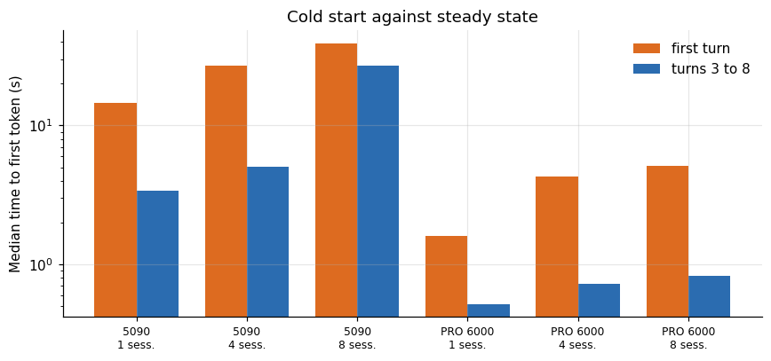

*Figure 13. Cold start against steady state.*

On the PRO 6000 the first turn took 1.61 seconds for a single session, which is what a cold 16,459-token prompt should take at the card's 10,000 tokens per second. With four sessions it took 4.28 seconds, and with eight 5.10 seconds, three times the single-session figure, because all sessions are asking for the same shared prefix at once. After the first turn, the median wait fell to 0.51 to 0.83 seconds. The first turn was between 3 and 6 times slower than the later ones. On the 5090 the first turn took 14.58 seconds for one session, 26.90 for four and 39.04 for eight.

The fix is cheap: send one request with the shared prefix before opening the service to traffic, so that the prefix is in the cache when the first real session arrives. If the prefix is warm, the first turn only has to compute the roughly 4,500 tokens that are new, about 0.45 seconds at the PRO 6000's prefill speed. That is an estimate from the measured speed and not a measurement, and I did not run the pre-warmed case. The same trick has to be repeated after every restart of the server and, for a service that scales out, on every new replica.

## 19. How the short-prompt capacity relates to the agent capacity

The cost article in this series applied a derate of 0.6 to the short-prompt capacity of the PRO 6000 to estimate agent capacity. The long-context measurements let me check that rule against direct evidence.

In the short-prompt load test, the NVFP4 build on the PRO 6000 produced 1,364 output tokens per second at thirty-two users within the service level. In the agent test it completed 116 turns per minute at eight sessions, which at about 24 output tokens per turn is only 46 output tokens per second. The two numbers measure different work: the short-prompt load is decode-bound and the agent load is prefill-bound, and the output token rate is a poor measure of the second.

A better comparison is time per turn. Eight sessions finished 64 turns in 33.2 seconds, so the card completed a turn every 0.52 seconds on average while serving all eight sessions, and the per-session time to first token stayed near 0.8 seconds. The throughput was still rising with the number of sessions (37, 84 and 116 turns per minute at one, four and eight sessions), so the card had not reached its limit in this test. That is why I cannot turn the agent result into a clean derate of the short-prompt capacity. What I can say is that for a workload dominated by long prompts the natural unit of capacity is turns per minute at a stated prompt length, and this article measured it for two cards.

## 20. What I would change in the test

Four changes would make the experiment better.

Stagger the sessions. Starting all sessions together exaggerates the cold start and makes the first-turn times a worst case. A real service sees arrivals spread out.

Vary the prompts. The synthetic text is uniform. A realistic mix of code, tool output and prose would show whether the prefill speed depends on content.

Report cache hits directly. The server I used did not return cached token counts in the usage field. A version that exposes them, or a scrape of the server's metrics endpoint during the run, would replace my inference from timings with a count.

Add a quality probe. Place a fact at a known position in the context and ask for it at the end. A card that processes 100,000 tokens in ten seconds and then forgets the first thousand has not solved the problem. I did not run this test, and any claim about long-context usefulness needs it.

I would also repeat the 5090 eight-session run, because its behavior in the overloaded regime is erratic and I have one sample.

## 21. What this test does not show

It does not show correctness at long context. A model can read a hundred thousand tokens quickly and still fail to use what is in them, and accuracy at long context is a separate measurement.

It uses synthetic text. Real agent histories contain code, tool output and conversation, which tokenize differently and may compress differently in attention.

It runs each configuration once. The sessions are concurrent but the whole experiment is a single pass, and the 8-session run on the 5090 is one sample of a regime where behavior is erratic.

It compares two different builds on two different cards. The 5090 ran a 4-bit AWQ build that, as the compatibility article showed, rejected ten-thousand-token prompts in the short-prompt load test; here it was served with a configuration that accepts long prompts. The PRO 6000 ran NVFP4 with speculative decoding. The difference in results is a difference of card and configuration together.

It does not include the prefix cache hit counters, because the server did not report cached tokens in the usage block. I infer hits from time to first token.

One more reading of the data is worth stating for readers who plan capacity. The two setups differ by a factor of 3 to 6 in cold prefill speed, but the prefix cache narrows the gap in practice: with the shared prefix cached, the 5090 read a 49,000-token prompt in 3.2 seconds, against 27.7 seconds cold, which is the difference between an agent that feels stuck and one that feels slow. The cache is therefore worth more on the smaller card than on the larger one in absolute seconds, and a deployment on the 5090 should treat the warm-up request and the stability of the prefix as part of the design and not as an optimization.

| Claim in this article | Evidence behind it | Caveat |
|---|---|---|
| Cold prefill on the PRO 6000 ran at 7,600 to 10,300 tokens per second | Table 1, server usage counts and client timings | One run per prompt length |
| A warm prefix is worth 2 to 33 times | Table 2, time to first token cold and warm | Best case, the same prompt just sent. The cached-token field was empty, so hits are inferred from timings and from the server's cumulative counter |
| The 5090 slowed sharply with eight sessions | Tables 4, 5 and 8 and the server counters (figure in section 7) | One run of an erratic regime |
| The slowdown is a cache problem | Hit rate fell from about 87 to about 59 percent in the eight-session phase | The pool never filled (81 percent at most) and the start log shows 134,795 tokens against my estimate of 73,000, so I treat the cause as unconfirmed |
| Per turn the PRO 6000 is the cheaper card | Table 5, with median rental prices | Different card and different build together, and prices are marketplace medians |

## 22. Limitations

The cache arithmetic rests on a per-token cache cost derived from four server logs on one card and an estimate of overhead, extrapolated to a card I did not measure in that way. The 12,000-token shared prefix and the eight turns are my choices, and other shapes will behave differently. Sessions start together, so the first turn contends in a way a staggered real workload would not. I did not test the 100,000-token prompt on the 5090. Prices are medians of marketplace rentals.

## 23. How much it cost

The two long-context studies ran inside two rentals. The PRO 6000 study was part of a session that cost 0.43 dollars in total, which also ran a behavior battery. The 5090 study was part of a session that cost 1.32 dollars and also ran the stability test described elsewhere in this series. The 5090 run's 527-second eight-session test alone cost about 0.09 dollars at 0.609 dollars per hour. The campaign as a whole cost US$ 50.79. This analysis ran on Kaggle's free notebooks.

## 24. Reproducing this analysis

Attach the dataset `gpu-ai-benchmark-campaign-2026`. The file `longctx_runs.csv` has one row per request with the phase, prompt and completion counts, time to first token and derived speeds. The load generator `longctx.py` is in the repository `llm-serving-engines-bench`.

## 25. Glossary

- **Prefill**: the parallel pass over the prompt before the first token.
- **Decode**: generating tokens one at a time.
- **Prefix cache**: stored attention state reused when a new prompt starts with a previously processed prefix.
- **KV cache**: the stored attention keys and values.
- **Eviction**: removing cache entries to make room.
- **Turn**: one request in an agent loop.
- **Session**: one agent conversation.
- **Warm**: served with a cache hit.
- **Cold**: no cache hit.

Lucas Rangel
