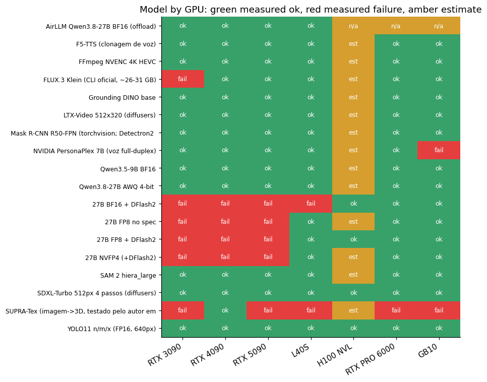
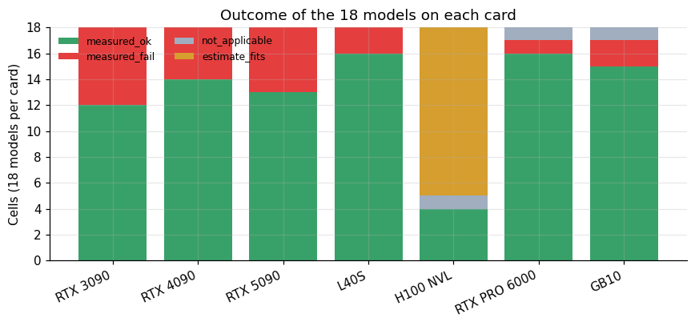
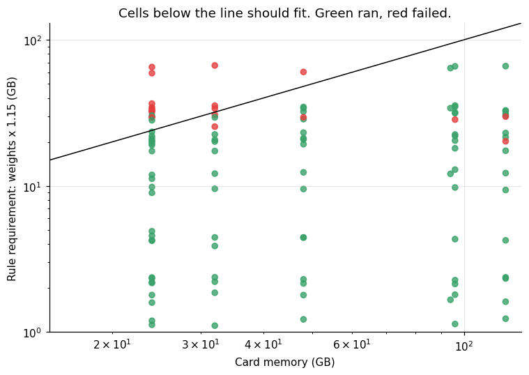
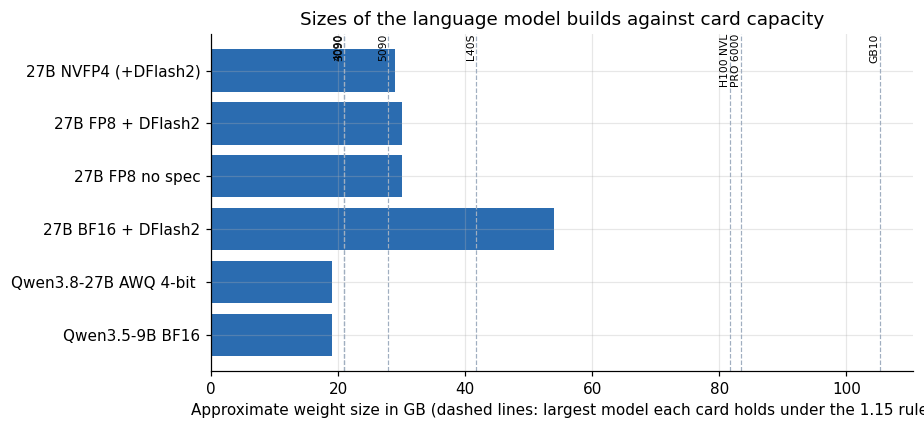
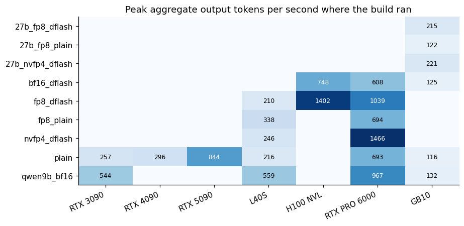
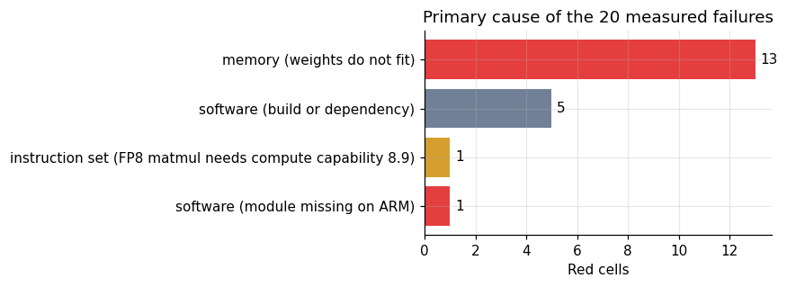
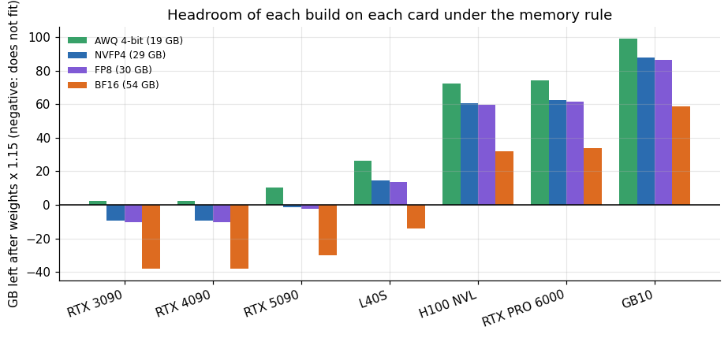

# What fits and what fails across seven GPUs

**Lucas Rangel** · [Kaggle writeup](https://www.kaggle.com/writeups/lucasrangelss/what-fits-and-what-fails-across-seven-gpus) · [Executable notebook](https://www.kaggle.com/code/lucasrangelss/what-fits-and-what-fails-across-seven-gpus) · [Code and data](https://github.com/LucasRangelSSouza/gpu-ai-benchmark-hub) · [Dataset](https://www.kaggle.com/datasets/lucasrangelss/gpu-ai-benchmark-campaign-2026)

## Abstract

I ran 18 models and tools on seven NVIDIA cards and wrote down, cell by cell, what happened. A cell is a model on a card, and its outcome is one of four things: it ran and produced a measurement, it failed in a way I observed, it does not apply, or I only estimated it from memory arithmetic. The grid has 126 cells.

The counts are 90 measured successes, 20 measured failures, 3 cells where the test makes no sense, and 13 estimates, all on a single card, the H100 NVL, which I left out of the campaign to save money. So 110 of the 126 cells, or 87 percent, are things I saw with my own eyes.

Four findings matter more than the grid itself:

- A simple memory rule predicts the outcome of 103 of the 110 measured cells (94 percent). The rule is weights times 1.15, plus room for the KV cache, must fit in video memory. The seven cells where it failed are the most useful part of this article, because each one exposes something other than memory.
- On the 27 billion parameter language model, the card decides the precision you can use. 24 gigabyte cards run only the 4-bit AWQ build. The 32 gigabyte RTX 5090 runs AWQ and nothing larger. The 48 gigabyte L40S runs FP8 and NVFP4 but not BF16. Only the 96 and 121 gigabyte machines run everything I tried.
- One written claim in my own notes was wrong. I had recorded that NVFP4 needs a Blackwell card. The L40S, which is an Ada card, ran the NVFP4 checkpoint and produced measurements.
- Failures that look like memory problems are often software problems. A 4090 and a 3090 have the same 24 gigabytes, yet the image model FLUX.3 Klein ran on one and crashed on the other, for a reason that has nothing to do with memory.

The notebook builds every table and figure from the attached dataset.

> **Code and data.** Everything behind this article is public: the code that ran, the curated data, the analysis that regenerates every figure, and tests that pin the conclusions to the data. Repositories: [llm-serving-engines-bench](https://github.com/LucasRangelSSouza/llm-serving-engines-bench), [vast-gpu-benchmark-harness](https://github.com/LucasRangelSSouza/vast-gpu-benchmark-harness). Index of the whole series: [gpu-ai-benchmark-hub](https://github.com/LucasRangelSSouza/gpu-ai-benchmark-hub).

## 1. What I was trying to find out

If you rent a GPU to run a model, the first question is whether it will run at all. The second is how fast. Most published benchmarks answer the second question for configurations that run, and say little about the first. A reader who owns a 3090 wants to know which of the models in a tutorial will crash on it. A team picking a card to rent wants to know the cheapest card that holds a given model.

I wanted a map from model to card that records failures as carefully as successes. A failure is a result. It saves the next person a rental. So the grid below treats "does not load" with the same status as "ran at 400 tokens per second".

## 2. What counts as a cell

The matrix has 18 rows and 7 columns. The rows are:

- Six language model configurations: the 27 billion parameter model in NVFP4, FP8 with speculative decoding, FP8 without it, BF16 with speculative decoding, a 4-bit AWQ build, and a 9 billion parameter model in BF16.
- Four vision models: YOLO11, SAM 2, Grounding DINO and Mask R-CNN.
- Eight media and voice tools: SDXL-Turbo, LTX-Video, F5-TTS, FFmpeg NVENC encoding, AirLLM offloading, FLUX.3 Klein, NVIDIA PersonaPlex 7B and the 3D tool SUPRA-Tex.

The columns are the RTX 3090 (24 GB), RTX 4090 (24 GB), RTX 5090 (32 GB), L40S (48 GB), H100 NVL (94 GB), RTX PRO 6000 (96 GB) and the GB10 (121 GB, an ARM machine with unified memory).

Each cell has one of four states in the dataset: `measured_ok`, `measured_fail`, `not_applicable` and `estimate_fits`. A measured cell means I ran the test on that card and recorded the log. An estimate is memory arithmetic only. The classification comes from the evidence in each cell, not from my later opinion of it.

## 3. The grid



*Figure 1. Model by GPU: green measured ok, red measured failure, amber estimate.*

The shape of the grid is what you would guess from the memory sizes, with exceptions. The left part of the language model block is red for everything bigger than AWQ: the RTX 3090, RTX 4090 and RTX 5090 columns fail on the FP8, NVFP4 and BF16 builds of the 27 billion parameter model. The right part is green. Vision models are green everywhere I measured. The media block is mostly green with red spots that deserve their own paragraphs below.

## 4. A scorecard per card

**Table 1.** A scorecard per card

|  | Estimate fits | Measured fail | Measured ok | Not applicable | Measured total | Ok rate |
|---|---|---|---|---|---|---|
| RTX 3090 | 0 | 6 | 12 | 0 | 18 | 0.67 |
| RTX 4090 | 0 | 4 | 14 | 0 | 18 | 0.78 |
| RTX 5090 | 0 | 5 | 13 | 0 | 18 | 0.72 |
| L40S | 0 | 2 | 16 | 0 | 18 | 0.89 |
| H100 NVL | 13 | 0 | 4 | 1 | 4 | 1 |
| RTX PRO 6000 | 0 | 1 | 16 | 1 | 17 | 0.94 |
| GB10 | 0 | 2 | 15 | 1 | 17 | 0.88 |



*Figure 2. Outcome of the 18 models on each card.*

Per card, the measured success counts are: GB10 15 of 17 measured cells, L40S 16 of 18, RTX PRO 6000 16 of 17, RTX 4090 14 of 18, RTX 5090 13 of 18, RTX 3090 12 of 18, and H100 NVL 4 of 4. The H100 figure is a trap: it measured only the four cells I ran there, so a 100 percent rate says nothing about the other 13 cells.

The RTX 3090 failed the most cells, six, and the RTX 5090 failed five. Their reasons differ. The 3090 loses cells to both memory and age: it lacks the hardware path that FP8 needs. The 5090 loses cells to a memory limit that sits just below the model sizes people want, 32 gigabytes against 28 to 30 gigabytes of weights plus cache.

## 5. The memory rule and how often it was right

My planning rule is that a model needs about its weight size times 1.15, plus room for the context cache. It is a crude rule. How crude? I can test it against the 110 measured cells.

**Table 2.** The memory rule and how often it was right

| False | True |
|---|---|
| 15 | 2 |
| 5 | 88 |



*Figure 3. Cells below the line should fit. Green ran, red failed.*

The rule agrees with the outcome in 103 of 110 measured cells (93.6 percent). In 88 cells the rule said the model fits and it ran. In 15 cells the rule said it does not fit and it failed. That is the boring majority, and it is useful: if you only have an hour, the arithmetic gets you almost all the way.

The 7 disagreements split into two groups of different character, and each group teaches something.

Five cells were predicted to fit and failed:

- PersonaPlex 7B on the GB10. The failure is a missing Python module, `moshi.offline`, in an ARM environment. The model would fit in memory. The software stack for it does not exist for that architecture in the form I tried.
- SUPRA-Tex, a 3D reconstruction tool, on the RTX 5090, RTX PRO 6000, L40S and GB10. The tool pins specific CUDA toolchain versions and builds native extensions, and the attempts failed for different reasons at different times. On the 5090 and the PRO 6000 the build of a native extension (CuMesh) failed. The same step had failed on an RTX 4090 earlier that day and passed after I changed how the CUDA 12.4 toolkit was installed, a fix I did not re-run on the Blackwell cards. On the L40S the dependencies installed and the example script died on a missing imaging library. On the GB10 the installer stopped because a pinned wheel exists only for x86_64. Only the last is a property of the platform.

The three kinds of failure each have a line. On the 5090 the native extension stopped in the build tool's choice of CUDA architecture, and the log of the PRO 6000 session ends with the same two lines. On the L40S the example script died on a missing imaging module. On the GB10 the installer stopped on a pinned wheel.

```
      ValueError: Unknown CUDA arch (12.0) or GPU not supported
Failed to build cumesh
ModuleNotFoundError: No module named 'PIL'
ERROR: The pinned NATTEN 0.17.5 wheel requires Linux x86_64.
```

The same CuMesh message also appears in the log of the first 4090 attempt, a card that is not Blackwell:

```
      ValueError: Unknown CUDA arch (12.0) or GPU not supported
```

A message about architecture 12.0 on an Ada card means the build was asked for an architecture the card does not have, and I do not know why. This is one more reason to read the SUPRA-Tex cells as a record of my environment on that day.

For PersonaPlex, the log of the run holds one line, and the install log of the same session explains where the module went. Lines were selected from the install log.

```
/workspace/g/pp/.venv/bin/python: No module named moshi.offline

error: Failed to build `sphn==0.1.12`
         Computed rustc target triple: aarch64-unknown-linux-gnu
             Compatibility with CMake < 3.5 has been removed from CMake.
hint: `sphn` (v0.1.12) was included because `moshi-personaplex` (v0.1.0) depends on `sphn`
```

The module is missing because the install of a dependency, `sphn`, failed while building a native part from source for the aarch64 target. The failing step is a CMake configuration of a bundled library that rejects the project's minimum CMake version. That is a build problem of one dependency in my environment. The log does not show whether a newer release or another version of CMake would have worked, and I did not try.

These five say the same thing: memory is a necessary condition and software is the sufficient one. A card with plenty of memory can still be useless if the project's binary dependencies do not exist for it.

Two cells were predicted not to fit and ran:

- FLUX.3 Klein on the 24 gigabyte RTX 4090. The tool's weights are in the 26 to 31 gigabyte range, more than the card holds. It ran in 39 seconds of wall time. I did not isolate how it fits. The log shows only that it ran, so the rule's assumption that every weight lives in video memory evidently does not hold for this tool.
- SUPRA-Tex on the RTX 4090. Its author tested it on a 3090 with 24 gigabytes, so the rule should have been conservative and instead the 4090 ran it to the end, twice. The log of each run ends with the path of the textured GLB and a silhouette overlap of 0.991 between the reconstructed geometry and the input image, after 1.4 to 1.6 minutes in the final mesh stages. I did not retrieve the GLB file from the rented machine before it was destroyed, so the evidence is the log and not the file. The article on image-to-3D tells the whole story of the ten attempts.

These are the two lines of the second 4090 run that the paragraph refers to, selected from its log:

```
Observation: silhouette IoU 0.991 (geometry inside image 0.998, image covered 0.993); admitted 311631 of 317044 trusted pixels (missed geometry 32, depth edge 5381)
Textured mesh: /workspace/g/st/outputs/spiny_whelk_shell.glb
```

**Table 3.** The memory rule and how often it was right (part 2)

|  | Model | GPU | Approx VRAM GB | VRAM | State |
|---|---|---|---|---|---|
| 106 | FLUX.3 Klein (CLI oficial, ~26-31 GB) | RTX 4090 | 26 | 24 | measured_ok |
| 118 | NVIDIA PersonaPlex 7B (voz full-duplex) | GB10 | 18 | 121 | measured_fail |
| 120 | SUPRA-Tex (imagem->3D, testado pelo autor em | RTX 4090 | 24 | 24 | measured_ok |
| 121 | SUPRA-Tex (imagem->3D, testado pelo autor em | RTX 5090 | 24 | 32 | measured_fail |
| 122 | SUPRA-Tex (imagem->3D, testado pelo autor em | L40S | 24 | 48 | measured_fail |
| 124 | SUPRA-Tex (imagem->3D, testado pelo autor em | RTX PRO 6000 | 24 | 96 | measured_fail |
| 125 | SUPRA-Tex (imagem->3D, testado pelo autor em | GB10 | 24 | 121 | measured_fail |

## 6. The 27 billion parameter model, precision by precision

The language model rows are the ones people ask about most, so here they are in detail. The same model comes in several precisions, and each needs a different amount of memory.



*Figure 4. Sizes of the language model builds against card capacity.*

The builds weigh about 19 gigabytes for the AWQ 4-bit version, 29 for NVFP4, 30 for FP8 and 54 for BF16, with the 9 billion parameter model in BF16 at 19. Dividing each card's memory by 1.15 gives the largest weight size it can host: 20.9 gigabytes for a 24 gigabyte card, 27.8 for the 5090, 41.7 for the L40S. Read the dashed lines in the figure against the bars. AWQ and the 9 billion model sit left of the 24 gigabyte line. NVFP4 and FP8 sit between the 5090 and the L40S. BF16 sits right of the L40S and left of the H100.

Now the measured outcomes by precision:

- AWQ 4-bit ran on every card I measured, with a peak of 257 tokens per second aggregate on the 3090, 296 on the 4090, 844 on the 5090, 216 on the L40S, 693 on the PRO 6000 and 116 on the GB10.
- FP8 without speculative decoding failed on the 3090, 4090 and 5090 and ran on the L40S (337.5 tokens per second peak), the PRO 6000 (694) and the GB10 (122).
- FP8 with speculative decoding behaved the same, and the H100 NVL measured 1,402 tokens per second at its peak.
- NVFP4 failed on the 3090, 4090 and 5090 and ran on the L40S (246), the PRO 6000 (1,466) and the GB10 (221).
- BF16 with speculative decoding failed everywhere except the H100 NVL (748), the PRO 6000 (608) and the GB10 (125).

The numbers in parentheses are the highest aggregate output speed I recorded for that configuration at any concurrency level in the load tests. They are peaks, so they say what a card can do under heavy load. Per-user speed at light load is a different number, discussed in the companion articles on serving.

**Table 4.** The 27 billion parameter model, precision by precision

|  | RTX 3090 | RTX 4090 | RTX 5090 | L40S | H100 NVL | RTX PRO 6000 | GB10 |
|---|---|---|---|---|---|---|---|
| 27b_fp8_dflash | – | – | – | – | – | – | 215 |
| 27b_fp8_plain | – | – | – | – | – | – | 122 |
| 27b_nvfp4_dflash | – | – | – | – | – | – | 221 |
| bf16_dflash | – | – | – | – | 748 | 608 | 125 |
| fp8_dflash | – | – | – | 210 | 1,402 | 1,039 | – |
| fp8_plain | – | – | – | 338 | – | 694 | – |
| nvfp4_dflash | – | – | – | 246 | – | 1,466 | – |
| plain | 257 | 296 | 844 | 216 | – | 693 | 116 |
| qwen9b_bf16 | 544 | – | – | 559 | – | 967 | 132 |



*Figure 5. Peak aggregate output tokens per second where the build ran.*

The heat map shows where the work is possible, and also where the results thin out. The blank cells are not zeros. They are combinations that failed to load or that I did not run.

## 7. A caution about comparing the peaks

The peak numbers above come from a single load generator that sends a mix of requests: chat, code refactoring, JSON generation and a long-document summary. The long-document request is about 30,000 characters of source code, which is roughly ten thousand tokens, and it makes up 15 percent of the mix.

Not every server configuration accepted that request. Servers I started with a small maximum context length answered it with an HTTP 400 error, "prompt too long", and the load generator counted that as an error. The pattern is consistent across the dataset: in 169 valid load-test rows, every error is a rejected long prompt, and the rows with rejections are the AWQ 4-bit and 9 billion parameter configurations on the smaller cards. In the NVFP4, FP8 and BF16 runs on the 96 and 121 gigabyte machines and the H100, the long prompt was accepted and served, with zero errors.

The serving file makes the pattern visible. This table takes, for each configuration, the load level that gave the peak speed, and lists the long prompts that were rejected at that level.

**Table 4a.** Rejected long prompts at the peak load level

| Card and build | Users | Requests | Completed | Rejected with HTTP 400 | Peak tokens per second |
|---|---|---|---|---|---|
| RTX 3090, AWQ | 16 | 44 | 39 | 5 | 257 |
| RTX 5090, AWQ | 16 | 97 | 85 | 12 | 844 |
| L40S, AWQ | 8 | 33 | 27 | 6 | 216 |
| RTX PRO 6000, AWQ | 16 | 83 | 72 | 11 | 693 |
| RTX PRO 6000, NVFP4 + speculative | 32 | 246 | 246 | 0 | 1,466 |

Across all valid rows, 67 rows have errors, and in every one the number of errors equals the number of rejected long prompts. The AWQ rows on the 5090 and the PRO 6000 show the effect: both finished 100 percent of the prompts that the server accepted and rejected the long ones, while the NVFP4 build on the PRO 6000 completed every request.

This matters for two reasons. First, an error count above zero in the dataset does not mean the server crashed. It means the configuration could not hold a ten thousand token prompt. The dataset records the number of rejected long prompts in its own column, `long_prompt_rejected_http400`, so that you can tell the two cases apart. Twelve other rows, from engine comparison runs where the server had not started, contain only connection errors, and I marked them as invalid runs and excluded them from every table.

Second, the peak throughput of a configuration that rejected the long prompts excludes 15 percent of the requests. Those requests are cheaper than their length suggests, because the document text is identical in every request and a prefix cache serves it from memory after the first one; in the stability test the long request had a median first-token time of 0.15 seconds. To check how much this matters I recomputed each row's aggregate speed counting only the short prompts. For the configurations that accepted everything, the short-prompt figure is lower by 3 to 6 percent: the NVFP4 peak on the PRO 6000 drops from 1,466 to 1,390 tokens per second, FP8 with speculative decoding from 1,039 to 976, and the H100 FP8 peak from 1,402 to 1,317. For the AWQ runs the two numbers are the same, because there were no long prompts to remove.

So the comparison between small and large cards holds on a short-prompt basis within about 6 percent, and in the other direction, the large cards earned their numbers while also serving a request that the small cards refused. When a figure in this article mentions the peak, read it as the all-request peak for large configurations and the short-prompt peak for context-limited ones.

## 8. Why the 5090 cannot run the 27 billion NVFP4 build

This one deserves a closer look because the 5090 is the card most people will consider next. It has the NVFP4 hardware path, and 32 gigabytes sounds like it should hold a 4-bit model of 27 billion parameters. It does not, and the log says why: the NVFP4 checkpoint occupies 28.2 GiB on disk, which leaves under 3 GiB for activations and cache in the 31.4 GiB the card exposes. I tried context limits of 32,768 and 8,192 tokens and memory utilization settings of 0.88 and 0.94, with and without speculative decoding, and every attempt ran out of memory at load. The rule predicts this: 29 gigabytes times 1.15 is 33.4, above 32.

Here are the lines of the first failed start on the 5090, selected from the log of the NVFP4 build. The weights took 27.69 GiB, an allocation failed with about 0.41 GB free of the 33.7 GB total, and the engine computed a negative cache budget.

```
INFO 10-26 11:44:37 [__init__.py:1180] Using FlashInferCutlassNvFp4LinearKernel for NVFP4 GEMM
INFO 10-26 11:44:49 [model_runner.py:428] Model loading took 27.69 GiB memory and 12.653666 seconds
[rank0]:[W1026 11:45:11.209810810 CUDACachingAllocator.cpp:3933] memory allocation failed with OOM on device 0 while trying to allocate 564133888 bytes (free: 410779648, total: 33668726784).
INFO 10-26 11:48:36 [gpu_worker.py:640] Available KV cache memory: -2.62 GiB
```

The cache budget of minus 2.62 GiB is the log's own statement of what the paragraph above says in prose: after the weights, there was less than nothing left for the cache.

What the 5090 can do is run the AWQ build, whose weights are about 18 gigabytes. It reached a peak of 844 aggregate tokens per second, the highest of any single-card AWQ result, and the 35 minute stability test ran on it without a failed request. The card is excellent for short chat and unsuitable for long agent sessions, because the memory left over for cache is small. That conclusion belongs to the long-context article, but it follows from the arithmetic here: weights take 18 of the 32 gigabytes and the rest is cache and overhead.

## 9. Why the 3090 and 4090 diverge on FLUX

FLUX.3 Klein is a good example of memory not being the whole story. The 4090 and the 3090 have the same 24 gigabytes. The model needs 26 to 31 gigabytes of weights. On the 4090 it ran, in 39 seconds of wall time. On the 3090 it crashed with `RuntimeError: torch._scaled_mm is only supported on CUDA devices with compute capability >= 9.0 or 8.9`.

The crash is in the tool's own FP8 layer. The last lines of the log from the 3090 session, selected from it:

```
  File "/workspace/g/flux/src/flux3/fp8.py", line 48, in forward
RuntimeError: torch._scaled_mm is only supported on CUDA devices with compute capability >= 9.0 or 8.9, or ROCm MI300+
```

The call that failed is inside `fp8.py` of the tool, and the message names the compute capabilities that the call accepts. The same session also holds two failed runs of the BF16 variant of the tool, which ran out of memory on this card, so the 3090 fails on both ways of running the tool, for two different reasons.

The error is about the instruction set. The tool uses FP8 matrix multiplication, which the hardware supports from compute capability 8.9, the Ada generation that includes the 4090, and not on the Ampere 3090 at 8.6. Memory plays no part. A person who read only the card's memory specification would have predicted the same outcome for both cards. The same limitation explains the 3090's red cells in the FP8 language model rows: even if those builds had fit, the card cannot execute FP8 natively.

I record this as a rule of thumb. For anything that ships FP8 weights, check the compute capability first and the memory second. Cards below 8.9 are out.

## 10. NVFP4 on an Ada card

My written note for the NVFP4 row said that the format requires a Blackwell card, naming the 5090, PRO 6000 and GB10. It was wrong. The L40S is an Ada card, not Blackwell, and it served the 27 billion NVFP4 build at up to 246 aggregate tokens per second with a single-user speed of 104 tokens per second.

Two things can both be true. The format is designed around Blackwell tensor cores, and recent inference engines can still decode it on earlier hardware through a software path. How good that path is, I did not isolate. What I can say from the data is that it runs, and that on the same L40S the FP8 build without speculative decoding reached a higher peak (337.5 tokens per second) than NVFP4 with speculative decoding (246). So on Ada, NVFP4 is a way to fit a model in memory, and FP8 is faster where it fits. The companion article on the L40S gives the full comparison.

## 11. Vision models: the dull, reassuring row group

The four vision rows are green on every card I measured: YOLO11, SAM 2, Grounding DINO and Mask R-CNN. That is 25 measured successes and no failures in that group, plus three H100 estimates. A memory rule is almost irrelevant here because the models are tiny: SAM 2 large needs about 4 gigabytes in the matrix, Grounding DINO base 2, Mask R-CNN 2 and YOLO11 well under 2.

There is one footnote. The Mask R-CNN row is labeled "torchvision" because the Detectron2 library, the more common home of Mask R-CNN, failed to build on the CUDA 13 environment of the newer cards. I substituted the torchvision implementation of the same architecture so that the row would have a measurement. The cell therefore measures torchvision's Mask R-CNN, not Detectron2. If you need Detectron2 itself, the matrix gives you no result on those cards.

## 12. Media tools and where they broke

**Table 5.** Media tools and where they broke

|  | RTX 3090 | RTX 4090 | RTX 5090 | L40S | H100 NVL | RTX PRO 6000 | GB10 |
|---|---|---|---|---|---|---|---|
| AirLLM Qwen3.8-27B BF16 (offload) | measured_ok | measured_ok | measured_ok | measured_ok | not_applicable | not_applicable | not_applicable |
| F5-TTS (clonagem de voz) | measured_ok | measured_ok | measured_ok | measured_ok | estimate_fits | measured_ok | measured_ok |
| FFmpeg NVENC 4K HEVC | measured_ok | measured_ok | measured_ok | measured_ok | estimate_fits | measured_ok | measured_ok |
| FLUX.3 Klein (CLI oficial, ~26-31 GB) | measured_fail | measured_ok | measured_ok | measured_ok | estimate_fits | measured_ok | measured_ok |
| LTX-Video 512x320 (diffusers) | measured_ok | measured_ok | measured_ok | measured_ok | estimate_fits | measured_ok | measured_ok |
| NVIDIA PersonaPlex 7B (voz full-duplex) | measured_ok | measured_ok | measured_ok | measured_ok | estimate_fits | measured_ok | measured_fail |
| SDXL-Turbo 512px 4 passos (diffusers) | measured_ok | measured_ok | measured_ok | measured_ok | measured_ok | measured_ok | measured_ok |
| SUPRA-Tex (imagem->3D, testado pelo auto | measured_fail | measured_ok | measured_fail | measured_fail | estimate_fits | measured_fail | measured_fail |

**Table 6.** Media tools and where they broke (part 2)

|  | Model | GPU |
|---|---|---|
| 105 | FLUX.3 Klein (CLI oficial, ~26-31 GB) | RTX 3090 |
| 118 | NVIDIA PersonaPlex 7B (voz full-duplex) | GB10 |
| 119 | SUPRA-Tex (imagem->3D, testado pelo auto | RTX 3090 |
| 121 | SUPRA-Tex (imagem->3D, testado pelo auto | RTX 5090 |
| 122 | SUPRA-Tex (imagem->3D, testado pelo auto | L40S |
| 124 | SUPRA-Tex (imagem->3D, testado pelo auto | RTX PRO 6000 |
| 125 | SUPRA-Tex (imagem->3D, testado pelo auto | GB10 |

The media block has 40 measured successes and 7 measured failures. Five of the seven failures are the same tool, SUPRA-Tex, on five different cards: the 3090, 5090, L40S, PRO 6000 and GB10. One is FLUX.3 Klein on the 3090 (explained above). One is PersonaPlex on the GB10 (missing ARM module). I have the least confidence in the SUPRA-Tex entries, because the tool's build is the most fragile thing in the whole matrix, and a failure of the build is a different statement from a failure of the model. The SUPRA-Tex cells record a failure of my attempt with the toolchain I had on that machine at that time. Of the five, only the GB10 is a platform limit; the others were fixable environment problems, one of which I fixed on the 4090 and did not go back to apply elsewhere.

AirLLM, which streams layers of a model from disk, ran on the 3090, 4090, 5090 and L40S at between 0.03 and 0.09 tokens per second, and was marked "does not apply" on the three cards where the full model fits. That is about one token every 11 to 33 seconds. It proves the model can be run on a small card. It does not make it usable for anything interactive.

## 13. Estimates: the 13 cells on the card I skipped

All 13 estimated cells are on the H100 NVL, the 94 gigabyte card. I rented it once, measured four cells on it (BF16 and FP8 with speculative decoding, SDXL-Turbo and YOLO11, plus one cell marked not applicable) and left the rest as memory estimates. The estimates say every remaining item should fit. The memory arithmetic is likely right: it was right in 94 percent of measured cells. But these are not measurements, and the rule's failures cluster in precisely the places where software compatibility is the real question, such as SUPRA-Tex and ARM-only issues. An H100 is x86 Hopper, so those particular failures do not apply, but that is my reasoning and not evidence.

I excluded the H100 from further measurement because the rental price of 2.80 dollars per hour and the roughly seven to nine dollars a full pass would have cost, was more than I was willing to add.

## 14. The 20 red cells, one by one

Twenty failures is a small enough number to account for individually. This table gives each one a primary cause. The classification is mine, made from the log text of each cell, and it is the part of this article that a reader should check most skeptically.

**Table 7.** The 20 red cells, one by one

| Model short | GPU | Cause |
|---|---|---|
| FLUX.3 Klein (CLI oficial, ~26-31 GB) | RTX 3090 | instruction set (FP8 matmul needs compute capa... |
| 27B BF16 + DFlash2 | L40S | memory (weights do not fit) |
| 27B BF16 + DFlash2 | RTX 3090 | memory (weights do not fit) |
| 27B BF16 + DFlash2 | RTX 4090 | memory (weights do not fit) |
| 27B BF16 + DFlash2 | RTX 5090 | memory (weights do not fit) |
| 27B FP8 + DFlash2 | RTX 3090 | memory (weights do not fit) |
| 27B FP8 + DFlash2 | RTX 4090 | memory (weights do not fit) |
| 27B FP8 + DFlash2 | RTX 5090 | memory (weights do not fit) |
| 27B FP8 no spec | RTX 3090 | memory (weights do not fit) |
| 27B FP8 no spec | RTX 4090 | memory (weights do not fit) |
| 27B FP8 no spec | RTX 5090 | memory (weights do not fit) |
| 27B NVFP4 (+DFlash2) | RTX 3090 | memory (weights do not fit) |
| 27B NVFP4 (+DFlash2) | RTX 4090 | memory (weights do not fit) |
| 27B NVFP4 (+DFlash2) | RTX 5090 | memory (weights do not fit) |

*First 14 of 20 rows; the full table is in the executable notebook.*



*Figure 6. Primary cause of the 20 measured failures.*

Thirteen of the twenty are memory failures, all of them language model builds that do not fit a card: NVFP4, FP8 with and without speculative decoding on the 3090, 4090 and 5090 (nine cells), and BF16 on the 3090, 4090, 5090 and L40S (four cells). These are the honest, boring failures. A bigger card fixes them.

Six are software failures: SUPRA-Tex on five cards and PersonaPlex on the GB10. A bigger card does not fix these. A different environment, a newer release of the tool or a port to the architecture might, and for SUPRA-Tex on four of the five cards a corrected environment is the likely cure. One is an instruction set failure, FLUX.3 Klein on the 3090, which no software setting will fix on that card.

The split matters for purchasing. Memory failures are predictable from the model card, and a spreadsheet will catch them. Software and instruction set failures are not predictable that way. They were 7 of the 20, 35 percent of the red cells, and each cost me a rental to discover. If you plan to rent or buy hardware for a tool you have not run yet, the cheapest insurance is a short trial on the actual architecture before you commit to a month.

## 15. A note on what green does not say

A green cell says the item ran and produced a measurement. It does not say the output was good. For the vision models the output is a number I can check against an expectation, so the risk is small. For the language models, the load test measures speed and errors, and a separate set of capability checks measures quality for a few builds. For image, video and voice tools, a green cell means the tool produced a file and the file exists in the evidence folder. I looked at samples, and I did not score them. A quantization format could, in principle, run fast and produce worse text than a slower one, which is why the companion article on the quantization ladder exists. Read the grid as a map of feasibility. Quality is a separate axis.

Green also does not say the configuration was tuned. I used the serving engine's defaults with a few flags to make things fit, such as a maximum context length. A person who spends a day tuning flags on a red cell may turn it green, and a person who tunes a green cell may make it faster. The grid is a floor for what each card can do with moderate effort, not a ceiling.

## 16. Using the matrix to choose a card

Putting the evidence into a decision, for the 27 billion parameter model:

If you have a 24 gigabyte card, you run the 4-bit AWQ build. Expect 47 to 54 tokens per second for a single user and about 257 to 296 aggregate at peak. Nothing larger loads.

If you have a 32 gigabyte 5090, you also run AWQ, but faster: 84 tokens per second for one user and 844 aggregate at peak. NVFP4 does not load. Plan for short contexts.

If you have 48 gigabytes, as on the L40S, you can run FP8 or NVFP4. FP8 without speculative decoding gave the higher peak (337.5 against 246).

If you have 96 gigabytes or more, you can run any build, and NVFP4 with speculative decoding is the one that scaled to 128 concurrent users: it peaked at 1,466 tokens per second at 32 users and still delivered 1,341 at 128 users, with no errors.

For vision tools, any of the seven cards works. Choose by price, not by memory.

For the image and 3D tools, check software support before you check the card. The best-known failure mode in the matrix is a build that does not exist for your architecture.

## 17. Corrections to my own earlier notes

Three entries in my working notes were stale or wrong when I built this article.

First, the NVFP4 note, discussed above. I replaced it with the measurement.

Second, the AWQ row used the label "Huihui" in an earlier draft of the matrix. The checkpoint I measured is a build by another author, derived from a different uncensored base model. The dataset now says "twolven AWQ build". The measurements were never affected, since they came from the checkpoint that actually ran, but a wrong label would have misattributed the result to a different author.

Third, a note on the Mask R-CNN row said Detectron2 needed a retest on an older CUDA toolchain. The retest did happen: the run log shows Detectron2 itself completing on the 4090 and the 5090. The row in the grid is still the torchvision measurement, because that is the one that exists on all seven cards.

I am recording these because a matrix like this is only useful if it is trusted, and trust comes from showing corrections.

## 18. Headroom: how much room is left after the weights

A pass or fail hides how close a model came. The headroom view subtracts the rule's requirement from each card's memory and shows what is left for the context cache and the serving engine's own buffers.

**Table 8.** Headroom: how much room is left after the weights

|  | AWQ 4-bit (19 GB) | NVFP4 (29 GB) | FP8 (30 GB) | BF16 (54 GB) |
|---|---|---|---|---|
| RTX 3090 | 2.2 | -9.3 | -10.5 | -38.1 |
| RTX 4090 | 2.2 | -9.3 | -10.5 | -38.1 |
| RTX 5090 | 10.2 | -1.3 | -2.5 | -30.1 |
| L40S | 26.2 | 14.7 | 13.5 | -14.1 |
| H100 NVL | 72.2 | 60.6 | 59.5 | 31.9 |
| RTX PRO 6000 | 74.2 | 62.6 | 61.5 | 33.9 |
| GB10 | 99.2 | 87.6 | 86.5 | 58.9 |



*Figure 7. Headroom of each build on each card under the memory rule.*

The table makes the 5090's position clear. For the AWQ build the rule leaves 10.2 gigabytes, for NVFP4 it leaves minus 1.3 and for FP8 minus 2.5. The negative numbers are small, which is why people are tempted to try, and the measured out-of-memory failures confirm that small negatives are still failures. The L40S has 14.7 gigabytes of headroom with the NVFP4 build and 13.5 with FP8, enough for a modest context. BF16 leaves it 14.1 short. A 24 gigabyte card with the AWQ build has only 2.2 gigabytes of headroom, which is why 24 gigabyte cards served the 27 billion model at short context lengths only.

The start logs of the AWQ build on the two cards confirm the headroom column. The weights took the same 17.8 GiB on both. The cache budget was 1.7 GiB on the 3090 and 8.7 GiB on the 5090, with the same 8,192-token limit.

```
RTX 3090
INFO 10-27 04:42:08 [model_runner.py:428] Model loading took 17.8 GiB memory and 12.650975 seconds
INFO 10-27 04:44:41 [gpu_worker.py:640] Available KV cache memory: 1.7 GiB
INFO 10-27 04:44:41 [kv_cache_utils.py:2395] GPU KV cache size: 16,865 tokens, Maximum concurrency for 8,192 tokens per request: 2.06x

RTX 5090
INFO 10-27 06:40:14 [model_runner.py:428] Model loading took 17.8 GiB memory and 16.557231 seconds
INFO 10-27 06:42:33 [gpu_worker.py:640] Available KV cache memory: 8.7 GiB
INFO 10-27 06:42:33 [kv_cache_utils.py:2395] GPU KV cache size: 87,220 tokens, Maximum concurrency for 8,192 tokens per request: 10.65x
```

The 3090 could hold 16,865 tokens of cache in total, enough for 2.06 requests of the full 8,192 tokens at once. The 5090 held 87,220 tokens, 10.65 such requests. These budgets are the ones the engine allowed under its own memory setting, so they are lower than the card could give if the setting were pushed.

The 96 and 121 gigabyte machines have 33.9 to 58.9 gigabytes to spare even for BF16, which is why the NVFP4 build could be tested there with contexts of 100,000 tokens and many concurrent sessions. The 32 gigabyte 5090 ran the AWQ build up to 64,000 tokens, with far slower first tokens.

## 19. How the matrix was produced

Each full manifest followed the same shape. I rented one card, ran a script that went through the list of items in a fixed order, and recorded one JSON line per item with its status, wall time and key metrics. Downloads of model files ran in the background while earlier items executed, so the card did not wait on the network more than necessary. A timeout bounded each item.

One rule matters for reading the red cells. A failure counts in the matrix only when it reflects the model and the card. If an item failed because the model download broke, or the package installation was interrupted, I classified that as an infrastructure failure, left it out of the grid, and reran it. A red cell is therefore a failure of the combination: an out-of-memory error, an unsupported instruction, a missing module in the environment, a build that does not compile. This keeps host noise out of the grid, at a cost: some red cells could in principle hide a fixable environment problem that I classified as part of the combination. SUPRA-Tex is the main candidate. I keep it in the grid because the build is a property of the tool.

Each language model cell took its numbers from a load test with several concurrency levels (1, 2, 4, 8, 16, 32 and sometimes 64 or 128 users), and the matrix text quotes the single-user speed and the peak aggregate speed. I used the peak aggregate for the heat map above because it is the number a capacity plan needs.

## 20. Five buyers, five answers

A hobbyist with a 24 gigabyte RTX 3090 asks what the matrix says. The 27 billion model runs only as the AWQ build, at about 47 tokens per second for one user. Everything vision-related runs. FLUX.3 Klein does not run, because of the FP8 instruction requirement. PersonaPlex runs. The overall measured rate on this card was 12 successes and 6 failures.

A startup building a chat feature on one RTX 5090 gets the best AWQ numbers of any single card in the matrix, up to 844 tokens per second aggregate, and the 35 minute soak test passed with no failed request. It cannot use the NVFP4 or FP8 builds of this model. If the product needs long contexts per session, the leftover memory is the constraint and the card is the wrong choice.

A team building an agent API that holds many long sessions needs the 96 gigabyte class. In the matrix, the PRO 6000 ran every language model build I tried and had one failure in the whole grid, SUPRA-Tex. Its NVFP4 result of 1,466 tokens per second at 32 users (1,341 at 128 users) is the highest aggregate of any run of the 27 billion parameter model in the dataset.

Someone with an ARM desk machine, the GB10 here, can run every language model build, including BF16, because of its 121 gigabytes of unified memory, at lower speed: 215 to 221 tokens per second peak with FP8 or NVFP4 and speculative decoding, against 1,039 to 1,466 on the PRO 6000. The failures are about ARM software support, not memory: PersonaPlex and SUPRA-Tex.

A researcher without a large GPU can use AirLLM to run the 27 billion model on a 24 gigabyte card at 0.04 to 0.09 tokens per second. That is a proof of feasibility, useful for a one-off evaluation where a few answers are enough, and no basis for a service.

## 21. What I would measure next

Three gaps stand out. The first is the 13 H100 estimates. A half-hour session would turn them into data, and the interesting cell is whether a 94 gigabyte card with higher memory bandwidth beats the 96 gigabyte PRO 6000 on the long-context workload. The second is a second run of every red cell on a fresh image with a different CUDA toolchain, to separate failures of the combination from failures of my environment. The third is the AMD and Apple side of the map, which this grid does not touch.

A smaller item is a cell for 8-bit integer quantization of the 27 billion model on the 48 gigabyte class, since FP8 is closed to Ampere cards and an 8-bit integer build might fit where FP8 cannot run.

## 22. Questions I expect

**Is a measured red cell final?** No. It is final for that combination on that image on that day. The fix for most red cells is a different environment, and I can only report the environment I used.

**Why is the memory rule so accurate?** Most cells are dominated by weight size, and the 1.15 factor is a cheap allowance for the engine's overhead. The rule is less accurate for tools that offload to host memory and for ones with native build steps.

**Why not simply trust the model card?** Model cards state weight size and sometimes a minimum card. They rarely say what the serving engine, the quantization format and the instruction set add on top, and the grid is mostly about those additions.

**Can I use the notes column to pick a card without running the notebook?** The dataset keeps the first 70 characters of each cell's note, which includes the speeds for language model cells. Treat them as a summary and use the serving file for exact numbers.

The limitations that follow can be read claim by claim.

**Table 8a.** Claims of the article, their evidence and their caveats

| Claim | Evidence | Caveat |
|---|---|---|
| The memory rule predicted 103 of 110 measured cells | `compat_matrix.csv` and the weight sizes of section 6 | Weight sizes rounded to the gigabyte; one run per cell in most cases |
| The 5090 cannot load the NVFP4 build | Start log: weights 27.69 GiB, cache budget minus 2.62 GiB | Settings tried: two context limits, two memory fractions |
| FLUX.3 Klein fails on the 3090 for its instruction set | Log line naming compute capability 9.0 or 8.9 | The BF16 variant also ran out of memory on that card |
| SUPRA-Tex failures are mostly environment problems | Build, import and wheel errors in the logs | Not retried on the Blackwell cards after the 4090 fix; the arch message also appears on a 4090 |
| Rejected long prompts explain every error in the serving file | Errors equal rejections in every valid row | Applies to the valid rows only |
| 13 cells are estimates | H100 NVL rented once | Memory arithmetic, not measurement |

## 23. Limitations

The grid has one run per cell in most cases. A cell marked ok means it ran at least once on a rented machine of that model. A cell marked failed means it failed under the toolchain I used, which was a CUDA 13 image for the newest cards. A different image could change the outcome of a red cell, particularly for SUPRA-Tex and Detectron2. The memory column is an approximation of weight size, rounded to the gigabyte, and ignores the framework's own overhead. The 126 cells cover 18 items, which is a small sample of the models people care about. "Measured" does not mean "measured twice". And the cards are specific marketplace hosts: a 3090 from a different host could be better or worse.

## 24. How much it cost

The matrix came from the full per-card manifests. Those 47 rentals cost 13.71 dollars in itemized hourly rental, and the whole campaign cost US$ 50.79. Dividing the 27.25 dollars of itemized rental by the 90 successful cells gives roughly 30 cents per successful cell, which is an upper bound on the price of a cell because some rentals were for other studies and many cells came from the same session. The cheap part of this result is the 20 failed cells: each saved a future rental, and I found them for the price of an hour on each card.

## 25. Reproducing this analysis

Attach the dataset `gpu-ai-benchmark-campaign-2026` to a Kaggle notebook and run the cells in order. The matrix file `compat_matrix.csv` holds the state and a short note for each of the 126 cells. The serving file holds the throughput numbers quoted in the language model section. The companion repository `quantization-and-offload-lab` publishes the same serving measurements with the scripts that produced them.

## 26. Glossary

- **Cell**: one model on one card.
- **Compute capability**: NVIDIA's version number for a GPU's instruction set (8.6 for the 3090, 8.9 for the 4090, 12.0 for the 5090).
- **KV cache**: memory that holds attention state for every token in a conversation.
- **AWQ**: a 4-bit weight quantization method.
- **NVFP4**: a 4-bit floating point format designed for Blackwell tensor cores.
- **Speculative decoding**: a draft model proposes tokens and the large model checks them.
- **Offloading**: keeping part of a model in system memory or on disk and moving it to the GPU as needed.

Lucas Rangel
