# NVFP4 on cards without FP4 hardware

**Lucas Rangel** · [Kaggle writeup](https://www.kaggle.com/writeups/lucasrangelss/nvfp4-on-cards-without-fp4-hardware) · [Executable notebook](https://www.kaggle.com/code/lucasrangelss/nvfp4-on-cards-without-fp4-hardware) · [Code and data](https://github.com/LucasRangelSSouza/gpu-ai-benchmark-hub) · [Dataset](https://www.kaggle.com/datasets/lucasrangelss/gpu-ai-benchmark-campaign-2026)

## Abstract

NVFP4 is a 4-bit floating point format that NVIDIA introduced with its Blackwell generation of GPUs, and the common advice is that you need a Blackwell card to use it. I tested that advice on seven rented or owned machines, with a 27 billion parameter language model stored in NVFP4 and served by vLLM. The advice turned out to be wrong in both directions. A Blackwell card, the RTX 5090, could not start the server, and an Ada card, the L40S, served the model at the same speed as the FP8 build. The variable that decided the outcome was memory.

- The NVFP4 checkpoint I used occupies 27.69 GiB once loaded, and the FP8 build occupies 28.06 GiB. The 4-bit format did not make the model smaller in any way that matters for choosing a card. The RTX 5090 (31.8 GB) failed with a negative KV cache budget of 2.62 GiB at one memory setting and 0.68 GiB at a higher one, and the same card failed in the same way with the FP8 build.
- On the L40S, which has no FP4 hardware, vLLM chose a weight-only kernel (Marlin) and logged a warning that the card lacks native FP4 support. The model served from 1 to 32 users. At one user NVFP4 decoded at 104.1 tokens per second against 109.7 for FP8, and at 32 users the aggregate was 246.0 against 210.5 tokens per second, 17 percent higher.
- The same pattern appears on the RTX PRO 6000, which has native FP4 hardware: 18 percent slower for one user and 22 percent faster in aggregate at 32 users. The pattern belongs to the format and the checkpoint, and the kernel path matters less than I expected.
- At 32 users on the L40S, NVFP4 cost 0.86 dollars per million output tokens against 1.01 for FP8. Single-user cost was the same, 2.63 against 2.65 dollars.
- On a benchmark set of 538 questions the NVFP4 build scored within the noise of FP8 and BF16, measured on the RTX PRO 6000. I did not repeat the quality measurement on the L40S, where the arithmetic runs through a different kernel.

> **Code and data.** Everything behind this article is public: the code that ran, the curated data, the analysis that regenerates every figure, and tests that pin the conclusions to the data. Repositories: [llm-serving-engines-bench](https://github.com/LucasRangelSSouza/llm-serving-engines-bench), [quantization-and-offload-lab](https://github.com/LucasRangelSSouza/quantization-and-offload-lab). Index of the whole series: [gpu-ai-benchmark-hub](https://github.com/LucasRangelSSouza/gpu-ai-benchmark-hub).

## 1. The claim and its origin

The format is called NVFP4 and stores each weight in 4 bits, with a shared scale for every group of 16 values. Blackwell GPUs have tensor core instructions that compute directly on those 4-bit values. The advice that follows from the hardware is simple: if you want the speed advantage of the format, you need a card that can compute in it. Many readers condense this to "NVFP4 only works on Blackwell", and I held that belief when I began the campaign.

The belief shaped the plan. The compatibility grid of the series has a row for the NVFP4 build of the 27 billion parameter model, and my first guess for the row was that it would show success on Blackwell cards and failure on everything else. The measured row looks like this.

**Table 1.** The claim and its origin

| GPU | State |
|---|---|
| RTX 3090 | measured_fail |
| RTX 4090 | measured_fail |
| RTX 5090 | measured_fail |
| L40S | measured_ok |
| H100 NVL | estimate_fits |
| RTX PRO 6000 | measured_ok |
| GB10 | measured_ok |

Three cards show a measured failure, three show a measured success and one is an estimate that I did not test. The failures are the RTX 3090, the RTX 4090 and the RTX 5090. The successes are the L40S, the RTX PRO 6000 and the GB10. By architecture that is Ampere and Ada and Blackwell failing, and Ada and Blackwell succeeding. The architecture does not predict the outcome. The Ada generation appears in both columns, and so does Blackwell.

I had written, in the quantization article of this series, that the 4-bit float kernels "ran on the Blackwell cards and, to my surprise, on an Ada card". That sentence is imprecise, since one of the Blackwell cards did not run it. This article replaces the sentence with a measured explanation.

## 2. What the server says when it starts

Every server start leaves a log, and the log of a vLLM start contains most of the facts that this question needs. It reports which kernel it selected for the 4-bit matrix multiplications, how much memory the model took, how much memory was left for the key-value cache and how many tokens that cache holds. When the start fails, the log says why. I extracted those lines from every start of an NVFP4 or FP8 build in the campaign.

**Table 2.** What the server says when it starts

| Card | Variant | NVFP4 GEMM kernel | Model loading GiB | GPU memory utilization | Available KV GiB | KV cache tokens | OOM reported | Engine failed to start |
|---|---|---|---|---|---|---|---|---|
| GB10 | fp8_dflash | – | 31.83 | 0.85 | 64.82 | 516,696 | no | no |
| GB10 | fp8_plain | – | 28.06 | 0.85 | 69.98 | 998,058 | no | no |
| GB10 | nvfp4_dflash | FlashInferCutlassNvFp4LinearKernel | 31.46 | 0.85 | 63.36 | 505,057 | no | no |
| H100 NVL | fp8_dflash | – | 31.83 | 0.9 | 46.53 | 350,641 | no | no |
| L40S | fp8_dflash | – | 31.83 | 0.88 | 3.05 | – | no | yes |
| L40S | fp8_dflash | – | 31.83 | 0.9 | 6.62 | 52,757 | no | no |
| L40S | fp8_plain | – | 28.06 | 0.88 | 8.43 | 120,149 | no | no |
| L40S | nvfp4_dflash | MarlinNvFp4LinearKernel | 31.47 | 0.9 | 7.09 | 56,426 | no | no |
| RTX 3090 | fp8_dflash | – | – | – | – | – | yes | yes |
| RTX 3090 | fp8_dflash | – | – | – | – | – | yes | yes |
| RTX 3090 | fp8_plain | – | – | – | – | – | yes | yes |
| RTX 3090 | fp8_plain | – | – | – | – | – | yes | yes |
| RTX 3090 | nvfp4_dflash | MarlinNvFp4LinearKernel | – | – | – | – | yes | yes |
| RTX 4090 | fp8_dflash | – | – | – | – | – | yes | yes |

*First 14 of 26 rows; the full table is in the executable notebook.*

The extraction found 26 server starts of FP8 or NVFP4 builds. Fifteen failed and eleven ran. The failures follow memory exactly. On the two 24 GB cards, the 3090 and the 4090, every start failed, for the FP8 builds as well as the NVFP4 build, and the log of each reports an out-of-memory error before the weights are loaded. On the RTX 5090 every start failed, again for both formats. On the L40S, the RTX PRO 6000 and the GB10, every start of an NVFP4 build ran, and the H100 NVL, which I used only for FP8, ran its one start. All but one start of an FP8 build on those cards ran. The exception was the first start on the L40S, which allowed 88 percent of the memory and was left with a 3.05 GiB cache budget; the later start at 90 percent ran with 6.62 GiB.

**Table 3.** What the server says when it starts (part 2)

|  | FP8 dflash | FP8 plain | NVFP4 dflash | NVFP4 plain |
|---|---|---|---|---|
| GB10 | 1 of 1 | 1 of 1 | 1 of 1 | 0 of 0 |
| H100 NVL | 1 of 1 | 0 of 0 | 0 of 0 | 0 of 0 |
| L40S | 1 of 2 | 1 of 1 | 1 of 1 | 0 of 0 |
| RTX 3090 | 0 of 2 | 0 of 2 | 0 of 1 | 0 of 0 |
| RTX 4090 | 0 of 1 | 0 of 1 | 0 of 1 | 0 of 0 |
| RTX 5090 | 0 of 1 | 0 of 1 | 0 of 2 | 0 of 2 |
| RTX PRO 6000 | 1 of 1 | 1 of 1 | 2 of 2 | 0 of 0 |

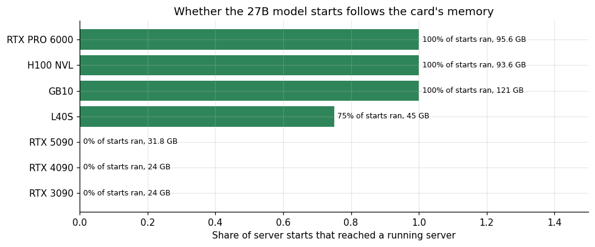

*Figure 1. Whether the 27B model starts follows the card.*

The ordering in the figure is by memory. The cards with 24 GB and 31.8 GB never started the model in 28 GB builds, and the cards with 45 GB or more nearly always did. There is no case in the table where a card with enough memory failed because of its architecture.

## 3. Why the RTX 5090 fails

The RTX 5090 is a Blackwell card with the hardware to compute in FP4, and vLLM selected the native kernel for it (the log says it uses the FlashInfer CUTLASS kernel for NVFP4 matrix multiplications). The weights loaded, taking 27.69 GiB for the plain build. The server then sized its cache and found a negative budget.

Here are the lines of that start. Nothing is paraphrased: the kernel line, the size of the weights, the cache budget and the error that ends the start, from the second 5090 session (94 percent of the memory allowed).

```
INFO 10-26 12:31:00 [__init__.py:1180] Using FlashInferCutlassNvFp4LinearKernel for NVFP4 GEMM
INFO 10-26 12:31:08 [model_runner.py:428] Model loading took 27.69 GiB memory and 8.219987 seconds
INFO 10-26 12:32:52 [gpu_worker.py:640] Available KV cache memory: -0.68 GiB
ValueError: No available memory for the cache blocks. Try increasing `gpu_memory_utilization` when initializing the engine (this flag also controls CPU memory reservation on the CPU backend…
```

**Table 4.** Why the RTX 5090 fails

|  | Variant | Model loading GiB | GPU memory utilization | Available KV GiB |
|---|---|---|---|---|
| 3 | nvfp4_plain | 27.69 | 0.88 | -2.62 |
| 7 | nvfp4_plain | 27.69 | 0.94 | -0.68 |
| 19 | fp8_plain | 28.06 | 0.9 | -2.31 |

**Table 5.** Why the RTX 5090 fails (part 2)

|  | Variant | Model loading GiB | GPU memory utilization | Available KV GiB | Usable GiB | Reserved for graphs and activations GiB |
|---|---|---|---|---|---|---|
| 3 | nvfp4_plain | 27.69 | 0.88 | -2.62 | 26.06 | 0.99 |
| 7 | nvfp4_plain | 27.69 | 0.94 | -0.68 | 27.84 | 0.83 |
| 19 | fp8_plain | 28.06 | 0.9 | -2.31 | 26.65 | 0.9 |

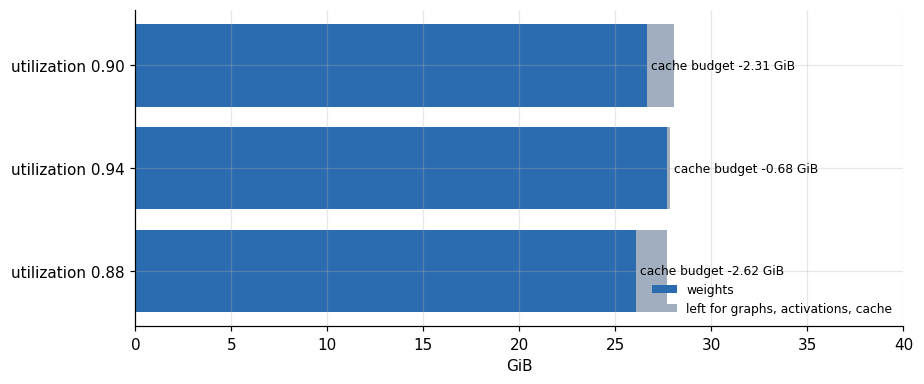

*Figure 2. Why the RTX 5090 fails.*

The first start allowed vLLM to use 88 percent of the card's memory and reported an available cache of minus 2.62 GiB. The second allowed 94 percent and reported minus 0.68 GiB. The extra 6 percent of utilization added 1.94 GiB to the budget, close to the 1.78 GiB that 6 percent of the card amounts to. The usable memory minus the weights minus the reported budget comes out at 0.99 and 0.83 GiB in the two NVFP4 starts, the memory that vLLM sets aside for graphs and activations. Extrapolating, a utilization of 96 to 97 percent would have brought the budget to zero, and a usable server needs more than zero, so I judge that the plain NVFP4 build does not fit on this card with a useful cache. I did not try 97 percent, since a setting that leaves no room for the card's own allocations tends to produce its own crashes.

The FP8 build fails the same way. Its weights take 28.06 GiB, the log reports a budget of minus 2.31 GiB at 90 percent utilization, and the start fails. The only difference between the two formats on this card is the 0.37 GiB between 28.06 and 27.69.

The FP8 start on the same card, in the session of 27 October, reads the same way with other numbers:

```
INFO 10-27 06:45:22 [model_runner.py:428] Model loading took 28.06 GiB memory and 20.220625 seconds
INFO 10-27 06:47:00 [gpu_worker.py:640] Available KV cache memory: -2.31 GiB
ValueError: No available memory for the cache blocks. Try increasing `gpu_memory_utilization` when initializing the engine (this flag also controls CPU memory reservation on the CPU backend…
```

That difference is the point of this section. NVFP4 is advertised as a way to cut the memory of a model to a quarter of its BF16 size. For this checkpoint the loaded size is 54 percent of BF16's 51.1 GiB, and about the same as FP8. The article on the quantization ladder gives the sizes: 17.8 GiB for the AWQ build, 27.69 for NVFP4, 28.06 for FP8 and 51.1 for BF16. The NVFP4 file I used keeps part of the network in a higher precision, and I did not inspect which part. Whatever the cause, a reader who expects 14 GiB will plan the wrong machine.

## 4. Why the 3090 and 4090 fail

On the 24 GB cards the failure is simpler. A model that takes 27.69 GiB cannot load into 24 GB of memory, and the logs of both cards report the out-of-memory error during loading. The kernel selection line is still present in the NVFP4 logs of these two cards, and it names the Marlin kernel, so vLLM found a software path for the 4-bit format on Ampere and Ada before the memory ran out.

On the 3090 and the 4090 the kernel line is followed by allocation failures during loading. The totals in the lines are the card memory in bytes: about 25.35 and 25.28 billion.

```
INFO 10-27 04:52:15 [__init__.py:1180] Using MarlinNvFp4LinearKernel for NVFP4 GEMM
[rank0]:[W1027 04:52:15.416120619 CUDACachingAllocator.cpp:3933] memory allocation failed with OOM on device 0 while trying to allocate 46137344 bytes (free: 37552128, total: 25351356416).
INFO 10-27 05:28:33 [__init__.py:1180] Using MarlinNvFp4LinearKernel for NVFP4 GEMM
[rank0]:[W1027 05:28:34.144551611 CUDACachingAllocator.cpp:3933] memory allocation failed with OOM on device 0 while trying to allocate 146800640 bytes (free: 61407232, total: 25280839680).
```

That detail answers half of the original question. The software path for NVFP4 exists on cards without FP4 hardware, and it was selected on both the RTX 3090 and the RTX 4090. The reason these two cards failed is the size of the checkpoint and not the missing instruction. Had a 14 GiB NVFP4 build of the 27 billion parameter model existed, the same software path would have had a chance on a 24 GB card.

## 5. The L40S: no FP4 hardware, and it ran

The L40S has 45 GB usable and the Ada architecture. Its server log for the NVFP4 build contains the line that decides this article.

The log lines in question, from the start of the NVFP4 build on the L40S:

```
INFO 10-27 07:38:44 [__init__.py:1180] Using MarlinNvFp4LinearKernel for NVFP4 GEMM
WARNING 10-27 07:38:48 [marlin.py:34] Your GPU does not have native support for FP4 computation but FP4 quantization is being used. Weight-only FP4 compression will be used leveraging the Marlin kernel. This may de…
INFO 10-27 07:38:50 [model_runner.py:428] Model loading took 31.47 GiB memory and 6.690813 seconds
INFO 10-27 07:41:01 [gpu_worker.py:640] Available KV cache memory: 7.09 GiB
INFO 10-27 07:41:01 [kv_cache_utils.py:2395] GPU KV cache size: 56,426 tokens, Maximum concurrency for 32,768 tokens per request: 1.72x
```

**Table 6.** The L40S: no FP4 hardware, and it ran

|  | Variant | NVFP4 GEMM kernel | No native fp4 warning | Model loading GiB | GPU memory utilization | Available KV GiB | KV cache tokens |
|---|---|---|---|---|---|---|---|
| 20 | fp8_dflash | – | no | 31.83 | 0.9 | 6.62 | 52,757 |
| 21 | nvfp4_dflash | MarlinNvFp4LinearKernel | yes | 31.47 | 0.9 | 7.09 | 56,426 |

The log says that vLLM is using the Marlin kernel for NVFP4, and it prints a warning that the GPU does not have native support for FP4 computation, that weight-only FP4 compression will be used, and that this may degrade performance. In weight-only mode the weights stay in 4 bits in memory and are expanded to a wider format inside the kernel just before the multiplication. The memory saving applies, since the weights are stored compactly, and the arithmetic runs at the speed of the wider format.

For this checkpoint the memory saving is small, as the previous sections showed. The model took 31.47 GiB with its speculative decoding drafter, against 31.83 GiB for the FP8 build with the same drafter. That left 7.09 GiB for the cache against 6.62 GiB, and the cache held 56,426 tokens against 52,757, 7 percent more. The 45 GB card therefore holds about 56 thousand tokens of conversation in total, shared between all users, in either format.

## 6. Speed on the L40S, against FP8

Speed is the second half of the question. If the software path on the L40S were much slower than the FP8 build, the format would be a curiosity. I ran the NVFP4 build and the FP8 build on the same L40S, in the same session, with the same speculative decoding drafter, at 1, 4, 8, 16 and 32 concurrent users.

**Table 7.** Speed on the L40S, against FP8

|  | Per user FP8 dflash | Per user NVFP4 dflash | Agg FP8 dflash | Agg NVFP4 dflash | Per user ratio | Aggregate ratio |
|---|---|---|---|---|---|---|
| 1 | 109.7 | 104.1 | 80 | 80.4 | 0.949 | 1.005 |
| 4 | 43.6 | 51.7 | 175.8 | 176.6 | 1.186 | 1.005 |
| 8 | 50.7 | 55.4 | 185.7 | 194.7 | 1.093 | 1.048 |
| 16 | 55.3 | 53.7 | 190.7 | 212.6 | 0.971 | 1.115 |
| 32 | 54.2 | 55.8 | 210.5 | 246 | 1.03 | 1.169 |

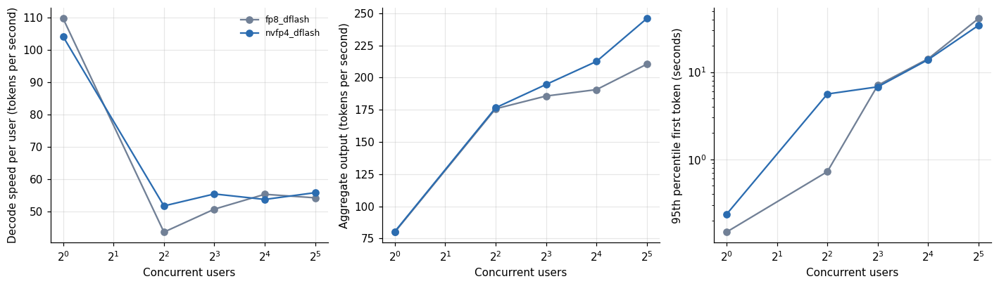

*Figure 3. Speed on the L40S, against FP8.*

At one user, the FP8 build decoded at 109.7 tokens per second and NVFP4 at 104.1, a ratio of 0.95. At four users NVFP4 was faster per user, 51.7 against 43.6. At eight users the speeds were 55.4 and 50.7, at sixteen 53.7 and 55.3, and at thirty-two 55.8 and 54.2. The per-user ratio swings between 0.95 and 1.19 without a trend, and with a single run per cell I read it as noise around parity.

The aggregate shows a trend. The ratio of NVFP4 to FP8 in aggregate output was 1.00 at one user, 1.00 at four, 1.05 at eight, 1.12 at sixteen and 1.17 at thirty-two, with 246.0 against 210.5 tokens per second in the last case. The software path at 32 users did not slow the card down, and it delivered more.

The first-token time tells a less flattering story for both formats. With speculative decoding on, the 95th percentile first-token time was 0.15 seconds at one user for FP8 and 0.23 for NVFP4, and rose to 41.2 and 34.4 seconds at 32 users. The service level the series uses, three seconds, held for one user in both formats, held for four users with FP8 (0.72 seconds) and failed there with NVFP4 (5.6 seconds), and failed for both at eight users and beyond. The comparison between formats is fair in that both are bad at load, and the lower number for NVFP4 at 32 users (34.4 against 41.2 seconds) does not rescue either.

## 7. Does native FP4 hardware change the pattern?

The L40S result invites a question. If the pattern of "slower for one user, faster in aggregate" comes from the format, it should appear on cards with native FP4 hardware as well. If it comes from the Marlin software path, it should vanish there. I have two such cards in the data: the RTX PRO 6000 and the GB10.

For comparison, the start of the same build on the RTX PRO 6000, a Blackwell card that has the FP4 hardware: the kernel line names the native path, and the cache budget is large because the card has 96 GB.

```
INFO 10-26 11:57:27 [__init__.py:1180] Using FlashInferCutlassNvFp4LinearKernel for NVFP4 GEMM
INFO 10-26 11:57:37 [model_runner.py:428] Model loading took 31.46 GiB memory and 10.507349 seconds
INFO 10-26 12:00:00 [gpu_worker.py:640] Available KV cache memory: 47.13 GiB
INFO 10-26 12:00:00 [kv_cache_utils.py:2395] GPU KV cache size: 355,066 tokens, Maximum concurrency for 32,768 tokens per request: 10.84x
```

**Table 8.** Does native FP4 hardware change the pattern?

| Card | Users | Per user ratio | Aggregate ratio | NVFP4 agg | FP8 agg |
|---|---|---|---|---|---|
| L40S | 1 | 0.949 | 1.005 | 80.4 | 80 |
| L40S | 4 | 1.186 | 1.005 | 176.6 | 175.8 |
| L40S | 8 | 1.093 | 1.048 | 194.7 | 185.7 |
| L40S | 16 | 0.971 | 1.115 | 212.6 | 190.7 |
| L40S | 32 | 1.03 | 1.169 | 246 | 210.5 |
| RTX PRO 6000 | 1 | 0.825 | 0.939 | 128.7 | 137 |
| RTX PRO 6000 | 2 | 0.83 | 0.912 | 194.8 | 213.5 |
| RTX PRO 6000 | 4 | 0.925 | 0.965 | 389.8 | 403.9 |
| RTX PRO 6000 | 8 | 1.07 | 1.038 | 604.8 | 582.8 |
| RTX PRO 6000 | 16 | 1.169 | 1.084 | 890.2 | 821.2 |
| RTX PRO 6000 | 32 | 1.185 | 1.216 | 1,263 | 1,039 |
| GB10 | 1 | 0.955 | 0.899 | 21.3 | 23.7 |
| GB10 | 2 | 0.856 | 0.927 | 34.1 | 36.8 |
| GB10 | 4 | 0.897 | 0.943 | 63.3 | 67.1 |

*First 14 of 17 rows; the full table is in the executable notebook.*

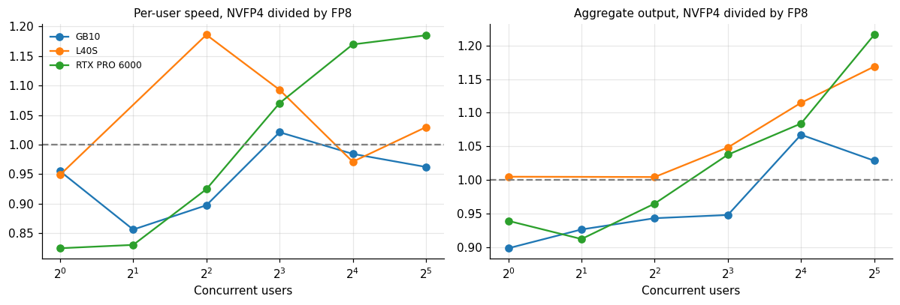

*Figure 4. Does native FP4 hardware change the pattern?*

On all three cards the ratio at one user is below 1: 0.95 on the L40S, 0.82 on the PRO 6000 and 0.96 on the GB10. At 32 users the aggregate ratio is above 1 on all three: 1.17, 1.22 and 1.03. The curve of aggregate ratio against users rises from below 1 to above 1 on the PRO 6000 and the GB10, and on the L40S it starts at 1.0 and rises.

The pattern therefore does not depend on the kernel. The card with the native hardware showed the largest swing, a one-user penalty of 18 percent and a 32-user gain of 22 percent, and the card with the software path showed a smaller penalty and a gain of 17 percent. I would have expected the native hardware to make NVFP4 uniformly better and the software path to make it uniformly worse, and neither happened. My reading is that for this checkpoint the format changes the balance between memory traffic and arithmetic in a similar way on the three cards, and that the choice of kernel is a second-order effect. I did not profile the kernels, so this is an interpretation of the ratios and not a measurement of the cause.

Each cell comes from one run, and the ratios in the low-concurrency region are close enough to 1 that run-to-run variation could produce them. The 32-user gains of 17 and 22 percent are large enough that I trust their sign, but the 3 percent on the GB10 does not distinguish the formats.

## 8. Memory traffic: why speed barely moved

Decoding one token requires reading the weights once. On the L40S, with a published memory bandwidth of 864 gigabytes per second that I take as given, the plain FP8 build (28.06 GiB) decoded a single user at 21.7 tokens per second. That implies 654 gigabytes per second of weight reads, 76 percent of the published figure. The same arithmetic applies to any build, and it predicts that a build with fewer bytes per token decodes faster in proportion.

**Table 9.** Memory traffic: why speed barely moved

| Build | Weights GiB | Predicted single user tok/s | Pct of FP8 |
|---|---|---|---|
| FP8 plain | 28.06 | 21.7 | 1 |
| NVFP4 plain (not run on L40S) | 27.69 | 21.99 | 1.01 |
| AWQ plain | 17.8 | 34.21 | 1.58 |

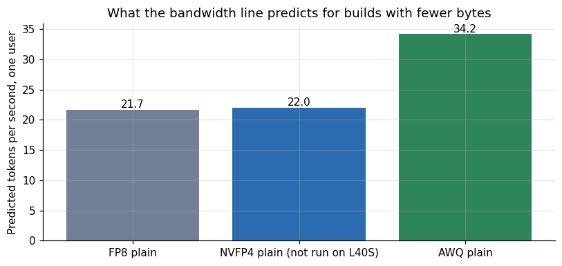

*Figure 5. What the bandwidth line predicts for builds with fewer bytes.*

If the NVFP4 checkpoint had been as small as its name suggests, say the 14 GiB that a pure 4-bit layout of 27 billion weights would take, the line predicts 43 tokens per second for a single user on this card instead of 21.7. The checkpoint I used occupies 27.69 GiB, and the line predicts 22.0 tokens per second for it, 1.4 percent faster than FP8. The AWQ build at 17.8 GiB, which is a real 4-bit file, is predicted to decode at 34.2 tokens per second. On the L40S I measured the AWQ build at 43.2 tokens per second for one user, which implies 826 gigabytes per second of weight reads, 96 percent of the published bandwidth, against 76 percent for the FP8 build. The proportional prediction therefore underestimates the AWQ build, and I do not know whether the gap comes from the FP8 kernels, from the online conversion of that build or from the cache traffic, since I did not profile it.

The conclusion for the format is that NVFP4 saves speed in proportion to the bytes it saves, and this checkpoint saves almost none. Its practical advantage on the three cards was a gain in aggregate throughput under load, and the data show that gain without explaining it.

## 9. What it costs per token

Each run in the dataset carries the hourly price of the machine it ran on, so the cost of a million output tokens follows from the speed. At full load it is the price per hour divided by the tokens generated in an hour; for a single user it is the same quotient with the single-user rate.

**Table 10.** What it costs per token

| Card | Users | FP8 | NVFP4 | NVFP4 vs FP8 |
|---|---|---|---|---|
| GB10 | 1 | 5.261 | 5.854 | 1.113 |
| GB10 | 32 | 0.58 | 0.564 | 0.972 |
| L40S | 1 | 2.647 | 2.633 | 0.995 |
| L40S | 32 | 1.006 | 0.861 | 0.856 |
| RTX PRO 6000 | 1 | 3.068 | 3.266 | 1.064 |
| RTX PRO 6000 | 32 | 0.405 | 0.333 | 0.822 |

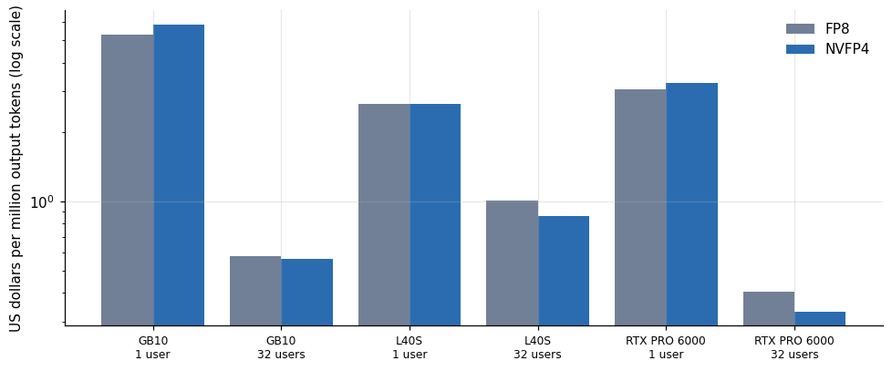

*Figure 6. What it costs per token.*

At 32 users on the L40S the cost per million output tokens was 0.86 dollars for NVFP4 and 1.01 for FP8, a difference of 14 percent. On the PRO 6000 it was 0.33 against 0.40 dollars, 18 percent lower, and on the GB10 0.56 against 0.58, 3 percent lower. At one user the two formats cost the same on the L40S (2.63 and 2.65 dollars) and NVFP4 cost more on the PRO 6000, where it was 6 percent slower in aggregate. The GB10 price is the rate at which I list the machine, and I do not pay it.

The cheapest option at saturation in this table is the PRO 6000, with its 1.51 dollar hourly price, since it generates so many more tokens per hour. The L40S costs 2.6 times as much per token as the PRO 6000 at 32 users in NVFP4. The format does not change the order of the cards; it moves each card by less than a fifth.

## 10. Quality: did the 4-bit format cost accuracy?

The same checkpoint ran through the quality benchmarks of the quantization ladder, on the RTX PRO 6000, where the native kernel handles the arithmetic. I use the item-level results to test whether NVFP4 differs from FP8 and from BF16 in a paired comparison: for each question, did the two builds agree?

**Table 11.** Quality: did the 4-bit format cost accuracy?

| Benchmark | N | Versus | NVFP4 only correct | Other only correct | NVFP4 acc | Other acc | P exact |
|---|---|---|---|---|---|---|---|
| gsm8k | 150 | FP8 (online from BF16) | 3 | 3 | 0.96 | 0.96 | 1 |
| gsm8k | 150 | BF16 | 4 | 3 | 0.96 | 0.9533 | 1 |
| gsm8k | 150 | AWQ 4-bit | 5 | 3 | 0.96 | 0.9467 | 0.7266 |
| mmlu | 200 | FP8 (online from BF16) | 7 | 6 | 0.82 | 0.815 | 1 |
| mmlu | 200 | BF16 | 5 | 5 | 0.82 | 0.82 | 1 |
| mmlu | 200 | AWQ 4-bit | 10 | 6 | 0.82 | 0.8 | 0.4545 |
| humaneval | 164 | FP8 (online from BF16) | 3 | 1 | 0.9268 | 0.9146 | 0.625 |
| humaneval | 164 | BF16 | 3 | 2 | 0.9268 | 0.9207 | 1 |
| humaneval | 164 | AWQ 4-bit | 7 | 8 | 0.9268 | 0.9329 | 1 |
| json | 24 | FP8 (online from BF16) | 0 | 0 | 1 | 1 | 1 |
| json | 24 | BF16 | 0 | 0 | 1 | 1 | 1 |
| json | 24 | AWQ 4-bit | 0 | 0 | 1 | 1 | 1 |

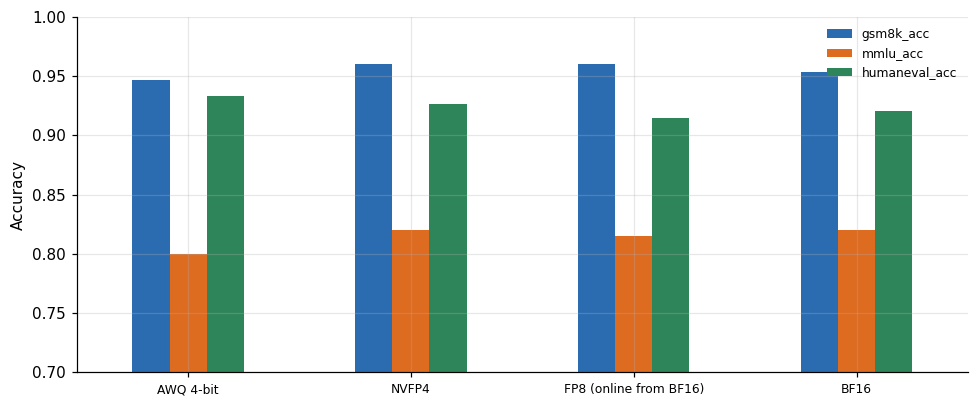

*Figure 7. Quality: did the 4-bit format cost accuracy?*

The accuracy of the NVFP4 build was 96.0 percent on 150 math problems, 82.0 percent on 200 knowledge questions, 92.7 percent on 164 coding problems and 100 percent on 24 structured-output checks. The FP8 build scored 96.0, 81.5, 91.5 and 100, and BF16 scored 95.3, 82.0, 92.1 and 100.

The paired test finds no difference between NVFP4 and either FP8 or BF16 on any benchmark. Against FP8, the two builds disagree on 6 of 150 math problems (3 in each direction), on 13 of 200 knowledge questions (7 and 6) and on 4 of 164 coding problems (3 and 1). The smallest exact p-value against FP8 or BF16 was 0.63, and against the AWQ build it was 0.45. A test on a few hundred questions can detect a difference of several points and cannot detect one of a point or less, so the claim I support is that NVFP4 is not detectably worse, which is weaker than the claim that it is equal.

This measurement does not transfer to the L40S. On the L40S the 4-bit weights are expanded by a different kernel, and kernels can differ in rounding. I expect the results to match, since both kernels implement the same format, but I did not run the benchmark on that card, and the throughput numbers above are the only L40S evidence.

## 11. Start-up time, and what a smaller file buys

A rented machine bills while the server loads, so the time from launch to a ready server is part of the cost. The start logs record how long loading the weights took, and the NVFP4 file is a few percent smaller than the FP8 weights it competes with.

**Table 12.** Start-up time, and what a smaller file buys

|  | FP8 | NVFP4 | NVFP4 over FP8 |
|---|---|---|---|
| GB10 | 348.7 | 177.3 | 0.51 |
| H100 NVL | 10.79 | – | – |
| L40S | 10.62 | 6.69 | 0.63 |
| RTX PRO 6000 | 18.02 | 7.75 | 0.43 |

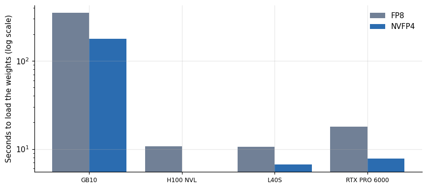

*Figure 8. Start-up time, and what a smaller file buys.*

On the L40S the weights loaded in 6.7 seconds for NVFP4 and 10.6 for FP8. On the RTX PRO 6000 the figures were 5.0 and 10.5 seconds for NVFP4 (two starts, on two machines) and 18.0 for FP8. On the GB10 they were 177 seconds against 349, a long time on every build, because that machine reads its model from a slow disk. The NVFP4 loads were faster in every pair, by a factor of 0.43 to 0.63 (the medians in the table). A file of the same size would not load faster, and these two differ by only a percent or two, so file size alone does not explain the gap; the reads may also have been affected by which files were already in the machine's page cache from an earlier build. I note the effect and do not rely on it.

The weights are a small part of the wait. The same L40S log shows that the first compilation of the model's graphs took 15.4 seconds, the draft model's graphs another 12.9 seconds, and the capture of CUDA graphs 24 seconds, so the load is 7 seconds in a start that takes roughly 3 minutes from launch to ready. These graph timings come from the log lines and are not in the dataset.

## 12. The comparison that matters more: plain FP8

Every NVFP4 measurement in this article used speculative decoding, since the only plain NVFP4 starts I attempted were on the RTX 5090, where they failed. The fair question for someone choosing a way to serve this model on an L40S is whether the speculative builds are the best option, and the data say they are not under load. The plain FP8 build ran on the same card family in an earlier session.

**Table 13.** The comparison that matters more: plain FP8

|  | FP8 dflash | FP8 plain | NVFP4 dflash |
|---|---|---|---|
| 1 | 80 | 20.8 | 80.4 |
| 2 | – | 41.4 | – |
| 4 | 175.8 | 66.1 | 176.6 |
| 8 | 185.7 | 126.6 | 194.7 |
| 16 | 190.7 | 220.4 | 212.6 |
| 32 | 210.5 | 337.5 | 246 |

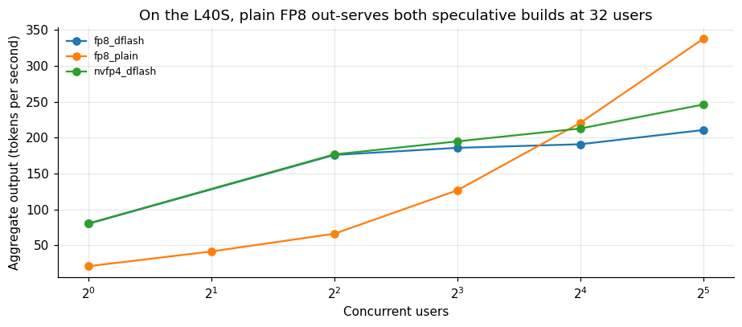

*Figure 9. On the L40S, plain FP8 out-serves both speculative builds at 32 users.*

At 32 users the plain FP8 build generated 337.5 tokens per second against 246.0 for NVFP4 with speculation and 210.5 for FP8 with speculation, and its 95th percentile first-token time was 2.7 seconds against 34.4 and 41.2. The cost per million output tokens followed: 0.66 dollars for plain FP8 against 0.86 and 1.01. The plain build ran in a different rental of an L40S (the first session of the series, at 0.80 dollars per hour) than the speculative builds (0.76 dollars per hour), so the comparison crosses two machines, and I treat the differences in the table as indications and not as precise gaps.

This reframes the whole article. NVFP4 with speculation beats FP8 with speculation on the L40S under load by 17 percent. Both lose to plain FP8 by 27 percent or more in aggregate, and by more than a factor of ten in first-token latency. Speculative decoding helps a single user a great deal on this card (109.7 against 21.7 tokens per second) and hurts a busy server. The series' article on speculative decoding gives the mechanism; here I add that the choice of weight format is a smaller decision than the choice of whether to speculate.

## 13. How many users does each build serve at the service level?

The series uses one service level: at least 20 tokens per second for each user and a 95th percentile first-token time of at most 3 seconds. I applied it to the three builds on the L40S.

**Table 14.** How many users does each build serve at the service level?

|  | Max users | Agg at max | Tested users |
|---|---|---|---|
| fp8_dflash | 4 | 175.8 | [1, 4, 8, 16, 32] |
| fp8_plain | 4 | 66.1 | [1, 2, 4, 8, 16, 32] |
| nvfp4_dflash | 1 | 80.4 | [1, 4, 8, 16, 32] |

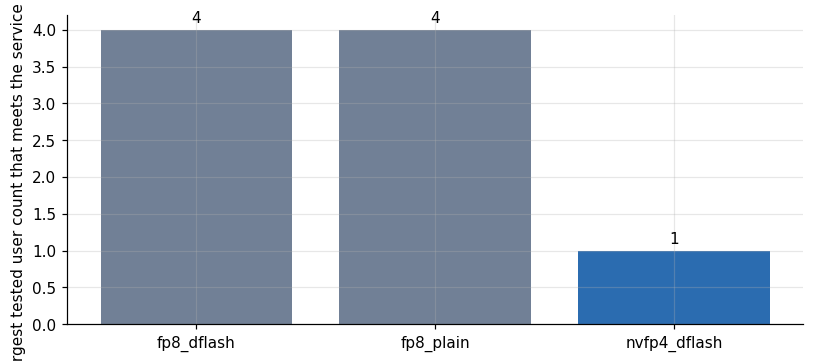

*Figure 10. How many users does each build serve at the service level?*

Plain FP8 met the service level up to 4 users, with 20.6 tokens per second each and a first token in 0.44 seconds. FP8 with speculation also met it at 4 users, with 43.6 tokens per second each and 0.72 seconds. NVFP4 with speculation met it at 1 user only, since its 4-user cell had a 95th percentile first-token time of 5.6 seconds. The tested user counts were 1, 4, 8, 16 and 32 for the speculative builds, so a build that met the service level at 2 or 3 users would still show 1 or 4 as its largest tested count.

The 5.6 seconds for NVFP4 at 4 users deserves caution. That cell had 18 requests, and the 95th percentile of 18 values is determined by the slowest one or two. The neighboring cells (0.23 seconds at 1 user, 6.8 at 8) suggest the build slows down above 4 users, and the 4-user value may be a start-up effect or an outlier. I did not rerun it. Under the series' service level, then, the three builds serve between 1 and 4 users per L40S, and the format decision is irrelevant next to that limit.

## 14. Sizing a card for this model

Putting the pieces together gives a rule for choosing a card for the NVFP4 build with speculative decoding. The server needs the loaded model, about 1 GiB for graphs and activations, and a cache sized for the conversations it will hold.

**Table 15.** Sizing a card for this model

|  | 1 user | 4 users | 8 users |
|---|---|---|---|
| 8,192 | 39.8 | 43.5 | 48.4 |
| 16,384 | 41.1 | 48.4 | 58.3 |
| 32,768 | 43.5 | 58.3 | 77.9 |
| 65,536 | 48.4 | 77.9 | 117.2 |
| 131,072 | 58.3 | 117.2 | 195.8 |

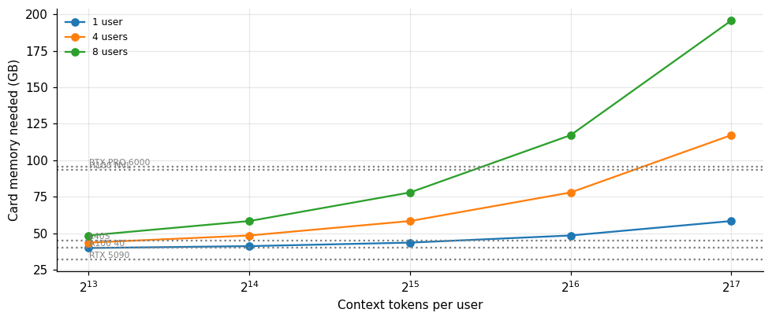

*Figure 11. Sizing a card for this model.*

With the cache density measured on the L40S, about 7,960 tokens per GiB, a single user with a 32,768-token context needs a card of about 43.5 GB, four users with 16,384 tokens each need about 48 GB, and eight users with the same context need about 58. The 45 GB L40S fits the first and cannot hold the other two, which agrees with the 56,426 tokens its server reported. The 40 GB A100 in my list falls short of even the first, and the 32 GB RTX 5090 falls short of the weights alone. The calculation assumes a utilization of 0.90 and an overhead of 0.9 GiB, both taken from the logs, and the cache density of the L40S, which differs by about 5 percent from that of the PRO 6000.

A reader who wants to run this model on a card with 24 or 32 GB of memory has two real options in my data: the AWQ build at 17.8 GiB, which left room for the cache and ran on every card where I tried it, or a smaller model. The NVFP4 build is a choice for 48 GB cards and above, and there it competes with FP8 on throughput under load, not on the size of the machine.

## 15. What could be wrong with these numbers

Every comparison in this article rests on a small number of runs, and the cost of that fact is worth stating before a reader builds a plan on it.

Each cell of the serving tables is a single run of a few minutes. The load generator keeps a fixed number of users busy for a fixed time, so a cell at 4 users holds 17 to 18 requests and a cell at 32 users holds 43 to 90. A 95th percentile of 18 values depends on the slowest one or two requests, and the same tail dominates the first-token column wherever the request count is small. I report medians over cells where a median exists, and in most cells there is only one run, so the median is the run.

The runs differ in more than the format. The NVFP4 and FP8 builds with speculation ran on the same L40S in the same session, one after the other, which removes most of the host variation. The plain FP8 build ran in another rental of an L40S, and the RTX PRO 6000 data come from one machine of that model, with a second machine of a workstation variant that I excluded from the comparison. Rented hosts of the same GPU model differ in processor, memory and disk, and I saw differences of a few percent between hosts in the repeated runs of other articles of this series.

The speculative decoding drafter is part of every NVFP4 measurement. The format and the drafter could interact, and I measured only the combination. A plain NVFP4 build on a card with enough memory, such as the L40S, would separate the two, and I did not run it, since the plan for the session was written before the finding of this article.

The memory arithmetic for the RTX 5090 is an extrapolation from two failed starts and one FP8 failure. It matches the three logs to within 0.2 GiB of overhead, which supports the model of "usable memory minus weights minus reserve", and it has not been tested by starting the server at a higher utilization. Anyone with a 5090 can test the prediction in one command by raising the utilization toward 0.97, with the risk that the server runs out of memory when it serves the first request.

The bandwidth figure of the L40S is the published value as I understand it, and I did not measure it. The ratios in the memory-traffic section do not depend on it, but the percentages of the published figure do.

Finally, the quality tests ran on a single machine type and a single sample of each benchmark. A paired test on a few hundred questions has the power to detect differences of several points and none to detect a difference of half a point. The claim in the summary, that NVFP4 is not detectably worse, is the strongest one the data support.

## 16. What I would measure next

The most informative next measurement is a plain NVFP4 build, without speculation, on a card with enough memory. It would give the format's speed on its own, on the L40S through the Marlin kernel and on the PRO 6000 through the native kernel, and it would settle whether the pattern of lower single-user speed and higher aggregate throughput belongs to the format or to its combination with the drafter.

The second is a profile of the L40S run, with the kernel-level time of the Marlin path against the FP8 path at 1 and 32 users. The ratios say that something changes between 1 and 32 users, and a profile would say what.

The third is the same quality benchmark on the L40S. The rented hour costs about 0.8 dollars, and the benchmark took a fraction of an hour on the PRO 6000, so the test is cheap. I did not run it because the campaign budget had been spent when I understood that the question was open.

## 17. What I got wrong

I planned this campaign with the belief that NVFP4 needs Blackwell. The belief was easy to keep, because most of the failures looked like architecture when I read the grid and not the logs: the format is new, the failing cards were mostly older, and the successful cards were mostly new. Reading the logs side by side removed it. The log of the 5090 said that the cache budget was negative, and the log of the L40S said that a software kernel had been selected and the server was running.

The lesson I take from it applies beyond this format. A failure on one card of a type should be explained from the log before it is generalized to the type. The log line "Available KV cache memory: -2.62 GiB" was in the 5090 output from the start, and I read it as an out-of-memory incident and not as the answer to the question I was asking.

I also corrected the quantization article of the series for the same reason: its sentence that credited Blackwell for the kernels now says that the 5090, a Blackwell card, could not hold the model. The matrix article already attributes the 5090 failure to memory, and the cell for that card should be read as "does not fit" and not as an architecture failure.

## 18. Questions I expect

**Does NVFP4 save memory?** In this checkpoint it saves 1.3 percent against FP8, and 46 percent against BF16. A pure 4-bit layout would save more, and AWQ does.

**Do I need a Blackwell card?** No. An Ada card ran it through a software kernel, and the speed and cost per token matched the FP8 build. A Blackwell card with too little memory could not run it at all.

**Is the speed better on Blackwell?** The L40S and the PRO 6000 show the same pattern of ratios against FP8, so I see no sign in my data that native hardware turned the format into a clear speed gain for this model.

**Is it worth the trouble?** At 32 users on a 48 GB card NVFP4 saved 14 percent per token. At one user it saved nothing. If your load is a single user, use FP8 or the AWQ build.

**Does quality drop?** On 538 questions measured on the PRO 6000, not detectably. Not measured on the L40S.

## 19. How much it cost

**Table 16.** How much it cost

|  | Started utc | GPU | Created to destroyed h | Dph USD | Est cost USD | Session kind |
|---|---|---|---|---|---|---|
| 131 | 2026-10-27 07:13:30 | L40S | 0.701 | 0.7622 | 0.535 | all-L40S |

The L40S measurements in this article came from the session of 27 October that started at 07:13 UTC and lived for 0.70 hours at 0.76 dollars per hour, 0.54 dollars. That session also ran the rest of the battery, so the share of the NVFP4 and FP8 runs is a fraction of it. The ten L40S rentals of the whole campaign together cost 3.92 dollars over 4.91 hours. The PRO 6000 data came from a session rented earlier, and the server-start logs of the 5090 and the 3090 came from sessions that were part of other measurements. The GB10 costs nothing in rental, since I own it.
