# The quantization ladder for a 27B model

**Lucas Rangel** · [Kaggle writeup](https://www.kaggle.com/writeups/lucasrangelss/the-quantization-ladder-for-a-27b-model) · [Executable notebook](https://www.kaggle.com/code/lucasrangelss/the-quantization-ladder-for-a-27b-model) · [Code and data](https://github.com/LucasRangelSSouza/gpu-ai-benchmark-hub) · [Dataset](https://www.kaggle.com/datasets/lucasrangelss/gpu-ai-benchmark-campaign-2026)

## Abstract

A 27 billion parameter language model can be stored and served in four precisions that matter to anyone renting GPUs: full BF16, FP8, NVFP4 and 4-bit AWQ. Each step down roughly halves the memory the weights occupy, and each step has a reputation for costing intelligence. I ran the same benchmark battery on all four on one RTX PRO 6000 with 96 GB, with identical prompts, greedy decoding and a fixed seed, and compared them item by item.

Four findings:

- No precision was measurably worse than the others on math, general knowledge or code. Accuracy ranged from 94.7 to 96.0 percent on 150 math problems, from 80.0 to 82.0 percent on 200 knowledge questions and from 91.5 to 93.3 percent on 164 coding problems. A paired test found no significant difference between any two precisions on any benchmark. The smallest p-value for any pair was 0.48.
- The absence of a difference has limits. With samples of this size, a true gap smaller than about 4 to 5 points cannot be detected. The honest claim is that quantizing cost less than a few points, not that it cost nothing.
- Memory is where the precisions differ sharply. The weights occupy 17.8 GiB in AWQ, 27.7 in NVFP4, 28.1 in FP8 and 51.1 in BF16, and the room left for the conversation cache falls from 654,396 tokens (AWQ) to 318,042 (BF16) on the same card.
- Answers differ in length and speed. Under the same 24-way concurrent load, a math answer took 9.0 seconds in AWQ and 15.6 seconds in BF16, the AWQ and NVFP4 builds wrote answers 32 to 44 percent longer than BF16 and FP8, and BF16 delivered only 55 to 58 percent of the correct answers per minute that FP8 did, for the same accuracy.

One confound runs through the whole ladder and I will repeat it where it matters: the AWQ build comes from a different author and a different starting checkpoint than the other three. The comparison across precisions is therefore a comparison of builds, and only BF16 against FP8 is a clean change of numeric precision on identical weights.

> **Code and data.** Everything behind this article is public: the code that ran, the curated data, the analysis that regenerates every figure, and tests that pin the conclusions to the data. Repositories: [quantization-and-offload-lab](https://github.com/LucasRangelSSouza/quantization-and-offload-lab). Index of the whole series: [gpu-ai-benchmark-hub](https://github.com/LucasRangelSSouza/gpu-ai-benchmark-hub).

## 1. Why a ladder

Renting a GPU makes memory a price. A 24 gigabyte card costs a fraction of a 96 gigabyte one. If a 4-bit build gives the same answers as the BF16 original, you can serve the model on a cheaper card or fit more users on the same card. If it does not, you pay for the larger card or accept worse output. The question is practical, and the literature on it is full of benchmarks that use different prompts, decoding settings and versions of the same model, which makes the claims hard to compare.

I wanted one battery, one card, one engine, one day. The ladder has four rungs: AWQ 4-bit, NVFP4, FP8 and BF16. The purpose is to give a reader a calibrated sense of how big the quality differences are, relative to the noise in the measurement.

## 2. The four builds

The ladder compares builds of a 27 billion parameter model in the Qwen family. The builds are not all derived from the same weights.

The BF16 build is the full-precision checkpoint from the Blackfrost project, at 51.1 GiB in memory. The FP8 configuration loads the same BF16 checkpoint and quantizes it to 8 bits on the fly when the server starts, so it shares every weight with the BF16 build and differs only in numeric precision. The NVFP4 build is a separately quantized checkpoint from the same project, with weights in a 4-bit floating point format that recent NVIDIA cards support. The AWQ build is a 4-bit integer quantization published by a different author, made from a different uncensored base checkpoint.

The launch script of the session says how the four rungs were served. Below is the function that starts the server and then the four calls, copied from the harness file; the blank line stands for the body of the function that runs the benchmarks between the calls.

```
serve() { # dir quant_args
  pkill -f "vllm serve"; sleep 6
  nohup vllm serve /workspace/models/$1 --served-model-name qwen-abliterated --host 127.0.0.1 --port 18000 --gpu-memory-utilization 0.90 --max-model-len 8192 --max-num-seqs 24 \
    --trust-remote-code --reasoning-parser qwen3 $2 > out/ld/vllm_$1_$3.log 2>&1 &
  waitup
}

rung awq awq ""
rung nvfp4 target ""
rung fp8 bf16 "--quantization fp8"
rung bf16 bf16 ""
```

Every rung got the same limits: 90 percent of the card, 8,192 tokens of context and 24 sequences at a time. The FP8 rung points at the directory of the BF16 build and only adds `--quantization fp8`, which is the sense in which FP8 shares every weight with BF16. The start logs record the same thing. The arguments the server printed for the FP8 start name the BF16 directory and carry `'quantization': 'fp8'`, the BF16 start prints no such key, and the weights took 28.06 GiB in one and 51.1 GiB in the other.

```
INFO 10-27 20:39:29 [api_utils.py:286] non-default args: {'model_tag': '/workspace/models/bf16', 'host': '127.0.0.1', 'port': 18000, 'model': '/workspace/models/bf16', 'trust_remote_code': True, 'max_model_len': 8192, 'quantization': 'fp8', 'served_model_name': ['qwen-abliterated'], 'reasoning_parse…
INFO 10-27 20:45:38 [api_utils.py:286] non-default args: {'model_tag': '/workspace/models/bf16', 'host': '127.0.0.1', 'port': 18000, 'model': '/workspace/models/bf16', 'trust_remote_code': True, 'max_model_len': 8192, 'served_model_name': ['qwen-abliterated'], 'reasoning_parser': 'qwen3', 'gpu_memor…
INFO 10-27 20:39:51 [model_runner.py:428] Model loading took 28.06 GiB memory and 6.398741 seconds
INFO 10-27 20:45:58 [model_runner.py:428] Model loading took 51.1 GiB memory and 5.366005 seconds
```

So the rungs are not a pure ladder:

- BF16 against FP8 isolates the effect of 8-bit numeric precision.
- BF16 against NVFP4 compares the original with a 4-bit float quantization from the same project, a fair test of 4-bit quantization of the same model.
- AWQ against everything else mixes quantization and a different model lineage. A difference there could come from either, and I cannot separate them with this data.

I label the confound here because the summary of such results tends to lose it. Anyone reading "AWQ scored 80 percent on the knowledge benchmark and BF16 scored 82" will want to know whether that gap belongs to the format or to the model. It could belong to either.

## 3. The battery

Four benchmarks, one prompt per item, no examples in the prompt, temperature 0, seed 1, reasoning mode off.

- Math: the first 150 problems of the GSM8K test set, graded by the final numeric answer.
- Knowledge: 200 multiple-choice questions sampled from MMLU across subjects, graded by the chosen letter.
- Code: all 164 HumanEval problems, graded by running the model's code against the problem's unit tests in a separate subprocess.
- Structure: 24 prompts that ask for a JSON object with a fixed schema, graded by a validity check on the parsed output.

All four builds ran on the same RTX PRO 6000 host with 24 requests in flight at a time, through the same vLLM server version, one after the other. The benchmark questions are public datasets. The dataset I publish keeps only the per-item correct or incorrect flags, with no question or answer text.

## 4. Accuracy with error bars

An accuracy measured on 150 items carries uncertainty. A 95 percent Wilson interval around 95 percent on 150 items runs from about 90 to 98. A single number without that interval invites over-reading.

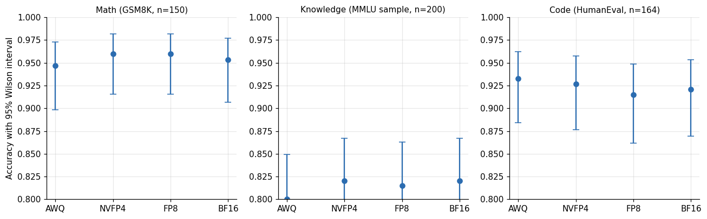

*Figure 1. Accuracy with error bars.*

**Table 1.** Accuracy with error bars

| Benchmark | Precision | Correct | N | Acc | Ci low | Ci high |
|---|---|---|---|---|---|---|
| gsm8k | AWQ 4-bit | 142 | 150 | 0.947 | 0.898 | 0.973 |
| gsm8k | NVFP4 | 144 | 150 | 0.96 | 0.915 | 0.982 |
| gsm8k | FP8 (online from BF16) | 144 | 150 | 0.96 | 0.915 | 0.982 |
| gsm8k | BF16 | 143 | 150 | 0.953 | 0.907 | 0.977 |
| mmlu | AWQ 4-bit | 160 | 200 | 0.8 | 0.739 | 0.85 |
| mmlu | NVFP4 | 164 | 200 | 0.82 | 0.761 | 0.867 |
| mmlu | FP8 (online from BF16) | 163 | 200 | 0.815 | 0.755 | 0.863 |
| mmlu | BF16 | 164 | 200 | 0.82 | 0.761 | 0.867 |
| humaneval | AWQ 4-bit | 153 | 164 | 0.933 | 0.884 | 0.962 |
| humaneval | NVFP4 | 152 | 164 | 0.927 | 0.876 | 0.958 |
| humaneval | FP8 (online from BF16) | 150 | 164 | 0.915 | 0.862 | 0.948 |
| humaneval | BF16 | 151 | 164 | 0.921 | 0.869 | 0.953 |

Every interval overlaps every other one. On math, the lowest point estimate is AWQ at 94.7 percent (interval 89.8 to 97.3) and the highest are NVFP4 and FP8 at 96.0 (91.5 to 98.2). On knowledge, AWQ scored 80.0 percent (73.9 to 85.0) and NVFP4 and BF16 each 82.0 (76.1 to 86.7). On code, the order inverts: AWQ scored the highest at 93.3 percent (88.4 to 96.2) and FP8 the lowest at 91.5 (86.2 to 94.8). The ordering changes by benchmark, which is what noise looks like: if quantization systematically hurt accuracy, the lower-precision builds would sit lower on all three.

The JSON task needs no figure. Every build passed all 24 prompts.

## 5. Paired comparisons

Overlapping intervals are a weak test, because the builds answered the same questions and mostly agreed. The better question is on which items they disagreed, and whether the disagreements lean one way. That is a paired comparison.

For each pair of builds and each benchmark, I count the items that build A got right and build B wrong, and the reverse, and test whether the split differs from 50 percent using an exact binomial test (McNemar's exact version).

**Table 2.** Paired comparisons

| Benchmark | A | B | A only right | B only right | Diff points | Ci95 low | Ci95 high | P exact |
|---|---|---|---|---|---|---|---|---|
| gsm8k | AWQ 4-bit | BF16 | 3 | 4 | -0.7 | -4.1 | 2.8 | 1 |
| gsm8k | NVFP4 | BF16 | 4 | 3 | 0.7 | -2.8 | 4.1 | 1 |
| gsm8k | FP8 (online from BF16) | BF16 | 1 | 0 | 0.7 | -0.6 | 2 | 1 |
| gsm8k | AWQ 4-bit | NVFP4 | 3 | 5 | -1.3 | -5 | 2.4 | 0.727 |
| mmlu | AWQ 4-bit | BF16 | 7 | 11 | -2 | -6.1 | 2.1 | 0.481 |
| mmlu | NVFP4 | BF16 | 5 | 5 | 0 | -3.1 | 3.1 | 1 |
| mmlu | FP8 (online from BF16) | BF16 | 1 | 2 | -0.5 | -2.2 | 1.2 | 1 |
| mmlu | AWQ 4-bit | NVFP4 | 6 | 10 | -2 | -5.9 | 1.9 | 0.454 |
| humaneval | AWQ 4-bit | BF16 | 8 | 6 | 1.2 | -3.2 | 5.7 | 0.791 |
| humaneval | NVFP4 | BF16 | 3 | 2 | 0.6 | -2.1 | 3.3 | 1 |
| humaneval | FP8 (online from BF16) | BF16 | 0 | 1 | -0.6 | -1.8 | 0.6 | 1 |
| humaneval | AWQ 4-bit | NVFP4 | 8 | 7 | 0.6 | -4 | 5.2 | 1 |

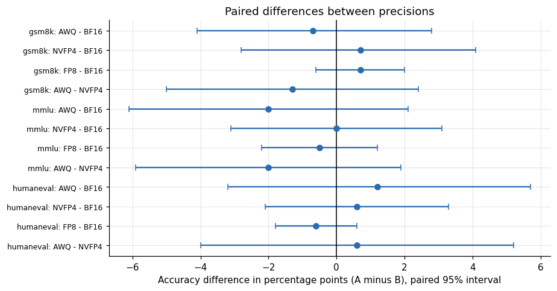

*Figure 2. Paired differences between precisions.*

The exact tests give p-values from 0.48 to 1.0 across the 12 comparisons. The smallest, 0.481, is AWQ against BF16 on knowledge, where BF16 got 11 items right that AWQ missed and AWQ got 7 right that BF16 missed. On math, AWQ and BF16 disagreed on only 7 of 150 items (3 against 4), and NVFP4 and BF16 on 7 as well (4 against 3). On code, AWQ and BF16 split 8 to 6, and FP8 against BF16 differed on a single problem.

Two observations deserve attention.

First, the disagreements are few. For FP8 against BF16, the two builds gave the same correct or incorrect verdict on all but 1 of 150 math items, all but 3 of 200 knowledge items and all but 1 of 164 coding items. That is the signature of a mild change of numeric precision: the model gives the same answers almost every time, and when the verdicts differ, it is one item in a hundred.

Second, the paired interval is much narrower than the unpaired one. The 95 percent interval on the AWQ minus BF16 difference is about plus or minus 4 points on knowledge, against about plus or minus 8 for two independent samples. Pairing buys a cut in the width of roughly half, because the builds make correlated mistakes. The residual width is the limit of what these 150 to 200 items can detect.

## 6. What difference could this battery detect?

A null result is only informative if you know what effect it could have seen. A rough power calculation says how large a difference would have to be to show up reliably.

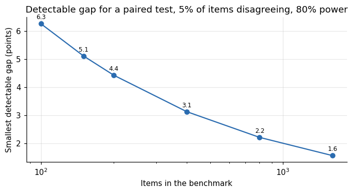

*Figure 3. Detectable gap for a paired test, 5% of items disagreeing, 80% power.*

With about 5 percent of items on which the two builds disagree, which is what the data above shows, the smallest gap that a paired test would detect with 80 percent power is about 5.1 points at 150 items, 4.4 at 200 and 2.2 at 800 items. The multiplier of 2.8 is the standard sum of the 5 percent significance and 80 percent power factors.

So the statement I can defend is this. If any of these builds were worse than BF16 by more than about 5 points on these benchmarks, I would probably have seen it. A gap of one or two points is below what I could resolve. Published evaluations that report differences of a point or two between quantization formats on a few hundred items are mostly reporting noise, and the same caution applies to mine.

## 7. Run-to-run noise as a second yardstick

I ran the AWQ build twice on this harness, once on an RTX 3090 earlier in the campaign and once here on the PRO 6000. The two runs scored 95.3 and 94.7 percent on math and 94.5 and 93.3 percent on code, with the knowledge score identical at 80.0. The same model, the same prompts and the same decoding settings moved by up to 1.2 points because of different hardware kernels and floating point order. That is a useful scale: differences between builds of the size of one point are indistinguishable from the difference between two runs of one build.

Both runs are in the published files. The earlier one is the AWQ row of `capability_checks.csv`, the one from this ladder is the AWQ row of `quantization_ladder.csv`.

| Run | Math (n=150) | Knowledge (n=200) | Code (n=164) | JSON (n=24) |
|---|---|---|---|---|
| capability_checks.csv (earlier run) | 95.3 | 80.0 | 94.5 | 100.0 |
| quantization_ladder.csv (this ladder) | 94.7 | 80.0 | 93.3 | 100.0 |
| Difference in points | 0.7 | 0.0 | 1.2 | 0.0 |

The largest gap is on code, 1.2 points, which is 2 problems out of 164 (155 against 153 solved). The knowledge score is identical, and the JSON task is 24 of 24 in both.

## 8. How much smaller is each build, really?

The names suggest a tidy ladder: 16 bits, 8 bits, 4 bits and 4 bits. The measured memory says the rungs are not equally spaced.

**Table 3.** How much smaller is each build, really?

| Precision | Weights GiB | GiB vs BF16 | Bits per weight if 27B params |
|---|---|---|---|
| AWQ 4-bit | 17.8 | 0.35 | 5.66 |
| NVFP4 | 27.69 | 0.54 | 8.81 |
| FP8 (online from BF16) | 28.06 | 0.55 | 8.93 |
| BF16 | 51.1 | 1 | 16.26 |

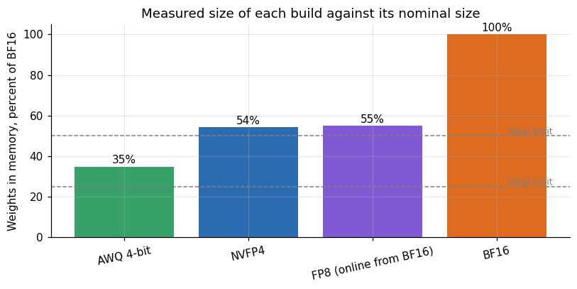

*Figure 4. Measured size of each build against its nominal size.*

Relative to the BF16 build at 51.1 GiB, FP8 occupies 55 percent, which is what you expect from 8 bits against 16 plus the scales. The AWQ build occupies 35 percent, above the 25 percent that a pure 4-bit model would take, and the NVFP4 build occupies 54 percent, which is almost the size of the 8-bit build.

If the model has about 27 billion parameters, the measured memory corresponds to an average of 5.7 bits per weight for AWQ, 8.8 for NVFP4, 8.9 for FP8 and 16.3 for BF16. The 16.3 bits for BF16 suggests the true parameter count is a little above 27 billion, or that a small part of the memory is not weights, so I read these averages as approximate. The pattern survives that doubt: the AWQ build is much closer to 4 bits than the NVFP4 build is.

Why would a 4-bit build be as large as an 8-bit one? The most likely reason is that the NVFP4 checkpoint quantizes only some of the layers and leaves others, such as attention projections, embeddings, the output head and perhaps a vision tower, in 16-bit. I did not inspect the checkpoint's layer list, so this is an inference from sizes. With the sizes alone, and a block-scaled 4-bit format costing about 4.5 bits per weight, the arithmetic implies that roughly 63 percent of the weights are in 4-bit form if the rest are in 16-bit. The practical consequence is large: this particular NVFP4 build does not save memory over FP8. Whatever advantage it has must come from speed on cards with hardware paths for 4-bit floating point, not from the footprint.

A buyer who sees "4-bit" on a model card and plans a 24 gigabyte card around it should check the size on disk. The AWQ build fit on a 24 gigabyte card with room to spare. The NVFP4 build did not fit on a 32 gigabyte card.

## 9. Where the builds disagree

Aggregate accuracy hides which questions are hard. Looking at the items, most mistakes are shared by all four builds, and the disagreements come from a small set of borderline questions.

**Table 4.** Where the builds disagree

|  | Items | All four correct | All four wrong | Builds disagree |
|---|---|---|---|---|
| gsm8k | 150 | 136 | 3 | 11 |
| mmlu | 200 | 150 | 25 | 25 |
| humaneval | 164 | 144 | 3 | 17 |

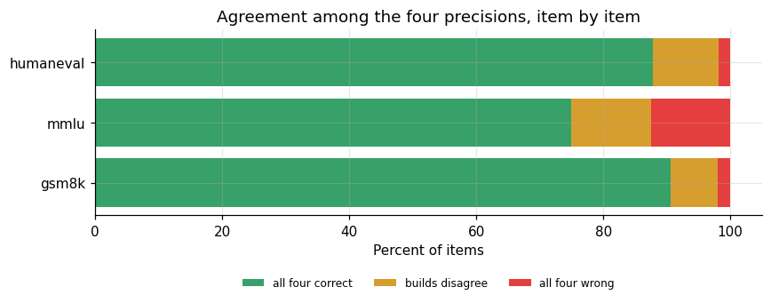

*Figure 5. Agreement among the four precisions, item by item.*

On math, 136 of 150 items were solved by all four builds and 3 were missed by all four; only 11 items (7 percent) split the builds. On knowledge, 150 of 200 were correct everywhere and 25 were wrong everywhere, leaving 25 items (12.5 percent) where builds differed. On code, 144 of 164 were solved by all four, 3 by none, and 17 split the builds.

The knowledge benchmark is the most sensitive because multiple choice with four options gives a 25 percent chance of guessing right. A borderline question can flip with tiny numeric changes. On the splits, the builds were not uniformly ordered: for example on math, among items where exactly one build was wrong, 8 items had one build failing and 1 item had only one build succeeding. A consistent ranking of precisions by quality would show up as the lowest-precision build failing the shared borderline items. It does not.

The 25 items that every build missed on the knowledge benchmark are worth a note. They are either hard, ambiguous or mislabeled, and they set a ceiling of 87.5 percent on this sample that no precision could break. Looking at the benchmark's actual score range of 80 to 82 percent against that ceiling puts the differences between builds in perspective: of the 175 items that at least one build got right, the weakest build got 160 and the strongest 164.

## 10. How to run your own ladder

The method is cheap, and the mistakes are common, so here is the protocol I would follow again.

Fix everything but the thing you vary. Same engine and version, same prompts, same decoding settings, same seed, same host for every rung, one after the other. If your builds come from different sources, write the confound down before you run, because afterwards you will want to forget it.

Use greedy decoding for accuracy benchmarks. With a nonzero temperature, repeated runs of one build move by more than the differences you are looking for, and you would need several repetitions per build to see anything.

Record per-item results. A score is a count, and a count cannot be paired. The per-item flags let you run a paired test and tell shared mistakes from flips.

This is what the per-item file looks like. The four lines below are one math item, number 51, in `ladder_items.csv`: the header and the four rows, copied from the file. There is no question or answer text in the file, only the item number, the verdict, the latency and the token count.

```
precision,benchmark,item,ok,seconds,tokens
AWQ 4-bit,gsm8k,51,True,5.721,286.0
NVFP4,gsm8k,51,True,7.911,280.0
FP8 (online from BF16),gsm8k,51,True,6.121,201.0
BF16,gsm8k,51,False,16.746,342.0
```

Three builds got item 51 right and BF16 got it wrong, which makes it one of the 8 math items on which exactly one build failed. The verdicts differ and so do the answers: the four builds wrote between 201 and 342 tokens for the same question, and the BF16 answer took 16.7 seconds against 6.1 for FP8. The per-item file is what lets me count such items, which a table of accuracies cannot do.

Size the benchmark to the effect you care about. If you only care about gaps larger than 5 points, 150 items is enough. If you care about 1 point, you need on the order of 4,000 items with a similar disagreement rate, and a fixed set of questions that you re-run rather than a fresh sample each time.

Run one build twice. The gap between two runs of the same configuration is your noise floor, and it costs one extra half hour of rental.

Report the interval next to the point estimate. A table with 94.7 and 95.3 side by side invites a conclusion the data cannot support.

## 11. Questions I expect

**Does 4-bit quantization lose accuracy?** On this battery, with the detection limit stated above, I could not see a loss. I did not test harder or longer tasks, where the effect could be larger.

**Why does the NVFP4 build not shrink more?** Its memory is close to FP8's, and my reading is that a large share of its weights stay in 16-bit. If the footprint is what you need, check the size on disk of the specific checkpoint.

**Why did AWQ and NVFP4 write longer answers?** They derive from different checkpoints than the FP8 and BF16 builds, and answer length is a property of the checkpoint's fine-tuning. The two builds that share weights, FP8 and BF16, wrote math answers within 3 percent of each other in length (309 and 317 tokens).

**Which build should I pick for a coding assistant?** The one that fits your memory and gives acceptable latency, and then a test on your own code. HumanEval scores of 91.5 to 93.3 percent say nothing about your repository.

**Can I use these results for other models?** The method transfers. The numbers do not. A smaller model may be more sensitive to quantization. I did not test one, because the 9 billion model ran only in BF16.

## 12. Memory: where the precisions truly differ

Quality is a wash; memory is not.

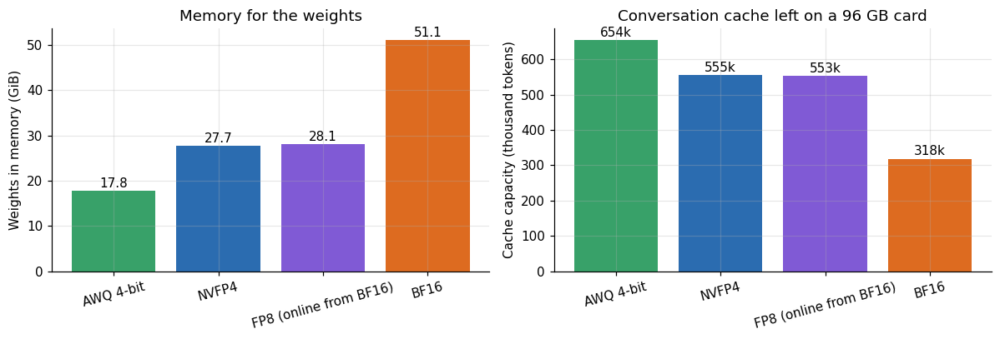

*Figure 6. Memory for the weights.*

**Table 5.** Memory: where the precisions truly differ

| Precision | Weights GiB | KV cache tokens | Concurrent 8k requests |
|---|---|---|---|
| AWQ 4-bit | 17.8 | 654396 | 79.9 |
| NVFP4 | 27.69 | 555128 | 67.8 |
| FP8 (online from BF16) | 28.06 | 553200 | 67.5 |
| BF16 | 51.1 | 318042 | 38.8 |

The server reports how many tokens of conversation history fit in the cache after loading the weights. On the 96 gigabyte card with the engine's default memory fraction, AWQ leaves room for 654,396 tokens, NVFP4 for 555,128, FP8 for 553,200 and BF16 for 318,042. In terms of simultaneous 8,192-token conversations, that is about 80 for AWQ, 68 each for NVFP4 and FP8 and 39 for BF16. BF16 halves the number of long conversations a card can hold compared with AWQ.

The numbers come from three lines per start in the server log. Here they are for the four rungs, in the order they ran, selected from the curated start logs.

```
INFO 10-27 20:26:07 [model_runner.py:428] Model loading took 17.8 GiB memory and 5.052150 seconds
INFO 10-27 20:28:05 [gpu_worker.py:640] Available KV cache memory: 64.99 GiB
INFO 10-27 20:28:05 [kv_cache_utils.py:2395] GPU KV cache size: 654,396 tokens, Maximum concurrency for 8,192 tokens per request: 79.88x
INFO 10-27 20:32:55 [model_runner.py:428] Model loading took 27.69 GiB memory and 3.870207 seconds
INFO 10-27 20:33:45 [gpu_worker.py:640] Available KV cache memory: 55.14 GiB
INFO 10-27 20:33:45 [kv_cache_utils.py:2395] GPU KV cache size: 555,128 tokens, Maximum concurrency for 8,192 tokens per request: 67.76x
INFO 10-27 20:39:51 [model_runner.py:428] Model loading took 28.06 GiB memory and 6.398741 seconds
INFO 10-27 20:40:59 [gpu_worker.py:640] Available KV cache memory: 54.97 GiB
INFO 10-27 20:40:59 [kv_cache_utils.py:2395] GPU KV cache size: 553,200 tokens, Maximum concurrency for 8,192 tokens per request: 67.53x
INFO 10-27 20:45:58 [model_runner.py:428] Model loading took 51.1 GiB memory and 5.366005 seconds
INFO 10-27 20:46:41 [gpu_worker.py:640] Available KV cache memory: 31.63 GiB
INFO 10-27 20:46:41 [kv_cache_utils.py:2395] GPU KV cache size: 318,042 tokens, Maximum concurrency for 8,192 tokens per request: 38.82x
```

Adding the weights and the cache budget of each start gives 82.79, 82.83, 83.03 and 82.73 GiB (AWQ, NVFP4, FP8 and BF16, from `vllm_starts_all.csv`). The four sums sit within 0.3 GiB of each other, so the server fills the same budget (90 percent of 96 GiB is 86.4 GiB) and what the weights do not take goes to the cache. That is why the cache shrinks by almost exactly what the weights grow.

The effect is larger on smaller cards, because the weights take a bigger share. On a 32 gigabyte RTX 5090, the 17.8 gigabyte AWQ build leaves about 10 gigabytes of headroom under the 1.15 memory rule, and nothing larger loads at all. The ladder's memory column is therefore the argument for 4-bit formats, and the capability columns say you do not give up much to get there.

## 13. Speed and answer length

The same server ran each build under 24 concurrent requests, and each item records its latency and, for math, the number of tokens generated.

**Table 6.** Speed and answer length

|  | Seconds | Tokens | Tokens per second per request |
|---|---|---|---|
| AWQ 4-bit | 9 | 444.9 | 49.5 |
| NVFP4 | 11.9 | 419.5 | 35.2 |
| FP8 (online from BF16) | 9.3 | 308.7 | 33.3 |
| BF16 | 15.6 | 317.1 | 20.4 |

**Table 7.** Speed and answer length (part 2)

|  | AWQ 4-bit | NVFP4 | FP8 (online from BF16) | BF16 |
|---|---|---|---|---|
| gsm8k | 9 | 11.9 | 9.3 | 15.6 |
| humaneval | 4.6 | 5.7 | 5.9 | 10.2 |
| json | 8.8 | 10.4 | 10.7 | 11.8 |
| mmlu | 0.9 | 0.6 | 1.1 | 1.8 |

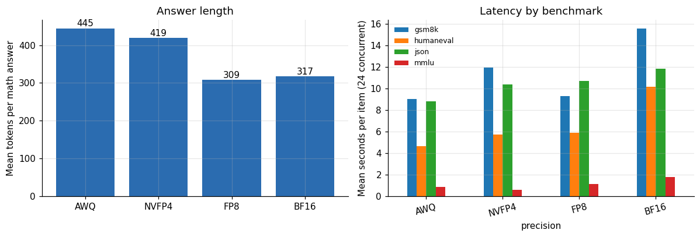

*Figure 7. Answer length.*

The AWQ build wrote math answers of 445 tokens on average and the NVFP4 build 420, against 309 for FP8 and 317 for BF16. The longer answers are consistent with the fact that AWQ and NVFP4 builds come from different checkpoints than the FP8 and BF16 pair: a lineage change can alter verbosity without altering the final answer. They are not consistent with a pure effect of 4-bit numeric precision, because the NVFP4 build and the AWQ build are far apart in method yet close in length.

Mean latency per math item under the 24-way load was 9.0 seconds for AWQ, 9.3 for FP8, 11.9 for NVFP4 and 15.6 for BF16. BF16 took 1.7 times as long as FP8 despite generating almost the same number of tokens, which is what a weight-streaming bound predicts: BF16 weights are 1.8 times larger than FP8 weights, and each generated token reads all of them. AWQ is as fast as FP8 despite generating 44 percent more tokens, so per token it is the fastest by a wide margin.

For a single user the pattern holds in the serving data. On the same card the AWQ build decoded 76.7 tokens per second and the FP8 build 45.4. Multiplying each speed by the size of its weights gives 1,365 and 1,274 GiB per second, which is within 7 percent between the two builds and 76 to 82 percent of the 1,792 GB per second memory bandwidth that the manufacturer publishes for this card, a figure I did not measure. In other words, in single-user decoding, speed follows bytes of weights read. The NVFP4 and BF16 single-user results (143 and 79 tokens per second) used speculative decoding and cannot be compared this way. That technique has its own article in the series.

The single-user speeds come from `llm_serving.csv`. Here are the rows for one user on the PRO 6000 (valid runs without reasoning mode), with three of the columns, copied from the file. The variant `plain` is the AWQ build.

```
variant,users,decode_tps_per_user_p50
plain,1,76.7
fp8_plain,1,45.4
nvfp4_dflash,1,143.1
bf16_dflash,1,78.7
```

The variant name carries the configuration: the two rows named dflash used speculative decoding, which is why I do not put them on the bandwidth line.

## 14. Correct answers per minute: speed and quality together

Accuracy says how often a build is right and latency says how long one answer takes. Neither tells you how much correct work a card produces. A build that is 1 point more accurate but twice as slow is not better for a service that pays by the hour. The ladder runs make the combined measure possible, because all four builds ran with the same harness, the same 24 concurrent requests and the same engine settings, and, as the server logs confirm, with speculative decoding off for every build. This is the cleanest speed comparison in the whole campaign, since nothing but the build changes.

The claim that speculative decoding was off for every build rests on the engine line in each start log, which prints the speculative configuration. These are the four lines, cut after that field, followed by the lines that name the kernels for the two 4-bit builds (the curated logs keep a kernel line only for those two).

```
INFO 10-27 20:26:00 [core.py:123] Initializing a V1 LLM engine (v0.30.0) with config: model='/workspace/models/awq', speculative_config=None, tokenizer='/workspace/models/…
INFO 10-27 20:32:50 [core.py:123] Initializing a V1 LLM engine (v0.30.0) with config: model='/workspace/models/target', speculative_config=None, tokenizer='/workspace/mode…
INFO 10-27 20:39:44 [core.py:123] Initializing a V1 LLM engine (v0.30.0) with config: model='/workspace/models/bf16', speculative_config=None, tokenizer='/workspace/models…
INFO 10-27 20:45:51 [core.py:123] Initializing a V1 LLM engine (v0.30.0) with config: model='/workspace/models/bf16', speculative_config=None, tokenizer='/workspace/models…
INFO 10-27 20:26:02 [compressed_tensors_wNa16.py:132] Using MarlinLinearKernel for CompressedTensorsWNA16
INFO 10-27 20:32:52 [__init__.py:1180] Using FlashInferCutlassNvFp4LinearKernel for NVFP4 GEMM
```

All four read `speculative_config=None`. The AWQ build ran through a Marlin kernel for 4-bit integer weights, and the NVFP4 build through a FlashInfer CUTLASS kernel for FP4 matrix products, so the two 4-bit builds do not share a kernel. The logs do not say which kernel served the FP8 and BF16 starts, and I did not look further.

**Table 8.** Correct answers per minute: speed and quality together

|  | Tokens | Correct | Wall s | Tokens per second | Correct per minute |
|---|---|---|---|---|---|
| AWQ 4-bit | 66,730 | 142 | 67 | 996 | 127.2 |
| NVFP4 | 62,923 | 144 | 92.5 | 680.2 | 93.4 |
| FP8 (online from BF16) | 46,299 | 144 | 66.7 | 694.1 | 129.5 |
| BF16 | 47,570 | 143 | 119.6 | 397.7 | 71.7 |

**Table 9.** Correct answers per minute: speed and quality together (part 2)

|  | Correct | Wall s | Correct per minute |
|---|---|---|---|
| AWQ 4-bit | 153 | 69.6 | 131.9 |
| NVFP4 | 152 | 91 | 100.2 |
| FP8 (online from BF16) | 150 | 94.1 | 95.6 |
| BF16 | 151 | 162.3 | 55.8 |

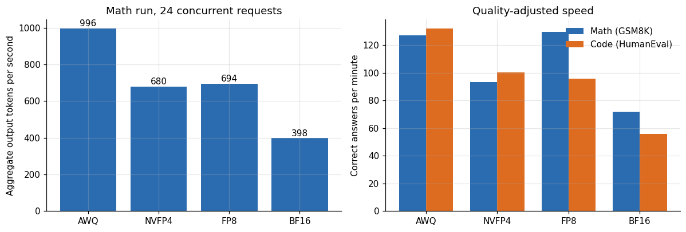

*Figure 8. Math run, 24 concurrent requests.*

On the math run the AWQ build generated 996 output tokens per second in aggregate, FP8 694, NVFP4 680 and BF16 398. The ratio between the fastest and slowest is 2.5. It tracks the size of the weights, with one exception: NVFP4 is no faster than FP8 here despite its marketing as a 4-bit format. That agrees with the footprint finding above, where the NVFP4 build is the same size as the FP8 one. Without speculative decoding, on this card and at this concurrency, NVFP4 bought no speed over FP8.

The right-hand panel converts speed into useful work. On math, AWQ and FP8 produced about 127 and 130 correct answers per minute, NVFP4 93 and BF16 72. On code, AWQ produced 132 correct solutions per minute, NVFP4 100, FP8 96 and BF16 56. On math, BF16 delivered 56 percent of AWQ's correct answers per minute and 55 percent of FP8's. On code it delivered 42 percent of AWQ's and 58 percent of FP8's. The paired tests cannot distinguish the quality of any of them.

Two caveats limit how far to take these figures. First, the harness uses 24 concurrent requests regardless of the build, which suits the faster builds and understates the largest-batch throughput the slower builds could reach if I raised the concurrency. Second, the AWQ build writes the longest answers, so its tokens-per-second lead is partly a lead in verbose output, and its correct-answers-per-minute figure is the fairer one. On that measure it is level with FP8 on math and well ahead on code.

If you translate this to money, the BF16 build needs about 1.8 times as many GPU-minutes per correct answer as FP8 on math and 1.7 times on code, on identical weights and with the same accuracy. At the 1.47 dollars per hour the PRO 6000 cost in this session, that is the difference between about 1.9 and 3.4 cents per hundred correct math answers. The sums are small because the battery is small, and the ratio is what carries over to a service that answers millions of questions.

**Table 10.** Correct answers per minute: speed and quality together (part 3)

|  | Math USD per 100 correct | Code USD per 100 correct |
|---|---|---|
| AWQ 4-bit | 0.0193 | 0.0186 |
| NVFP4 | 0.0262 | 0.0245 |
| FP8 (online from BF16) | 0.0189 | 0.0256 |
| BF16 | 0.0342 | 0.0439 |

## 15. What the cache numbers imply for smaller cards

The server reports its cache capacity in tokens, and the weights in gibibytes. Two numbers per build on one card are enough to back out how much memory one cached token costs, which then lets me estimate what a smaller card would have left over. This is an extrapolation and I label it as one.

**Table 11.** What the cache numbers imply for smaller cards

| Pair | Mib per token |
|---|---|
| AWQ 4-bit vs BF16 | 0.1014 |
| AWQ 4-bit vs NVFP4 | 0.102 |
| NVFP4 vs BF16 | 0.1011 |
| FP8 (online from BF16) vs BF16 | 0.1003 |

**Table 12.** What the cache numbers imply for smaller cards (part 2)

|  | Weights GiB | Cache pool GiB | Implied overhead GiB |
|---|---|---|---|
| AWQ 4-bit | 17.8 | 64.7 | 3.9 |
| NVFP4 | 27.69 | 54.9 | 3.8 |
| FP8 (online from BF16) | 28.06 | 54.7 | 3.6 |
| BF16 | 51.1 | 31.4 | 3.9 |

**Table 13.** What the cache numbers imply for smaller cards (part 3)

|  | AWQ 4-bit | NVFP4 | FP8 (online from BF16) | BF16 |
|---|---|---|---|---|
| RTX 3090 / 4090 (24) | 0 | 0 | 0 | 0 |
| RTX 5090 (32) | 73 | 0 | 0 | 0 |
| L40S (48) | 218 | 118 | 115 | 0 |
| PRO 6000 (96) | 655 | 555 | 552 | 319 |

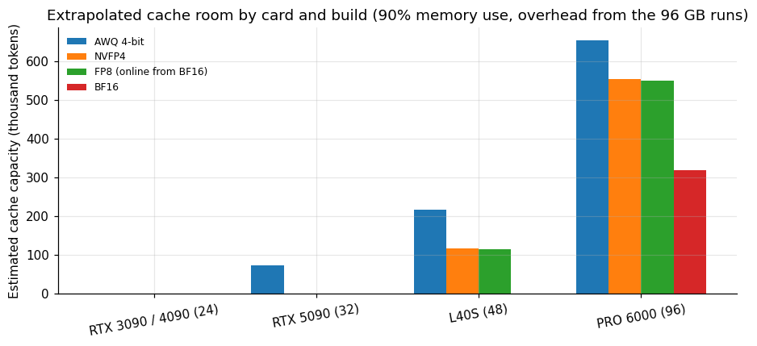

*Figure 9. Extrapolated cache room by card and build (90% memory use, overhead from the 96 GB runs).*

The four pairwise estimates agree closely, at about 0.10 MiB (roughly 104 KiB) of cache per token. That agreement is a good sign for the method, because the pairs mix different weight sizes and different cache sizes. Multiplying the reported cache capacity by this cost gives the size of the cache pool in each run, between 31 and 65 GiB, and subtracting weights and pool from 90 percent of the card's memory gives an implied fixed overhead of about 3 to 4 GiB for activations and graph capture.

Carrying the same per-token cost and overhead to smaller cards gives mixed results. A 32 gigabyte card running the AWQ build comes out at about 73 thousand tokens of cache, enough for a handful of simultaneous short conversations and not for long agent sessions. The 48 gigabyte card with FP8 or NVFP4 comes out near 115 to 118 thousand tokens, and BF16 does not fit. Only the 96 gigabyte card reaches half a million tokens for the 4-bit builds. For the 24 gigabyte cards the extrapolation says zero, yet those cards did serve the AWQ build with short context windows. The start logs show that the memory fraction in those runs was 0.92, higher than the 90 percent I assumed. That explains only part of the gap: at 0.92 the same extrapolation gives about 4,801 tokens for a 24 gigabyte card against the 16,000 measured. The rest must come from a smaller overhead, which the logs put at about 2.6 GiB on the 3090 (0.92 of 24 GiB, minus the 17.8 GiB of weights and the 1.66 GiB left for the cache), against 3.8 on the 96 gigabyte card. The extrapolation is too pessimistic at the small end. Treat the table as a lower bound and as a way to rank options.

The extrapolation can be checked, because the AWQ build also started on the other cards with the same 8,192-token context limit. The table lines my estimate up against the cache that each start log reported. The grey bars are the extrapolation of Table 13, recomputed with the code of the notebook (0.1012 MiB per token and 3.8 GiB of overhead), the orange bars repeat it at the memory fraction of the start, and the blue bars are the figure each server printed.

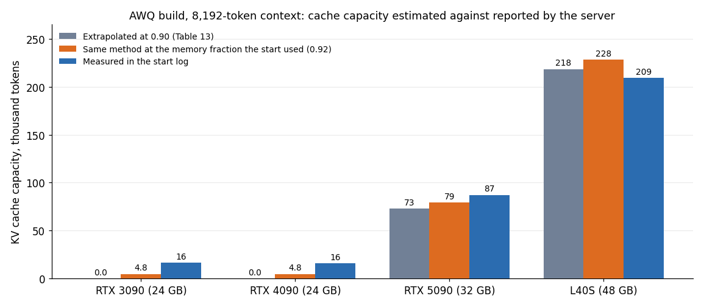

*Figure 10. AWQ build on four cards, 8,192-token context: cache capacity extrapolated in Table 13, the same method at the start's memory fraction, and the figure in the server start log.*

The 96 GB card is left out because the estimate was fitted on it (measured 654,396 and 673,671 tokens against 655,341 estimated), so its agreement proves nothing. On the L40S the estimate was 4 percent above the measured 209,136 tokens, and on the 5090 it was 17 percent below the measured 87,220. On the 24 GB cards the estimate was zero and the servers reported 15,902 to 16,865 tokens.

I stress that these are estimates built from one pair of runs on one card, with the assumption that the engine's memory fraction and overhead carry over. The real figure will differ with the engine version, the context-length setting and CUDA graph options. Use the table to rank options, and measure before you commit.

## 16. A buyer's scenario

To close the loop, take a service that must answer 10,000 questions of the GSM8K type an hour at the accuracy this battery shows. The correct-answers-per-minute figures translate into the number of cards, and the price of the card into dollars.

**Table 14.** A buyer's scenario

| Precision | Correct answers per card hour | Cards for 10k per hour | USD per hour 96GB card | USD per 10k answers |
|---|---|---|---|---|
| AWQ 4-bit | 7630 | 1.31 | 1.471 | 1.928 |
| NVFP4 | 5604 | 1.78 | 1.471 | 2.625 |
| FP8 (online from BF16) | 7772 | 1.29 | 1.471 | 1.893 |
| BF16 | 4304 | 2.32 | 1.471 | 3.417 |

At 24 concurrent requests, one PRO 6000 running the FP8 build answers about 7,770 math questions correctly per hour, the AWQ build 7,630, NVFP4 5,600 and BF16 4,300. To reach 10,000 correct answers an hour you need 1.3 cards of FP8, 1.3 of AWQ, 1.8 of NVFP4 and 2.3 of BF16, which at 1.471 dollars an hour is 1.89, 1.93, 2.62 and 3.42 dollars. The problem set is a toy and the absolute amounts are meaningless. The relative amounts carry over: the BF16 build costs 1.8 times as much per correct answer as the FP8 build that shares its weights.

## 17. Throughput at scale

Under concurrency the picture changes, because large batches amortize the weight reads.

**Table 15.** Throughput at scale

|  | BF16 + spec | FP8 (no spec) | NVFP4 + spec | AWQ |
|---|---|---|---|---|
| 1 | 85 | 42 | 129 | 75 |
| 2 | 134 | – | 195 | – |
| 4 | 280 | 140 | 390 | 234 |
| 8 | 402 | 278 | 605 | 399 |
| 16 | 608 | 419 | 930 | 693 |
| 32 | 505 | 694 | 1,364 | – |
| 64 | – | – | 1,390 | – |
| 100 | – | – | 1,349 | – |
| 128 | – | – | 1,341 | – |

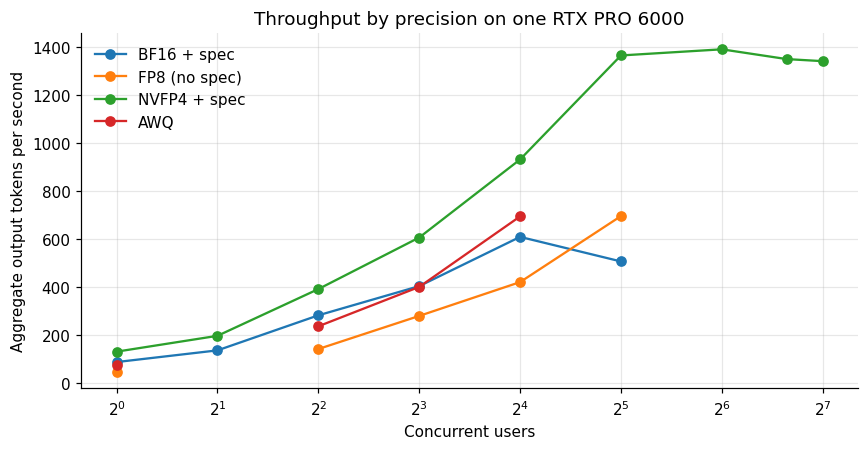

*Figure 11. Throughput by precision on one RTX PRO 6000.*

At 16 users the AWQ build reached 693 tokens per second and FP8 without speculative decoding 419. At 32 users FP8 reached 694, NVFP4 with speculative decoding 1,364 and BF16 with speculative decoding 505, while the AWQ configuration had not been tested past 16 users on this card. The serving configurations differ in more than precision, since two use speculative decoding and the AWQ and FP8 runs do not, so I read this figure as a measurement of four deployable configurations and not as a controlled comparison of formats.

The start logs of the servers behind the four columns show how much more than precision differs. These are the engine lines of one start per column, cut after the speculative field (the first and last two come from different sessions on the same card).

```
INFO 10-26 12:07:31 [core.py:123] Initializing a V1 LLM engine (v0.30.0) with config: model='/workspace/models/bf16', speculative_config=SpeculativeConfig(method='dflash', model='/workspace/models/drafter', num_spec_tokens=7), tokenizer='/workspace/models/bf16'…
INFO 10-26 11:57:24 [core.py:123] Initializing a V1 LLM engine (v0.30.0) with config: model='/workspace/models/target', speculative_config=SpeculativeConfig(method='dflash', model='/workspace/models/drafter', num_spec_tokens=7), tokenizer='/workspace/models/tar…
INFO 10-27 08:32:54 [core.py:123] Initializing a V1 LLM engine (v0.30.0) with config: model='/workspace/models/bf16', speculative_config=None, tokenizer='/workspace/models/bf16', skip_tokenizer_init=False, tokenizer_mode=auto, revision=None, tokenizer_revision=…
INFO 10-27 08:29:02 [core.py:123] Initializing a V1 LLM engine (v0.30.0) with config: model='/workspace/models/awq27', speculative_config=None, tokenizer='/workspace/models/awq27', skip_tokenizer_init=False, tokenizer_mode=auto, revision=None, tokenizer_revisio…
```

Two columns carry a `SpeculativeConfig` with the dflash method and seven drafted tokens, and two read `speculative_config=None`. The same files give the context limit and the memory fraction: 32,768 tokens and 0.88 for BF16, 32,768 and 0.88 for NVFP4, 32,768 and 0.90 for FP8, 8,192 and 0.92 for AWQ (from `vllm_starts_all.csv`). The AWQ column therefore ran with a context limit four times shorter than the other three, which is one more reason to read the throughput figure as four configurations.

## 18. Takeaways by role

If you pay for the GPU, the useful figure is correct answers per minute, and the 4-bit AWQ and 8-bit FP8 builds led it on this card at 127 to 132 per minute on both math and code, well ahead of BF16.

If you write the service, the useful figure is the cache capacity, because it sets how many long conversations a card holds. The AWQ build held 654,396 tokens and the BF16 build 318,042 on the same card.

If you evaluate models, the useful figure is the detectable gap. At 150 to 200 items per benchmark the battery cannot see differences below about 4 to 5 points, so a claim that one precision is better than another needs a larger sample and paired item-level data.

If you carry the decision to a buyer, the honest sentence is that I found no capability loss from quantization larger than the noise, that the size of the saving depends on the specific checkpoint, and that behavior, which this article does not cover, was the thing that moved.

**Table 16.** Behavior counts and reply lengths for the four builds

| Build | Boundary trials judged unsafe at temperature 0.7 (of 21) | Boundary replies of 5 tokens or fewer (of 28) | Mean tokens per math answer |
|---|---|---|---|
| AWQ 4-bit | 17 | 0 | 445 |
| NVFP4 | 5 | 0 | 420 |
| FP8 | 9 | 22 | 309 |
| BF16 | 9 | 23 | 317 |

Here are the counts behind the word behavior in that sentence, recounted from the fixed-judge file of the same session (`rejudge.jsonl`, 160 judgments) and from the reply lengths in the generation files. I used only labels and token counts. The prompts and replies stay unpublished, and the article on refusal behavior has the full analysis.

The unsafe counts run from 5 to 17 of 21 across the four builds, while the accuracies in Table 1 span 2 points or less on each of the three benchmarks. The reply lengths split the builds in two groups as well: 22 of the 28 FP8 replies and 23 of the 28 BF16 replies to the boundary prompts had five tokens or fewer, against none for AWQ and NVFP4. The two builds that wrote the longer math answers (the AWQ and NVFP4 rows) are the two that wrote the long replies here. I do not know why.

## 19. Behavior is a different story

The ladder also ran a behavior battery: a set of prompts that probe where each build draws the line on requests it should refuse, judged by one fixed judge. The result is not "no difference". The builds differ a great deal in how often they comply with boundary-testing requests, and that difference is much larger than any difference in capability. I treat it in a separate article on abliteration, because it is a property of the checkpoint lineage and not of the numeric format, and because the evidence is aggregate counts only. The relevant point for this article is the contrast: capability moved within noise across the ladder while behavior did not. If you choose a quantization format by capability, you may be choosing a behavior without knowing.

## 20. A decision guide

Given the evidence, here is how I would choose.

If memory is the constraint, use the 4-bit format your hardware supports. AWQ ran on every card I measured and left the most room for cache. NVFP4 is no smaller than FP8 in this checkpoint (27.69 against 28.06 GiB loaded), so it saves no memory over FP8, and the 5090 failed to hold it for that reason. The 4-bit float kernels ran on the PRO 6000 and the GB10, and through a software kernel on an Ada card, the L40S. Expect no loss of capability larger than a few points.

The kernel claims in this paragraph come from the start logs of the NVFP4 build. These are the lines that name the kernel, the weights and the cache budget on the PRO 6000, the GB10 and the L40S, followed by the tail of the failed start on the RTX 5090 (selected from the logs, in that order).

```
INFO 10-27 20:32:52 [__init__.py:1180] Using FlashInferCutlassNvFp4LinearKernel for NVFP4 GEMM
INFO 10-27 20:32:55 [model_runner.py:428] Model loading took 27.69 GiB memory and 3.870207 seconds
INFO 10-27 20:33:45 [gpu_worker.py:640] Available KV cache memory: 55.14 GiB
INFO 10-26 11:42:23 [__init__.py:1180] Using FlashInferCutlassNvFp4LinearKernel for NVFP4 GEMM
INFO 10-26 11:45:20 [model_runner.py:428] Model loading took 31.46 GiB memory and 177.299205 seconds
INFO 10-26 11:47:04 [gpu_worker.py:640] Available KV cache memory: 63.36 GiB
INFO 10-27 07:38:44 [__init__.py:1180] Using MarlinNvFp4LinearKernel for NVFP4 GEMM
WARNING 10-27 07:38:48 [marlin.py:34] Your GPU does not have native support for FP4 computation but FP4 quantization is being used. Weight-only FP4 compression will be used leveraging the Marlin kernel. This may degrade performance for com…
INFO 10-27 07:38:50 [model_runner.py:428] Model loading took 31.47 GiB memory and 6.690813 seconds
INFO 10-27 07:41:01 [gpu_worker.py:640] Available KV cache memory: 7.09 GiB
INFO 10-26 12:31:08 [model_runner.py:428] Model loading took 27.69 GiB memory and 8.219987 seconds
INFO 10-26 12:32:52 [gpu_worker.py:640] Available KV cache memory: -0.68 GiB
ValueError: No available memory for the cache blocks. Try increasing `gpu_memory_utilization` when initializing the engine (this flag also controls CPU memory reservation on the CPU backend…
```

The PRO 6000 and the GB10 report a FlashInfer CUTLASS kernel for the FP4 products. The L40S reports a Marlin kernel and a warning that the GPU has no native FP4 support, so the weights are compressed and the arithmetic is not done in FP4. On the 5090 the weights took 27.69 GiB and the server computed a cache budget of minus 0.68 GiB, which is the failure the paragraph mentions.

If you have the memory for FP8 and your card supports it natively (compute capability 8.9 or higher), FP8 is the safe middle: the same weights as BF16, indistinguishable answers on this battery, and a bit more than half the memory.

Use BF16 only when you must, such as when you intend to fine-tune or when you need to compare against a reference. It costs a card's worth of memory, halves the long-conversation capacity and was the slowest in every latency measure.

Whichever format you pick, run a few hundred of your own items before you commit. The reason is not that quantization is dangerous. It is that the battery here cannot resolve differences of one or two points, and your task may be more sensitive than grade-school math.

## 21. Limitations

Before the limitations themselves, here are the main claims of this article with the evidence behind each and the caveat that goes with it, taken from the sections above.

**Table 17.** Claims, evidence and caveats

| Claim | Evidence behind it | Caveat |
|---|---|---|
| No precision was measurably worse on math, knowledge or code | 150, 200 and 164 paired items per build; exact p-values from 0.48 to 1.0 over 12 comparisons | A paired test on these samples resolves gaps of about 4 to 5 points, not 1 or 2 |
| BF16 against FP8 is a clean change of precision | Same checkpoint directory, FP8 applied when the server starts; verdicts differ on 1 of 150, 3 of 200 and 1 of 164 items | AWQ comes from another author and checkpoint, so its rows mix format and lineage |
| The NVFP4 build is no smaller than FP8 | 27.69 against 28.06 GiB in the start logs | I did not inspect the layer list, so the reason is an inference from sizes |
| BF16 delivers 55 to 58 percent of FP8's correct answers per minute | Same harness, 24 requests in flight, speculation off in every start log | One concurrency level and one repetition per build |
| Cache room on smaller cards follows from two runs on one card | Extrapolation checked against measured AWQ starts on four cards | Off by 4 to 17 percent where it was checkable, and far too low on 24 GB cards |
| Behavior moved where capability did not | Fixed-judge counts and reply lengths for the same four builds | Seven prompts and a model judge; see the refusal article |

The sample sizes are 150, 200 and 164 items, and the JSON set has 24. The detectable gap is 4 to 5 points or more. The builds differ in lineage, and the AWQ comparison cannot isolate format. The battery is zero-shot at temperature 0, so it says nothing about sampling behavior at higher temperatures, long-context accuracy or multilingual quality. The Portuguese free-text generations that the harness also produced are not scored in this article. The server was vLLM at one version with default memory settings. One host produced all four rows, which controls for hardware and confounds nothing, but it also means I have a single repetition per build except for the AWQ rerun. The latency and token counts are under a particular concurrency level, and the throughput table mixes configurations that differ in speculative decoding.

## 22. How much it cost

The ladder ran in one rental of an RTX PRO 6000 that lasted about 42 minutes and cost 1.03 dollars at 1.47 dollars per hour, according to the lease ledger. The same session also ran the behavior battery and an engine comparison, so the ladder's own share is smaller. The campaign as a whole cost US$ 50.79.

## 23. Reproducing this analysis

Attach the dataset `gpu-ai-benchmark-campaign-2026`. The per-item file `ladder_items.csv` holds a correct or incorrect flag, the latency and, for math, the token count for each of the 538 items per build. The repository `quantization-and-offload-lab` publishes the harness, `intel.py`, and the launch script for the ladder.

## 24. Glossary

- **AWQ**: activation-aware weight quantization to 4-bit integers.
- **NVFP4**: a 4-bit floating point format with block scaling, native to Blackwell tensor cores.
- **FP8**: 8-bit floating point, native from compute capability 8.9.
- **BF16**: 16-bit brain floating point, the usual full-precision format for training and serving.
- **KV cache**: stored attention state for earlier tokens.
- **Wilson interval**: a confidence interval for a proportion that behaves well near 0 and 1.
- **McNemar's test**: a paired test for two classifiers evaluated on the same items.
- **Speculative decoding**: a draft model proposes tokens that the large model verifies in parallel.

Lucas Rangel
