# SAM 2 Grounding DINO and Mask R-CNN latency

**Lucas Rangel** · [Kaggle writeup](https://www.kaggle.com/writeups/lucasrangelss/sam-2-grounding-dino-and-mask-r-cnn-latency) · [Executable notebook](https://www.kaggle.com/code/lucasrangelss/sam-2-grounding-dino-and-mask-r-cnn-latency) · [Code and data](https://github.com/LucasRangelSSouza/gpu-ai-benchmark-hub) · [Dataset](https://www.kaggle.com/datasets/lucasrangelss/gpu-ai-benchmark-campaign-2026)

## Abstract

Segmentation and open-vocabulary detection models sit in the middle of many image pipelines: labeling tools, catalog cleanup, quality control, robotics. I timed three of them on seven kinds of GPU: SAM 2 (promptable segmentation), Grounding DINO (detection from a text prompt) and Mask R-CNN (instance segmentation, run through the torchvision implementation as a stand-in for Detectron2). The measurements are single-image latencies at batch size 1, taken on rented machines that I used for other tests as well. The ordering of the cards depends on the model, which is the main finding, and one measurement is 17 times slower than an additive model predicts for it, which I cannot explain.

- The campaign logged 29 records for these models. Twenty-three produced a latency and six failed: three Detectron2 attempts, two installs of SAM 2 and one model download for Grounding DINO. All six failures were environment or network problems and none was a limit of the card.
- Detectron2 itself ran once, on an RTX 3090: Mask R-CNN took 51.1 milliseconds at the median on real images, against 30.2 for the torchvision stand-in on random noise, so the stand-in in the main tables is a floor.
- SAM 2 took from 21.8 milliseconds on the RTX 5090 to 92.0 on the GB10 for one image and one point prompt, a factor of 4.2, and 505.5 milliseconds on one RTX PRO 6000 host. The same card model is expected to run it near 30 milliseconds.
- Grounding DINO ranged from 45.4 milliseconds on the 5090 to 168.8 on the GB10, and the RTX 4090 (149.3) was slower than the RTX 3090 (108.1) on it, while the 4090 was faster than the 3090 on SAM 2 and on Mask R-CNN.
- An additive model with one factor per card and one per model fits the 19 cell medians to within 23 percent (standard deviation of the residuals), and the largest residual is 46 percent. The card factor is a property of the host as much as of the GPU: these models run a few dozen milliseconds, and in that range the processor and the Python stack matter.
- At batch size 1 a single stream on the 5090 processes about 46 SAM 2 images per second. A thousand SAM 2 images cost about 0.39 US cents of rental on the 5090, the lowest of the cards, and 0.50 cents on the RTX 3090.

> **Code and data.** Everything behind this article is public: the code that ran, the curated data, the analysis that regenerates every figure, and tests that pin the conclusions to the data. Repositories: [vision-detection-tracking-bench](https://github.com/LucasRangelSSouza/vision-detection-tracking-bench). Index of the whole series: [gpu-ai-benchmark-hub](https://github.com/LucasRangelSSouza/gpu-ai-benchmark-hub).

## 1. What each model does, and what I timed

SAM 2 is a segmentation model from Meta that takes an image and a prompt, such as a point, and returns a mask of the object under the prompt. Its image encoder is a large vision transformer (the checkpoint I used is the "hiera large" one), and the part that handles the prompt is small. In the timed function I call the image encoder once and then the prompt predictor once with a single point, in bfloat16.

Grounding DINO takes an image and a text phrase and returns boxes for the things in the phrase. I used the "base" model from the Hugging Face hub through the transformers library, in half precision, with a three-class prompt ("a person. a car. a cat."). The timed function includes the preprocessing of the image and the text on the processor, then the model call, so it measures the pipeline a user would run and not the neural network alone.

Mask R-CNN is a classic instance segmentation network that proposes regions and predicts a mask for each. The usual research implementation is Detectron2. It would not build in the first two rented environments where I tried it (the compilation step failed on an RTX 4090 and on an RTX 5090), so for the main tables I ran the torchvision implementation of the same architecture with its default weights and a 800 by 1200 pixel input of random noise. Random noise yields few confident detections, so the post-processing is lighter than it would be on a real photograph, and the number is a lower bound for a busy scene. Detectron2 later ran on an RTX 3090 in another suite, and a section below compares the two.

All three timings use the same harness: three untimed warm-up calls, then 10, 15 or 20 timed calls (SAM 2, Grounding DINO and Mask R-CNN respectively), with a CUDA synchronization after each call so the clock stops when the GPU finishes. The 50th percentile is the median of the timed calls and the 95th percentile is the second slowest call in all three cases. With so few calls, the 95th percentile is a rough indicator of jitter.

## 2. The attempts

**Table 1.** The attempts

|  | Failed | Latency measured |
|---|---|---|
| detectron2 | 3 | 1 |
| detectron2_faster_rcnn | 0 | 1 |
| grounding_dino | 1 | 7 |
| maskrcnn_torchvision | 0 | 7 |
| sam2 | 2 | 7 |

**Table 2.** The attempts (part 2)

|  | Session | GPU | Lib | Stage | Reason |
|---|---|---|---|---|---|
| 0 | 20261026T105054 | RTX 4090 | detectron2 | install | ges/setuptools/_distutils/cmd.py", line 342, i... |
| 1 | 20261026T121335 | RTX 5090 | detectron2 | install | istutils/command/build_ext.py", line 484, in b... |
| 2 | 20261026T185012 | RTX 3090 | detectron2 | sandbox | ModuleNotFoundError: No module named 'pkg_reso... |
| 9 | 20261027T022124 | RTX 3090 | grounding_dino | – | OSError("Can't load the model for 'IDEA-Resear... |
| 24 | 20261027T022124 | RTX 3090 | sam2 | install | error: subprocess-exited-with-error × git clo... |
| 26 | 20261027T075632 | RTX PRO 6000 | sam2 | install | ERROR: Could not find a version that satisfies... |

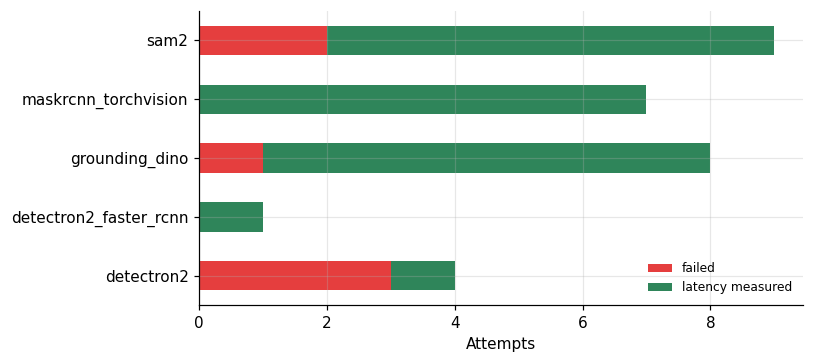

*Figure 1. The attempts.*

The ledger of attempts has 29 rows. SAM 2 was measured 7 times and failed 2; Grounding DINO was measured 7 times and failed once; the torchvision Mask R-CNN was measured 7 times and never failed; Detectron2 failed 3 times and ran once, which produced a row for Mask R-CNN and one for Faster R-CNN.

The SAM 2 failures were both installation errors: in one the package index could not find a required dependency (the RTX PRO 6000 session), and in the other the clone of the source repository from GitHub failed because the disk was full (an RTX 3090 session). The Grounding DINO failure was the model download: the transformers library could not load the model from the hub in one RTX 3090 session, which had 200 MB of free disk for a 933 MB file, and the next session on the same card loaded it. Two of the three Detectron2 failures were compilation errors during its install, and the third was a missing Python module in a fresh environment. None of these is information about a GPU. They are the usual friction of rented machines with small disks and variable network access, and I record them so that a reader can see how many measurements each cell of the next table survived.

The saved logs say more about two of these failures than I had written. The lines below are selected from the logs of the RTX 3090 session that failed twice, plus the error text stored in the record of the PRO 6000 failure (the records keep newlines escaped, so I show the relevant lines).

```
lib_sam2.log (RTX 3090 session), error text stored in the record:
      fatal: write error: No space left on device
      fatal: could not fetch 39b1b3d603ed0cf6b7f94c9c08067f148f35613f from promisor remote

lib_gdino.log (same session):
/venv/main/lib/python3.12/site-packages/huggingface_hub/file_download.py:769: UserWarning: Not enough free disk space to download the file. The expected file size is: 933.40 MB. The target location /root/.cache/huggingface/hub/models--IDEA-Research--grounding-dino-base/blobs only has 200.45 MB free disk space.

lib_sam2.log (RTX PRO 6000 session), error text stored in the record:
ERROR: Could not find a version that satisfies the requirement hydra-core>=1.3.2 (from sam-2) (from versions: none)
ERROR: No matching distribution found for hydra-core>=1.3.2
```

Both RTX 3090 failures happened in one session whose disk was full: the SAM 2 clone stopped on `No space left on device`, and Hugging Face warned that 200 MB were free for a file of 933 MB. The same session also logged `No space left on device` for the SDXL-Turbo and LTX-Video downloads. So these two were a disk problem of that rental, and the network was not the cause. The PRO 6000 error says the package index returned no version of a dependency at all, which fits a network or mirror problem, but the log does not say which.

## 3. The latency table

**Table 3.** The latency table

|  | SAM 2 | Grounding DINO | Mask R-CNN |
|---|---|---|---|
| A100 | 47.85 | 95.68 | – |
| GB10 | 92.03 | 168.8 | 76.84 |
| L40S | 63.37 | 74.01 | 18.36 |
| RTX 3090 | 69.53 | 108 | 30.2 |
| RTX 4090 | 54.11 | 149.3 | 18.6 |
| RTX 5090 | 21.75 | 45.36 | 17.73 |
| RTX PRO 6000 | 505.5 | 62.21 | 13.52 |

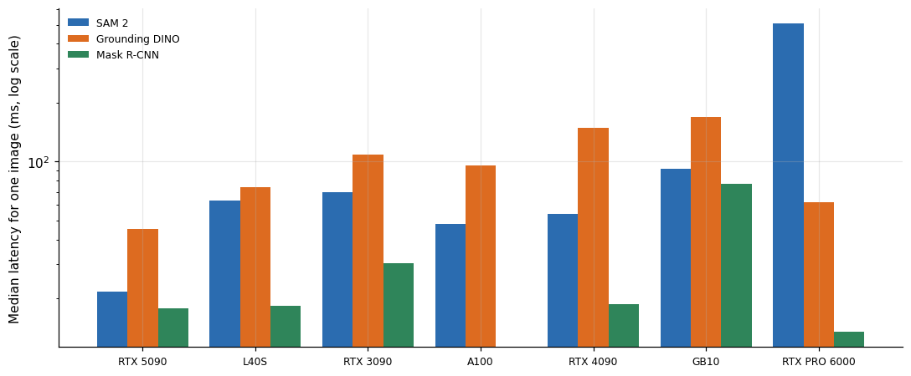

*Figure 2. The latency table.*

The table gives the median over sessions of the 50th percentile latency in milliseconds, with the RTX PRO 6000 value for SAM 2 shown as the measured 505.5, which the next section discusses. Mask R-CNN was the fastest of the three on every card, between 13.5 milliseconds on the PRO 6000 and 76.8 on the GB10. SAM 2 and Grounding DINO took from 21.8 and 45.4 on the 5090 to 92.0 and 168.8 on the GB10. The 5090 is the fastest card for SAM 2 and Grounding DINO, and the PRO 6000, which has the same architecture and more cores, is the fastest for Mask R-CNN.

For Mask R-CNN the cards sit in a narrow range, 13.5 to 30.2 milliseconds, among the discrete cards: PRO 6000 13.5, 5090 17.7, L40S 18.4, 4090 18.6 and 3090 30.2. The 5090, the L40S and the 4090 are within 5 percent of each other. That is what the launch-bound regime looks like: a network of this size does not keep a large card busy at batch size 1, and the cards converge on the time it takes the host to issue the work.

## 4. The ranking changes with the model

If one factor, the card's speed, determined latency, the cards would appear in the same order for all three models. I check that with the rank of each card per model.

**Table 4.** The ranking changes with the model

|  | SAM 2 | Grounding DINO | Mask R-CNN |
|---|---|---|---|
| A100 | 2 | 4 | – |
| GB10 | 6 | 7 | 6 |
| L40S | 4 | 3 | 3 |
| RTX 3090 | 5 | 5 | 5 |
| RTX 4090 | 3 | 6 | 4 |
| RTX 5090 | 1 | 1 | 2 |
| RTX PRO 6000 | 7 | 2 | 1 |

**Table 5.** The ranking changes with the model (part 2)

| Pair | Tau | Cards |
|---|---|---|
| SAM 2 vs Grounding DINO | 0.238 | 7 |
| SAM 2 vs Mask R-CNN | 0.2 | 6 |
| Grounding DINO vs Mask R-CNN | 0.733 | 6 |

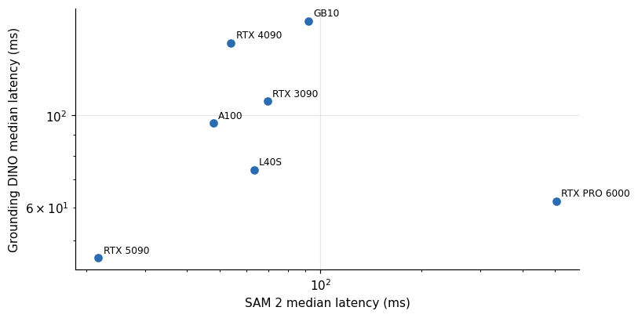

*Figure 3. The ranking changes with the model.*

The rank correlations (Kendall's tau) between models over the cards that have both are 0.73 for Grounding DINO against Mask R-CNN, 0.24 for SAM 2 against Grounding DINO and 0.20 for SAM 2 against Mask R-CNN. The two low values include the 505 millisecond cell, which puts the PRO 6000 last for SAM 2 and second or first elsewhere, so they understate the agreement of the other cards. The clearest disagreement among the rest is the RTX 4090. It ranks sixth of seven on Grounding DINO at 149.3 milliseconds, behind the RTX 3090 at 108.1, third of seven on SAM 2 and fourth of six on Mask R-CNN. A newer, faster GPU lost to an older one on one model and beat it on two others.

The explanation I find most likely is the processor. Grounding DINO's timed function includes the Hugging Face processor, which resizes and normalizes the image and tokenizes the prompt on the CPU, and that portion does not depend on the GPU at all. Rented hosts of the same GPU model differ in processors. The 4090 measurement of Grounding DINO came from the first rented 4090 of the campaign, and its Mask R-CNN measurement from a different 4090 rental, so the two are not from the same machine. I cannot separate the effects of the machine and the card, since I did not measure the processor stage by itself.

## 5. Detectron2 itself against the stand-in

Detectron2 did run once. The libs suite, which compiled it from source on rented machines, failed twice. A separate suite of GPU tests then installed it into a fresh environment on an RTX 3090, failed the first time on a missing Python module (`pkg_resources`), and succeeded on the next attempt. That run used real photographs from the COCO validation set, the library's own prediction class (which includes the image preprocessing and the mask post-processing), 2 warm-up images and 30 timed calls, for both Mask R-CNN and Faster R-CNN with a ResNet-50 backbone.

**Table 6.** Detectron2 itself against the stand-in

|  | Lib | GPU | P50 ms | P95 ms | VRAM GB |
|---|---|---|---|---|---|
| 3 | detectron2 | RTX 3090 | 51.1 | 91.3 | 0.63 |
| 4 | detectron2_faster_rcnn | RTX 3090 | 44.5 | 48.4 | 0.6 |

**Table 7.** Detectron2 itself against the stand-in (part 2)

|  | Session | P50 ms | P95 ms |
|---|---|---|---|
| 14 | 20261027T022124 | 29.85 | 30.27 |
| 15 | 20261027T035103 | 30.54 | 32.6 |

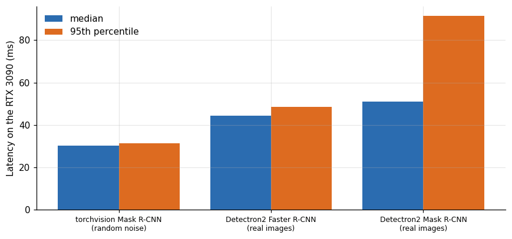

*Figure 4. Detectron2 itself against the stand-in.*

On the same card, the library took 51.1 milliseconds at the median for Mask R-CNN on real images, against 30.2 for the torchvision stand-in on random noise, a ratio of 1.69. At the 95th percentile the gap is larger, 91.3 against 31.4 milliseconds (2.9 times), which is the signature of work that depends on the content of the image: the number of objects the model finds sets the cost of pasting masks onto the image, and random noise finds almost none. Faster R-CNN, the same detector without the mask branch, took 44.5 milliseconds, so the mask head and its post-processing added 6.6 milliseconds, or 15 percent.

Two measurements on a single card and a single environment carry little weight, but the direction is clear. The stand-in underestimates Detectron2 on real images, and the numbers in the Mask R-CNN column of the main table are better read as a floor. If the same ratio held on other cards, the 5090 would take about 30 milliseconds for Detectron2 and the PRO 6000 about 23, and the ordering of the cards would not change, because the ratio is a property of the software and the image. I did not test that assumption on the other cards.

## 6. One factor per card, one per model

To make the "launch-bound" idea testable I fit an additive model in logarithms: the log of the latency of model m on card c is the sum of a card term and a model term. If the model describes the data, the card terms are a property of the host that applies to every model, and the model terms say how heavy each model is on a reference host. The fit uses the median of each card and model cell, leaves out the one suspicious SAM 2 value, and handles missing cells by alternating averages.

**Table 8.** One factor per card, one per model

|  | Grounding DINO | Mask R-CNN | SAM 2 |
|---|---|---|---|
| A100 | 0.03 | – | -0.03 |
| GB10 | -0.19 | 0.36 | -0.17 |
| L40S | -0.14 | -0.19 | 0.33 |
| RTX 3090 | -0.08 | -0.02 | 0.1 |
| RTX 4090 | 0.38 | -0.36 | -0.01 |
| RTX 5090 | -0.1 | 0.3 | -0.21 |
| RTX PRO 6000 | 0.09 | -0.09 | – |

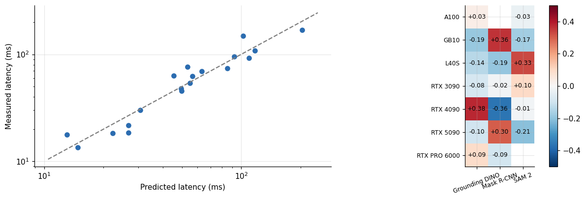

*Figure 5. One factor per card, one per model.*

The model has 19 cells and 10 free parameters, so it is far from a test. Even so, its residuals are informative: a standard deviation of 0.21 in logarithms, which is 23 percent, and a largest absolute residual of 0.38, which is 46 percent. The card terms rank the machines as the 5090 (26.9), the PRO 6000 (30.5), the L40S (45.7), the A100 (49.7), the 4090 (55.0), the 3090 (63.1) and the GB10 (109.8), and the model terms put Grounding DINO at 1.86 times SAM 2 and Mask R-CNN at 0.49 times SAM 2.

Two things stand out. The 4090 term (55.0) is worse than the L40S (45.7), although both have the same GPU architecture and the 4090 has the higher clocks. The 4090's cells carry the two largest residuals of the table, +0.38 on Grounding DINO and -0.36 on Mask R-CNN, which is the sign of two different machines, not of one machine with a card factor. And the GB10, a desk computer with an ARM processor, has a card term four times the 5090's, which is in line with its Mask R-CNN at 76.8 milliseconds against 17.7.

I read the card terms as the speed of the stack that issues work to the GPU, and the GPU's own speed enters only at the margin for these small workloads. The yolo article of this series found the same structure with a different set of models and a cleaner fit. The conclusion carries a warning for anyone who buys a GPU to speed up these single-image pipelines: the model predicts that moving from a 3090 to a 5090 would shorten the latencies by 2.3 times, and that moving from a 3090 to a 4090 would shorten them by 1.15 times, which no one would guess from the price list.

## 7. Does the YOLO launch factor carry over?

The YOLO article of this series fitted the same kind of additive model to detection latencies at batch size 1, and found that the card term behaves like a measure of how fast the host issues kernel launches. If that interpretation is right, the card terms estimated from YOLO should predict the card terms estimated from the three models in this article. This is a stronger test than the fit itself, because it uses different models on the same cards.

**Table 9.** Does the YOLO launch factor carry over?

|  | Yolo launch factor | Segmentation card factor |
|---|---|---|
| A100 | 2.98 | 1.85 |
| GB10 | 1.37 | 4.09 |
| L40S | 1.9 | 1.7 |
| RTX 3090 | 3.16 | 2.35 |
| RTX 4090 | 4.94 | 2.05 |
| RTX 5090 | 1 | 1 |
| RTX PRO 6000 | 2.73 | 1.13 |

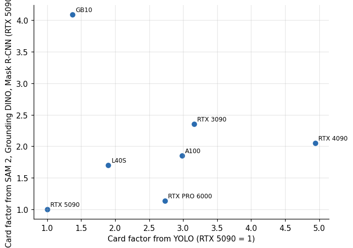

*Figure 6. Does the YOLO launch factor carry over?*

Over the 7 cards that have both, the rank correlation is only 0.39. Without the GB10 it is 0.89 over the 6 discrete cards (a p-value of 0.02, for what so few points are worth). The two orders differ by swaps of neighbors: the 4090 is the slowest host by the YOLO measure (a factor of 4.9 against the 5090) and the third slowest here (2.05), the 3090 is second slowest by YOLO and the slowest of the discrete cards here (2.35), and the PRO 6000 has a factor of 2.7 by YOLO and 1.1 here, which puts it third of the discrete cards by YOLO and second here.

The GB10 is the departure that spoils the correlation. It is the second fastest launcher in the YOLO data (1.4) and the slowest card in this article (4.1). The explanation fits the arithmetic of the machines. YOLO at batch size 1 on a small model is limited by launches, where the GB10's ARM processor is quick. SAM 2's image encoder is a large transformer and Grounding DINO is a larger network still, and for them the GB10's modest GPU is the limit, as it was for large detection batches. The card term of an additive model that mixes launch-bound and compute-bound workloads is a blend of the two properties, and for a card whose GPU is much slower than its host, a single number stops describing it.

The test therefore supports the host-factor reading for the six discrete cards and breaks it for the machine with a small GPU. It also keeps the earlier caution: the card terms combine host speed with GPU speed in proportions that depend on the model. For deciding which card to rent, the useful statement is the empirical one: the cell medians in the table, with the host effect folded in.

## 8. The 505 millisecond measurement

One cell in the SAM 2 column does not fit anything: 505.5 milliseconds at the median on an RTX PRO 6000, with a 95th percentile of 602.9 and a mean of 559.9. Every other SAM 2 median is between 21.8 and 92.0. The model above predicts about 30.5 milliseconds for that card, so the measurement is 16.6 times the prediction.

**Table 10.** The 505 millisecond measurement

|  | Session | GPU | P50 ms | P95 ms | Mean ms | N | VRAM GB | P95 over p50 |
|---|---|---|---|---|---|---|---|---|
| 21 | 20261026T121335 | RTX 5090 | 21.75 | 42.02 | 27.67 | 10 | 1.7 | 1.93 |
| 23 | 20261026T193237 | A100 | 47.85 | 48.46 | 47.31 | 10 | 1.67 | 1.01 |
| 20 | 20261026T105054 | RTX 4090 | 54.11 | 54.83 | 53.3 | 10 | 1.67 | 1.01 |
| 22 | 20261026T193212 | L40S | 63.37 | 66.23 | 49.95 | 10 | 1.67 | 1.05 |
| 25 | 20261027T035103 | RTX 3090 | 69.53 | 70.2 | 69.9 | 10 | 1.67 | 1.01 |
| 27 | 20261027T095940 | GB10 | 92.03 | 92.78 | 91.87 | 10 | 1.69 | 1.01 |
| 28 | 20261027T134349 | RTX PRO 6000 | 505.5 | 602.9 | 559.9 | 10 | 1.7 | 1.19 |

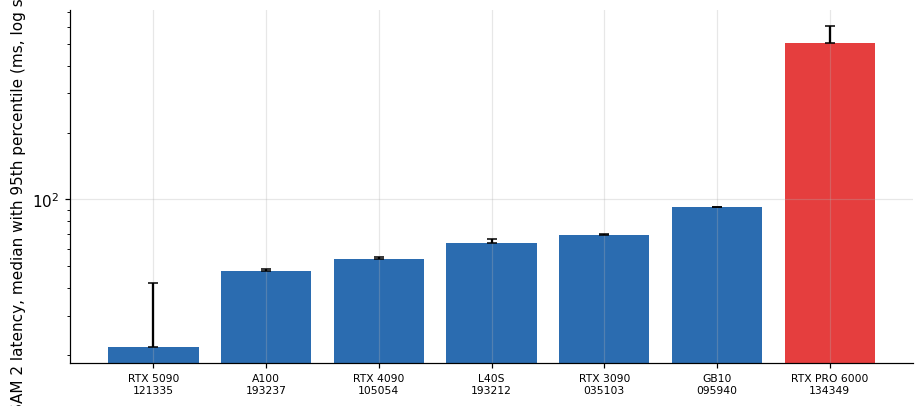

*Figure 7. The 505 millisecond measurement.*

The slow run is not a one-off stall, since all ten timed calls were slow: the mean (559.9) is above the median and the 95th percentile (602.9) is only 19 percent above the median. A transient event, such as the disk or a neighboring process, would have produced a few slow calls and a normal median. This run was slow for the whole timing window.

The host's own sampler, which records the GPU every second, shows what the machine was doing around the measurement. For the first 85 seconds of the SAM 2 item the GPU was idle at its lowest clock (180 megahertz) with no memory in use, which is the install and download phase. Then the clock rose to 2,325 megahertz with 845 to 847 mebibytes in use, and later 2,771 mebibytes. The card was therefore not stuck in a low power state while it was timed. The sampler reported 0 percent utilization for the whole item, which is a limitation of a one-second sample on a workload made of short kernels, and it does not distinguish the two cases.

Here is that sampler for the 135 seconds before the result was logged and the 25 seconds after it. The three panels are the SM clock, the power draw and the memory in use.

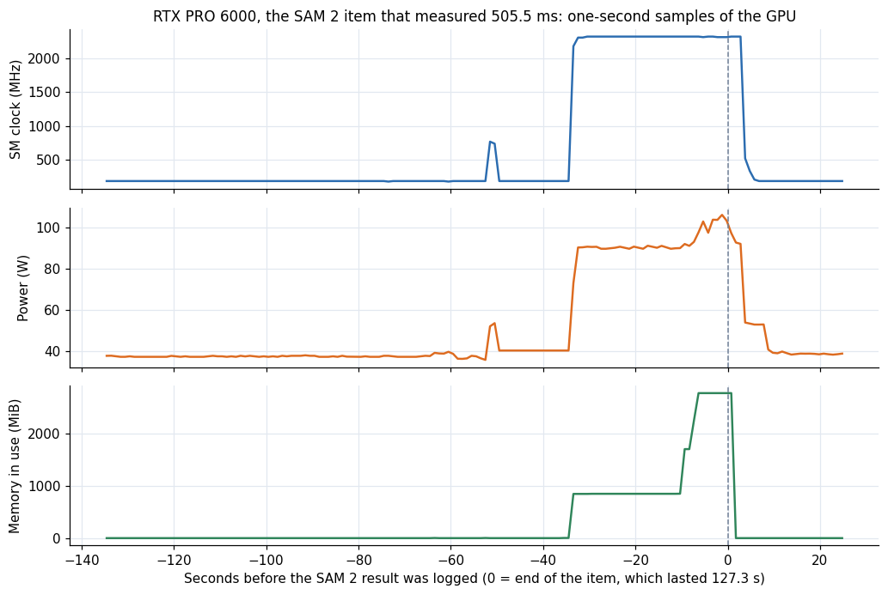

*Figure 8. RTX PRO 6000, the SAM 2 item that measured 505.5 ms: SM clock, power draw and memory in use, one sample per second.*

The clock sits at 180 MHz and the power near 37 W until 34 seconds before the end of the item. Then the clock jumps to about 2,320 MHz and the power to about 90 W (median 90.5 W, maximum 106 W over the 34 samples at that clock), and memory goes from 0 to 845 MiB, then to 1,701 and 2,771 MiB in the last ten seconds. A card at full clock and 90 W was working, not parked. That window is 34 seconds long, while the harness makes 13 calls (3 warm-up and 10 timed) of about 0.5 seconds each, roughly 7 seconds, so the window holds more than the timed calls and I cannot tell from the sampler which part of it the slow calls were.

Hypotheses that fit these facts are a processor that was slower or busier than on other machines, a library path that fell back to a slow implementation for a step of SAM 2 (the package logs a warning about an optional compiled component when it is missing), or a problem in the virtualized host. I do not have the evidence to choose between them. The first RTX PRO 6000 session of the campaign failed to install SAM 2, so I have no second measurement on that model of card to compare. I keep the value in the data and in the figures, label it as unexplained, and exclude it from the fit.

This is the kind of cell that a summary table would hide. If I had averaged the SAM 2 column over cards, 505 milliseconds would have raised the mean from 58 to 122 milliseconds and made the PRO 6000 look like the slowest card in the study. A reader who planned a purchase from that mean would have rejected the fastest card for Mask R-CNN.

## 9. Throughput and cost at batch size 1

The latency converts into images per second for a single stream and into the rental cost of processing a batch of images one after another. The price used is the hourly rate of each run, as recorded in the dataset.

**Table 11.** Throughput and cost at batch size 1

|  | SAM 2 | Grounding DINO | Mask R-CNN |
|---|---|---|---|
| A100 | 0.89 | 1.78 | – |
| GB10 | 1.15 | 2.11 | 0.96 |
| L40S | 1.41 | 1.65 | 0.41 |
| RTX 3090 | 0.5 | 0.77 | 0.21 |
| RTX 4090 | 0.64 | 1.78 | 0.19 |
| RTX 5090 | 0.39 | 0.81 | 0.33 |
| RTX PRO 6000 | – | 3 | 0.65 |

**Table 12.** Throughput and cost at batch size 1 (part 2)

|  | Grounding DINO | Mask R-CNN | SAM 2 |
|---|---|---|---|
| A100 | 10.5 | – | 20.9 |
| GB10 | 5.9 | 13 | 10.9 |
| L40S | 13.5 | 54.5 | 15.8 |
| RTX 3090 | 9.3 | 33.1 | 14.4 |
| RTX 4090 | 6.7 | 53.8 | 18.5 |
| RTX 5090 | 22 | 56.4 | 46 |
| RTX PRO 6000 | 16.1 | 74 | – |

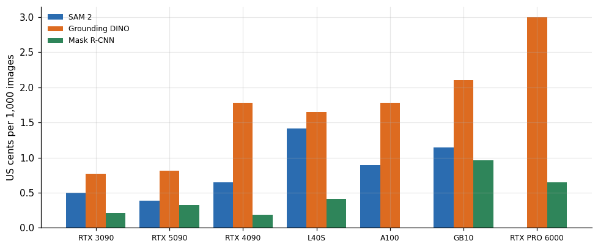

*Figure 9. Throughput and cost at batch size 1.*

On the 5090 a single stream handles 46 SAM 2 images, 22 Grounding DINO images and 56 Mask R-CNN images per second. A thousand SAM 2 images cost about 0.39 cents of rental on that card, a thousand Grounding DINO images 0.81 cents and a thousand Mask R-CNN images 0.33 cents. The 5090 is the fastest and the cheapest per image for SAM 2, since its hourly price (0.64 dollars) is moderate and its latency is the lowest. The 3090 follows at 0.50 cents per 1,000 SAM 2 images, ahead of the 4090 at 0.64 and the A100 at 0.89. For Grounding DINO the 3090 is 5 percent cheaper than the 5090 (0.77 against 0.81 cents), and for Mask R-CNN the 4090 (0.19) and the 3090 (0.21) are cheapest while the 5090 costs 0.33. The GB10 costs 1.15 cents at its listing rate and the L40S 1.41.

These costs are small enough that the choice of card hardly matters for a one-off job. A labeling run of 100,000 images with SAM 2 takes 36 minutes on the 5090 and 1.9 hours on the 3090, and costs 0.39 and 0.50 dollars. The rental time that the installation consumed was larger than the compute. The SAM 2 item on the 3090 took 550 seconds in total, dominated by the install and the checkpoint download, against 0.07 seconds for each image.

## 10. A text-prompted segmentation pipeline

The two models are often chained: Grounding DINO finds boxes for a phrase and SAM 2 turns each box into a mask. The latency of that chain is at least the sum of the two, since they run one after the other, and a real implementation adds a small cost for each box beyond the first and for moving data between them. With the single-image medians I can compute the floor of that pipeline per card.

**Table 13.** A text-prompted segmentation pipeline

|  | Grounding DINO | SAM 2 | Chain ms | Chain img per s | USD per 1000 |
|---|---|---|---|---|---|
| RTX 5090 | 45.36 | 21.75 | 67.11 | 14.9 | 0.012 |
| L40S | 74.01 | 63.37 | 137.4 | 7.279 | 0.031 |
| A100 | 95.68 | 47.85 | 143.5 | 6.967 | 0.027 |
| RTX 3090 | 108 | 69.53 | 177.6 | 5.631 | 0.013 |
| RTX 4090 | 149.3 | 54.11 | 203.4 | 4.917 | 0.024 |
| GB10 | 168.8 | 92.03 | 260.8 | 3.834 | 0.033 |

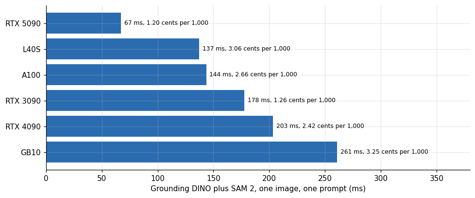

*Figure 10. A text-prompted segmentation pipeline.*

The floor of the chain is 67.1 milliseconds on the 5090, which is 14.9 images per second for a single stream. The 3090 takes 177.6 milliseconds, the A100 143.5, the L40S 137.4, the 4090 203.4 and the GB10 260.8. In rental cost per thousand images the 5090 is again the cheapest at 1.20 US cents, the 3090 is next at 1.26 and the 4090, A100, L40S and GB10 cost 2.42, 2.66, 3.06 and 3.25 cents.

The 3090 is almost as cheap as the 5090 even though it takes 2.6 times as long, because its hourly price is 0.26 dollars against 0.64. For a batch job where waiting is free, the 3090 is a reasonable choice. For an interactive tool where a person waits for the mask, 178 milliseconds is noticeable and 67 is not, and the 5090 is the better card at the same cost. The same arithmetic favors the 4090 less: it is slower than the 3090 on the grounding step and costs about two thirds more per hour.

The sum understates the real pipeline. A text prompt with three classes can return several boxes per class, and SAM 2 predicts a mask for each. In the SAM 2 timing I called the predictor once, and the image encoder dominates that call, so extra boxes add a smaller increment than the first. I did not measure the increment. If each additional box cost a tenth of the first call, an image with ten boxes would take about twice the SAM 2 time shown here, and the chain on the 5090 would grow from 67 to about 87 milliseconds. This is arithmetic on an assumption, and I include it to show the direction and not as a measurement.

## 11. Jitter

The ratio of the 95th percentile to the median says how steady a card was.

**Table 14.** Jitter

|  | Count | Min | 50% | Max |
|---|---|---|---|---|
| Grounding DINO | 7 | 1.01 | 1.04 | 2.04 |
| Mask R-CNN | 7 | 1.01 | 1.01 | 1.08 |
| SAM 2 | 7 | 1.01 | 1.01 | 1.93 |

**Table 15.** Jitter (part 2)

|  | GPU | Model | P50 ms | P95 ms | P95 over p50 |
|---|---|---|---|---|---|
| 6 | RTX 5090 | Grounding DINO | 45.36 | 92.69 | 2.04 |
| 8 | A100 | Grounding DINO | 95.68 | 188.5 | 1.97 |
| 21 | RTX 5090 | SAM 2 | 21.75 | 42.02 | 1.93 |
| 28 | RTX PRO 6000 | SAM 2 | 505.5 | 602.9 | 1.19 |
| 5 | RTX 4090 | Grounding DINO | 149.3 | 171.5 | 1.15 |
| 18 | RTX PRO 6000 | Mask R-CNN | 13.52 | 14.66 | 1.08 |

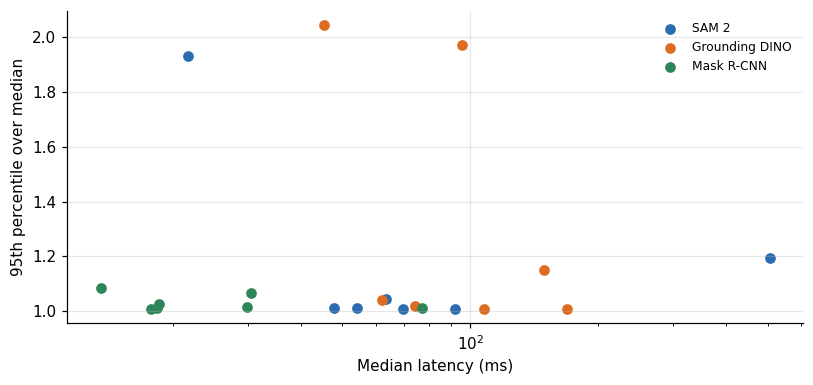

*Figure 11. Jitter.*

Most runs are steady: the median ratio is 1.01 for SAM 2 and for Mask R-CNN and 1.04 for Grounding DINO, and 16 of the 21 runs are below 1.1. The exceptions are the 5090 on Grounding DINO (45.4 against 92.7, a ratio of 2.04), the A100 on Grounding DINO (95.7 against 188.5, 1.97), the 5090 on SAM 2 (21.8 against 42.0, 1.93), the PRO 6000 on SAM 2 (1.19, slow throughout) and the 4090 on Grounding DINO (1.15). Except for the PRO 6000 run, each of these has one slow call among the 10 or 15, and with so few calls, one slow call is the 95th percentile. A production system that must meet a latency target would need more calls than I made to measure its tail.

## 12. Memory

GPU memory is not a constraint for these models at batch size 1. SAM 2 peaked at 1.67 to 1.70 gigabytes, Grounding DINO at 1.06 to 1.08 and Mask R-CNN at 0.62 to 0.65 on the discrete cards. On the GB10, where memory is shared with the processor, the reported values were 1.69, 1.08 and 1.45 gigabytes. A 24 gigabyte card could hold a dozen copies of each model, and the limit on how many streams one card can serve would come from compute and from the host's ability to feed them. I did not measure concurrent streams of these models, so I have no number for that limit.

## 13. From frames per second to camera streams

A common use of instance segmentation is on video: every frame of a camera passes through the model. The single-image latency gives an upper bound on how many streams one process can serve on one card, if the process handles frames one at a time. The calculation is the latency converted to frames per second, divided by the frame rate of the stream.

**Table 16.** From frames per second to camera streams

|  | Mask R-CNN at 30 fps | Mask R-CNN at 10 fps | SAM 2 at 10 fps | Grounding DINO at 10 fps |
|---|---|---|---|---|
| A100 | – | – | 2.09 | 1.05 |
| GB10 | 0.43 | 1.3 | 1.09 | 0.59 |
| L40S | 1.82 | 5.45 | 1.58 | 1.35 |
| RTX 3090 | 1.1 | 3.31 | 1.44 | 0.93 |
| RTX 4090 | 1.79 | 5.38 | 1.85 | 0.67 |
| RTX 5090 | 1.88 | 5.64 | 4.6 | 2.2 |
| RTX PRO 6000 | 2.47 | 7.4 | – | 1.61 |

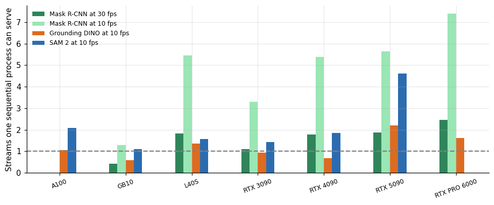

*Figure 12. From frames per second to camera streams.*

At 30 frames per second, one Mask R-CNN process serves between 0.4 camera streams on the GB10 and 2.5 on the PRO 6000: 1.9 on the 5090, 1.8 on the L40S and 1.8 on the 4090, and 1.1 on the 3090. At 10 frames per second the numbers triple. For SAM 2 at 10 frames per second the 5090 manages 4.6 streams, the A100 2.1, the 4090 1.8 and the L40S 1.6, and for Grounding DINO at 10 frames per second the 5090 manages 2.2 and the GB10 0.6.

These are figures for a naive loop, and a deployed system can do better in two ways. Batching frames from several streams raises throughput on launch-bound models, and the multi-camera article of this series shows how much, for a detector. And SAM 2 has a video mode that propagates masks between frames with a lighter memory mechanism instead of running the full image encoder each time, which I did not test. The numbers here are a floor for planning. They also show why per-frame segmentation of many cameras is a different order of cost than detection: the 5090 serves tens of YOLO streams in the other article and a few streams of these models.

## 14. An interactive budget

For a tool where a person clicks and waits, the question is whether the answer arrives before the person notices. I use 100 milliseconds as a working threshold for "instant", which is my own convention and not a measured property of any user. With that threshold, the single-model medians sort the combinations.

**Table 17.** An interactive budget

|  | Single model under 100 ms | Models measured | Chain under 100 ms |
|---|---|---|---|
| A100 | 2 | 2 | no |
| GB10 | 2 | 3 | no |
| L40S | 3 | 3 | no |
| RTX 3090 | 2 | 3 | no |
| RTX 4090 | 2 | 3 | no |
| RTX 5090 | 3 | 3 | yes |
| RTX PRO 6000 | 2 | 2 | no |

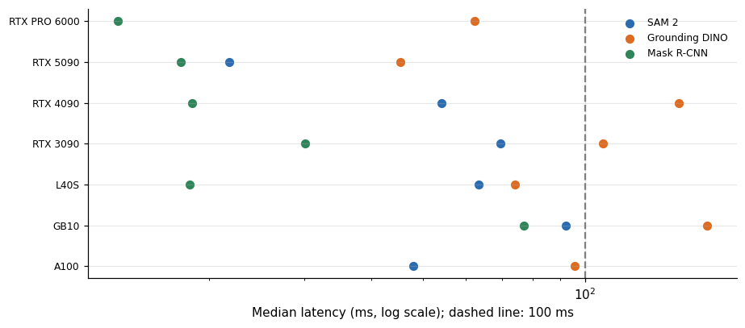

*Figure 13. An interactive budget.*

Mask R-CNN is under 100 milliseconds on every card, including the GB10 at 76.8. SAM 2 is under 100 on every card except the PRO 6000 value discussed above, and the GB10 is just inside at 92.0. Grounding DINO is under 100 milliseconds on the 5090, the PRO 6000, the L40S and the A100 (95.7), and over it on the 3090, the 4090 and the GB10. Among the cards measured on all three models, the 5090 and the L40S fit every model under the threshold, and the PRO 6000 would, but for the SAM 2 anomaly. The chained pipeline fits under 100 milliseconds on the 5090 only, at 67.

A margin matters more than a point estimate here. The 5090 shows a doubling of its 95th percentile over its median on two of the three models, so a design for 100 milliseconds on that card should plan for the occasional 93 milliseconds on the Grounding DINO step alone. The sum of the two 95th percentiles, 42 and 93 milliseconds, is 135, and on the slow calls the chain misses the threshold.

## 15. The five failures and what would have prevented them

Six of the 29 attempts failed, and each failure has a cheap guard. I list them as design notes for the next campaign.

**Table 18.** The five failures and what would have prevented them

| Failure | Stage | Guard | Saves |
|---|---|---|---|
| Detectron2 build, RTX 4090 session | compile | use the torchvision implementation, or a prebu... | a 20 second item here, a long compile elsewhere |
| Detectron2 build, RTX 5090 session | compile | same as above | a 50 second item |
| Detectron2 import, RTX 3090 sandbox session | first import | import the library once before timing, and pin... | about 118 seconds of a 0.25 dollar per hour card |
| SAM 2 install, RTX 3090 session | git clone | download the source once and install from a lo... | a session with no SAM 2 result on that attempt |
| SAM 2 install, RTX PRO 6000 session | package index | install with a constraints file and a retry; c... | 328 seconds of a 1.73 dollar per hour card, 0.... |
| Grounding DINO model download, RTX 3090 session | model hub | pre-download model files to storage the machin... | a session with no Grounding DINO result |

Two of the six trace to a full disk on one RTX 3090 rental (a source clone and a model download), one concerns the package index, two a source build and one a missing module at the first import. They share a pattern with the failures of the image-to-3D article: an environment assembled at rental time from the internet breaks in ways that have nothing to do with the thing being measured. The cost was small in money, 0.16 dollars for the most expensive one. In coverage, Detectron2 ended with a result on one card only; each failed SAM 2 or Grounding DINO attempt was followed by a successful session on the same kind of card, at the price of another rental.

The Detectron2 case deserves a remark. I substituted the torchvision implementation and labeled the result a stand-in, which is the honest way to continue, and the later Detectron2 run showed the stand-in to be faster than the library on real images. A reader who needs Detectron2 must not use the Mask R-CNN column of the main table as if it came from that library.

One of the two compile failures has a readable cause in its log. This line is from the Detectron2 install log of the RTX 4090 session, copied from the record's error text:

```
      RuntimeError: ('The detected CUDA version (%s) mismatches the version that was used to compilePyTorch (%s). Please make sure to use the same CUDA versions.', '12.6', '13.0')
```

The CUDA toolkit on that machine was 12.6 and the PyTorch build had been compiled for 13.0, so the extension refused to build. The log of the RTX 5090 attempt ends in a generic `Error compiling objects for extension` and I did not find the cause there.

## 16. Three decisions this table can and cannot support

A reader will use these numbers to decide something, and the decisions differ in how much weight the data can bear.

The first decision is which card to rent for a batch job. The data support a firm answer: any of the discrete cards finishes a job of 100,000 images in under two hours at a cost under a dollar, and the 5090 and the 3090 are the cheapest per image. The differences between cards are cents.

The second decision is which card to buy for an interactive tool. The data support a weaker answer. The 5090 is the fastest in my table, and the host effect is large enough that a 5090 in a slow machine could lose to a 3090 in a fast one. The measurement says what happened on the hosts I rented. It does not say what will happen on yours, and the ratios of the additive model, up to 46 percent in the residuals, give the scale of the uncertainty.

The third decision is whether a card is "fast enough" for a latency target. The data support almost nothing here. They are medians of a few calls at batch size 1 on one image, with a 95th percentile of ten calls. A service with a target at the 99th percentile needs a different measurement, with hundreds of calls, concurrent streams and real images. The table can reject a card that is clearly too slow, and it cannot certify one that is fast enough.

## 17. What could be wrong

The latencies are medians of a few calls from one session, and in most cells there is one session. Where two sessions exist for the same card and model, they agree within a few percent: the 3090 measured Mask R-CNN at 29.9 and 30.5 milliseconds in two sessions.

The sessions ran on different rented hosts, so the card terms in the additive fit include the host. The per-card ranking should not be read as a ranking of the GPUs themselves. The Mask R-CNN timing in the main table used random noise as the input and the torchvision implementation, and the one run of Detectron2 on real images was 1.7 times slower on the same card. The Grounding DINO timing includes the processor stage, and the SAM 2 timing includes the image encoder, which a real application running many prompts on the same image would pay once. Each of these choices is visible in the code that the dataset documents.

The input image deserves a note as well. SAM 2 and Grounding DINO ran on the first of the harness's sample images, the same one on every card, so the numbers carry no information about how latency varies with the content of the image. For Grounding DINO that matters, since the number of candidate boxes the model keeps depends on the scene, and for SAM 2 the cost of the image encoder does not, since it works on a fixed-size resized input. A production workload with many image sizes would change the cost of the resize on the processor, which my loop pays on every call for a single image size, and on a slow host that step could rival the model call. I take this as a reason to read the card terms as a floor for the real pipeline and not as its latency.

Finally, none of these timings says anything about quality. I did not check the masks or boxes against ground truth, and a faster configuration could be a worse one.

## 18. Questions I expect

**Which card should I rent for SAM 2?** For a one-off job any card works and the cost differences are under a cent per thousand images. For a service, the 5090 was the fastest and the cheapest per image for SAM 2 in my data, subject to the host effect.

**Is the newest card always faster?** Not for these models at batch size 1. The ratio between the best and worst discrete card was 2.2 to 3.3 times, and the order changed with the model.

**Why not batch the images?** Batching would raise the throughput of the cards that are launch-bound, and I did not measure it here. The YOLO article of the series shows how large the effect can be for detection.

**Can I trust the 505 millisecond value?** As a measurement of what happened on that machine, yes. As a statement about the PRO 6000, no.

**Did Detectron2 run?** Once. It failed to compile twice and failed an import once, and then ran on an RTX 3090 at 51.1 milliseconds for Mask R-CNN. The Mask R-CNN column of the main table comes from the torchvision implementation of the same architecture.

## 19. How much it cost

**Table 19.** How much it cost

|  | GPU | Lib | Total s | Dph USD | Item cost USD |
|---|---|---|---|---|---|
| 17 | RTX 4090 | gdino | 59 | 0.4289 | 0.007 |
| 19 | RTX 4090 | sam2 | 121.9 | 0.4289 | 0.0145 |
| 133 | RTX 5090 | sam2 | 74 | 0.6422 | 0.0132 |
| 135 | RTX 5090 | gdino | 20.5 | 0.6422 | 0.0037 |
| 186 | L40S | sam2 | 136.6 | 0.8015 | 0.0304 |
| 188 | L40S | gdino | 27.2 | 0.8015 | 0.0061 |
| 223 | A100 | sam2 | 81.5 | 0.6681 | 0.0151 |
| 225 | A100 | gdino | 25.1 | 0.6681 | 0.0047 |
| 240 | RTX 3090 | sam2 | 160.9 | 0.2538 | 0.0113 |
| 241 | RTX 3090 | gdino | 154.4 | 0.2538 | 0.0109 |
| 265 | RTX 3090 | sam2 | 550.3 | 0.2563 | 0.0392 |
| 267 | RTX 3090 | gdino | 27.7 | 0.2563 | 0.002 |
| 295 | RTX PRO 6000 | gdino | 111.9 | 1.735 | 0.0539 |
| 296 | RTX PRO 6000 | sam2 | 327.7 | 1.735 | 0.1579 |

*First 14 of 17 rows; the full table is in the executable notebook.*

The 17 SAM 2 and Grounding DINO items, including the failed ones, took 2,133 seconds of rented time at the hourly prices of their sessions, which came to 0.44 dollars. The SAM 2 install that failed on the PRO 6000 alone cost 0.16 dollars. Most of the time was installation and checkpoint download, and the timed calls themselves added up to a few seconds. The Mask R-CNN items were part of larger sessions, and their share is too small to compute. The sessions that carried these items also ran other tests, so the full session costs are higher.
