# A 35-minute soak test on one RTX 5090

**Lucas Rangel** · [Kaggle writeup](https://www.kaggle.com/writeups/lucasrangelss/a-35-minute-soak-test-on-one-rtx-5090) · [Executable notebook](https://www.kaggle.com/code/lucasrangelss/a-35-minute-soak-test-on-one-rtx-5090) · [Code and data](https://github.com/LucasRangelSSouza/gpu-ai-benchmark-hub) · [Dataset](https://www.kaggle.com/datasets/lucasrangelss/gpu-ai-benchmark-campaign-2026)

## Abstract

A benchmark that runs for a minute tells you how fast a server is. It does not tell you whether the server stays that way. Memory can creep up, latency can drift, the card can throttle as it heats, and the first minutes are not representative of the rest. A soak test is the cheap way to find out: run a realistic load for much longer than the benchmark and watch for change.

I ran one on an RTX 5090 serving a 4-bit AWQ build of a 27 billion parameter model with vLLM. Eight simulated users sent requests back to back for 34.8 minutes, a mix of chat, code, JSON and long-document tasks. A second process sampled the GPU every 30 seconds.

What happened:

- All 4,051 requests succeeded. Zero failed, zero timed out. The rule of three puts the 95 percent upper bound on the true failure rate at 0.074 percent.
- After a warm-up of about 100 seconds, throughput and latency were flat. From minute 5 to minute 35 the server produced 487 to 513 output tokens per second in every five-minute window. The 95th percentile of time to first token stayed between 0.19 and 0.21 seconds.
- Every request that suffered a stall of more than one second between tokens happened in the first 95 seconds. There were 39 of them, and none later.
- GPU memory held at 28,838 to 28,839 MiB for the whole steady state. The card ran at 100 percent utilization at 60 to 67 degrees Celsius, drawing a median 437 watts, with its clock between 2,850 and 2,932 MHz and no sign of throttling.
- The 35 minutes produced 1,024,267 output tokens on 0.243 kilowatt-hours of GPU board power, about 0.24 kilowatt-hours per million tokens.

The card behaves as a short test predicted. What the 35 minutes add is confidence that nothing slow is happening underneath, and a measured warm-up. They do not prove the server would run for a week.

> **Code and data.** Everything behind this article is public: the code that ran, the curated data, the analysis that regenerates every figure, and tests that pin the conclusions to the data. Repositories: [llm-serving-engines-bench](https://github.com/LucasRangelSSouza/llm-serving-engines-bench). Index of the whole series: [gpu-ai-benchmark-hub](https://github.com/LucasRangelSSouza/gpu-ai-benchmark-hub).

## 1. Why test for longer

Short benchmarks measure a server at its best. A load test at one concurrency level for 60 seconds sees a cold start at the beginning, a steady middle and nothing else. Several things only show with time.

Memory. A server that leaks a few megabytes per request looks fine for a minute and runs out of memory after a day. A fragmented cache can slow down as it fills.

Heat. A GPU that boosts to a high clock for the first minute may settle lower once the chip and the board reach thermal equilibrium. That drop is invisible in a short run. On a rented machine in a crowded rack, it can be large.

Drift in the workload. Real traffic is a mix, and the mix cycles through states. A short test samples one state.

Rare events. A failure that happens once in a thousand requests needs thousands of requests to appear.

None of these is proven absent by 35 minutes. A soak test of this length can find a fast problem. It cannot certify a slow one.

## 2. The setup

The server was vLLM serving a 4-bit AWQ build of a 27 billion parameter model on one RTX 5090 with 32 GB. The load generator was the one used throughout this series: continuous users, each sending the next request as soon as the previous finishes. Eight users ran in parallel. Each request is drawn from four kinds: short chat (35 percent), code refactoring (30 percent), structured JSON (20 percent) and a long-document summary of about ten thousand tokens (15 percent), with output caps of 256, 512, 256 and 256 tokens.

Alongside the server, a shell loop appended one line to a file every 30 seconds with GPU memory used, utilization, temperature, power draw and streaming-multiprocessor clock, read from `nvidia-smi`. I recorded 70 samples across 2,078 seconds of sampling.

The first rows of that file, as saved:

```
t_s,vram_mib,util_pct,temp_c,power_w,sm_clock_mhz
0.0,32092.0,0.0,47.0,75.63,2542.0
30.0,32092.0,14.0,47.0,142.87,2685.0
61.0,32002.0,29.0,49.0,213.37,2940.0
91.0,32002.0,20.0,46.0,175.76,2715.0
121.0,28838.0,93.0,62.0,425.69,2932.0
```

The sampler started 11 seconds before the first request. Its first rows show 32,092 MiB of memory in use, 0 percent utilization and 76 watts, which already says that the card was holding a server before the load began.

The data are one row per request (time of completion, kind, status, time to first token, total time, token counts, and three statistics of the gaps between streamed chunks) and one row per GPU sample.

A word on the long-document request: its text is identical in every request, so after the first one the server's prefix cache answers most of it from memory. That makes it a cheap request in this test, not a hard one, which the numbers below confirm.

## 3. Throughput over time

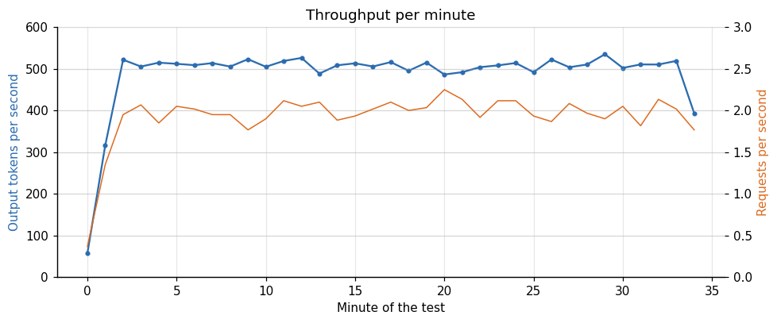

*Figure 1. Throughput per minute.*

**Table 1.** Throughput over time

| Requests | Tokens | TTFT p50 | TTFT p95 | TTFT p99 | Tokens per s |
|---|---|---|---|---|---|
| 455 | 114,895 | 0.122 | 1.417 | 3.703 | 383 |
| 584 | 153,757 | 0.122 | 0.2 | 0.224 | 512.5 |
| 603 | 152,795 | 0.123 | 0.187 | 0.219 | 509.3 |
| 605 | 152,686 | 0.124 | 0.205 | 0.227 | 509 |
| 632 | 150,240 | 0.124 | 0.208 | 0.244 | 500.8 |
| 585 | 153,785 | 0.122 | 0.207 | 0.234 | 512.6 |
| 587 | 146,109 | 0.122 | 0.202 | 0.226 | 487 |

In the five-minute windows after the first, the server produced between 487 and 513 output tokens per second and handled between 1.95 and 2.11 requests per second. The first window ran lower, at 383 tokens per second, because it contains the warm-up. The per-minute figure has one low outlier, the first minute, in which only a few requests completed (57 tokens per second); from the second minute on its quartiles are 503 and 515 and its maximum 535.

A cross-check: the load test I ran earlier on this card, at eight users with the same engine, measured 494.7 output tokens per second. The soak steady state of about 509 tokens per second agrees with it to within 3 percent. The short test and the long one tell the same story, which is the main thing I wanted to know.

The server logged its own throughput every ten seconds, which gives a check that does not depend on my load generator. These are three of its lines from the middle of the soak:

```
INFO 10-27 22:40:06 [loggers.py:315] Engine 000: Avg prompt throughput: 161.4 tokens/s, Avg generation throughput: 514.8 tokens/s, Running: 8 reqs, Waiting: 0 reqs, GPU KV cache usage: 17.8%, Prefix cache hit rate: 75.9%
INFO 10-27 22:40:16 [loggers.py:315] Engine 000: Avg prompt throughput: 140.0 tokens/s, Avg generation throughput: 511.7 tokens/s, Running: 7 reqs, Waiting: 0 reqs, GPU KV cache usage: 22.8%, Prefix cache hit rate: 76.0%
INFO 10-27 22:40:26 [loggers.py:315] Engine 000: Avg prompt throughput: 121.1 tokens/s, Avg generation throughput: 531.2 tokens/s, Running: 7 reqs, Waiting: 0 reqs, GPU KV cache usage: 15.6%, Prefix cache hit rate: 76.1%
```

Over the 184 ten-second lines from four minutes after the start to the end, the server's generation throughput averaged 509.0 tokens per second, with a lowest line of 459 and a highest of 543. The mean number of running requests was 7.7, there was never a waiting request, and cache usage stayed between 13 and 27 percent. The client log gives 509 for the same period, so the two records agree. The prefix cache hit rate in the same lines rose from 72 to 94 percent, most of the rise in one step around 22:42, and I do not know what caused the step.

## 4. The first 100 seconds

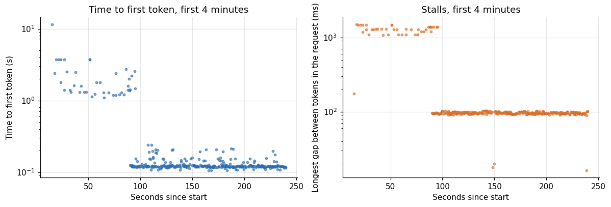

*Figure 2. Time to first token, first 4 minutes.*

Everything unusual happened at the start. All 39 requests that had a gap of more than one second between streamed chunks completed within the first 95 seconds, across all four kinds of request (13 chat, 10 code, 8 JSON, 8 long-document). Every request with a first-token time above one second also finished early. The worst first-token time of the whole test, 11.4 seconds, was a long-document request near the start, which was the first time the server saw that text and had to process ten thousand tokens cold.

The load generator sent a single short request before the load began, and that is the only warm-up the soak had. The server was not fresh: it was the process that had just run the 13-minute long-context study, and its log shows no compilation or graph capture after start-up. The first 100 seconds were slow anyway, and I do not know why. Seeing the long document for the first time and refilling caches after the study are candidates, and I tested neither. In practice this means that the first minute or two of any benchmark on this server is not representative, and a production deployment should send a few representative requests before it admits traffic.

The server log has more to say about those first minutes. These are its lines for the first 100 seconds of the soak, selected from the log (the soak began at 22:32:41):

```
INFO 10-27 22:32:56 [loggers.py:315] Engine 000: Avg prompt throughput: 38.8 tokens/s, Avg generation throughput: 12.9 tokens/s, Running: 8 reqs, Waiting: 0 reqs, GPU KV cache usage: 21.1%, Prefix cache hit rate: 67.2%
INFO 10-27 22:33:06 [loggers.py:315] Engine 000: Avg prompt throughput: 1034.3 tokens/s, Avg generation throughput: 47.8 tokens/s, Running: 8 reqs, Waiting: 0 reqs, GPU KV cache usage: 25.0%, Prefix cache hit rate: 67.2%
INFO 10-27 22:33:16 [loggers.py:315] Engine 000: Avg prompt throughput: 51.4 tokens/s, Avg generation throughput: 82.6 tokens/s, Running: 6 reqs, Waiting: 0 reqs, GPU KV cache usage: 20.6%, Prefix cache hit rate: 67.5%
INFO 10-27 22:33:26 [loggers.py:315] Engine 000: Avg prompt throughput: 66.2 tokens/s, Avg generation throughput: 72.2 tokens/s, Running: 7 reqs, Waiting: 0 reqs, GPU KV cache usage: 22.8%, Prefix cache hit rate: 67.7%
INFO 10-27 22:33:36 [loggers.py:315] Engine 000: Avg prompt throughput: 32.3 tokens/s, Avg generation throughput: 97.2 tokens/s, Running: 8 reqs, Waiting: 0 reqs, GPU KV cache usage: 17.8%, Prefix cache hit rate: 67.7%
INFO 10-27 22:33:46 [loggers.py:315] Engine 000: Avg prompt throughput: 40.5 tokens/s, Avg generation throughput: 111.1 tokens/s, Running: 7 reqs, Waiting: 0 reqs, GPU KV cache usage: 22.8%, Prefix cache hit rate: 67.8%
INFO 10-27 22:33:56 [loggers.py:315] Engine 000: Avg prompt throughput: 19.1 tokens/s, Avg generation throughput: 130.1 tokens/s, Running: 8 reqs, Waiting: 0 reqs, GPU KV cache usage: 17.8%, Prefix cache hit rate: 67.8%
INFO 10-27 22:34:06 [loggers.py:315] Engine 000: Avg prompt throughput: 17.8 tokens/s, Avg generation throughput: 124.4 tokens/s, Running: 7 reqs, Waiting: 0 reqs, GPU KV cache usage: 15.6%, Prefix cache hit rate: 67.8%
INFO 10-27 22:34:16 [loggers.py:315] Engine 000: Avg prompt throughput: 69.1 tokens/s, Avg generation throughput: 80.2 tokens/s, Running: 8 reqs, Waiting: 0 reqs, GPU KV cache usage: 25.0%, Prefix cache hit rate: 68.1%
INFO 10-27 22:34:26 [loggers.py:315] Engine 000: Avg prompt throughput: 116.1 tokens/s, Avg generation throughput: 345.4 tokens/s, Running: 8 reqs, Waiting: 0 reqs, GPU KV cache usage: 25.0%, Prefix cache hit rate: 68.3%
```

Six to eight requests were running from 22:32:56 and the server produced between 13 and 130 output tokens per second until 22:34:16, when the line reads 80. The next line, at 22:34:26, reads 345, and then 517. So the slow stretch in the request log is also in the server's counters, for about 100 seconds. The log shows no line about compilation or graph capture in that time. Those happened at start-up, before the long-context study.

If you measure with short runs, discard the first minute, or at least check your first window against the later ones as I did here. For my own earlier load tests this affects the first concurrency level of each sweep, which is why the repeated-run medians I use elsewhere are the more reliable figures.

## 5. Steady state latency

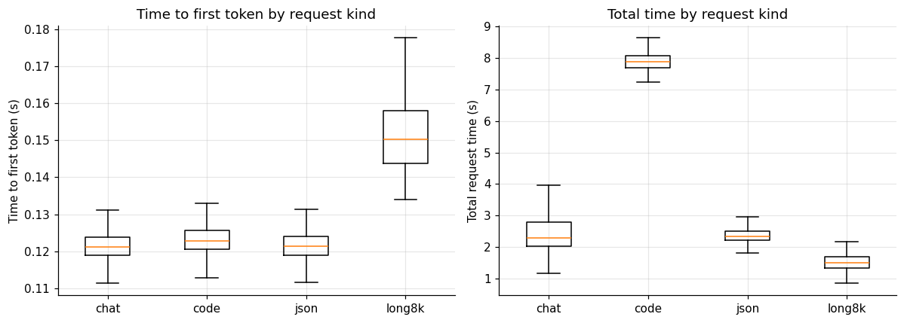

*Figure 3. Time to first token by request kind.*

**Table 2.** Steady state latency

|  | N | TTFT p50 | TTFT p95 | TTFT p99 | Total p50 | Total p99 | Prompt | Reply |
|---|---|---|---|---|---|---|---|---|
| chat | 1363 | 0.121 | 0.192 | 0.213 | 2.293 | 4.258 | 31 | 143 |
| code | 1215 | 0.123 | 0.2 | 0.218 | 7.891 | 8.554 | 95 | 512 |
| json | 797 | 0.121 | 0.188 | 0.211 | 2.346 | 2.891 | 51 | 145 |
| long8k | 573 | 0.15 | 0.231 | 0.252 | 1.495 | 2.148 | 10,420 | 87 |

After the warm-up the median time to first token was 0.12 seconds for every kind of request, including the ten-thousand-token document (0.15 seconds), and the 95th percentile was 0.20 to 0.24 seconds. The 99th percentile was 0.21 to 0.25 seconds for every kind, and the 99.9th percentile across all steady-state requests was 0.28 seconds. Total request time follows the reply length: about 2.3 seconds for a 143-token chat reply, 7.9 seconds for a 512-token code reply, 2.35 seconds for JSON and 1.5 seconds for the document summary, whose median reply was only 86 tokens.

With eight users at once, each stream decoded at a median inter-chunk gap of 13.4 milliseconds, or about 75 tokens per second per user, with a 95th percentile gap of 16.6 milliseconds (60 tokens per second). This is the experience of a person using the service: a first token in a tenth of a second and a stream faster than anyone reads.

## 6. Zero failures, and what that proves

None of the 4,051 requests failed. The rule of three says that if you observe no events in n independent trials, the 95 percent upper confidence bound on the event probability is about 3 over n.

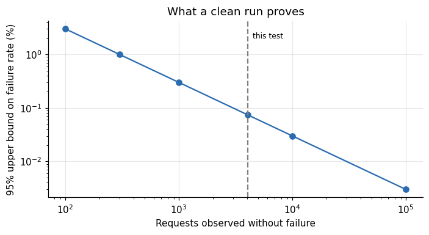

*Figure 4. What a clean run proves.*

With 4,051 clean requests the upper bound is 0.074 percent, roughly one failure per 1,350 requests. A service that must not fail more than once in ten thousand would need about 30,000 clean requests to claim it, which is 4.2 hours at this load. The bound assumes the requests are independent, and they are not entirely: one stuck server fails all of them. The statement it supports is limited: under this load for 35 minutes, I saw nothing fail, and a failure rate above a tenth of a percent would probably have shown.

## 7. Is anything drifting?

The comparison of five-minute windows already suggests not. Statistical tests on the per-request data make it precise.

**Table 3.** Is anything drifting?

| Metric | Spearman rho vs time | P value |
|---|---|---|
| time to first token | 0.03 | 0.057 |
| total time | -0.014 | 0.384 |
| median inter-token gap | 0.064 | 0 |
| 95th percentile gap | 0.01 | 0.515 |

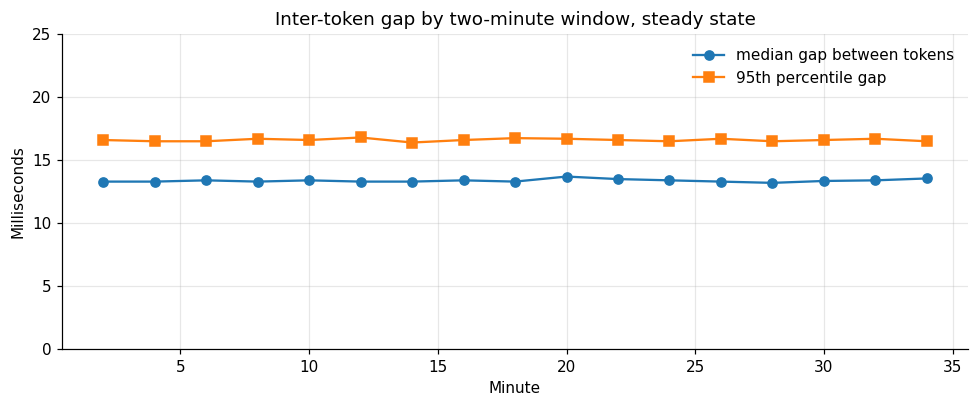

*Figure 5. Inter-token gap by two-minute window, steady state.*

After the warm-up, the Spearman correlation between completion time and each latency metric is within 0.07 of zero. Time to first token has a correlation of 0.03 with the clock (p = 0.06), total request time of minus 0.014 (p = 0.38) and the 95th percentile gap of 0.010 (p = 0.52). The median inter-token gap has a correlation of 0.064 (p below 0.001), which is statistically detectable with 3,900 points and practically nothing: a straight-line fit puts the rise at 0.002 milliseconds per minute, or 0.07 milliseconds over the 33 minutes, half a percent. The medians in two-minute windows sit between 13.2 and 13.7 milliseconds throughout.

A correlation near zero does not exclude a slow drift hidden under the noise. What it excludes is a visible slope over 35 minutes. If the median gap grew by 5 percent per hour it would have grown by 3 percent here, which this data could not distinguish from noise. For a longer window than I tested, the way to find out is to run longer.

## 8. The GPU while it worked

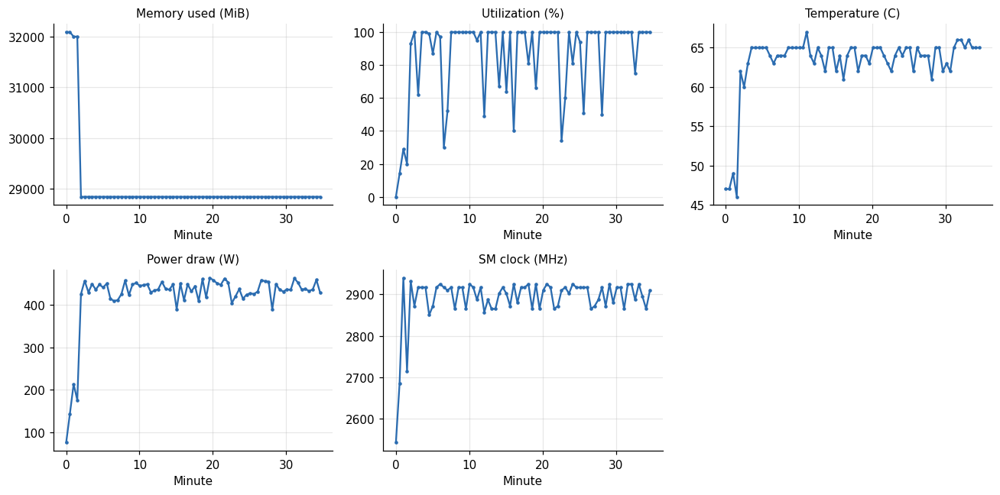

*Figure 6. The GPU while it worked.*

**Table 4.** The GPU while it worked

|  | VRAM mib | Util pct | Temp c | Power w | Sm clock mhz |
|---|---|---|---|---|---|
| count | 66 | 66 | 66 | 66 | 66 |
| mean | 28,839 | 89.8 | 64.1 | 437.7 | 2,900 |
| std | 0.1 | 19.2 | 1.4 | 17.3 | 24 |
| min | 28,838 | 30 | 60 | 389.6 | 2,850 |
| 25% | 28,839 | 93.2 | 63.2 | 427.8 | 2,872 |
| 50% | 28,839 | 100 | 64.5 | 437.4 | 2,917 |
| 75% | 28,839 | 100 | 65 | 450.5 | 2,917 |
| max | 28,839 | 100 | 67 | 464.1 | 2,932 |

Memory was 32,092 MiB at the first samples, while the server was warming up, and settled at 28,838 to 28,839 MiB within two minutes and stayed there for the other 33. That is a flat line: 1 MiB of variation in half an hour. The 1 Hz sampler below shows the same 32,092 MiB at the end of the long-context study, so the fall to 28,838 is memory released by a server that had been running for 20 minutes. I did not investigate which buffers.

Utilization tells the warm-up story from the hardware side. The sampler started 11 seconds before the first request, and for the first 90 seconds of its clock utilization was between 0 and 29 percent, with power between 76 and 213 watts, while the load generator was already sending requests that stalled. At 121 seconds utilization was 93 percent and from then on it sat at 100 percent at the median. The server's log shows six to eight requests running and 13 to 130 output tokens per second in that stretch, and I do not know what kept the card from being busy. Temperature went from 46 degrees Celsius to 62 between the 91 and 121 second samples, the moment the load took hold, and then held between 60 and 67. The streaming-multiprocessor clock ran between 2,850 and 2,932 MHz after warm-up, close to the 2,940 MHz maximum I observed, and showed no correlation with temperature (Spearman 0.11, p = 0.37). Power was a median 437 watts with a peak of 464. The card did not throttle in any way these counters can show. The caveat is that a rented machine in a well-cooled rack at one time of day is one data point, and a different host in a hot room may behave differently.

A second sampler, at one sample per second, ran on the host for the whole session, and I had not looked at it when I wrote the sections above. The figure shows it from two minutes before the long-context study to the end of the soak.

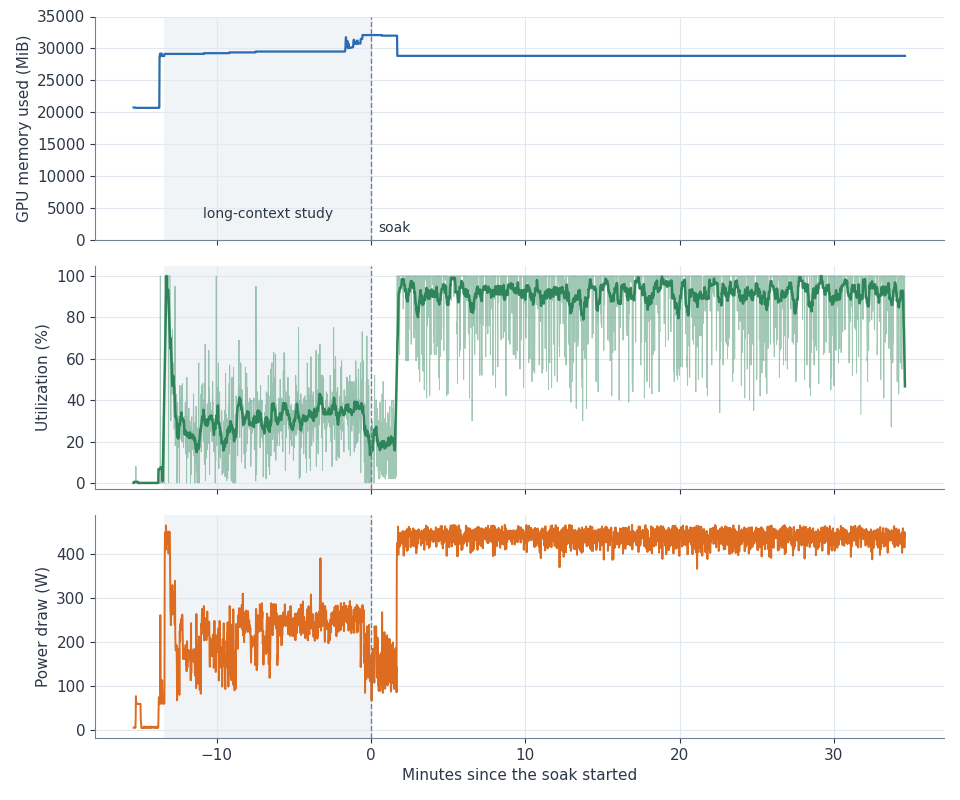

*Figure 7. RTX 5090, vLLM 27B AWQ: GPU memory, utilization and power at one sample per second, from the long-context study (shaded) into the 35-minute soak.*

During the eight-session phase of the study the card ran at a median 32 percent utilization and 242 watts. In the first 100 seconds of the soak the mean was 19 percent and the median power 145 watts, and then utilization went to the 90s and power to about 440 watts. Memory sat at 32,092 MiB through the last minutes of the study and the first minutes of the soak, and fell to 28,838 MiB at about 1.7 minutes, when the throughput recovered. So the memory drop, the rise in utilization and the end of the stalls happen together, and the same server process had been running for 20 minutes before that. I do not know which buffers were released, or why.

## 9. Which requests use the card

The mix has four kinds of request, and they do not weigh the same. A refactoring request produces 512 tokens, a document summary 86. Looking at who consumes the output budget shows what the throughput number is made of.

**Table 5.** Which requests use the card

|  | Requests | Tokens | Seconds | Prompt | Share requests | Share tokens | Share time |
|---|---|---|---|---|---|---|---|
| chat | 1404 | 221782 | 3,694 | 31 | 0.347 | 0.217 | 0.221 |
| code | 1237 | 630483 | 9,997 | 95 | 0.305 | 0.616 | 0.599 |
| json | 821 | 121422 | 2,042 | 51 | 0.203 | 0.119 | 0.122 |
| long8k | 589 | 50580 | 947.4 | 10,420 | 0.145 | 0.049 | 0.057 |

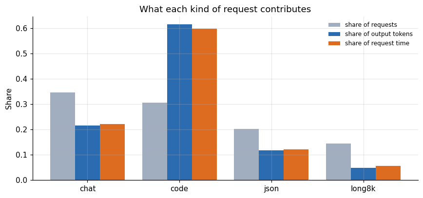

*Figure 8. What each kind of request contributes.*

Code refactoring is 31 percent of requests and produces 62 percent of the output tokens, because every reply hits the 512 token cap. Chat is 35 percent of requests and 22 percent of tokens. JSON is 20 percent of requests and 12 percent of tokens, and the long document request is 15 percent of requests and 5 percent of tokens. When a vendor quotes a tokens-per-second figure, the mix behind it matters as much as the card. A service with mostly short answers produces fewer tokens per second at the same load because less of each request is decode.

The request time shares are close to the token shares, which says that time is spent where tokens are written: decode dominates and prefill is almost free in this test, even for the document request, because of the prefix cache. That is the reverse of the agent workload in the long-context article, where prefill dominates.

## 10. A consistency check with Little's law

A closed-loop load generator with eight users should satisfy a simple identity. The number of requests in the system equals the arrival rate times the average time each request spends there. If the eight users are always busy, then the throughput in requests per second multiplied by the mean request time should come to about eight.

**Table 6.** A consistency check with Little's law

| Lambda | W | In flight |
|---|---|---|
| 1.17 | 4.09 | 4.8 |
| 1.95 | 4.1 | 7.99 |
| 2.01 | 3.98 | 7.99 |
| 2.02 | 3.97 | 8.01 |
| 2.11 | 3.81 | 8.03 |
| 1.95 | 4.09 | 7.98 |
| 1.96 | 3.92 | 7.67 |

In steady state the server completed 2.007 requests per second with a mean time of 3.99 seconds per request, which gives 8.00 requests in flight, exactly the 8 users I configured. Every five-minute window after the first gives between 7.7 and 8.0, and the first window, with the warm-up in it, gives 4.8. The identity holding is a sign that the measurements are consistent with each other: no requests are missing from the log, and the clock is the same clock.

## 11. Hitches within a stream

The inter-token gap statistics describe how smooth a stream feels. The median gap was 13.4 milliseconds, but the largest gap inside a request was typically much bigger.

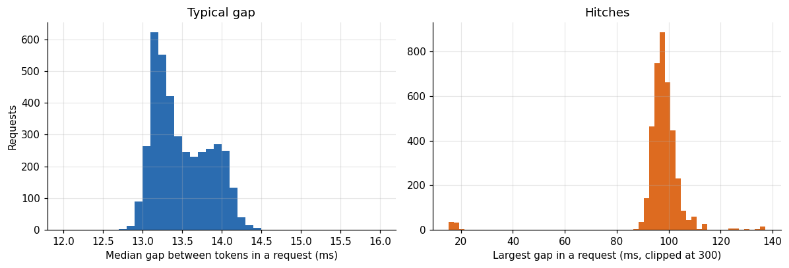

*Figure 9. Typical gap.*

In steady state the median of the largest gap in a request was 98 milliseconds, the 90th percentile 103, the 99th 114 and the 99.9th 137, and no request had a gap above 200 milliseconds. A hitch of about a tenth of a second appears in nearly every request, which matches what happens when a new request's prompt is processed between decode steps of the others: the running streams pause briefly while the server prefills. At eight users, with a new request arriving every half second, the pauses are frequent and short.

To a person reading a stream, a tenth of a second is imperceptible next to the 13 milliseconds between tokens. For a voice application that needs steady audio, it would not be. A voice system should plan on buffering of at least a few hundred milliseconds if it uses this configuration.

## 12. How much headroom is left

The soak ran eight users with each stream at about 75 tokens per second. The service level I use elsewhere in the series asks for 20 tokens per second per user and a first token in under three seconds. Eight users clear that by a factor of 3.7 on speed and about 15 on first token time.

**Table 7.** How much headroom is left

|  | Per user | Ttft95 | Agg |
|---|---|---|---|
| 1 | 83.6 | 0.05 | 82.1 |
| 4 | 72.2 | 0.11 | 274.1 |
| 8 | 73.1 | 0.16 | 494.7 |
| 16 | 63.7 | 0.28 | 844.4 |

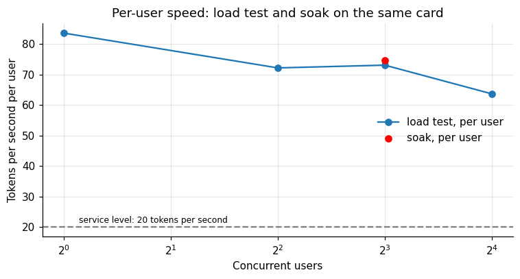

*Figure 10. Per-user speed: load test and soak on the same card.*

The load test on this card measured 63.7 tokens per second per user at sixteen users, and the soak measured about 75 per user at eight, which lies on the same curve. The curve says sixteen users still deliver more than three times the required speed and a first token in 0.28 seconds. The card has headroom for roughly twice the load of the soak before the service level is at risk, and the memory is not a limit for short prompts, since the cache is only exposed to ten thousand token requests in this mix. The soak does not prove that sixteen users are stable for 35 minutes, and I did not run that soak.

## 13. Each kind of request over time

The overall windows hide the possibility that one kind of request degrades while another improves. Splitting the five-minute windows by kind closes that gap.

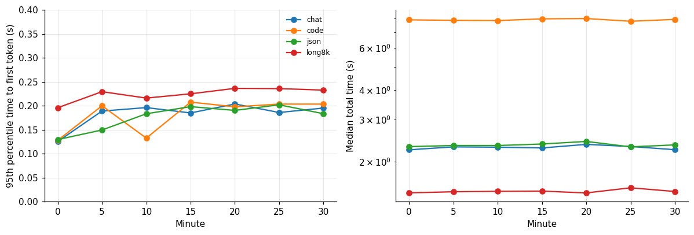

*Figure 11. Each kind of request over time.*

**Table 8.** Each kind of request over time

| Chat | Code | Json | Long8k |
|---|---|---|---|
| 0.125 | 0.128 | 0.129 | 0.196 |
| 0.189 | 0.2 | 0.149 | 0.229 |
| 0.196 | 0.132 | 0.183 | 0.216 |
| 0.185 | 0.208 | 0.198 | 0.225 |
| 0.204 | 0.198 | 0.19 | 0.236 |
| 0.186 | 0.203 | 0.202 | 0.236 |
| 0.195 | 0.203 | 0.183 | 0.233 |

Within each kind the five-minute 95th percentile of first-token time stays inside a band 0.08 seconds wide or less after the warm-up (0.04 for the document request), and the median total time barely moves. No kind degrades while the others hold, which is what a hidden problem usually looks like. The document request, the only one with a long prompt, has the highest and the most variable first-token time (about 0.23 seconds at the 95th percentile against 0.19 to 0.20 for the others), which is the ten-thousand-token prompt being looked up in the cache.

## 14. Closed loop and open loop

The load generator is closed-loop: each of the eight users waits for a reply before sending the next request. That design has a property worth stating. When the server slows down, the users send fewer requests, so the offered load falls and the queue cannot grow without bound. It is a good model of a fixed pool of clients, such as eight agents that each work through a task list, and a gentle one for a public service.

A public service is open-loop: requests arrive at some rate regardless of whether the server keeps up. If the rate exceeds capacity, the queue grows and latency climbs without limit until clients give up. The soak does not test that regime. It shows what the card does at about two requests per second with eight in flight and tells nothing about what happens at five requests per second. For capacity planning of an open service, I would add an open-loop soak at the expected peak arrival rate and at 1.5 times that rate, and compare the tails.

One practical rule follows from the closed-loop result. The number of users in the test is a concurrency, not a population. Eight concurrent users correspond to a much larger number of registered users, because most of the time most users are not waiting on the model. The conversion depends on how people use the product, and the cost article in this series made one assumption about it (a message every 30 seconds) that I did not measure.

## 15. Reading 509 tokens per second

A number like 509 is hard to feel. Shared among eight streams it is 64 tokens per second each on average, and the median inter-token gap says about 75 for the typical stream. A fast reader takes in four to five words a second, or perhaps seven tokens a second, so each stream is producing ten times faster than a person reads. The server could serve fifty readers of ordinary speed, if each one only read and did not wait for the first token. That is the sense in which the measured capacity is generous for chat and tight for anything that consumes tokens faster than a person, such as an agent calling the model in a loop or a pipeline that processes documents.

I use this framing in the cost article, where I treat a chat user as consuming about twelve output tokens per second while active.

## 16. Energy per token

Power draw and token counts give a measure of efficiency.

Taking the mean of the 70 power samples times the 2,078 seconds they span gives 0.243 kilowatt-hours, and with 1,024,267 completion tokens that is 0.237 kilowatt-hours per million output tokens. This is the power drawn by the GPU board as reported by `nvidia-smi`, and not the whole machine: it excludes the CPU, memory, fans and the data center overhead. At an electricity price of 0.20 dollars per kilowatt-hour the GPU's energy cost is about 0.05 dollars per million tokens. Compared with the 0.29 dollars per million tokens that renting the card costs at the prices I paid, electricity is a small part of the cost at this scale, and it is the part an owner of the hardware pays.

## 17. From the soak to a daily budget

Extrapolating a stable rate is simple, if you accept the assumption of stability that the test supports for 35 minutes.

At 509 tokens per second, a card running flat out produces about 44 million tokens per day. Rented around the clock at the median 0.609 dollars per hour, it costs 14.62 dollars a day, which is 0.33 dollars per million tokens at full load, 0.47 at 70 percent utilization and 0.95 at 35 percent. The cost article in this series reaches 0.29 dollars per million at 70 percent utilization using the higher throughput at sixteen users. The two numbers differ because eight users do not saturate the card: at sixteen users the same engine produced 844 tokens per second in the load test, and the soak's per-user speed of 75 tokens per second shows spare capacity.

## 18. How long should a soak be?

The 35 minutes I ran were a budget decision. The data can say what that length could and could not have found. The steady-state throughput per minute is a noisy series: a mean of about 509 tokens per second and a standard deviation of 11. A drift in that series is a trend, and the smallest trend a test can find depends on the noise and on how many minutes it covers.

**Table 9.** How long should a soak be?

| Soak minutes | Smallest detectable total drift pct | Rental cost USD |
|---|---|---|
| 10 | 6.8 | 0.1 |
| 20 | 4.8 | 0.2 |
| 35 | 3.6 | 0.36 |
| 60 | 2.7 | 0.61 |
| 120 | 1.9 | 1.22 |
| 480 | 1 | 4.87 |
| 1,440 | 0.6 | 14.62 |

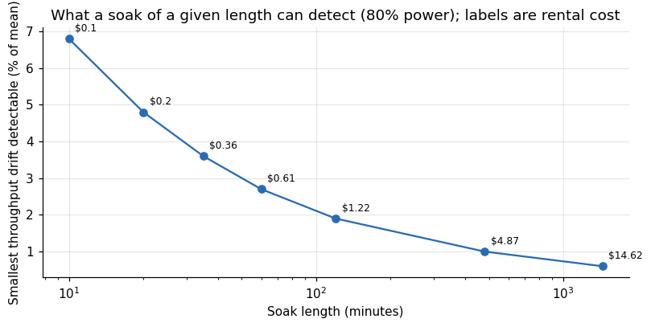

*Figure 12. What a soak of a given length can detect (80% power); labels are rental cost.*

The fitted trend across the 32 steady minutes is minus 0.07 tokens per second per minute, with a standard error of 0.21, so it is indistinguishable from zero. Over the whole window it amounts to minus 2.2 tokens per second, or minus 0.4 percent of the mean.

What could I have seen? Assuming the same minute-to-minute noise and a linear drift, a 35-minute soak has 80 percent power to detect a total throughput drift of about 3.6 percent over the window, which is 18 tokens per second. A one-hour soak would detect 2.7 percent. A day-long soak would detect a drift of 0.6 percent in total, and would cost 14.6 dollars at the price I paid. Detecting a drift of one percent needs roughly eight hours, because the smallest detectable total drift shrinks only with the square root of the soak length.

That sets the claim I can make: over 35 minutes, throughput did not fall by more than about 4 percent. It may have fallen by 2 percent, or risen by 2, and I could not have told. The statement "no degradation" is stronger than the evidence, and "no degradation larger than 4 percent over half an hour" is the one the data support.

## 19. What a warm-up costs

The first hundred seconds were poor: throughput of 57 tokens per second in the first minute against 509 in steady state, a handful of requests with first tokens above one second and gaps above a second between tokens. In money and user terms:

In the first 100 seconds the server produced about 12,600 tokens against the 50,900 it would have produced at the steady rate, a shortfall of about 38,300 tokens. Of the 61 requests that completed in those 100 seconds, 41 had a first token above one second, and none after them did. The value of the shortfall at the card's steady-state cost per token is about a cent and a quarter. Money is not the issue. The issue is who is waiting: whoever arrives in that stretch gets a worse experience than everyone after them. This server had not just restarted, so I cannot say the same stretch would follow a restart, a scale-out or a deployment.

For a service, three consequences follow. Warm the server with a representative workload before the load balancer sends it traffic, including a few long prompts and each kind of request you serve. Roll deployments one replica at a time, with a health check that waits for steady latency as well as for the port to open. And when you scale out in response to load, remember that a replica added now is useful in two minutes, so autoscaling needs a margin.

## 20. Sampling resolution

I sampled the GPU every 30 seconds. That resolution is enough for memory, temperature and clock, which change on the scale of minutes, and weak for power and utilization, which change on the scale of seconds.

After the warm-up, 16 of 66 samples read a utilization below 90 percent, with the lowest at 30 percent, while the request log shows steady throughput. A utilization number sampled once every 30 seconds is the state at that instant. The request-level throughput was steady throughout, which argues against real idle periods, but the 30-second samples alone cannot tell a counter artifact from short gaps between requests, and the one-second sampler below partly can. If the question were whether the card ever stalls, a 30 second sampler cannot answer it. I would sample at 1 to 5 seconds next time. The cost is a larger log file, a few hundred kilobytes for a day.

The one-second sampler answers part of it. Between four and 34 minutes into the soak it has 1,800 samples. Utilization was below 90 percent in 23.6 percent of them and below 50 percent in 3.1 percent, it was never zero, and the mean was 91.9 percent. The card therefore had short dips but no idle stretch of the kind that would show as a stall, over a window in which the request log shows steady throughput.

## 21. Reading someone else's soak report

If a vendor or a blog post tells you a server was soak tested, these are the questions I would ask, each of which this test lets me answer for myself.

How long, at what load, and with what mix? A soak at one user proves little about a service for eight.

Was the warm-up separated? A report that averages over the start hides the worst latencies and flatters the steady state, or the reverse.

How many requests, and how many failed? Zero failures in 100 requests proves almost nothing, and the rule of three gives the bound.

Which resource counters were recorded, at what interval, and did they stay flat? Memory is the one to look at first.

What was the trend and how big could it have been undetected? A p-value without an effect size, or a flat-looking chart without a detection limit, does not rule out a slow slide.

Was the hardware representative? One card in a good rack is a good case.

Were the outputs checked? Stability of speed says nothing about stability of quality.

## 22. What this test cannot tell you

It cannot tell you about hours or days. Memory fragmentation, a slow leak in a tokenizer cache, log files that fill a disk and background processes on the host all operate on longer clocks. The server preallocates GPU memory, so this counter says little about leaks in host memory, which I did not record. What the flat line does show is that the cache pool and activation buffers did not grow.

It cannot tell you about different traffic. The mix is fixed, and the long-document text is a repeated string that the cache serves. A service whose documents differ every time would load the card more heavily, as the long-context article shows.

It cannot tell you about other hosts. One machine, one afternoon, one cooling environment.

It cannot tell you about quality. A stable server can produce wrong answers stably. This test measures speed and failures only.

It does not exercise failure handling. A real service sees client disconnects, malformed requests and bursts. The users here are polite.

## 23. A protocol for your own soak

Run at the concurrency you expect at peak, with the mix of requests you expect. Run for at least thirty minutes, and longer when the hardware is rented. Sample the GPU at an interval of 30 seconds or less, with memory, utilization, temperature, power and clock. Log every request with its start and end time, status, time to first token and token counts. Discard the first two minutes from your steady-state numbers and report them separately. Compare windows of equal length as well as the overall mean. Test for a trend, and report the size of the effect as well as the p-value. Watch memory above all: a flat line is what you want. Keep the logs, because the day something goes wrong in production, the soak data are the baseline you compare against.

## 24. Questions I expect

**Is 35 minutes long enough?** For a first look, yes. For a promise to a customer, no. It found the warm-up and showed nothing drifting at the resolution of the counters. A day-long run costs about 15 dollars on this card and is the right next step before a commitment.

**Why use AWQ for this test?** Because it is the build that fits and performs on a 32 gigabyte card, and the test is about the card's stability, not about the best model. The same harness would run on any configuration.

**Should the warm-up be part of the benchmark?** Report it separately. A production server restarts, and the first minutes of its life are part of the user experience after a deployment, so they deserve their own number.

**Does a steady 100 percent utilization mean the card is saturated?** Utilization as reported by the driver means that a kernel was running during the sample, not that the card was working at its limit. The per-user speed headroom shows the card could take more load even at 100 percent.

**Is the energy figure usable for a data center?** It is board power only, so multiply by the facility's overhead and add the host.

| Claim in this article | Evidence behind it | Caveat |
|---|---|---|
| All 4,051 requests succeeded | Request log, status 200 and a completed stream | I did not check the content of the replies, and the rule of three bounds the rate at 0.074 percent |
| Throughput and latency were flat after about 100 seconds | Five-minute windows, Spearman tests and the server's own counters (mean 509.0 tokens per second over 184 samples) | 35 minutes cannot show a slow drift, and a drift under about 4 percent would be invisible |
| GPU memory was flat at 28,838 to 28,839 MiB | 70 samples at 30 seconds and the 1 Hz sampler | The server preallocates, so the counter says little about host memory, which I did not record |
| The first 100 seconds were a warm-up | 39 requests with stalls, all in the first 95 seconds, and low utilization in the sampler | The server was not fresh and its log shows no compilation, so the cause of the slow start is unknown |
| The card did not throttle | Clock between 2,850 and 2,932 MHz, 60 to 67 degrees Celsius | One host, one afternoon, board power only |

## 25. Limitations

The test ran once, for 34.8 minutes, on one host. The 70 GPU samples are 30 seconds apart and would miss short thermal or power events. The reported board power is not wall power. The load is eight continuous users with a fixed mix of request types and capped outputs. The long-document request is served mostly from cache. Failure counts are for the client's view: a request counts as successful if it returned a 200 status and completed its stream. I did not check the content of the replies. The server was an AWQ build with a context window configured to accept ten-thousand-token prompts.

## 26. How much it cost

The soak ran as part of a single RTX 5090 session at 0.6 dollars per hour that cost 1.32 dollars of itemized rental in total, together with the long-context test and an engine comparison. The soak itself took 35 minutes, which at the card's median price is about 0.36 dollars. The campaign as a whole cost US$ 50.79.

## 27. Reproducing this analysis

Attach the dataset `gpu-ai-benchmark-campaign-2026`. The files `soak_requests_5090_awq.csv` and `soak_gpu_5090.csv` hold the per-request and per-sample data used above. The load generator and the harness are in the repository `llm-serving-engines-bench`.

## 28. Glossary

- **Soak test**: a long-duration run at steady load to find slow problems.
- **Warm-up**: the period after start during which kernels compile, caches fill and latencies settle.
- **Time to first token**: delay between sending a request and receiving the first streamed token.
- **Inter-token gap**: time between consecutive streamed chunks.
- **Rule of three**: with no events in n trials, the 95 percent upper bound on the event rate is about 3 over n.
- **Thermal throttling**: a reduction of clock speed to limit temperature or power.
- **SM clock**: the frequency of the GPU's streaming multiprocessors.

Lucas Rangel
