# How much speculative decoding really speeds up

**Lucas Rangel** · [Kaggle writeup](https://www.kaggle.com/writeups/lucasrangelss/how-much-speculative-decoding-really-speeds-up) · [Executable notebook](https://www.kaggle.com/code/lucasrangelss/how-much-speculative-decoding-really-speeds-up) · [Code and data](https://github.com/LucasRangelSSouza/gpu-ai-benchmark-hub) · [Dataset](https://www.kaggle.com/datasets/lucasrangelss/gpu-ai-benchmark-campaign-2026)

## Abstract

Speculative decoding lets a small drafting model propose several tokens at once and has the large model check them in one pass. When the drafts are good, the large model produces several tokens for the price of one pass. The technique is popular because, in theory, it changes nothing about the output and only makes generation faster.

I measured it on a 27 billion parameter model served with vLLM, using a drafting method called DFlash with seven speculative tokens per step, on three kinds of hardware. I compared each configuration with and without it, across concurrency levels from one user to thirty-two, and I read the acceptance statistics that the server logged while it ran.

What I found:

- For one user, speculative decoding multiplied decode speed by 3.8 on an RTX PRO 6000, by 5.1 on an L40S and by 3.3 on the GB10. Those numbers are large and they are real.
- The benefit shrinks as load grows, and on one card it reverses. On the PRO 6000 the aggregate throughput gain fell from 3.2 times at one user to 1.5 times at thirty-two. On the L40S it fell from 3.8 times to 0.62: at thirty-two users the plain FP8 server delivered 338 tokens per second and the speculative one only 210.
- The drafts were accepted at a steady rate. Across 384 logged windows the mean acceptance length was 3.6 tokens per verification step, and the chance that the draft's first token was accepted was about 0.75 on the larger cards. The chance fell with position, to about a quarter at the seventh token.
- Precision changed the acceptance. On the PRO 6000 the mean acceptance length was 4.04 for BF16, 3.94 for FP8 and 3.63 for NVFP4. The drafter does slightly worse against the 4-bit target.
- The ARM machine, the GB10, had markedly lower acceptance on its FP8 build (2.77 on average) than the larger cards, while its BF16 build (3.88) matched them. I cannot explain the gap from this data.

The practical rule that falls out is simple. Speculative decoding is a latency tool for lightly loaded servers. For a service that runs near saturation, test it before trusting it, because the same technique that triples speed at one user can reduce capacity at thirty.

> **Code and data.** Everything behind this article is public: the code that ran, the curated data, the analysis that regenerates every figure, and tests that pin the conclusions to the data. Repositories: [quantization-and-offload-lab](https://github.com/LucasRangelSSouza/quantization-and-offload-lab), [llm-serving-engines-bench](https://github.com/LucasRangelSSouza/llm-serving-engines-bench). Index of the whole series: [gpu-ai-benchmark-hub](https://github.com/LucasRangelSSouza/gpu-ai-benchmark-hub).

## 1. What speculative decoding does

A language model generates one token per forward pass. Each pass reads all the model weights from memory, which for a 27 billion parameter model in 8 bits is 28 gigabytes. On a modern GPU the arithmetic is cheap compared with moving those bytes, so a single-user decode is limited by memory bandwidth, and the compute units sit mostly idle.

Leviathan, Kalman and Matias (2023) observed that the idle compute could be put to use. A cheap draft proposes the next several tokens. The large model then processes all of them in one pass, which costs about the same memory traffic as a single token pass, and accepts the longest prefix that agrees with what it would have generated. The accepted tokens are exactly the ones the large model would have produced, with the sampling rule adjusted so the distribution of the output is unchanged. When the draft is often right, the large model advances several tokens per pass.

The method I tested is configured in vLLM as `method='dflash'` with a separate drafter model and `num_spec_tokens=7`, according to the server logs. I did not inspect the drafter beyond that configuration line, and I describe only what the server reported.

Here is what the server said when it started the speculative FP8 build on the RTX PRO 6000. I selected the lines about the drafter from the log, and each is shown as written (long lines cut with an ellipsis).

```
INFO 10-26 11:42:17 [model.py:692] Resolved architecture: DFlash2DraftModel
INFO 10-26 11:42:43 [core.py:123] Initializing a V1 LLM engine (v0.30.0) with config: model='/workspace/models/bf16', speculative_config=SpeculativeConfig(method='dflash', model='/workspace/models/drafter', num_spec_tokens=7), tokenizer='/workspace/models/bf16'…
WARNING 10-26 11:45:47 [kv_cache_utils.py:2206] Speculative decoding (method=dflash) is enabled but no KV cache group could be identified as the draft model's.
```

The log names the drafter's architecture as `DFlash2DraftModel` and gives the method and the seven drafted tokens. The last line is a warning that no cache group was identified as the drafter's. I do not know what that means for the cache budget, and it is the only thing the log says about the drafter's memory.

Two quantities describe how well it works. The mean acceptance length is the average number of tokens the large model advances per verification pass, counting the one it always produces. The draft acceptance rate is the share of drafted tokens that were accepted. With seven drafted tokens, a mean acceptance length of 3.6 means about two to three drafted tokens survive on average.

## 2. The setup

The comparison is between a plain server and a speculative one for the same model on the same card. I have such pairs on three cards:

- RTX PRO 6000, FP8 build, with and without speculative decoding.
- L40S, FP8 build, with and without.
- GB10, FP8 build, with and without.

The load test is the one described in the other articles of this series: continuous users with a mix of chat, code, JSON and long-document requests, at concurrency levels of 1, 2, 4, 8, 16 and 32 (not every level on every card). For each level I take the median of repeats and compare decode speed per user and aggregate output throughput.

In addition, the vLLM servers print a line every ten seconds with the acceptance statistics for that window. I parsed 384 of these lines from 12 distinct server logs, covering BF16, FP8 and NVFP4 builds on the PRO 6000, H100, L40S and GB10.

These are the first three of those lines from the PRO 6000 FP8 server log, copied unchanged except for the process prefix.

```
INFO 10-26 11:50:28 [metrics.py:120] SpecDecoding metrics: Mean acceptance length: 3.06, Accepted throughput: 27.84 tokens/s, Drafted throughput: 94.71 tokens/s, Accepted: 321 tokens, Drafted: 1092 tokens, Per-position acceptance rate: 0.660, 0.423, 0.282, 0.218, 0.173, 0.167, 0.135, Avg Draft acceptance rate: 29.4%
INFO 10-26 11:50:38 [metrics.py:120] SpecDecoding metrics: Mean acceptance length: 4.80, Accepted throughput: 106.79 tokens/s, Drafted throughput: 196.69 tokens/s, Accepted: 1068 tokens, Drafted: 1967 tokens, Per-position acceptance rate: 0.811, 0.673, 0.559, 0.509, 0.459, 0.409, 0.381, Avg Draft acceptance rate: 54.3%
INFO 10-26 11:50:48 [metrics.py:120] SpecDecoding metrics: Mean acceptance length: 4.09, Accepted throughput: 90.70 tokens/s, Drafted throughput: 205.80 tokens/s, Accepted: 907 tokens, Drafted: 2058 tokens, Per-position acceptance rate: 0.769, 0.561, 0.459, 0.381, 0.347, 0.303, 0.265, Avg Draft acceptance rate: 44.1%
```

One line holds everything the acceptance tables use: the mean acceptance length, the accepted and drafted tokens in the window, and the acceptance rate for each of the seven positions. In the first window the mean acceptance length was 3.06 and position 7 was accepted 13.5 percent of the time. In the second it was 4.80 and 38.1 percent.

## 3. Speedup for one user and for many

**Table 1.** Speedup for one user and for many

|  | Users | User plain | Agg plain | User spec | Agg spec | Speedup per user | Speedup aggregate | GPU |
|---|---|---|---|---|---|---|---|---|
| 0 | 1 | 45.4 | 42.4 | 173.5 | 137 | 3.82 | 3.23 | RTX PRO 6000 |
| 1 | 4 | 42.3 | 139.7 | 131.3 | 403.9 | 3.1 | 2.89 | RTX PRO 6000 |
| 2 | 8 | 39.8 | 277.8 | 78.4 | 582.8 | 1.97 | 2.1 | RTX PRO 6000 |
| 3 | 16 | 35.6 | 418.9 | 60.2 | 821.2 | 1.69 | 1.96 | RTX PRO 6000 |
| 4 | 32 | 30.2 | 694.3 | 38.4 | 1,039 | 1.27 | 1.5 | RTX PRO 6000 |
| 0 | 1 | 21.7 | 20.85 | 109.7 | 80 | 5.06 | 3.84 | L40S |
| 1 | 4 | 20.75 | 66.1 | 43.6 | 175.8 | 2.1 | 2.66 | L40S |
| 2 | 8 | 19.75 | 126.5 | 50.7 | 185.7 | 2.57 | 1.47 | L40S |
| 3 | 16 | 17.7 | 220.4 | 55.3 | 190.7 | 3.12 | 0.87 | L40S |
| 4 | 32 | 14.4 | 337.5 | 54.2 | 210.5 | 3.76 | 0.62 | L40S |
| 0 | 1 | 8 | 7.9 | 26.7 | 23.7 | 3.34 | 3 | GB10 |
| 1 | 2 | 8.1 | 14.6 | 18.1 | 36.8 | 2.23 | 2.52 | GB10 |
| 2 | 4 | 7.7 | 24.5 | 15.6 | 67.1 | 2.03 | 2.74 | GB10 |
| 3 | 8 | 7.3 | 37.8 | 14.3 | 111.9 | 1.96 | 2.96 | GB10 |

*First 14 of 16 rows; the full table is in the executable notebook.*

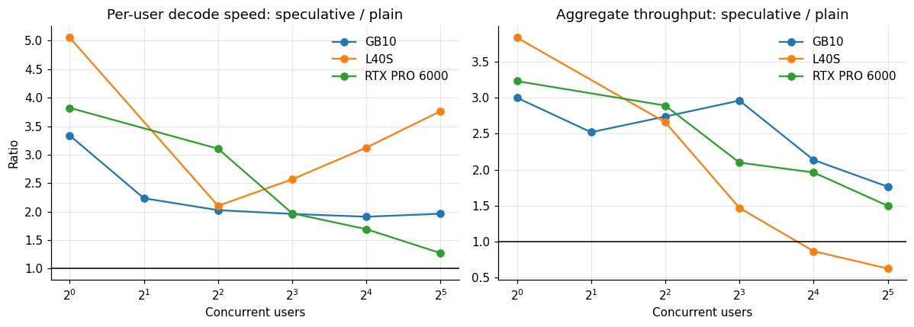

*Figure 1. Speedup for one user and for many.*

On the RTX PRO 6000, a single user decoded at 45.4 tokens per second with the plain FP8 server and 173.5 with speculative decoding, a factor of 3.82. The factor fell to 3.10 at four users, 1.97 at eight, 1.69 at sixteen and 1.27 at thirty-two. Aggregate throughput followed the same shape: 3.23 times at one user, 1.96 at sixteen and 1.50 at thirty-two. The gain never disappeared on this card, but at thirty-two users it was a third of what it had been at one.

The GB10 shows a flatter curve. At one user the factor was 3.34 per user and 3.00 in aggregate. At thirty-two users it was 1.96 and 1.76. Its aggregate gain stayed above 1.7 across the whole range I tested, which makes sense for a machine whose bandwidth is low relative to its compute, a regime where spare compute is plentiful at all batch sizes.

The L40S behaves differently. At one user the speedup per user is 5.06 and the aggregate 3.84. By eight users the aggregate gain is 1.47. At sixteen it is 0.87 and at thirty-two 0.62, which means the speculative server delivered less total throughput than the plain one. At thirty-two users the per-user speed is still higher with speculation (54 against 14 tokens per second), because the aggregate is split among the users it is already serving, and that is the trap in reading per-user numbers alone: the two servers are not carrying the same load.

## 4. Why the benefit shrinks with load

The mechanism is the same idea that makes the technique work in the first place. A decode step is memory-bound at low batch size: the cost is reading the weights, and extra tokens to verify are nearly free. As more users share the step, the batch grows, the weights are read once for the whole batch, and compute starts to matter. The verification pass then does real work on drafted tokens that will be rejected, work the plain server would not do. Drafted tokens that fail the check are wasted compute, and when compute is the limit, waste is a loss.

The logs let me measure how wasteful the drafts are.

**Table 2.** Why the benefit shrinks with load

| Host GPU | Quantization | Accepted | Drafted | Accepted share | Wasted per accepted |
|---|---|---|---|---|---|
| GB10 | bf16 | 12705 | 29274 | 0.434 | 1.304 |
| GB10 | fp8 | 7125 | 28595 | 0.249 | 3.013 |
| GB10 | nvfp4 | 51885 | 176862 | 0.293 | 2.409 |
| H100 NVL | bf16 | 100635 | 234647 | 0.429 | 1.332 |
| H100 NVL | fp8 | 159820 | 392616 | 0.407 | 1.457 |
| L40S | fp8 | 20251 | 46662 | 0.434 | 1.304 |
| L40S | nvfp4 | 21753 | 54887 | 0.396 | 1.523 |
| RTX PRO 6000 | bf16 | 86090 | 196126 | 0.439 | 1.278 |
| RTX PRO 6000 | fp8 | 131243 | 312550 | 0.42 | 1.381 |
| RTX PRO 6000 | nvfp4 | 534315 | 1387323 | 0.385 | 1.596 |

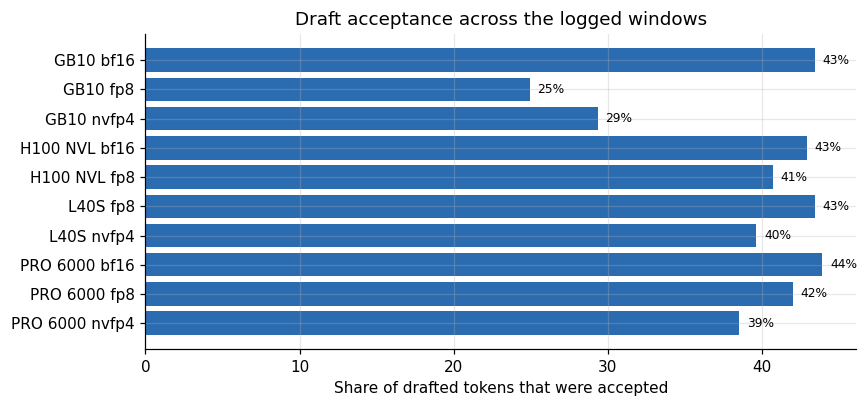

*Figure 2. Draft acceptance across the logged windows.*

Across all windows, only 25 to 43 percent of drafted tokens were accepted. For the PRO 6000 running FP8, 42 percent were: for every accepted draft token the server verified 1.4 more that were thrown away. For the GB10 running FP8 the accepted share was 25 percent, which is three wasted for every accepted. With seven drafted tokens per step, an acceptance rate of 40 percent means each step verifies seven tokens and keeps about 2.8 of them, plus the one the large model always produces.

At low batch the seven-token verification costs almost the same as a one-token step, so the waste is invisible. At high batch it multiplies the work per step by up to eight, and the gain collapses. That is a hypothesis about mechanism and I did not isolate compute from bandwidth with a profiler. The measured pattern fits it. A second explanation fits the L40S reversal equally well. The speculative server must also hold the drafter in memory, and my operator notes record that an earlier attempt at a 32,000-token context on this 48 gigabyte card ran short of cache by 1.1 GiB. If the speculative server had less cache than the plain one, it could not keep thirty-two sequences in flight, and its aggregate throughput would fall for a reason unrelated to wasted compute. The start logs below show that the speculative server did have less cache, but not how much of the throughput drop that explains, so the data cannot separate the two.

The start logs can say something about the cache explanation. This is the L40S, the plain FP8 server first and the speculative FP8 server after it, with the weights, the cache budget and the cache size each reported.

```
INFO 10-26 11:32:09 [model_runner.py:428] Model loading took 28.06 GiB memory and 10.138116 seconds
INFO 10-26 11:33:14 [gpu_worker.py:640] Available KV cache memory: 8.43 GiB
INFO 10-26 11:33:14 [kv_cache_utils.py:2395] GPU KV cache size: 120,149 tokens, Maximum concurrency for 32,768 tokens per request: 3.67x
INFO 10-27 07:31:01 [model_runner.py:428] Model loading took 31.83 GiB memory and 10.621211 seconds
INFO 10-27 07:33:48 [gpu_worker.py:640] Available KV cache memory: 6.62 GiB
INFO 10-27 07:33:48 [kv_cache_utils.py:2395] GPU KV cache size: 52,757 tokens, Maximum concurrency for 32,768 tokens per request: 1.61x
```

The speculative server's weights were 3.77 GiB larger (31.83 against 28.06 GiB, the drafter included), its cache budget 6.62 GiB against 8.43, and its cache 52,757 tokens against 120,149, which is 44 percent of the plain server's. The two starts were in different sessions and I did not check that their memory settings matched, so part of the difference could come from the settings. For comparison, the PRO 6000 pair:

```
INFO 10-27 08:34:41 [gpu_worker.py:640] Available KV cache memory: 54.95 GiB
INFO 10-27 08:34:41 [kv_cache_utils.py:2395] GPU KV cache size: 783,701 tokens, Maximum concurrency for 32,768 tokens per request: 23.92x
INFO 10-26 11:49:36 [gpu_worker.py:640] Available KV cache memory: 47.17 GiB
INFO 10-26 11:49:36 [kv_cache_utils.py:2395] GPU KV cache size: 355,425 tokens, Maximum concurrency for 32,768 tokens per request: 10.85x
```

On the PRO 6000 the speculative cache was 355,425 tokens against 783,701, again in different sessions. The speculative servers held less cache on both cards. The logs do not show how much of the L40S throughput drop that explains.

## 5. The acceptance statistics in detail

**Table 3.** The acceptance statistics in detail

|  | Quantization | Pos1 | Pos2 | Pos3 | Pos4 | Pos5 | Pos6 | Pos7 |
|---|---|---|---|---|---|---|---|---|
| GB10 | bf16 | 0.76 | 0.55 | 0.42 | 0.35 | 0.31 | 0.26 | 0.23 |
| GB10 | fp8 | 0.64 | 0.38 | 0.24 | 0.18 | 0.13 | 0.1 | 0.09 |
| GB10 | nvfp4 | 0.67 | 0.43 | 0.3 | 0.22 | 0.17 | 0.14 | 0.12 |
| H100 NVL | bf16 | 0.74 | 0.55 | 0.43 | 0.35 | 0.3 | 0.26 | 0.23 |
| H100 NVL | fp8 | 0.73 | 0.52 | 0.41 | 0.33 | 0.28 | 0.24 | 0.21 |
| L40S | fp8 | 0.75 | 0.56 | 0.44 | 0.37 | 0.33 | 0.29 | 0.27 |
| L40S | nvfp4 | 0.74 | 0.54 | 0.42 | 0.34 | 0.29 | 0.25 | 0.22 |
| RTX PRO 6000 | bf16 | 0.76 | 0.58 | 0.46 | 0.38 | 0.33 | 0.29 | 0.26 |
| RTX PRO 6000 | fp8 | 0.75 | 0.55 | 0.44 | 0.36 | 0.32 | 0.28 | 0.25 |
| RTX PRO 6000 | nvfp4 | 0.73 | 0.52 | 0.39 | 0.31 | 0.26 | 0.22 | 0.2 |

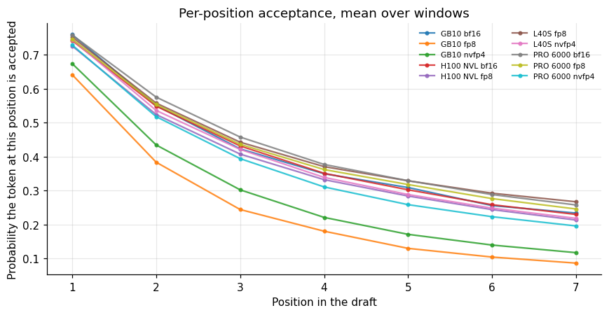

*Figure 3. Per-position acceptance, mean over windows.*

The acceptance curve falls steeply. On the PRO 6000 with BF16 weights, the first draft token was accepted 76 percent of the time, the second 58, the third 46, and the seventh 26 percent. On the GB10 with FP8 weights the same positions gave 64, 38, 24 and 9 percent. A drafter that gets the next token right three quarters of the time still gets the seventh right only a quarter of the time, because each position depends on all the earlier ones being right.

Two design lessons follow. First, seven speculative tokens is more than the later positions justify: the sixth and seventh tokens are accepted less than one time in three even on the best hardware, and on the GB10 below one in six. A shorter draft would waste less compute at high load. I did not test other lengths. Second, the mean acceptance length is what sets the ceiling on speedup. A mean of 3.9 bounds the single-user gain at about 3.9 times, and the PRO 6000 measured 3.82, which is close to that ceiling. The L40S measured 5.06 against a mean acceptance length of 4.0, which exceeds the ceiling. The difference suggests the plain L40S baseline ran well below the speed the hardware allows: it decoded at 21.7 tokens per second, while streaming 28 gigabytes of weights at the manufacturer's published 864 gigabytes per second would allow about 31. Part of the L40S speedup is therefore the repair of a slow baseline.

## 6. Does the quantization of the target matter?

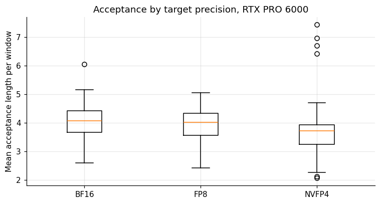

*Figure 4. Acceptance by target precision, RTX PRO 6000.*

**Table 4.** Does the quantization of the target matter?

|  | Count | Mean | Median | Std |
|---|---|---|---|---|
| bf16 | 37 | 4.04 | 4.07 | 0.7 |
| fp8 | 37 | 3.94 | 4.02 | 0.6 |
| nvfp4 | 106 | 3.63 | 3.72 | 0.89 |

On one card, with the same drafter, acceptance falls as the target gets coarser: a mean of 4.04 for BF16, 3.94 for FP8 and 3.63 for NVFP4. The NVFP4 figure comes from 106 windows, and the gap between it and BF16 (0.41 tokens, 10 percent) is well beyond the window-to-window scatter. The likely cause is that the drafter was trained to imitate the full-precision model, and the 4-bit target's next-token distribution is slightly different from the one the drafter learned. It is a small effect, but it means that when you quantize the target you give back a little of the speculative gain.

The same pattern shows on the L40S (4.01 for FP8, 3.79 for NVFP4) and mildly on the GB10, where NVFP4 (3.06) did better than FP8 (2.77), against the trend.

## 7. Does acceptance depend on the load?

Acceptance should not depend on how many users are connected, since each sequence is drafted independently. The log windows show a modest correlation with the amount of work being done.

**Table 5.** Does acceptance depend on the load?

|  | Windows | Mean acceptance length |
|---|---|---|
| <50 | 83 | 2.96 |
| 50-150 | 116 | 3.6 |
| 150-400 | 82 | 3.69 |
| 400-1000 | 75 | 3.93 |
| >1000 | 28 | 4.3 |

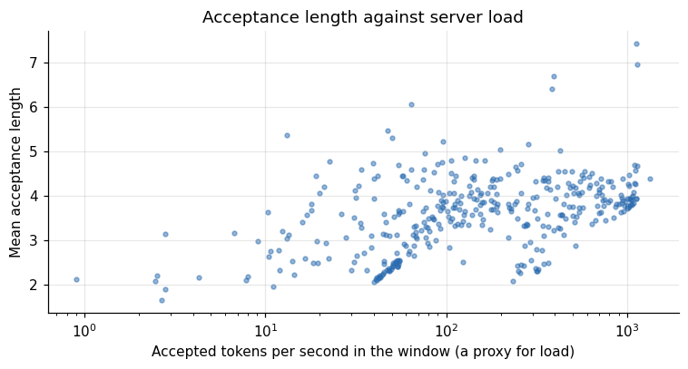

*Figure 5. Acceptance length against server load.*

Windows with under 50 accepted tokens per second averaged an acceptance length of 2.96, and windows above 1,000 averaged 4.30. The likely explanation is the content and not the load: the light windows include warm-up requests and the first moments of each concurrency level, where the sequence is short and the drafter has little context to anchor on. The heavy windows are steady state with long outputs of code and structured text, which are more predictable. I take it as a reminder that acceptance depends on what is being generated. Code and JSON draft well, free prose less so, and a benchmark that is rich in code will flatter the technique.

The same kind of log, plotted over time, shows what a window is. The figure uses the 37 windows of the PRO 6000 FP8 server, in the order the server wrote them.

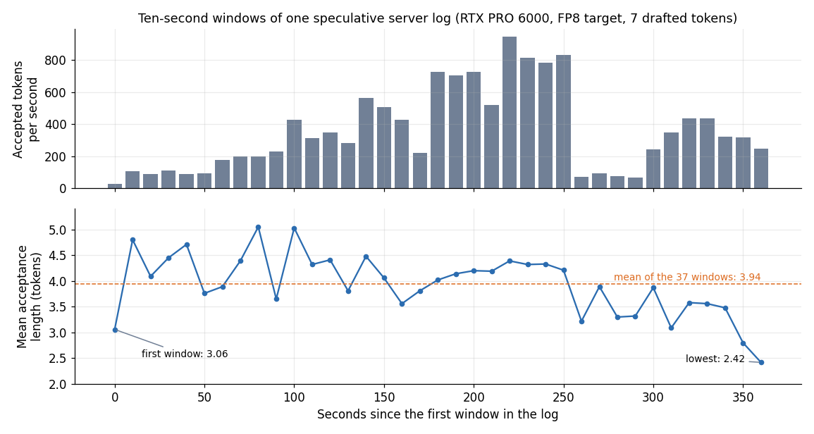

*Figure 6. Ten-second windows of one speculative server log on an RTX PRO 6000, FP8 target, 7 drafted tokens: accepted tokens per second (top) and mean acceptance length (bottom).*

The first window, at 28 accepted tokens per second, had an acceptance length of 3.06. The mean over the 37 windows was 3.94, the highest window 5.05 and the lowest 2.42, which was the last one. Accepted throughput climbed from 28 to a peak of 944 tokens per second and fell to 72 near the 260-second mark. The correlation between the two panels over these 37 windows is 0.27, weak. I do not know what the load generator was doing in each window, so I cannot say why the length dropped in the last minute.

## 8. Time to first token and the long prompt

Decode speed is only half of what a user feels. The other half is how long the first token takes, and speculative decoding changes it in a way the throughput numbers hide, because the drafter has to be fed the prompt as well.

**Table 6.** Time to first token and the long prompt

|  | Users | TTFT p95 short s plain | TTFT p95 long8k s plain | E2e p95 s plain | TTFT p95 short s spec | TTFT p95 long8k s spec | E2e p95 s spec | GPU |
|---|---|---|---|---|---|---|---|---|
| 0 | 1 | 0.1 | 1.06 | 9.52 | 0.12 | 1.28 | 2.86 | RTX PRO 6000 |
| 1 | 4 | 0.28 | 0.28 | 9.35 | 0.29 | 2.95 | 4.32 | RTX PRO 6000 |
| 2 | 8 | 0.34 | 0.34 | 13.04 | 2.91 | 2.91 | 5.5 | RTX PRO 6000 |
| 3 | 16 | 0.66 | 0.67 | 12.34 | 5.06 | 5.06 | 8.78 | RTX PRO 6000 |
| 4 | 32 | 1.24 | 1.24 | 17.52 | 2.2 | 2.2 | 12.43 | RTX PRO 6000 |
| 0 | 1 | 0.15 | 2.33 | 15.07 | 0.15 | 2.23 | 4.81 | L40S |
| 1 | 4 | 0.4 | 0.44 | 25.22 | 0.72 | 2.5 | 8.68 | L40S |
| 2 | 8 | 0.63 | 0.35 | 26.35 | 7.05 | 7.82 | 13.2 | L40S |
| 3 | 16 | 1.35 | 1.16 | 28.03 | 14.21 | 14.01 | 18.83 | L40S |
| 4 | 32 | 2.74 | 2.75 | 35.64 | 41.17 | 35.45 | 44.63 | L40S |
| 0 | 1 | 0.33 | – | 31.48 | 0.4 | 4.97 | 17 | GB10 |
| 1 | 2 | 0.42 | – | 56.87 | 3.25 | 1.09 | 21.3 | GB10 |
| 2 | 4 | 2.11 | 5.46 | 70.29 | 3.13 | 3.13 | 20 | GB10 |
| 3 | 8 | 1.36 | 1.22 | 69.24 | 1.94 | 1.94 | 23.32 | GB10 |

*First 14 of 16 rows; the full table is in the executable notebook.*

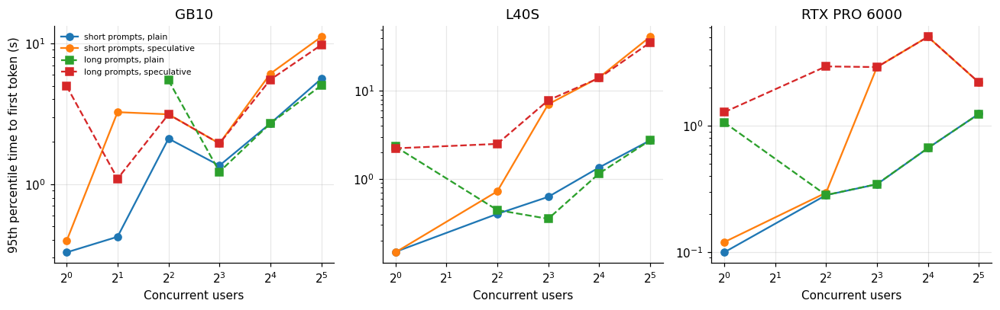

*Figure 7. Time to first token and the long prompt.*

For short prompts the picture is mixed on the PRO 6000. At one and four users the first-token times are the same (0.10 against 0.12 seconds, and 0.28 against 0.29). At eight users the speculative server's 95th percentile was 2.91 seconds against 0.34 for the plain one, and at sixteen users 5.06 against 0.66. At thirty-two users it was 2.20 against 1.24. Speculation shortens the whole response (the 95th percentile of end-to-end time at thirty-two users was 12.4 seconds against 17.5), and it makes the wait before the first token longer in the middle of the load range. The costs also show up on long prompts. The ten-thousand-token summarization request had a 95th percentile first-token time of 1.28 seconds at one user with speculation on the PRO 6000, against 1.06 without. At sixteen users the speculative server needed 5.06 seconds for the long prompt and the plain server 0.67. The document text is the same in every request, so after the first one a prefix cache serves most of it, and these times mostly reflect queueing behind running requests and not prefill work. The speculative server carried more work per user in the middle of the load range and made requests wait.

The request files show the other side of the first-token numbers. Each request records how many tokens arrived in each streamed chunk. For chat requests that returned status 200 with at least five chunks, on the PRO 6000 with FP8 weights:

| Server (PRO 6000, FP8) | Chat requests | Median tokens per streamed chunk | Lowest | Highest |
|---|---|---|---|---|
| Plain | 73 | 1.01 | 1.00 | 1.01 |
| Speculative | 235 | 2.37 | 1.68 | 4.83 |

The plain server sent one token per chunk. The speculative server sent 2.37 tokens per chunk at the median, as the accepted drafts arrive together. Tokens that arrive in a burst do not show in the speed per user, and a reader who streams the text sees them.

On the L40S the penalty is severe for both kinds of prompt: at thirty-two users the 95th percentile first-token time was 41.17 seconds for short prompts and 35.45 for the long request with speculation, against 2.74 and 2.75 without. This is consistent with the memory explanation above: a server with less cache queues long requests behind running ones.

The lesson for an agent workload is that the throughput table understates the downside. An agent session carries a long history, so its requests behave like the long prompt, and the first-token time on those requests is where the user waits. If your traffic has long prompts, measure first-token time on them with speculation on and off, and do not rely on short-prompt numbers.

## 9. A simple saturation model

To see where the curves would cross on a card where I did not reach the crossing point, I fitted a saturating model to the aggregate throughput of each server. The model says aggregate throughput rises with the number of users as A times u over (u plus K), where A is the throughput at saturation and K is the number of users at which the server reaches half of it. It is the shape of a server that gets a larger batch with more users until the hardware limit stops it.

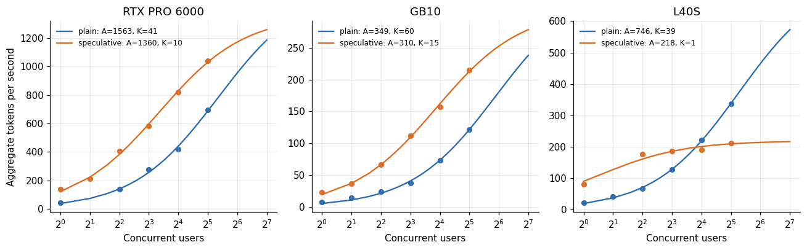

*Figure 8. A simple saturation model.*

**Table 7.** A simple saturation model

| GPU | Plain A | Plain K | Spec A | Spec K | Predicted crossover users |
|---|---|---|---|---|---|
| RTX PRO 6000 | 1563 | 40.7 | 1360 | 10.2 | 194 |
| GB10 | 349 | 59.9 | 310 | 14.6 | 341 |
| L40S | 746 | 38.6 | 218 | 1.4 | 14 |

The fits say that speculation lowers the saturation level and brings the half-saturation point much closer to zero. On the PRO 6000 the plain server saturates at about 1,560 tokens per second with a half-saturation of 41 users, and the speculative one at about 1,360 with a half-saturation of 10 users. The curves cross at about 194 users, far beyond the 32 I tested. For the GB10 the predicted crossing is near 341 users. For the L40S it is near 14 users, which agrees with the observed break-even between 8 and 16.

The crossing points for the PRO 6000 and GB10 are extrapolations by a factor of six to ten beyond the data, and I would not rely on them as numbers. What I take from the model is the ranking: speculation stops paying at roughly 14 users on the L40S and in the hundreds on the larger cards. The model is also blind to the cache explanation, which would not saturate in this way. If your own load test shows the gain fading, a fit like this is a cheap way to estimate where it will end.

## 10. What it does to cost

Throughput is money. Here is the cost per million output tokens, at 70 percent utilization and the median rental prices from the lease ledger, for plain and speculative servers at each concurrency level.

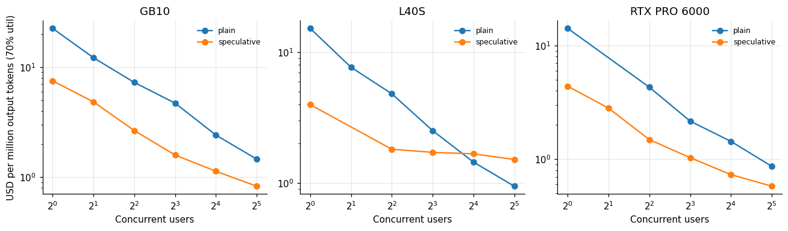

*Figure 9. What it does to cost.*

**Table 8.** What it does to cost

|  | Mode users | Plain | Speculative |
|---|---|---|---|
| GB10 | 1 | 22.55 | 7.518 |
| GB10 | 2 | 12.2 | 4.842 |
| GB10 | 4 | 7.272 | 2.655 |
| GB10 | 8 | 4.714 | 1.592 |
| GB10 | 16 | 2.418 | 1.133 |
| GB10 | 32 | 1.46 | 0.829 |
| L40S | 1 | 15.26 | 3.978 |
| L40S | 2 | 7.687 | – |
| L40S | 4 | 4.815 | 1.81 |
| L40S | 8 | 2.515 | 1.714 |
| L40S | 16 | 1.444 | 1.669 |
| L40S | 32 | 0.943 | 1.512 |
| RTX PRO 6000 | 1 | 14.16 | 4.382 |
| RTX PRO 6000 | 2 | – | 2.812 |

*First 14 of 18 rows; the full table is in the executable notebook.*

At one user, speculation cuts the cost per million tokens by a factor of 3 to 4 on every card, because a single stream leaves the GPU almost idle and speculation fills the gap. On the PRO 6000 at thirty-two users, plain FP8 costs 0.865 dollars per million tokens and speculative FP8 0.578. That is a saving of a third, taken at the point where the benefit is smallest. On the L40S at thirty-two users, plain FP8 costs about 0.94 dollars and speculative FP8 about 1.51, a penalty of 60 percent.

A service sits at one point on this curve, set by how many users are active at once. If the service is lightly loaded most of the time, as an interactive assistant usually is, it lives on the left, where speculation is a large win for both latency and cost. If it is a batch pipeline that keeps the server saturated, it lives on the right, where speculation is worth a third at best and a loss at worst.

## 11. What the acceptance curve predicts about a shorter draft

The per-position acceptance rates contain enough information to answer a question I did not test directly: what would a shorter draft have done? Each logged rate is the share of draft steps in which the token at that position was accepted. Because position three can only be accepted if positions one and two were, the rates are already conditional on the earlier ones, so the expected number of tokens advanced per verification pass with a draft of length k is one plus the sum of the first k rates.

**Table 9.** What the acceptance curve predicts about a shorter draft

|  | Model mean len | Logged mean len |
|---|---|---|
| GB10 bf16 | 3.88 | 3.88 |
| GB10 fp8 | 2.77 | 2.77 |
| GB10 nvfp4 | 3.06 | 3.06 |
| H100 NVL bf16 | 3.86 | 3.86 |
| H100 NVL fp8 | 3.73 | 3.73 |
| L40S fp8 | 4.01 | 4.01 |
| L40S nvfp4 | 3.79 | 3.79 |
| PRO 6000 bf16 | 4.04 | 4.04 |
| PRO 6000 fp8 | 3.94 | 3.94 |
| PRO 6000 nvfp4 | 3.63 | 3.63 |

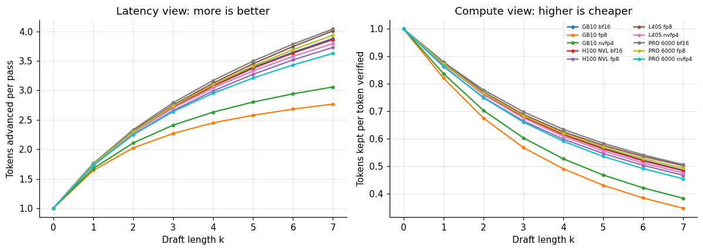

*Figure 10. Latency view: more is better.*

**Table 10.** What the acceptance curve predicts about a shorter draft (part 2)

|  | 3 | 4 | 7 |
|---|---|---|---|
| GB10 bf16 | 0.68 | 0.62 | 0.49 |
| GB10 fp8 | 0.57 | 0.49 | 0.35 |
| GB10 nvfp4 | 0.6 | 0.53 | 0.38 |
| H100 NVL bf16 | 0.68 | 0.61 | 0.48 |
| H100 NVL fp8 | 0.66 | 0.6 | 0.47 |
| L40S fp8 | 0.69 | 0.62 | 0.5 |
| L40S nvfp4 | 0.68 | 0.61 | 0.47 |
| PRO 6000 bf16 | 0.7 | 0.63 | 0.51 |
| PRO 6000 fp8 | 0.68 | 0.62 | 0.49 |
| PRO 6000 nvfp4 | 0.66 | 0.59 | 0.45 |

The first check is whether the logged per-position rates reproduce the logged mean acceptance length. One plus the sum of the seven rates equals the logged mean for every server, to two decimals, so the rates are conditional on the earlier positions as I read them.

The left panel says that each extra drafted token adds less than the one before it. For the PRO 6000 with FP8 weights, a draft of length one advances 1.75 tokens per pass, a draft of length three 2.74, and the full seven 3.94. Cutting the draft from seven to three keeps 70 percent of the single-user gain. The right panel shows why that matters under load. If the server is compute-bound, the cost of a pass is proportional to the number of tokens it verifies, which is k plus one. The useful fraction is then the tokens kept divided by the tokens verified. With no speculation it is one. With seven drafted tokens on the PRO 6000 it is 3.94 over 8, or 0.49. With three drafted tokens it is 2.74 over 4, or 0.69.

This quantity predicts the saturated behavior I measured. On the L40S, whose speculative server fell furthest, the logs give a useful fraction of about 0.50 at seven tokens (4.01 over 8), and the measured aggregate ratio at thirty-two users was 0.62. On the PRO 6000 the fraction is 0.49 and the measured ratio at thirty-two users was still 1.50, because that server had not yet become compute-bound at that load, in line with the saturation fit above. On the GB10 the fraction is only 0.35 (2.77 over 8 for FP8), and the measured ratio at thirty-two users was 1.76, so the GB10 remains memory-bound across the whole range I tested. When a server does become compute-bound, the ratio should approach the useful fraction, and the L40S is the one that got close to it.

This does not prove the compute explanation over the cache explanation for the L40S, but it adds a quantitative reason for it: a number computed from log lines that were written before I thought about the question lands close to the measured ratio. It also gives a concrete recommendation. A draft of three or four tokens would lift the compute-bound floor from about 0.5 to 0.7, at a cost of 25 to 30 percent of the single-user gain.

## 12. Capacity at the service level, with and without

All of this concerns throughput and speed. The decision a service makes is how many users it can serve while meeting its latency target, so here is the same comparison at the service level used in the cost article: first-token time under 3 seconds for short prompts, and at least 20 tokens per second per user.

**Table 11.** Capacity at the service level, with and without

| GPU | Mode | Users in sla | Agg tok/s at that level | Per user tok/s | USD per mtok 70pct |
|---|---|---|---|---|---|
| RTX PRO 6000 | plain | 32 | 694.3 | 30.2 | 0.865 |
| RTX PRO 6000 | speculative | 32 | 1,039 | 38.4 | 0.578 |
| L40S | plain | 4 | 66.1 | 20.75 | 4.815 |
| L40S | speculative | 4 | 175.8 | 43.6 | 1.81 |
| GB10 | plain | 0 | – | – | – |
| GB10 | speculative | 1 | 23.7 | 26.7 | 7.518 |

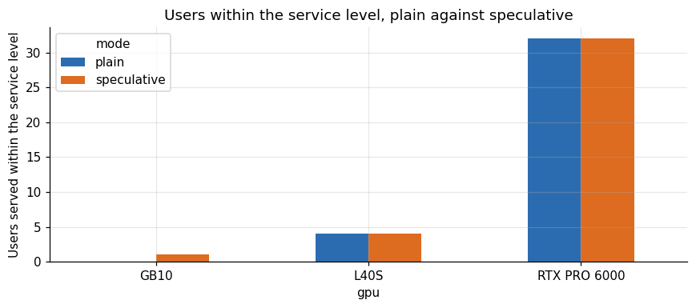

*Figure 11. Users within the service level, plain against speculative.*

At the service level, speculation barely changes the number of users. On the PRO 6000 both servers meet the service level at thirty-two users, the largest level tested. On the L40S both meet it for four users. On the GB10 the plain FP8 server meets it for nobody, since its single-user speed of 8 tokens per second is under the 20 token requirement, and the speculative server meets it for one user. Speculation thus turns the GB10 from unusable for interactive serving into usable for one person. What speculation changes at the service level is how well those users are served and what it costs: on the PRO 6000 the speculative server gave each of thirty-two users 38.4 tokens per second against 30.2, and the cost per million tokens fell from 0.865 to 0.578 dollars. On the L40S the cost at the service level fell from 4.82 to 1.81 dollars per million tokens.

The service level in this study is not the only reasonable one. A looser first-token bound would allow more users on both servers, and the comparison could then differ. For completeness the whole concurrency range is in the table above.

## 13. Does it change the answers?

In theory, no: the verification step ensures the output distribution matches the target's. In practice the numerics of the two code paths differ slightly, and the sampling at temperature above zero consumes random numbers in a different order. I checked the one thing I could, the refusal behavior battery from the abliteration article, on the FP8 build with and without speculative decoding. Under the same judge setup the plain server was judged unsafe in 7 of 21 trials and the speculative servers in 8 or 9 of 21 across four runs. A difference of one or two trials is inside the noise of the battery, and it supports the view that speculation does not shift behavior, without proving it. I did not compare capability scores with and without speculation.

## 14. Variation between hosts and runs

The acceptance statistics let me ask how much a drafter's performance varies between servers that should be identical.

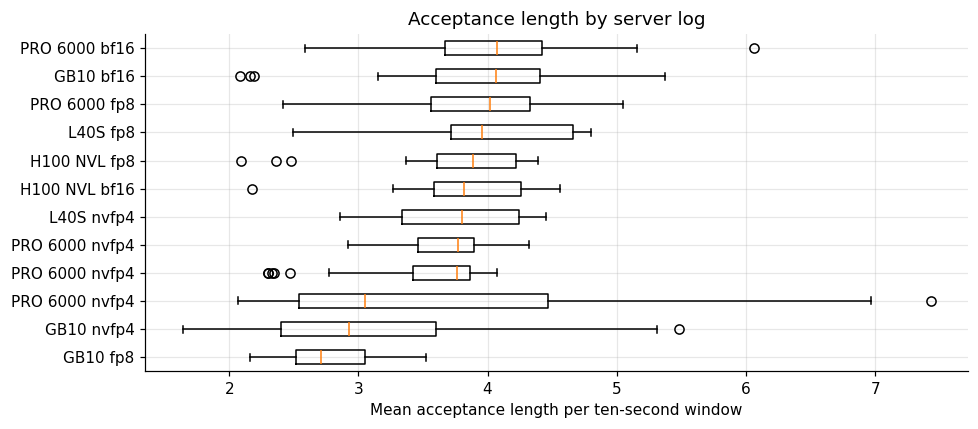

*Figure 12. Acceptance length by server log.*

**Table 12.** Variation between hosts and runs

|  | Count | Median | Std |
|---|---|---|---|
| vllm_fp8_dflash_c0cd4 | 13 | 2.71 | 0.38 |
| vllm_nvfp4_dflash_ec7ff | 88 | 2.92 | 0.86 |
| vllm_46f0e | 33 | 3.05 | 1.46 |
| vllm_nvfp4_dflash_2fc61 | 39 | 3.76 | 0.53 |
| vllm_nvfp4_dflash_5cc26 | 34 | 3.78 | 0.33 |
| vllm_nvfp4_dflash_2277c | 16 | 3.8 | 0.5 |
| vllm_bf16_dflash_61455 | 23 | 3.82 | 0.55 |
| vllm_fp8_dflash_5ef72 | 24 | 3.89 | 0.62 |
| vllm_fp8_dflash_1966c | 16 | 3.96 | 0.67 |
| vllm_fp8_dflash_156a6 | 37 | 4.02 | 0.6 |
| vllm_bf16_dflash_66496 | 24 | 4.06 | 0.82 |
| vllm_bf16_dflash_8ea0c | 37 | 4.07 | 0.7 |

Two of the three PRO 6000 NVFP4 logs, recorded on different occasions, have medians of 3.76 and 3.78, and the third, which includes ramp-up windows, has a median of 3.05 with a standard deviation of 1.46. The BF16 and FP8 logs on the H100, L40S and PRO 6000 have medians between 3.82 and 4.07. The GB10 is the outlier, and not uniformly: its BF16 log has a median of 4.06, level with the large cards, while its FP8 log (2.71) and NVFP4 log (2.92) sit lowest. The same drafter and the same settings gave normal acceptance against the BF16 target on that machine and poor acceptance against the quantized targets. A possible reason is that the ARM software stack used different kernels for the quantized targets and so produced slightly different probabilities, but I did not investigate.

## 15. A decision rule

Use speculative decoding when the server is typically lightly loaded and latency matters, as in a chat assistant or an agent that waits on tool calls. Expect three times faster single-user decoding on a card with abundant spare compute.

Do not assume it helps at saturation. Run your own load test across the concurrency range you expect, measure aggregate throughput as well as per-user speed, and compare against the plain server. On the L40S the break-even came between 8 and 16 users.

If your load swings, run both: serve with speculation off during peaks and on during quiet hours, or limit it to a replica reserved for latency-sensitive traffic. I did not test dynamic switching.

If you quantize the target, expect a small loss of acceptance, about 10 percent in the NVFP4 case, and re-measure.

If you tune, shorten the draft. The late positions are rarely accepted, and they cost the most under load.

## 16. Tuning checklist

If I were deploying this, I would work through these in order.

First, measure the single-user speedup. If it is under 2, the drafter is poorly matched to the target or the workload, and the rest is not worth the effort.

Second, measure aggregate throughput at the concurrency you expect at peak, with speculation on and off, on the same hardware and the same traffic mix. Choose by the peak, not the average.

Third, check first-token time on the longest prompts you expect.

Fourth, check memory: speculation costs cache. If you need long contexts, the cache you give up may matter more than the speed you gain.

Fifth, try shorter drafts. The seventh position is accepted a quarter of the time or less, so three or four speculative tokens may capture most of the gain with less waste at load. I did not test this.

Sixth, re-measure after any change of precision, since acceptance moves with it.

Seventh, keep a plain replica or a runtime switch for periods of saturation.

## 17. One scorecard

Pulling the findings together by card:

**Table 13.** One scorecard

| GPU | Single user speedup | Aggregate speedup at 1 user | Aggregate speedup at top load | Top load users | FP8 mean acceptance length | FP8 accepted share |
|---|---|---|---|---|---|---|
| RTX PRO 6000 | 3.82 | 3.23 | 1.5 | 32 | 3.94 | 0.42 |
| L40S | 5.06 | 3.84 | 0.62 | 32 | 4.01 | 0.434 |
| GB10 | 3.34 | 3 | 1.76 | 32 | 2.77 | 0.249 |

Read across a row: the card where acceptance is highest and bandwidth is plentiful (PRO 6000) keeps a benefit at the top load I tested; the card whose baseline is slow and whose cache is tight (L40S) shows the biggest low-load gain and the only reversal; the card with low acceptance and low bandwidth (GB10) has the most stable, if modest, gain.

## 18. A protocol for your own hardware

Speculative decoding is configuration-dependent enough that I would not adopt it from anyone's numbers, including mine. The protocol below takes about an hour of rental.

Start two servers on the same card and the same image, one with speculation and one without, keeping every other flag identical. Load the same prompts. Warm both up with a few requests so that compilation and cache effects do not leak into the measurement.

Run a concurrency sweep with continuous users: 1, 2, 4, 8, 16 and 32, and 64 if the card has room. For each level record the median decode speed per user, the aggregate output throughput, and the 95th percentile first-token time for a short prompt and for a long one. Sixty seconds per level is enough to see the shape.

Capture the server log during the speculative run. The vLLM lines that start with SpecDecoding give the acceptance length every ten seconds. If your acceptance length is under 2.5, stop: the drafter does not fit the target or the traffic.

Plot the ratio of aggregate throughput, speculative over plain, against concurrency. Find the level where it crosses one. Decide from the traffic you expect, not from the best level.

Repeat once at a different time of day or on a different host if you can afford it, because the gap between repeated runs here was about 10 percent, and a gain below that is not a finding.

## 19. Speculation and the other levers

Speculative decoding is one of several ways to spend a card's spare capacity on speed, and its interaction with the others is worth stating.

Against a larger batch: batching raises aggregate throughput by amortizing the weight reads, and speculation raises per-user speed by amortizing them over more tokens per user. Both draw on the same spare bandwidth, so they compete. The saturation fit shows exactly that: the speculative server reaches half of its maximum at a far smaller number of users because it has already used part of the headroom.

Against quantization: a lower-precision target reads fewer bytes per token, which also raises single-user speed. On the PRO 6000, the plain 4-bit AWQ build decoded at 76.7 tokens per second for one user against 45.4 for FP8. Speculation on the FP8 build brought it to 173.5, more than twice the 4-bit speed, without touching the weights. The two levers can be combined, and the NVFP4 build with speculation reached 143 tokens per second at one user, less than the FP8 build with speculation, which fits the lower acceptance reported above.

Against a smaller model: the 9 billion parameter model decodes quickly without any speculation, at 85 to 96 tokens per second for a single user on the PRO 6000 and the 5090. If the task fits in the smaller model, it is a simpler speedup than a drafter and has no acceptance rate to worry about.

## 20. What I would test next

A sweep over draft lengths from two to seven, to confirm the prediction from the acceptance curve that three or four tokens retain most of the benefit under load. A second drafter, to separate properties of the method from properties of this drafter. A dynamic setting that turns speculation off above a load threshold, which the saturation fit suggests would capture the best of both servers. And a long-context comparison, since agent workloads carry long histories and the first-token results above show that the long prompt is where speculation costs the most.

## 21. Questions I expect

**Does speculative decoding change the output?** By design it does not change the distribution. I saw no change in behavior on the one battery I compared, and I did not compare capability scores.

**Is a bigger drafter better?** I tested one drafter. Larger drafters tend to be accepted more often and to cost more per step; I have no measurement of that tradeoff.

**Why does the single-user speedup exceed the mean acceptance length on the L40S?** The plain baseline was slow, so the ratio includes a repair of the baseline.

**Does it work with every quantization?** It ran with BF16, FP8 and NVFP4 here. The NVFP4 target gave the lowest acceptance on the PRO 6000.

**Should I use it on a consumer card?** I have no paired data for a 24 or 32 gigabyte card, because the 27 billion FP8 builds do not fit them.

Before the limitations, the main claims with their evidence and caveats, taken from the sections above.

**Table 14.** Claims, evidence and caveats

| Claim | Evidence behind it | Caveat |
|---|---|---|
| Single-user decoding is 3.3 to 5.1 times faster | Paired plain and speculative load tests on three cards | The L40S plain baseline looks slow, which inflates its ratio |
| The gain shrinks with load and reverses on the L40S | Aggregate throughput at 1 to 32 users | Plain and speculative runs come from different sessions |
| Only 25 to 43 percent of drafted tokens are accepted | 384 ten-second windows from 12 server logs | Windows mix whatever traffic the generator sent |
| Acceptance falls with a coarser target | Mean length 4.04, 3.94 and 3.63 on the PRO 6000 | One drafter, one draft length |
| Compute waste explains the reversal | The useful fraction computed from the logs is close to the measured ratio | The speculative server also had less cache; the data cannot separate the two |
| Behavior did not shift | 7 of 21 unsafe plain, 8 or 9 of 21 speculative | Inside the noise of the battery, and capability was not compared |

## 22. Limitations

The pairs of plain and speculative servers come from different sessions on the same card type, so the host and its neighbors could differ, though the repeated measurements agree with each other within about 10 percent. The drafter is one specific model with one speculative length. The acceptance statistics are windows of ten seconds from server logs, which mix whatever the load generator was sending at the time. The load test caps output length at 256 to 512 tokens, and speculative decoding behaves differently on long generations. I did not profile compute against bandwidth, so the mechanism is inferred. The L40S baseline looks slow, which inflates its low-load speedup. The H100 data have no plain baseline, so they appear in the acceptance statistics and not in the speedup comparison. All of it is one family of models.

## 23. How much it cost

The serving sessions that produced the paired measurements cost, in itemized hourly rental, 5.71 dollars for the PRO 6000 across all its sessions, 3.93 for the L40S and nothing for the GB10 (my own machine), inside a campaign that cost US$ 50.79 in total. The acceptance statistics cost nothing extra: they come from logs the servers wrote anyway. This analysis ran on Kaggle's free tier.

## 24. Reproducing this analysis

Attach the dataset `gpu-ai-benchmark-campaign-2026`. The file `speculative_decoding_windows.csv` has one row per ten-second window, with the acceptance length, throughputs and per-position rates. The file `llm_serving.csv` has the paired load tests. The repository `llm-serving-engines-bench` contains the load generator.

## 25. Glossary

- **Speculative decoding**: a draft proposes several tokens and the large model verifies them in one pass.
- **Mean acceptance length**: average tokens advanced per verification pass.
- **Drafted tokens**: tokens proposed by the draft.
- **Memory-bound**: limited by moving data from memory.
- **Compute-bound**: limited by arithmetic throughput.
- **Batch size**: the number of sequences processed in one step.
- **Window**: a ten-second interval in the server log.

Lucas Rangel
