# vLLM against SGLang on one RTX 5090

**Lucas Rangel** · [Kaggle writeup](https://www.kaggle.com/writeups/lucasrangelss/vllm-against-sglang-on-one-rtx-5090) · [Executable notebook](https://www.kaggle.com/code/lucasrangelss/vllm-against-sglang-on-one-rtx-5090) · [Code and data](https://github.com/LucasRangelSSouza/gpu-ai-benchmark-hub) · [Dataset](https://www.kaggle.com/datasets/lucasrangelss/gpu-ai-benchmark-campaign-2026)

## Abstract

Two open-source engines dominate self-hosted language model serving: vLLM and SGLang. Both batch requests continuously, both are fast, and a benchmark between them can say almost anything depending on how each was started. I compared them on one RTX 5090 serving a 9 billion parameter model in BF16, with the same load generator, the same request mix and the same seeds, at 1, 8, 16 and 32 simultaneous users. I also kept the record of a first attempt on an RTX 4090 in which SGLang looked four times worse than vLLM, because the way it went wrong is the most useful part of the result.

- Up to 16 users the engines tie on throughput. At 16 users SGLang produced 1,115 output tokens per second and vLLM 1,062, a difference of 5 percent that is inside the run-to-run noise of this kind of test.
- SGLang answers faster at low load. Its median time to first token was 0.025 seconds at one user against 0.051 for vLLM, and 0.037 against 0.063 at eight users.
- At 32 users vLLM scaled and SGLang did not. vLLM reached 1,900 tokens per second with a median first-token time of 0.075 seconds. SGLang stayed at 1,121 tokens per second, the same as at 16 users, and its median first-token time rose to 3.47 seconds.
- The request logs show why. Reconstructing how many requests were decoding at each moment, vLLM ran all 32 users at once (27 on average), while SGLang never ran more than 16 at once, with the other 16 waiting in a queue. That is a cap on the batch, and it explains both the flat throughput and the first-token delay.
- The 4090 first attempt had the same disease worse. SGLang ran at most 3 requests at once, whatever the number of users, and its throughput at 16 users was 147 tokens per second against vLLM's 657 on the same card.

So the engines are close in speed, and the dominant factor in any comparison between them is the configuration of the batch limits, not the engine. A benchmark that does not report how many requests actually ran concurrently does not tell you which engine is faster.

> **Code and data.** Everything behind this article is public: the code that ran, the curated data, the analysis that regenerates every figure, and tests that pin the conclusions to the data. Repositories: [llm-serving-engines-bench](https://github.com/LucasRangelSSouza/llm-serving-engines-bench). Index of the whole series: [gpu-ai-benchmark-hub](https://github.com/LucasRangelSSouza/gpu-ai-benchmark-hub).

## 1. The setup

The model was a 9 billion parameter Qwen-family model in BF16, which fits easily in the 5090's 32 gigabytes with a large cache. The load generator is the one used throughout this series: continuous users with a mix of chat, code refactoring, structured JSON and long-document requests, with output caps of 256 to 512 tokens. For each engine it ran four concurrency levels for about 30 seconds each, with reasoning mode off.

Both servers were started on the same machine, one after the other, with CUDA graphs enabled. CUDA graphs record the sequence of GPU kernels for a decode step once and replay it, which removes launch overhead. In SGLang this is controlled by a flag that also sets the largest batch for which graphs are captured, and I had to correct that flag after a first run (more on that below). The engine versions in my operator notes were vLLM 0.30 and SGLang 0.5.22.

These are the start-up lines of the two servers in the 5090 run. For vLLM it is the line of non-default arguments from the start log. SGLang prints a dump of all its arguments, which has several hundred fields, so I kept the five that bear on batching and memory and marked the cuts with ellipses.

```
INFO 10-27 23:25:44 [api_utils.py:286] non-default args: {'model_tag': '/workspace/models/q9', 'host': '127.0.0.1', 'port': 18000, 'model': '/workspace/models/q9', 'max_model_len': 8192, 'served_model_name': ['q9'], 'reasoning_parser': 'qwen3', 'gpu_memory_utilization': 0.85, 'max_num_seqs': 32}
[2026-10-27 23:41:46] server_args={… 'context_length': 8192, … 'mem_fraction_static': 0.85, … 'max_running_requests': None, … 'chunked_prefill_size': 4096, … 'cuda_graph_max_bs_decode': 32 …}
```

vLLM was started with an explicit limit of 32 sequences. SGLang got the same context limit and the same memory fraction, and its `max_running_requests` stayed at None, which leaves the limit to the server. The graph batch setting is the corrected one, 32 here.

The server was configured with a modest maximum context length, so the long-document request, about 10,000 tokens, was rejected with an HTTP 400 error by both engines. The rejections are the same in both: 13 of 82 requests at eight users and 41 of 252 (vLLM) against 28 of 162 (SGLang) at 32, a fixed fraction of the mix. I exclude them from throughput, which counts only completed requests, and from time-to-first-token, which uses only short prompts.

**Table 1.** The setup

| Setup | Users | Requests | Ok | Rejected 400 | Connection errors | Wall s | Agg out tok/s | TTFT p50 s |
|---|---|---|---|---|---|---|---|---|
| RTX 5090 / 9B BF16 / vLLM (CUDA graphs on) | 1 | 10 | 9 | 1 | 0 | 29.5 | 93.6 | 0.051 |
| RTX 5090 / 9B BF16 / vLLM (CUDA graphs on) | 8 | 82 | 69 | 13 | 0 | 30.5 | 564.3 | 0.063 |
| RTX 5090 / 9B BF16 / vLLM (CUDA graphs on) | 16 | 140 | 122 | 18 | 0 | 30.8 | 1,062 | 0.071 |
| RTX 5090 / 9B BF16 / vLLM (CUDA graphs on) | 32 | 252 | 211 | 41 | 0 | 31.3 | 1,900 | 0.075 |
| RTX 5090 / 9B BF16 / SGLang (CUDA graphs on) | 1 | 10 | 9 | 1 | 0 | 29.4 | 96.4 | 0.025 |
| RTX 5090 / 9B BF16 / SGLang (CUDA graphs on) | 8 | 82 | 69 | 13 | 0 | 30 | 585.9 | 0.037 |
| RTX 5090 / 9B BF16 / SGLang (CUDA graphs on) | 16 | 144 | 125 | 19 | 0 | 30 | 1,115 | 0.037 |
| RTX 5090 / 9B BF16 / SGLang (CUDA graphs on) | 32 | 162 | 134 | 28 | 0 | 33.9 | 1,121 | 3.472 |

## 2. Throughput and latency

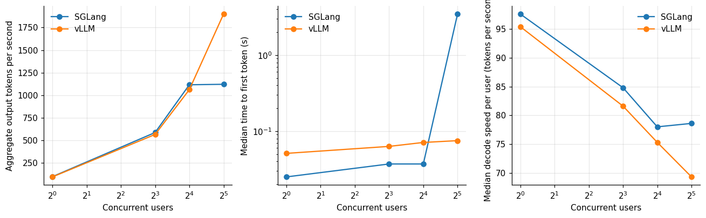

*Figure 1. Throughput and latency.*

Aggregate throughput at 1, 8, 16 and 32 users was 93.6, 564.3, 1,061.5 and 1,899.7 tokens per second for vLLM, and 96.4, 585.9, 1,115.4 and 1,120.7 for SGLang. The two track each other until the last point. Throughput per user fell for vLLM from 95.4 tokens per second at one user to 69.3 at thirty-two as the batch grew, which is the normal behavior of continuous batching: each user slows slightly and the total rises almost linearly.

Time to first token tells a more interesting story. SGLang's median was 25 milliseconds at one user and 37 at eight and sixteen, where vLLM's was 51, 63 and 71. SGLang's 95th percentile at eight users was 0.380 seconds against vLLM's 0.116, so SGLang is faster at the median and showed a worse tail in that run. At 32 users SGLang's median jumped to 3.47 seconds and its 95th percentile to 4.90 seconds, while vLLM's stayed at 0.075 and 0.198.

SGLang's per-user decode speed at 32 users was 78.6 tokens per second, as high as at 16 users (78.0) and higher than vLLM's 69.3. That is the clue. A server whose users are all decoding concurrently slows each of them as the batch grows. A server whose per-user speed stays flat while the number of users doubles is not decoding all of them.

## 3. How many requests were running?

Each request in the log has a start time, a time to first token, and an end time. Between the start and the first token it is waiting or being prefilled; between the first token and the end it is decoding. Counting the requests in each state at every moment gives the effective concurrency of the server, which the engines do not report in the load generator's output.

Here is the raw material for that count, five rows of the request log of SGLang at 32 users. The first two rows were sent at 89.45 seconds, the other three at about 96 seconds, and the third row is a long document rejected with status 400.

```
setup,level,kind,status,total_s,ttft_s,prompt_tokens,completion_tokens,t_start_s,t_end_s
RTX 5090 | 9B BF16 | SGLang (CUDA graphs on),32,chat,200,3.4663,1.8493091349955648,29.0,127.0,89.45,92.917
RTX 5090 | 9B BF16 | SGLang (CUDA graphs on),32,code,200,6.5411,0.11262521799653769,95.0,512.0,89.451,95.992
RTX 5090 | 9B BF16 | SGLang (CUDA graphs on),32,long8k,400,0.0167,,,,96.0,96.017
RTX 5090 | 9B BF16 | SGLang (CUDA graphs on),32,json,200,5.653,4.777693319832906,51.0,68.0,96.0,101.653
RTX 5090 | 9B BF16 | SGLang (CUDA graphs on),32,code,200,10.9384,4.3013656991533935,95.0,512.0,95.999,106.937
```

The first two requests had their first token after 1.85 and 0.11 seconds. The two accepted requests sent at about 96 seconds waited 4.78 and 4.30 seconds, which is the queue. The rejected row has no first-token time, which is why the rejections stay out of the latency figures.

**Table 2.** How many requests were running?

| Setup | Users | Max waiting | Max running | Avg running |
|---|---|---|---|---|
| RTX 4090 / 9B BF16 / SGLang (first attempt) | 1 | 1 | 1 | 1 |
| RTX 4090 / 9B BF16 / SGLang (first attempt) | 8 | 8 | 3 | 2.6 |
| RTX 4090 / 9B BF16 / SGLang (first attempt) | 16 | 16 | 3 | 2.8 |
| RTX 4090 / 9B BF16 / vLLM | 1 | 1 | 1 | 1 |
| RTX 4090 / 9B BF16 / vLLM | 8 | 8 | 8 | 6.8 |
| RTX 4090 / 9B BF16 / vLLM | 16 | 16 | 16 | 13.6 |
| RTX 5090 / 9B BF16 / SGLang (CUDA graphs on) | 1 | 1 | 1 | 1 |
| RTX 5090 / 9B BF16 / SGLang (CUDA graphs on) | 8 | 8 | 8 | 7 |
| RTX 5090 / 9B BF16 / SGLang (CUDA graphs on) | 16 | 16 | 16 | 14.3 |
| RTX 5090 / 9B BF16 / SGLang (CUDA graphs on) | 32 | 32 | 16 | 14.2 |
| RTX 5090 / 9B BF16 / vLLM (CUDA graphs on) | 1 | 1 | 1 | 1 |
| RTX 5090 / 9B BF16 / vLLM (CUDA graphs on) | 8 | 8 | 8 | 6.9 |
| RTX 5090 / 9B BF16 / vLLM (CUDA graphs on) | 16 | 16 | 16 | 14 |
| RTX 5090 / 9B BF16 / vLLM (CUDA graphs on) | 32 | 31 | 32 | 27.3 |

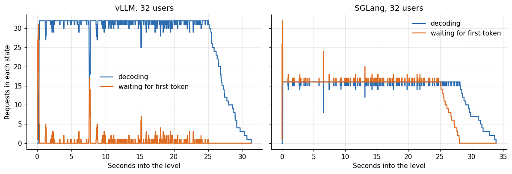

*Figure 2. How many requests were running?*

For vLLM at 32 users the number of requests decoding reached 32 and averaged 27. For SGLang at 32 users the number decoding never exceeded 16 and averaged 14. At 16 users both engines ran all 16, with averages of 14.0 and 14.3. SGLang therefore decodes at most 16 requests at a time in this configuration, and the other users queue.

SGLang prints its own counters, so I could check this reading against the server. These lines are selected from its log of the 32-user level: the cap and the reason it gives, the size of the cache pool, and three decode steps from the middle of the level.

```
[2026-10-27 23:42:12] max_running_requests is capped to 16 by the mamba state cache (max_mamba_cache_size=81, 5 state slots per request). To raise it: increase --mamba-full-memory-ratio or --max-mamba-cache-size, or halve the state size with --mamba-ssm-dtype bfloat16.
[2026-10-27 23:43:05] max_total_num_tokens=145643, chunked_prefill_size=4096, max_prefill_tokens=16384, max_running_requests=16, context_len=8192, available_gpu_mem=3.11 GB
[2026-10-27 23:44:52] Decode batch, #running-req: 16, #full token: 1779, full token usage: 0.01, mamba num: 49, mamba usage: 0.60, cuda graph: True, gen throughput (token/s): 1242.71, #queue-req: 16
[2026-10-27 23:44:53] Decode batch, #running-req: 16, #full token: 2260, full token usage: 0.02, mamba num: 46, mamba usage: 0.57, cuda graph: True, gen throughput (token/s): 1321.72, #queue-req: 16
[2026-10-27 23:44:53] Decode batch, #running-req: 16, #full token: 2666, full token usage: 0.02, mamba num: 49, mamba usage: 0.60, cuda graph: True, gen throughput (token/s): 1205.42, #queue-req: 16
```

The cap of 16 is not an engine default. The log says it was set by the state cache that SGLang keeps for the recurrent layers of this model, with 81 slots and five slots per request, and it names three ways to raise it, none of which I tried. The decode lines show 16 requests running and 16 in the queue, which are the numbers in Table 2.

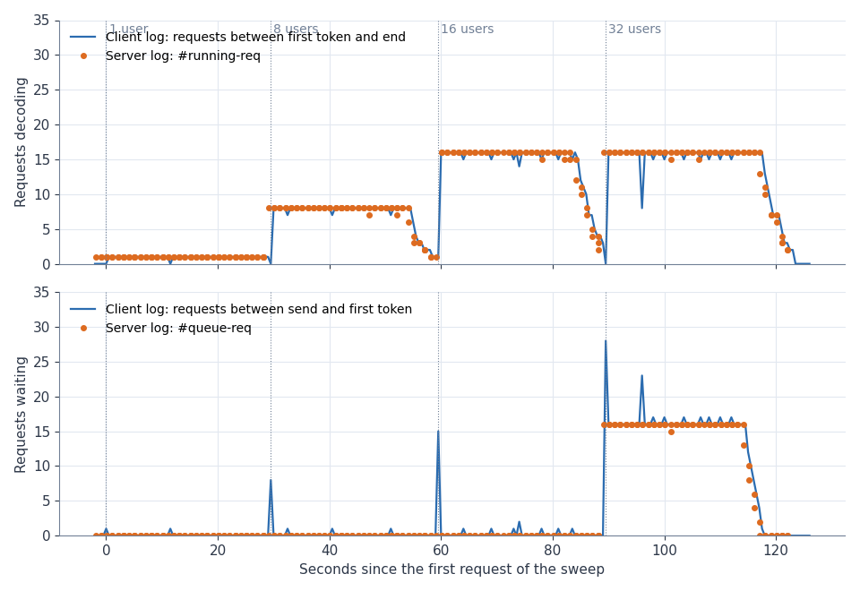

*Figure 3. SGLang on an RTX 5090, 9B BF16, 1 to 32 users: requests decoding and waiting over the sweep, from the client log (line) and from the server's own counters (dots).*

The two sources agree through all four levels. At 32 users the server's counters stay at 16 running and 16 queued for about 25 seconds, and the client reconstruction draws the same plateau. The client count of waiting requests spikes to about 28 for a moment at the start of the level. It counts every request that has been sent and has no first token yet, including the ones being prefilled, which the server does not list as queued.

The numbers agree with the aggregate. Sixteen concurrent decoders at 78 tokens per second each is 1,248 tokens per second as an upper bound, and the measured 1,121 is consistent with 14 on average. The cap is the whole reason SGLang plateaued. It is not that the engine runs out of speed at 16 users. The server set the limit of 16 itself when it started, and its log says why.

## 4. What the first attempt on the 4090 shows

Before the 5090 run, I compared the same engines on an RTX 4090 and concluded that SGLang was about four times worse. It was an artifact of how I started it.

**Table 3.** What the first attempt on the 4090 shows

|  | Setup | Users | Requests | Ok | Rejected 400 | Connection errors | Wall s | Agg out tok/s |
|---|---|---|---|---|---|---|---|---|
| 8 | RTX 4090 / 9B BF16 / vLLM | 1 | 7 | 6 | 1 | 0 | 27.9 | 56.2 |
| 9 | RTX 4090 / 9B BF16 / vLLM | 8 | 58 | 48 | 10 | 0 | 31.9 | 350.1 |
| 10 | RTX 4090 / 9B BF16 / vLLM | 16 | 100 | 88 | 12 | 0 | 34.6 | 656.7 |
| 11 | RTX 4090 / 9B BF16 / SGLang (first attempt) | 1 | 7 | 6 | 1 | 0 | 29.4 | 57.1 |
| 12 | RTX 4090 / 9B BF16 / SGLang (first attempt) | 8 | 29 | 23 | 6 | 0 | 41.1 | 139 |
| 13 | RTX 4090 / 9B BF16 / SGLang (first attempt) | 16 | 35 | 30 | 5 | 0 | 46.8 | 147.2 |

**Table 4.** What the first attempt on the 4090 shows (part 2)

| Setup | Users | Max waiting | Max running | Avg running |
|---|---|---|---|---|
| RTX 4090 / 9B BF16 / SGLang (first attempt) | 1 | 1 | 1 | 1 |
| RTX 4090 / 9B BF16 / SGLang (first attempt) | 8 | 8 | 3 | 2.6 |
| RTX 4090 / 9B BF16 / SGLang (first attempt) | 16 | 16 | 3 | 2.8 |
| RTX 4090 / 9B BF16 / vLLM | 1 | 1 | 1 | 1 |
| RTX 4090 / 9B BF16 / vLLM | 8 | 8 | 8 | 6.8 |
| RTX 4090 / 9B BF16 / vLLM | 16 | 16 | 16 | 13.6 |

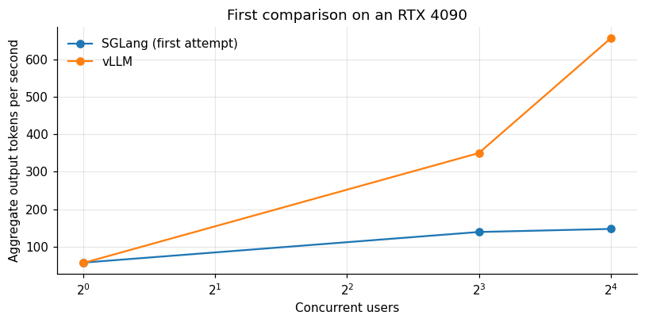

*Figure 4. First comparison on an RTX 4090.*

At 16 users, vLLM produced 656.7 tokens per second and the first SGLang attempt 147.2, a factor of 4.5. The per-user decode speeds were the same, 48.2 and 52.8 tokens per second, which already says the decoding itself was fine. What differed was admission. SGLang's time to first token at eight users was 7.7 seconds and at sixteen 16.5 seconds. The reconstructed concurrency shows why: with 16 users it never had more than 3 requests decoding at once, and 16 waiting.

My notes from the time blame a flag. SGLang's `--cuda-graph-max-bs` option was ambiguous in the version I used, and I changed it to the explicit decode-specific flag, `--cuda-graph-max-bs-decode`, before I re-ran on the 5090, with the results above. The lesson I took is about the claim "engine A is four times slower than engine B", which in my case was a claim about how I had started one server.

I read the start-up log of that 4090 run afterwards. These lines come from it, with the same selection as before: the setting I had changed, the cap and its reason, the pool size, and two decode steps at 16 users.

```
[2026-10-27 13:02:17] server_args={… 'context_length': 8192, … 'mem_fraction_static': 0.85, … 'max_running_requests': None, … 'chunked_prefill_size': 4096, … 'cuda_graph_max_bs_decode': None …}
[2026-10-27 13:02:26] max_running_requests is capped to 3 by the mamba state cache (max_mamba_cache_size=17, 5 state slots per request). To raise it: increase --mamba-full-memory-ratio or --max-mamba-cache-size, or halve the state size with --mamba-ssm-dtype bfloat16.
[2026-10-27 13:03:08] max_total_num_tokens=33136, chunked_prefill_size=4096, max_prefill_tokens=16384, max_running_requests=3, context_len=8192, available_gpu_mem=2.00 GB
[2026-10-27 13:04:33] Decode batch, #running-req: 3, #full token: 198, full token usage: 0.01, mamba num: 10, mamba usage: 0.59, cuda graph: True, gen throughput (token/s): 78.02, #queue-req: 13
[2026-10-27 13:04:34] Decode batch, #running-req: 3, #full token: 318, full token usage: 0.01, mamba num: 10, mamba usage: 0.59, cuda graph: True, gen throughput (token/s): 158.86, #queue-req: 13
```

In that run the graph batch setting was at its default and the cap was 3, again set by the state cache, which held 17 slots on the 24 GB card. The log does not show the graph flag limiting anything. Between the two runs I changed the card as well as the flag, and the state cache grew from 17 slots to 81, so I cannot tell which change lifted the cap from 3 to 16.

## 5. Statistical noise

How much of the 5 percent difference at 16 users, and the 1.7 times difference at 32, could be chance? A resampling of the requests gives an interval.

**Table 5.** Statistical noise

| Engine | Users | Tok/s low | Tok/s median | Tok/s high |
|---|---|---|---|---|
| SGLang | 1 | 61 | 96 | 133 |
| SGLang | 8 | 486 | 585 | 685 |
| SGLang | 16 | 982 | 1,115 | 1,251 |
| SGLang | 32 | 994 | 1,121 | 1,250 |
| vLLM | 1 | 55 | 94 | 133 |
| vLLM | 8 | 472 | 563 | 665 |
| vLLM | 16 | 945 | 1,064 | 1,190 |
| vLLM | 32 | 1,722 | 1,901 | 2,068 |

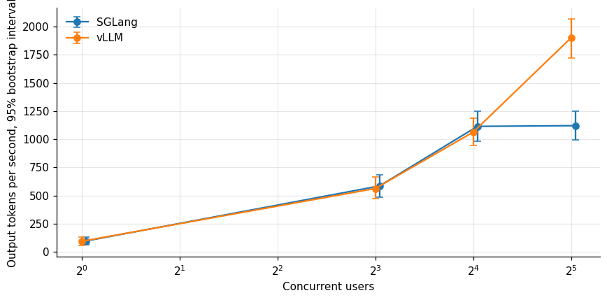

*Figure 5. Statistical noise.*

The bootstrap intervals are wide at low concurrency because a 30-second level contains few requests. At 16 users the intervals of the two engines overlap, and the 5 percent difference is not distinguishable from noise. At 32 users the intervals separate completely. So the ranking at 32 holds up under resampling, and the tie below it is a tie.

## 6. A queue model that predicts the delay

If SGLang held its decoding batch at 16 and sent the other users to a queue, then the delay before their first token should follow from simple queueing arithmetic. This is a prediction I can test against the measurement.

In a closed loop with N users and c running slots, each user sends a request, waits for it to finish, and sends the next. When N is larger than c, the users beyond c are always waiting in line. A request that finds the line full waits for roughly the time it takes the running requests to finish, divided across the slots. If the mean service time of a request once running is S, then the expected wait for the queued share is about S times the queue length divided by c.

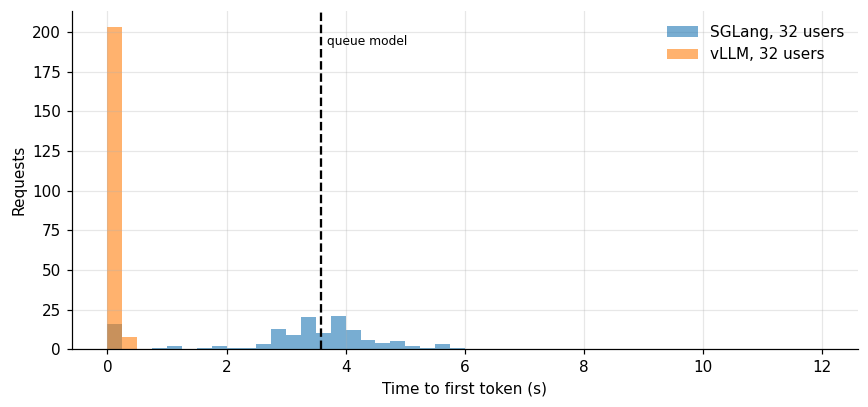

*Figure 6. A queue model that predicts the delay.*

A request that has started decoding spends on average 3.6 seconds before it finishes, in the SGLang run. With 32 users and 16 slots, the model predicts a queue wait of 3.6 seconds, and the measured time to first token was 3.2 seconds on average and 3.5 at the median, within about 12 percent of the prediction. The model is a first approximation, because requests finish at different times and the short ones turn over faster, and it agrees with the measurement better than I expected. It supports the reading that a batch cap of 16 is the entire reason SGLang's first token took three seconds.

A comparison with vLLM at 32 users completes the check: its mean time to first token was 0.10 seconds, because every request is admitted at once and starts decoding immediately. The queue, not the compute, is the entire difference in latency.

## 7. How the decode speed per user falls with batch size

Continuous batching trades per-user speed for total throughput. The vLLM data give four points on that trade.

**Table 6.** How the decode speed per user falls with batch size

| Users | Decode tok/s per user p50 | Agg out tok/s |
|---|---|---|
| 1 | 95.4 | 93.6 |
| 8 | 81.6 | 564.3 |
| 16 | 75.3 | 1,062 |
| 32 | 69.3 | 1,900 |

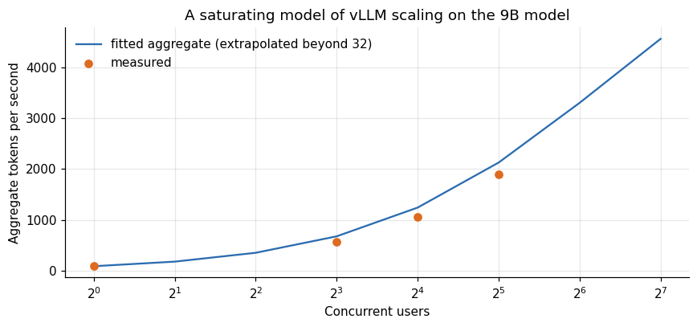

*Figure 7. A saturating model of vLLM scaling on the 9B model.*

Per-user decode speed on vLLM fell from 95.4 tokens per second at one user to 81.6 at eight, 75.3 at sixteen and 69.3 at thirty-two. A hyperbolic fit, speed equal to the single-user speed divided by one plus the number of users over a constant, describes it with a single-user speed of 93.5 tokens per second and a constant of 79 users. The fit predicts 2,127 tokens per second at 32 users against the 1,900 measured, and extrapolates to about 3,300 at 64 users and 4,600 at 128, which are projections I did not measure; the real curve will bend earlier as the cache fills or the compute saturates. The point of the model is the shape: at 32 users the card was running at about 40 percent of the throughput the same fit gives for 128, so there was headroom, and the vLLM curve had not yet flattened.

## 8. What the rejections tell us

Both engines rejected a fixed share of requests with an HTTP 400 error. These are the 10,000-token document requests, which exceeded the maximum context length I had configured for the 9 billion model.

**Table 7.** What the rejections tell us

| Engine | Users | Requests | Rejected 400 | Rejected share |
|---|---|---|---|---|
| vLLM | 1 | 10 | 1 | 0.1 |
| vLLM | 8 | 82 | 13 | 0.159 |
| vLLM | 16 | 140 | 18 | 0.129 |
| vLLM | 32 | 252 | 41 | 0.163 |
| SGLang | 1 | 10 | 1 | 0.1 |
| SGLang | 8 | 82 | 13 | 0.159 |
| SGLang | 16 | 144 | 19 | 0.132 |
| SGLang | 32 | 162 | 28 | 0.173 |

The share of rejected requests was 10 to 17 percent at every level for both engines, in line with the 15 percent weight of the long-document request in the mix. That the shares are similar between engines confirms that both saw the same traffic. A fixed rejection share is also a reminder that these throughput numbers describe the 85 percent of the mix that the configuration accepted, and a deployment that must accept long documents needs a larger context and gets lower throughput.

## 9. Launching an engine: a checklist

From this experience, here is the list I would follow whenever I start a serving engine for a benchmark or a deployment.

Name the batch limits explicitly. In vLLM, the maximum number of sequences. In SGLang, the maximum running requests and the CUDA graph batch sizes. If you accept defaults, write down what they were.

Name the context limit and the memory fraction, since they bound the cache and so the concurrency the server can keep.

Check that the server health endpoint answers and that a warm-up request has run before you start the clock. Early requests include compilation and graph capture.

Run the load generator at a concurrency above your target to see whether throughput saturates, and reconstruct the running concurrency from timestamps to see whether the server is the one limiting it.

Pin the engine versions. Flag names and defaults changed between versions of both engines, and my own first attempt tripped on one.

Keep the logs of both the server and the client. The server log has the cache size and the batch limits it started with, and I used them throughout this series.

## 10. What it costs per token

**Table 8.** What it costs per token

|  | SGLang | VLLM |
|---|---|---|
| 1 | 2.507 | 2.582 |
| 8 | 0.412 | 0.428 |
| 16 | 0.217 | 0.228 |
| 32 | 0.216 | 0.127 |

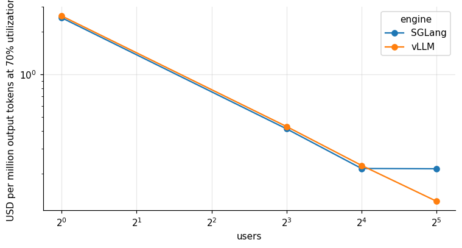

*Figure 8. What it costs per token.*

At 32 users and 70 percent utilization, the 9 billion model costs 0.127 dollars per million output tokens on vLLM and 0.216 on SGLang with this configuration, at the 5090's median rental price of 0.609 dollars per hour. Up to 16 users the costs are within 5 percent of each other, 0.228 and 0.217 at 16. The 70 percent higher cost of SGLang at 32 users is a configuration effect, and a correctly configured SGLang would presumably close it. I did not test that.

## 11. Which engine for what

The data support a modest conclusion. For a service below 16 concurrent users on this class of card, both engines perform the same on throughput and SGLang answers the first token about twice as fast at the median. For a service above 16, vLLM scaled without tuning, and SGLang needs its running-request limit raised, which its log ties to the size of the state cache for this model, and I did not do that for this run. I would test both on my own traffic, with the batch and graph limits set explicitly, before choosing. The difference between the engines in these measurements is smaller than the difference a single flag makes.

## 12. How to avoid a false conclusion

Several checks from this experience belong in any engine comparison.

Report the concurrency the server achieved as well as the number of users the client sent. The reconstruction above needs only timestamps and is cheap.

Look at the per-user decode speed alongside throughput. If it stays flat as users double, some of them are waiting.

Look at the first-token time. A queue shows up there before it shows up anywhere else.

Set the limits explicitly on both sides: maximum running requests, CUDA graph batch size, maximum context length, memory fraction. Defaults differ between engines and between versions.

Keep the model, precision, hardware, prompts, seeds and output caps identical. Check that the rejection pattern matches, as it did here.

Repeat the run at least once. Single 30-second levels are noisy, and the bootstrap intervals show how noisy.

## 13. Questions I expect

**Is SGLang slower than vLLM?** Not in these measurements below 16 users, where it matched on throughput and answered faster at the median. Above 16 the comparison was decided by a batch limit.

**Why did SGLang answer faster at low load?** I did not investigate. Possible reasons are a lighter scheduling path or the way the first token is returned, and each would need a profile to confirm.

**Which should I deploy?** The one you have measured on your traffic, with the limits set. If you cannot measure, vLLM scaled without tuning here.

**Do these results apply to the 27 billion model?** They concern a 9 billion model in BF16. The structure of the lesson, that configuration dominates, applies to any size, and the numbers do not.

## 14. The same 9B model on every card

The 9 billion parameter model also ran, under vLLM, on every card in the series, which puts the 5090 result in context. The comparison below uses the same load generator.

**Table 9.** The same 9B model on every card

|  | Users | Agg out tok/s | Decode tok/s per user p50 | TTFT p95 short s |
|---|---|---|---|---|
| RTX 5090 | 32 | 1,802 | 65.1 | 0.39 |
| RTX PRO 6000 | 32 | 966.7 | 70.7 | 6.22 |
| A100 | 32 | 856 | 62.4 | 7.22 |
| RTX 4090 | 32 | 709.9 | 42.9 | 7.6 |
| L40S | 32 | 558.7 | 41.8 | 10.51 |
| RTX 3090 | 32 | 544.1 | 40.9 | 11.04 |
| GB10 | 16 | 131.6 | 12.3 | 0.6 |

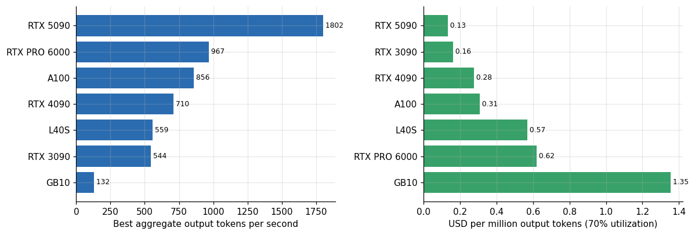

*Figure 9. The same 9B model on every card.*

**Table 10.** The same 9B model on every card (part 2)

|  | Agg out tok/s | USD per mtok 70pct |
|---|---|---|
| RTX 5090 | 1,802 | 0.134 |
| RTX 3090 | 544.1 | 0.161 |
| RTX 4090 | 709.9 | 0.277 |
| A100 | 856 | 0.31 |
| L40S | 558.7 | 0.57 |
| RTX PRO 6000 | 966.7 | 0.621 |
| GB10 | 131.6 | 1.354 |

At the best concurrency I tested on each card, the 9 billion model produced 1,802 tokens per second on the RTX 5090 at 32 users, 967 on the PRO 6000, 856 on the A100, 710 on the RTX 4090, 559 on the L40S, 544 on the RTX 3090 and 132 on the GB10. The 5090 is the fastest card for this model, almost twice the PRO 6000, which has a larger memory and a larger price. A small model does not use a big card's extra memory, and it rewards bandwidth and clock speed, which the consumer Blackwell card has.

In cost per million tokens at 70 percent utilization, the 5090 is also the cheapest at about 0.13 dollars, followed by the 3090 at 0.16, the 4090 at 0.28, the A100 at 0.31, the L40S at 0.57 and the PRO 6000 at 0.62. One caveat qualifies the ranking. At 32 users the 95th percentile of first-token time for short prompts was 0.39 seconds on the 5090 and between 6.2 and 11 seconds on the PRO 6000, A100, 4090, L40S and 3090, so those cards were past saturation at that load, and their peak throughput comes with long waits. Only the 5090 delivered its best throughput within a three-second first-token budget at 32 users. The order matches the 27 billion model's story in the cost-per-token article: the 5090 and the 3090 are the economical cards for models that fit them, and the large cards are for models that need the memory.

These numbers come from different sessions with different load-test lengths, and the 5090 figure is the one reproduced in this article's engine comparison, where vLLM reached 1,900 at 32 users. The agreement between the earlier sweep and the engine run (1,802 against 1,900) is a small repeatability check in its own right, a 5 percent difference between sessions on what was the same card model.

## 15. How other benchmarks go wrong

Published engine comparisons vary a great deal in what they report. These are the failure modes I would look for, each of which I either committed or came close to committing.

Unequal limits. One engine is run with its default maximum batch and the other with a different default. The result is a comparison of defaults.

Unequal graphs. One engine uses CUDA graphs and the other does not, or captures graphs only for small batches.

Different request mixes or seeds. Output lengths vary by seed, and throughput depends on output length.

Cold starts included in one engine's run. The first requests after launch are much slower than the rest.

No concurrency report. A client that sends 32 requests does not make the server run 32.

Averages without distributions. A mean time to first token of 1.7 seconds could be a uniform 1.7 or a mixture of 0.04 and 3.4. In the SGLang run at 32 users the second is closer to the truth.

One run. At 30 seconds per level the bootstrap interval of throughput is about 10 percent wide at 16 users.

## 16. A fair comparison protocol

The protocol I would write down before running an engine comparison fits on a page.

Fix the model, precision, hardware, prompts, seeds and output caps. Record the engine versions and every non-default flag, and state the batch, graph and context limits explicitly in both. Warm each server with representative requests before the clock starts. Run each concurrency level for at least a minute, repeat the whole sweep twice, and alternate the order of the engines between sweeps. Record every request with start, first-token and end times. From the timestamps, compute the achieved concurrency at each level and the first-token time distribution as well as its mean. Report aggregate throughput with an interval. Only then report a ranking, and say at which concurrency it holds.

I broke several of these rules in my first attempt and obeyed most of them in the second. The cost of the correction was a few cents of rental. The cost of publishing the first attempt would have been a false claim about an open-source project, which is a worse price.

Two further habits would have saved me time in this study. The first is to keep the server start logs next to the benchmark results: the logs state the batch limit, the context limit and the cache size that each engine actually used, which is exactly the information that explained the 4090 first attempt and the 32-user plateau, and I had to dig them out afterwards. The second is to run the comparison at a load level above the one the service will see, since the difference between the engines appeared only past 16 users, a load that many tests never reach.

The numbers I had to dig out are these, from the two start-up logs:

| Run | State-cache slots | Cap on running requests | KV cache tokens | cuda_graph_max_bs_decode | mem_fraction_static |
|---|---|---|---|---|---|
| RTX 5090, second comparison | 81 | 16 | 145,643 | 32 | 0.85 |
| RTX 4090, first attempt | 17 | 3 | 33,136 | None (default) | 0.85 |

The 5090 run reserved 145,643 tokens of cache against 33,136 for the 4090 run, at the same memory fraction of 0.85.

## 17. Deploying: batch limits as a capacity decision

The batch cap is a capacity decision as well as a tuning detail. A cap of 16 running requests means that the server will hold at most 16 users in the decoding state and queue the rest. For an interactive service that is a policy: it bounds per-user speed, which falls as the batch grows, in exchange for a longer wait for the unlucky users. For a throughput-oriented service it is a loss.

The relevant trade, on the vLLM data, is that raising the batch from 16 to 32 cut each user's speed from 75 to 69 tokens per second, a loss of 8 percent, and raised total throughput by 79 percent. In that range the case for a high cap is overwhelming. At larger caps the cache memory limits the number of sequences the card can hold, which the long-context article analyzes for the 27 billion model.

## 18. What a user feels: the whole request

The throughput and first-token tables describe the server. A user feels something else: the time from sending a request to receiving its last token. The request log has that time for every request, split by the three kinds of request in the mix (a chat answer, a code answer and a short structured answer).

**Table 11.** What a user feels: the whole request

|  | Level | Kind | Median s | P95 s |
|---|---|---|---|---|
| SGLang | 8 | chat | 2.6 | 3.5 |
| SGLang | 8 | code | 6.14 | 6.89 |
| SGLang | 8 | json | 0.84 | 1.13 |
| SGLang | 16 | chat | 2.38 | 3.35 |
| SGLang | 16 | code | 6.61 | 7.01 |
| SGLang | 16 | json | 0.92 | 1.28 |
| SGLang | 32 | chat | 5.71 | 7.52 |
| SGLang | 32 | code | 10.05 | 12.01 |
| SGLang | 32 | json | 4.28 | 5.67 |
| vLLM | 8 | chat | 2.19 | 3.2 |
| vLLM | 8 | code | 6.41 | 6.44 |
| vLLM | 8 | json | 0.88 | 0.98 |
| vLLM | 16 | chat | 2.47 | 3.53 |
| vLLM | 16 | code | 6.91 | 6.99 |

*First 14 of 18 rows; the full table is in the executable notebook.*

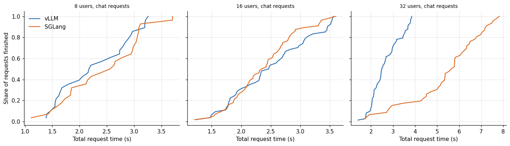

*Figure 10. users, chat requests.*

Up to 16 users the two engines give the same experience: a chat answer takes about 2.2 to 2.6 seconds at the median and 3.2 to 3.5 at the 95th percentile on both. At 32 users the distributions separate. The median chat answer takes 2.50 seconds on vLLM and 5.71 on SGLang, and the 95th percentile 3.80 against 7.52. The 32-user case on vLLM is as fast as the 16-user one, which is what scaling looks like. On SGLang it is more than twice as slow, which is what a queue looks like. The short structured answers suffer most, since they are short and wait as long as the others: 4.28 seconds at the median on SGLang against 1.08 on vLLM, a factor of 4, while the code answers, the longest, are 1.3 times slower (10.05 against 7.55 seconds). The shorter the request, the larger the relative penalty of the queue.

## 19. Waiting is half of the request

The share of a request's life spent before the first token isolates the queue from the generation.

**Table 12.** Waiting is half of the request

|  | SGLang | VLLM |
|---|---|---|
| 1 | 0.009 | 0.023 |
| 8 | 0.022 | 0.028 |
| 16 | 0.017 | 0.028 |
| 32 | 0.535 | 0.025 |

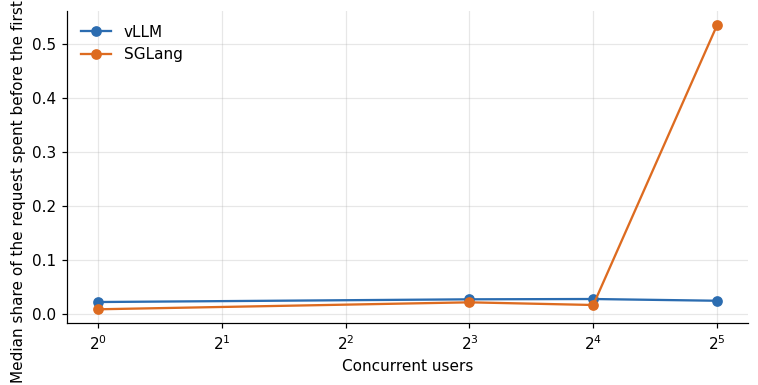

*Figure 11. Waiting is half of the request.*

On vLLM the median request spent 2 to 3 percent of its time waiting for the first token at every load level. On SGLang the share was 1 to 2 percent up to 16 users and 54 percent at 32. Half of what a user waited for was queueing, not generation. A reader who looks only at decode speed would see nothing wrong, as the next section shows.

## 20. The engine that waits decodes faster

The speed at which each request generated its tokens, after the first one arrived, is available too.

**Table 13.** The engine that waits decodes faster

|  | SGLang | VLLM |
|---|---|---|
| 1 | 97.6 | 95.4 |
| 8 | 84.8 | 81.6 |
| 16 | 78 | 75.3 |
| 32 | 78.6 | 69.3 |

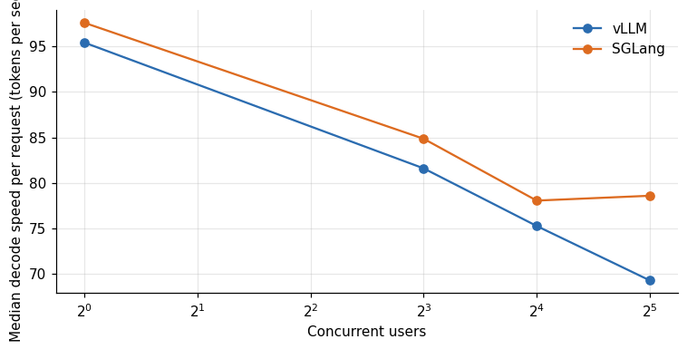

*Figure 12. The engine that waits decodes faster.*

At 32 users the median request on SGLang decoded at 78.6 tokens per second against 69.3 on vLLM, 13 percent faster, and at one user 97.6 against 95.4. The explanation follows from the cap on the batch: SGLang ran at most 16 requests at once, so each ran in a batch of 16 and decoded at the speed of a 16-user vLLM batch (75 to 78 tokens per second), while vLLM ran all 32 and paid for the larger batch. The cap bought speed per request at the price of throughput and waiting. If you only measure the speed of generation, SGLang at 32 users looks better than vLLM. If you measure throughput or total time, it looks worse. Neither number is wrong, and only the pair of them tells the story.

## 21. Arrival order at 32 users

A scatter of the first-token time against the moment each request was sent shows how the queue built and drained.

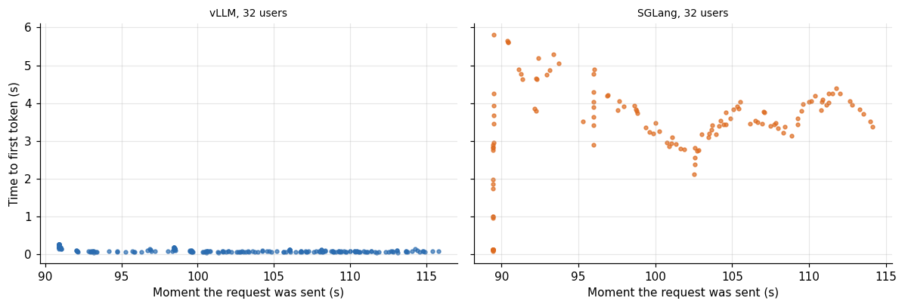

*Figure 13. , 32 users.*

On vLLM the first-token time is small across the whole run, below a quarter of a second for every request (0.18 seconds at the median for the first 20 requests and 0.07 for the last 20). On SGLang the first requests were served at once, with a median of 0.11 seconds for the first 20, and then the queue built up: the median for the last 20 was 4.02 seconds, and the cloud of points sits around 3 to 4 seconds for the rest of the run. That is the signature of a fixed excess of load over capacity and not of a transient: after a ramp of a few seconds the system sits at a steady state in which about half of the users are queued at any moment. The overload does not decay because the closed-loop load generator sends a new request as soon as one finishes, so the queue never drains.

## 22. Work completed in the same time

Finally, the number of requests that each engine finished during the same measurement window summarizes the effect for capacity planning.

**Table 14.** Work completed in the same time

|  | SGLang | VLLM | Sglang over vllm |
|---|---|---|---|
| 1 | 9 | 9 | 1 |
| 8 | 69 | 69 | 1 |
| 16 | 125 | 122 | 1.025 |
| 32 | 134 | 211 | 0.6351 |

**Table 15.** Work completed in the same time (part 2)

|  | SGLang | VLLM | Sglang over vllm |
|---|---|---|---|
| 1 | 2,828 | 2,761 | 1.02 |
| 8 | 17,580 | 17,208 | 1.02 |
| 16 | 33,468 | 32,711 | 1.02 |
| 32 | 37,951 | 59,453 | 0.64 |

In the 30-second window at 32 users, vLLM completed 211 requests and SGLang 134, 64 percent as many, and produced 59,453 output tokens against 37,951, also 64 percent (the table above gives 1,900 against 1,121 tokens per second). At 1, 8 and 16 users the counts were equal or within 3 percent. So an operator who sized a service by the 16-user results would find the SGLang deployment suddenly unable to carry the additional load, and the first sign would be the first-token time, not an error.

## 23. How many users one card could carry

The vLLM measurements stop at 32 users, and a reader will want to know how far the same card could go. A saturating curve fitted to the four measured points gives an extrapolation, with the warning that it extends the data beyond where I measured.

**Table 16.** How many users one card could carry

| Per user floor tok/s | Users at floor | Aggregate tok/s | USD per user hour | USD per m tokens |
|---|---|---|---|---|
| 10 | 657 | 6,570 | 0.001 | 0.027 |
| 20 | 289.2 | 5,784 | 0.002 | 0.031 |
| 30 | 166.6 | 4,997 | 0.004 | 0.036 |
| 40 | 105.3 | 4,211 | 0.006 | 0.042 |

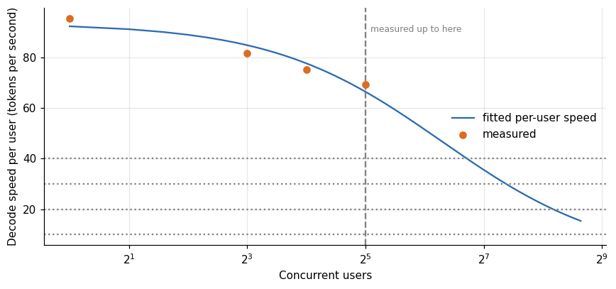

*Figure 14. How many users one card could carry.*

The fit has a single-user speed of 93.5 tokens per second and a half-speed point near 79 users. If the card is asked to hold at least 20 tokens per second for each user, the curve allows about 290 users and an aggregate of 5,800 tokens per second. At 30 tokens per second it allows 167 users, at 40 tokens per second 105, and at 10 tokens per second 657. The extrapolation ignores two limits that stop the real system sooner. The first-token time grows when the scheduler cannot start new requests quickly, and the vLLM first-token time at 32 users was 0.075 seconds at the median, nothing like a limit yet, but I have no data at 100 users. The second limit is the cache, and it is the one that binds first.

On the 5090 the 9 billion BF16 model left 6.70 to 8.85 GiB for the cache at the memory fractions used, which held 154,530 to 204,427 tokens in the starts recorded in the logs. Divided among 290 users, that is 530 to 700 tokens each, enough for a short chat exchange and not for a conversation with history. At 2,000 tokens per conversation the cache holds 77 to 102 users, and at 8,000 tokens 19 to 25. The cache therefore sets the number of simultaneous conversations for any realistic context well below the 290 that decode speed would allow, and the extrapolation above is an upper bound on a case that applies only to very short conversations.

The two vLLM starts behind those figures, selected from their logs. The first is the start of the engine comparison (memory fraction 0.85), the second is the earlier load sweep on the same card (0.92):

```
INFO 10-27 23:25:44 [api_utils.py:286] non-default args: {'model_tag': '/workspace/models/q9', 'host': '127.0.0.1', 'port': 18000, 'model': '/workspace/models/q9', 'max_model_len': 8192, 'served_model_name': ['q9'], 'reasoning_parser': 'qwen3', 'gpu_memory_utilization': 0.85, 'max_num_seqs': 32}
INFO 10-27 23:28:40 [gpu_worker.py:640] Available KV cache memory: 6.7 GiB
INFO 10-27 23:28:40 [kv_cache_utils.py:2395] GPU KV cache size: 154,530 tokens, Maximum concurrency for 8,192 tokens per request: 18.86x
INFO 10-26 16:06:28 [api_utils.py:286] non-default args: {'model_tag': '/workspace/models/q9base', 'host': '127.0.0.1', 'port': 18000, 'model': '/workspace/models/q9base', 'max_model_len': 8192, 'served_model_name': ['q9'], 'reasoning_parser': 'qwen3', 'max_num_seqs': 64}
INFO 10-26 16:08:38 [gpu_worker.py:640] Available KV cache memory: 8.85 GiB
INFO 10-26 16:08:38 [kv_cache_utils.py:2395] GPU KV cache size: 204,427 tokens, Maximum concurrency for 8,192 tokens per request: 24.95x
```

SGLang's pool in the comparison, 145,643 tokens, is close to vLLM's 154,530 at the same memory fraction. The two engines therefore sized the cache alike, and what differed was the cap on running requests.

In money, a 5090 at 0.642 dollars per hour carrying 105 users at 40 tokens per second each would cost about 0.006 dollars per user-hour, or 0.042 dollars per million output tokens, and carrying 290 users at 20 tokens per second about 0.002 dollars per user-hour, or 0.031 per million tokens. Those prices are only reachable if the users keep the server saturated, which a real user population does not, and the cache limit makes the higher user counts unreachable for conversations of any length. The utilization argument of the pricing article of this series applies in full.

| Claim in this article | Evidence behind it | Caveat |
|---|---|---|
| Up to 16 users the two engines tie on throughput | Table 1 and the bootstrap intervals in Table 5 | 30-second levels and one run per setup, and the intervals overlap at 16 users |
| At 32 users SGLang held 16 requests in the batch and queued the rest | Request timestamps (Table 2) and the server's own `#running-req` and `#queue-req` counters (figure above) | One card, one model. The log gives the state cache of this model as the reason for the cap, and I did not raise it to see what happens |
| vLLM scaled to 32 users without tuning | 211 requests and 1,900 tokens per second in the 30-second window | Nothing was measured beyond 32 users, and the 64 and 128 user figures are a fit |
| The first 4090 attempt made SGLang look 4.5 times slower | Table 3 and the cap of 3 in that run's start-up log | My notes blamed a graph flag, and the log names the state cache instead, so I cannot say which change lifted the cap |
| SGLang costs 70 percent more per token at 32 users | Cost per token at the median rental price (Table 8) | A statement about this configuration, and I did not test a configuration with a higher cap |

## 24. Limitations

One card, one model, one precision, 30-second levels, one run per setup. Engine flags are described from my operator notes. The cap on SGLang's batch is read from its start-up log and agrees with the cap that the request timestamps give, but I did not try to raise it. The CUDA graph and context settings were not exhaustively varied. Only short prompts count toward first-token times, and long prompts were rejected by both servers. The rental price is a marketplace median.

## 25. How much it cost

The engine comparison ran in a single RTX 5090 session at 0.6 dollars per hour that also hosted the camera study, and the 4090 attempt ran in a library sweep; each cost under a dollar of itemized rental inside a campaign of US$ 50.79. The incorrect first conclusion cost the 4090 session's engine run and the time to understand it.

## 26. Reproducing this analysis

Attach the dataset `gpu-ai-benchmark-campaign-2026`. The summary table is `engine_comparison.csv` and the per-request log is `engine_requests.csv`. The load generator and launch scripts are in the repository `llm-serving-engines-bench`.

## 27. Glossary

- **Continuous batching**: adding new requests to a running batch at every decoding step.
- **CUDA graph**: a recorded sequence of GPU kernels replayed with one launch.
- **Admission**: the server's decision to start processing a waiting request.
- **Time to first token**: delay from sending a request to receiving the first streamed token.
- **Bootstrap interval**: a confidence interval from resampling the data.

Lucas Rangel
