# Speech workloads on rented GPUs

**Lucas Rangel** · [Kaggle writeup](https://www.kaggle.com/writeups/lucasrangelss/speech-workloads-on-rented-gpus) · [Executable notebook](https://www.kaggle.com/code/lucasrangelss/speech-workloads-on-rented-gpus) · [Code and data](https://github.com/LucasRangelSSouza/gpu-ai-benchmark-hub) · [Dataset](https://www.kaggle.com/datasets/lucasrangelss/gpu-ai-benchmark-campaign-2026)

## Abstract

Voice features come in three shapes: turning text into speech, turning speech into text, and holding a spoken conversation in real time. I measured one open tool of each kind on rented GPUs, and a fourth on a laptop CPU for contrast. The tools were F5-TTS for synthesis with a cloned voice, faster-whisper for transcription, NVIDIA's PersonaPlex 7B for full-duplex conversation, and OpenVoice with MeloTTS for voice conversion on an Intel i7-1355U.

The summary is that synthesis and transcription are cheap on any GPU, a live conversation model is borderline on a consumer card, and the first call is always the slow one.

- F5-TTS synthesized speech 7 to 18 times faster than real time once warm. The median real-time factor (seconds of compute per second of audio) for the medium text was 0.056 to 0.14 across seven GPUs, and cost between 0.03 and 0.11 dollars per hour of generated audio.
- The first call is not representative. The very first synthesis on one RTX 3090 ran at a factor of 44 (it took 299 seconds to produce 6.75 seconds of audio) because it downloaded model files during the call. Short texts had a median factor of 0.33 against 0.06 for medium ones, which is warm-up showing in the first request of each run.
- faster-whisper transcribed 66 seconds of clean speech at a real-time factor of 0.0547 with the large-v3-turbo model, 0.0721 with small and 0.1862 with large-v3, with no word errors in the turbo and large models, on an RTX 3090. An hour of audio costs between 1 and 5 cents of GPU time.
- PersonaPlex, a 7 billion parameter model that listens and speaks at the same time, took 30.6 to 43.1 seconds of wall time to process 40 seconds of audio once warm. That is a real-time factor of 0.77 on the RTX PRO 6000, 0.82 on the L40S, 0.83 on the 5090, 0.92 on the 4090 and 1.08 on the 3090. The 3090 is too slow for a live conversation, and the others have little margin.
- On a laptop CPU, MeloTTS took 30.4 seconds to synthesize 4.71 seconds of speech (a factor of 6.5, including warm-up), and OpenVoice's voice conversion ran at a factor of 0.93.

None of these measurements evaluated how the speech sounds, and the transcription accuracy results come from a short clip. They describe speed and cost.

> **Code and data.** Everything behind this article is public: the code that ran, the curated data, the analysis that regenerates every figure, and tests that pin the conclusions to the data. Repositories: [voice-stt-tts-bench](https://github.com/LucasRangelSSouza/voice-stt-tts-bench). Index of the whole series: [gpu-ai-benchmark-hub](https://github.com/LucasRangelSSouza/gpu-ai-benchmark-hub).

## 1. Three shapes of voice workload

A text-to-speech request has a text and a voice and returns audio. It is not interactive in the way a conversation is; a delay of a second or two before the audio starts is acceptable, but if the reply is long the audio should arrive at least as fast as it is played, or the listener hears gaps. The metric that matters is the real-time factor: seconds of compute per second of audio. Below 1, the system produces speech faster than it plays.

A speech-to-text request has audio and returns a transcript. For batch transcription of recordings, the factor decides the cost. For live captions it decides the latency.

A full-duplex conversation model takes the user's audio and produces its own audio while the user is still talking, the way people interrupt and overlap each other. It has to run in real time at all times, with a factor safely below 1, and it has to hold the state of the conversation in memory. This is the most demanding shape, and the least standardized.

## 2. The tools and how I ran them

F5-TTS is a flow-matching speech synthesizer that clones a voice from a short reference clip (Chen and colleagues, 2025). I ran it with three texts of 71, 155 and 302 characters, which produced 6.75, 14.77 and 28.28 seconds of audio, and recorded the wall time of each synthesis.

faster-whisper is a reimplementation of OpenAI's Whisper speech recognizer (Radford and colleagues, 2023) that runs the same models faster. I ran three model sizes on a 66-second clip, and, separately, transcribed the F5-TTS outputs to check that the synthesized speech was intelligible.

PersonaPlex 7B is NVIDIA's full-duplex speech model. I ran its offline script on a 40-second input and recorded the wall time of each run.

OpenVoice with MeloTTS is a voice conversion stack: MeloTTS reads the text in a base voice, and OpenVoice converts it to the voice of a reference clip. I ran it on a local laptop CPU, a 10-core Intel i7-1355U in a Docker container with 7 gigabytes of memory, because the setup on the rented GPUs hung on a dictionary download.

## 3. Speech synthesis across seven GPUs

**Table 1.** Speech synthesis across seven GPUs

|  | Chars | Audio s | N |
|---|---|---|---|
| curto | 71 | 6.75 | 11 |
| medio | 155 | 14.77 | 11 |
| longo | 302 | 28.28 | 10 |

**Table 2.** Speech synthesis across seven GPUs (part 2)

|  | Curto | Medio | Longo |
|---|---|---|---|
| A100 | 0.299 | 0.075 | 0.097 |
| GB10 | 0.546 | 0.14 | 0.246 |
| L40S | 0.332 | 0.064 | 0.074 |
| RTX 3090 | 22.36 | 19.09 | 0.136 |
| RTX 4090 | 0.341 | 0.056 | 0.107 |
| RTX 5090 | 0.328 | 0.058 | 0.088 |
| RTX PRO 6000 | 0.39 | 0.071 | 0.108 |

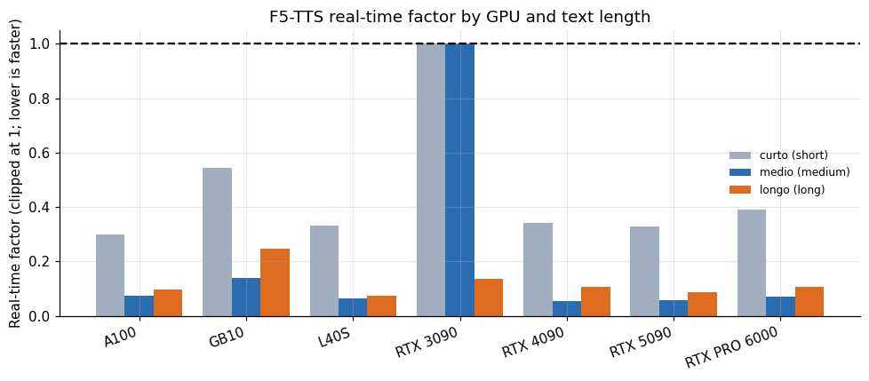

*Figure 1. F5-TTS real-time factor by GPU and text length.*

For the medium text of 155 characters (14.8 seconds of audio), the median real-time factor ranged from 0.056 on the RTX 4090 and 0.058 on the 5090 to 0.075 on the A100, 0.071 on the PRO 6000, 0.064 on the L40S and 0.126 on the RTX 3090 once its model files had downloaded, and 0.14 on the GB10. For the long text of 302 characters (28.3 seconds) it ranged from 0.054 to 0.136 across the cards, with the GB10 at 0.246. A factor of 0.06 means a minute of speech took about 3.6 seconds to generate. A single GPU could in principle serve more than ten simultaneous listeners in real time, if the model could be batched, which I did not test.

The short text is different, with medians of 0.25 to 0.55. A 6.75-second clip took about 2 to 3 seconds on every card, and a good part of that is fixed cost: loading the reference audio, encoding it, and the first pass of the model. The cost per call is therefore not proportional to the length of the audio at the short end, and a service that synthesizes short phrases will see a worse real-time factor than the long-text figure suggests.

## 4. Cold start

**Table 3.** Cold start

|  | GPU | Case | Audio s | Wall s | Rtf |
|---|---|---|---|---|---|
| 58 | RTX 3090 | curto | 6.75 | 299.3 | 44.33 |
| 59 | RTX 3090 | medio | 14.77 | 562.3 | 38.06 |

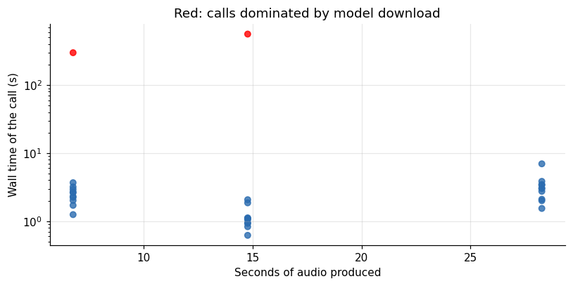

*Figure 2. Red: calls dominated by model download.*

Two calls out of 32 were outliers: the first short call on one RTX 3090 took 299.3 seconds (a factor of 44.3) and the first medium call on the same card 562.3 seconds (38.1). Both ran while the model files were still downloading in the background of a slow host. The same card on a second run produced the medium text at a factor of 0.13. An outlier of this size is not a property of the model. It is a reminder that on a fresh instance the first request may take minutes, and that a production deployment must load models and run a warm-up request before taking traffic.

## 5. What synthesis costs

**Table 4.** What synthesis costs

|  | USD per hour of generated speech (medium text, warm) |
|---|---|
| RTX 4090 | 0.0278 |
| RTX 3090 | 0.0278 |
| RTX 5090 | 0.0353 |
| A100 | 0.0501 |
| L40S | 0.0513 |
| GB10 | 0.0629 |
| RTX PRO 6000 | 0.1074 |

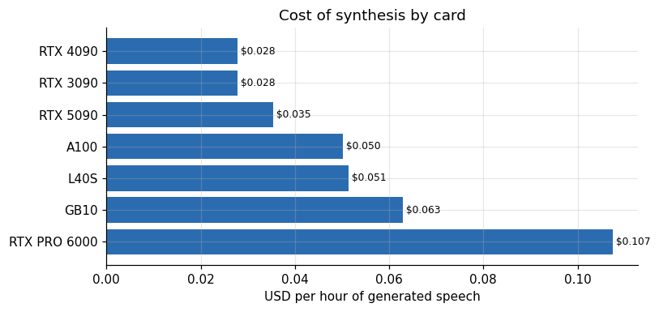

*Figure 3. Cost of synthesis by card.*

Multiplying the hourly rental price by the real-time factor gives the compute cost of an hour of generated speech: 0.028 dollars on the RTX 3090 and the 4090, 0.035 on the 5090, 0.050 on the A100, 0.051 on the L40S, 0.063 on the GB10 (listed price) and 0.107 on the PRO 6000, for the medium text. The numbers are small. An hour of narration costs three to eleven cents of GPU time on any of these cards, which makes the choice of card irrelevant for batch narration and the price of the model license, if any, much more important. For a real-time service, the card matters for concurrency and for the delay to the first audio, not for the average cost.

## 6. Fixed cost and marginal cost of a synthesis call

The real-time factor hides a structure that matters for short phrases. A call has a fixed cost (encoding the reference voice, preparing the model, the first pass) and a marginal cost per second of audio. If wall time is roughly a plus b times the seconds of audio, then b is the marginal factor and a is the delay you pay even for one word.

**Table 5.** Fixed cost and marginal cost of a synthesis call

|  | GPU | Fixed s | Marginal s per audio s | Points |
|---|---|---|---|---|
| 2 | L40S | 1.586 | 0.021 | 9 |
| 5 | RTX 5090 | 1.466 | 0.023 | 6 |
| 6 | RTX PRO 6000 | 1.697 | 0.033 | 3 |
| 0 | A100 | 1.241 | 0.043 | 3 |
| 4 | RTX 4090 | 1.282 | 0.046 | 3 |
| 3 | RTX 3090 | 1.723 | 0.064 | 3 |
| 1 | GB10 | 1.34 | 0.175 | 3 |

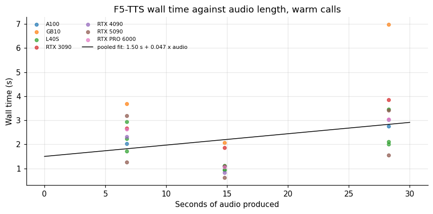

*Figure 4. F5-TTS wall time against audio length, warm calls.*

Fitting a straight line to the warm calls of all seven cards gives a fixed cost of about 1.5 seconds and a marginal factor of about 0.047 seconds per second of audio, with the per-card fixed costs between 1.2 and 1.7 seconds and the marginal factors between 0.021 (L40S) and 0.175 (GB10). So a one-second utterance costs about 1.5 seconds of compute, a ten-second one about 2.0, and a thirty-second one about 2.9. For a service that produces many short phrases, such as confirmation messages and one-line replies, the fixed cost is the whole story: the real-time factor of such calls is above 1, not 0.06. The fixed part is largely a function of the code path (reference audio processing is repeated on every call) and could be removed by caching the encoded reference voice, which I did not test.

## 7. How soon can the audio start?

F5-TTS, as I ran it, synthesizes the whole utterance before returning it. The delay before playback can start is therefore the full wall time of the call, and it grows with the length of the text.

**Table 6.** How soon can the audio start?

|  | Curto | Medio | Longo |
|---|---|---|---|
| A100 | 2.02 | 1.1 | 2.75 |
| GB10 | 3.68 | 2.07 | 6.97 |
| L40S | 2.24 | 0.94 | 2.1 |
| RTX 3090 | 2.67 | 1.86 | 3.85 |
| RTX 4090 | 2.31 | 0.83 | 3.02 |
| RTX 5090 | 2.22 | 0.86 | 2.48 |
| RTX PRO 6000 | 2.63 | 1.05 | 3.05 |

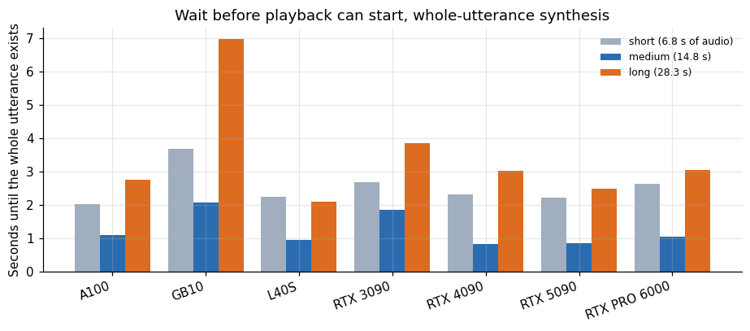

*Figure 5. Wait before playback can start, whole-utterance synthesis.*

On the GPUs the wait was 0.8 to 1.9 seconds for the medium text and 2.1 to 3.9 seconds for the long one; on the GB10 it was 2.1 and 7.0 seconds. The short text waited 2.0 to 2.7 seconds, longer than the medium one, because it is the first call of each run and carries the warm-up. A person listening to a 28-second reply waits two to three seconds before hearing anything, and then hears it uninterrupted. That is acceptable for an announcement and sluggish for a conversation. A conversational product would split the reply into sentences and synthesize them in sequence, so that the first sentence starts playing after the delay of a short call (1.3 seconds fixed plus a little) while the rest is made behind it. The fixed cost then becomes a per-sentence cost, which is why the cached-reference optimization matters.

## 8. What a character costs

TTS services are usually priced per thousand characters. The measurements allow the equivalent for self-hosted synthesis.

**Table 7.** What a character costs

|  | Curto | Medio | Longo |
|---|---|---|---|
| A100 | 0.00528 | 0.00132 | 0.00169 |
| GB10 | 0.00646 | 0.00167 | 0.00288 |
| L40S | 0.00703 | 0.00135 | 0.00155 |
| RTX 3090 | 0.00231 | 0.00074 | 0.00078 |
| RTX 4090 | 0.00448 | 0.00074 | 0.00138 |
| RTX 5090 | 0.00529 | 0.00093 | 0.00139 |
| RTX PRO 6000 | 0.01557 | 0.00285 | 0.00424 |

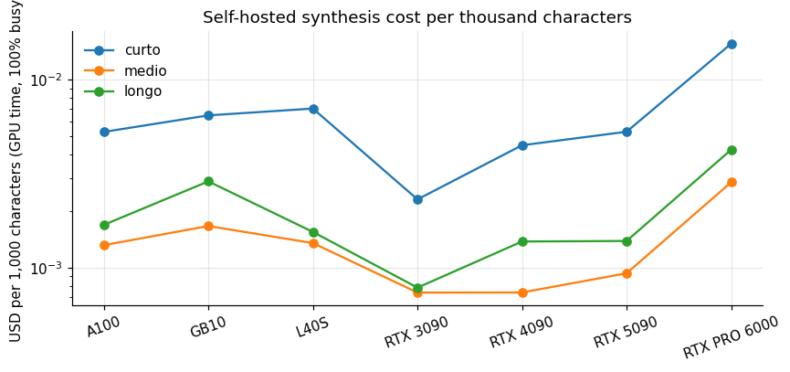

*Figure 6. Self-hosted synthesis cost per thousand characters.*

At full utilization the compute cost of synthesis is between 0.0007 and 0.003 dollars per thousand characters for the medium text and between 0.0008 and 0.004 for the long one, and between 0.002 and 0.016 for the short text with its warm-up. Hosted TTS services are priced orders of magnitude above this, which says only that a self-hosted model leaves the price of the service in labor, reliability, quality and licensing, and not in the GPU. At 35 percent utilization and with a fixed fleet for peak load, the cost still stays well under a cent per thousand characters.

## 9. Transcription

**Table 8.** Transcription

|  | Value |
|---|---|
| audio_s | 66 |
| large_v3_rtf | 0.1862 |
| large_v3_turbo_rtf | 0.0547 |
| large_v3_turbo_wer | 0 |
| large_v3_wer | 0 |
| small_rtf | 0.0721 |
| small_wer | 0.023 |

**Table 9.** Transcription (part 2)

| Model | Rtf | Wer | USD per audio hour | Audio hours per GPU hour |
|---|---|---|---|---|
| small | 0.0721 | 0.023 | 0.0159 | 13.87 |
| large_v3_turbo | 0.0547 | 0 | 0.0121 | 18.28 |
| large_v3 | 0.1862 | 0 | 0.0412 | 5.371 |

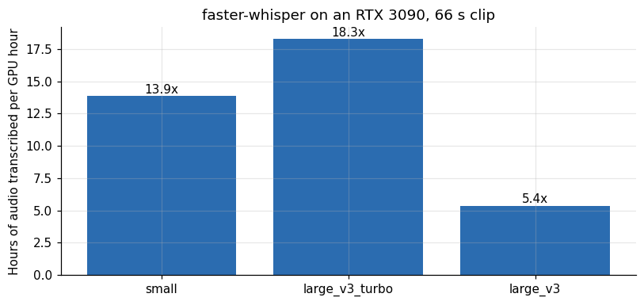

*Figure 7. faster-whisper on an RTX 3090, 66 s clip.*

On the RTX 3090 and a 66-second clip, faster-whisper's small model ran at a real-time factor of 0.0721 and made 2.3 percent word errors, the large-v3-turbo model at 0.0547 with no errors, and the large-v3 model at 0.1862 with no errors. The turbo model is the best of the three on this clip: faster than the small model and as accurate as the largest. In throughput terms, one GPU hour transcribes 18 hours of audio with turbo, 14 with small and 5.4 with large-v3. In cost terms, an hour of audio costs 1.2 cents with turbo, 1.6 with small and 4.1 with large-v3 at the 3090's price.

Two cautions. The clip is 66 seconds of clean speech. Word error rates of 0 to 2 percent on one clip say nothing about noisy calls, accents or telephone audio. And these runs were sequential: a server transcribing many streams at once could get more throughput by batching, which I did not measure.

## 10. Transcribing a backlog

A common request is to transcribe an archive of recordings. The measurements give the time and cost for a stated volume.

**Table 10.** Transcribing a backlog

| Model | GPU hours for 1000h audio | Cost USD on 3090 | Wall hours with 8 gpus | Word error on clip |
|---|---|---|---|---|
| small | 72.1 | 15.93 | 9.01 | 0.02 |
| large_v3_turbo | 54.7 | 12.09 | 6.84 | 0 |
| large_v3 | 186.2 | 41.15 | 23.28 | 0 |

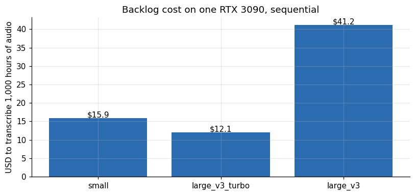

*Figure 8. Backlog cost on one RTX 3090, sequential.*

A thousand hours of recordings is 55 GPU hours with the turbo model, 72 with the small model and 186 with large-v3, which at the 3090's median price costs 12, 16 and 41 dollars. With eight cards in parallel the turbo run takes under 7 hours. These estimates assume the long-run speed matches the 66-second clip and ignore audio decoding, voice activity detection, retries and the cost of storing the transcripts. Real recordings with noise, crosstalk and silence will behave differently, and the turbo model's perfect score on one clean clip is a reason to test, not a promise.

## 11. Checking the synthesized speech with the recognizer

A cheap quality check for a synthesizer is to transcribe its output and compare it with the input text. If the speech is clear, the recognizer recovers most words.

**Table 11.** Checking the synthesized speech with the recognizer

|  | GPU | Case | Audio s | Wall s | Rtf | Wer |
|---|---|---|---|---|---|---|
| 286 | RTX 4090 | curto | 6.75 | 0.69 | 0.103 | 0.083 |
| 287 | RTX 4090 | medio | 14.77 | 0.29 | 0.02 | 0.519 |
| 288 | RTX 4090 | longo | 28.28 | 1.36 | 0.048 | 0.294 |

Applied to the three F5-TTS outputs on the 4090, the round-trip word error rate was 8.3 percent for the short text, 51.9 percent for the medium one and 29.4 percent for the long one. The harness notes that these error rates are only indicative, because the reference voice was in English and the texts were Portuguese. The rates are high enough that they should not be read as the recognizer's accuracy, and the round trip tells me less than I hoped. I did not listen to the outputs systematically. So the speed numbers above describe a model that produced audio on every call, and I make no claim about its quality in Portuguese.

A web page cannot play the clips, so here they are as spectrograms: time across, frequency up, brighter where there is more energy. The shaded bands are silences of 200 ms or more.

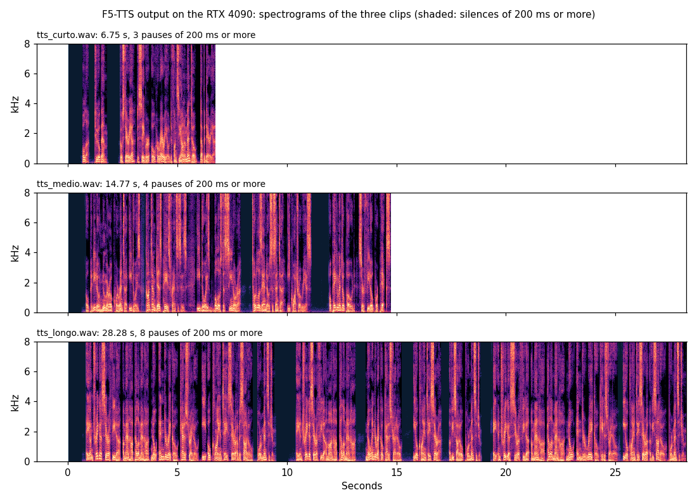

*Figure 9. F5-TTS clips saved by the RTX 4090 run: 6.75 s, 14.77 s and 28.28 s, with silences of 200 ms or more shaded.*

Each clip opens with 0.66 to 0.82 seconds of silence and then shows the stacked horizontal bands of voiced speech, up to 8 kHz. The clips hold 3, 4 and 8 pauses of 200 ms or more, and 29, 25 and 21 percent of their 20 ms frames are silent, so the longer text is spoken with proportionally fewer and shorter gaps. The picture shows that every call produced speech-shaped audio. It cannot show whether the Portuguese words are intelligible, and the high word error rates above are the better evidence on that point.

## 12. A live conversation model

**Table 12.** A live conversation model

|  | 1 | 2 |
|---|---|---|
| L40S | 239.5 | 32.9 |
| RTX 3090 | 210.1 | 43.1 |
| RTX 4090 | 211.1 | 36.9 |
| RTX 5090 | 33.1 | 640.7 |
| RTX PRO 6000 | 148.9 | 30.6 |

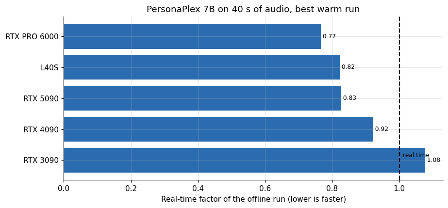

*Figure 10. PersonaPlex 7B on 40 s of audio, best warm run.*

PersonaPlex's offline script took 148.9 seconds on the PRO 6000 for its first run, 211.1 on the 4090, 210.1 on the 3090 and 239.5 on the L40S, and 30.6, 36.9, 43.1 and 32.9 seconds on the second run on the same cards. The first run is a cold start, with the model loaded from disk and the compute kernels prepared. On the RTX 5090 the first run took 33.1 seconds and the second 640.7, a result I did not investigate, since the same card ran other tools normally. On the GB10 the run failed for a missing Python module on the ARM platform.

The script also saves the 40 seconds of audio the model produced and a transcript of its own speech. The figure shows one of them, the 4090 run with the voice called NATF2: a short burst at the start, a silence, then two longer bursts of speech. The orange lines mark where the transcript places each word, and they fall on the bursts. I did not check what the input audio contained, so I read the long silences as the model waiting, not as a failure.

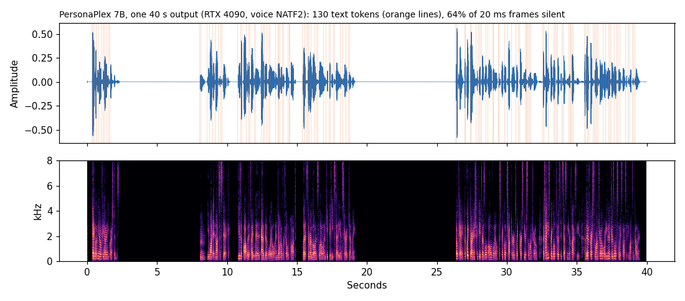

*Figure 11. PersonaPlex 7B output on the RTX 4090 (voice NATF2): waveform with transcript token times, and spectrogram.*

The transcripts say more than the timings. Every run starts with the same sentence, "Hey, let me know if you have any questions.", and then continues differently. The 4090 and the L40S, both Ada cards, wrote word-for-word the same continuation for both voices. The 3090, the 5090 and the PRO 6000 each wrote something else:

```
RTX 4090 / L40S  NATF2  Hmm, you want it not to stick. Use a pot with a tight lid, add a bit of oil, and don't overfill the pot. ...
RTX 3090         NATF2  Yeah, the trick is to rinse the rice a few times until the water runs clear, that cuts down on extra starch, ...
RTX 5090         NATF2  Hmm, you want rice that stays separate, you can rinse it a few times, use a bit more water, bring it to a boil ...
RTX PRO 6000     NATF2  Hmm, try rinsing the rice a few times until the water runs clear, that cuts down on extra starch, then use a pot ...

RTX 4090 / L40S  NATM1  Hmm, the trick is to keep the heat gentle and stir often, so the grains don't sit and stick together. ...
RTX 5090         NATM1  Hmm, try rinsing the rice a few times until the water runs clear, that cuts down on extra starch, ...
RTX PRO 6000     NATM1  Hmm, you can keep the heat steady, use a pot with a lid so it doesn't stick to the bottom, ...
```

The same script, with the same weights, gave identical text on two cards of one architecture and different text on the others. This is ten runs on five cards, each run once, and I do not know whether the sampling seed was fixed, so the reason is open. It matters for testing: a regression check that compares the transcript of a voice model across machines will fail on machines that are not the same.

The warm runs give real-time factors of 0.77 on the PRO 6000, 0.82 on the L40S, 0.83 on the 5090, 0.92 on the 4090 and 1.08 on the 3090. A live conversation needs the model to process audio no slower than it arrives, with margin for network jitter and for the cost of the other parts of a voice product: the speech detector, the audio codec, the network. A factor of 0.77 leaves 23 percent of headroom, and 0.92 leaves 8. The 3090 at 1.08 would fall behind a live speaker, a second of audio taking 1.08 seconds to process, and the lag would accumulate. This is an offline script processing a file, and a streaming deployment could differ in either direction. The ordering is the useful part: of the five working cards, only the PRO 6000, L40S and 5090 have room.

## 13. Voice conversion on a laptop CPU

**Table 13.** Voice conversion on a laptop CPU

|  | 0 |
|---|---|
| t_utc | 2026-10-27T14:27:28.549261+00:00 |
| tool | openvoice_v2+melotts |
| hardware | PC local Intel i7-1355U (10 nucleos/12 threads... |
| device | cpu |
| melo_tts_s | 30.41 |
| melo_audio_s | 4.71 |
| melo_rtf | 6.462 |
| load_s | 12.0 |
| se_extract_s | 111.12 |
| convert_s_median | 4.35 |
| convert_rtf | 0.925 |
| note | 1a execucao inclui aquecimento; se_extractor p... |
| measurement_kind | measured |

On the laptop CPU, MeloTTS took 30.4 seconds to produce 4.71 seconds of speech, a factor of 6.46 that the harness notes includes warm-up on the first run. The OpenVoice conversion step ran at a factor of 0.925 (a median of 4.35 seconds per clip), and the one-time extraction of the target speaker's embedding took 111 seconds. Converting is therefore about as fast as real time on this CPU, and the base synthesis, as measured here, is not. I would not draw a conclusion about steady-state CPU synthesis speed from a single warm-up-inclusive run. What the measurement does show is that a laptop can run a voice conversion pipeline without a GPU at an offline pace, and that a GPU is what makes it interactive.

## 14. A cascaded voice assistant against a duplex model

There are two ways to build a voice assistant. The cascade chains a recognizer, a language model and a synthesizer. A full-duplex model does the whole job in one network. The measurements in this series allow a rough latency budget for the cascade.

**Table 14.** A cascaded voice assistant against a duplex model

| Stage | Seconds | Cumulative |
|---|---|---|
| Speech recognition (turbo, 5 s utterance) | 0.27 | 0.27 |
| Language model, first token (soak test median) | 0.12 | 0.4 |
| Language model, 40-token reply at 75 tok/s | 0.53 | 0.93 |
| Speech synthesis, first sentence (fixed + 5 s ... | 1.73 | 2.66 |

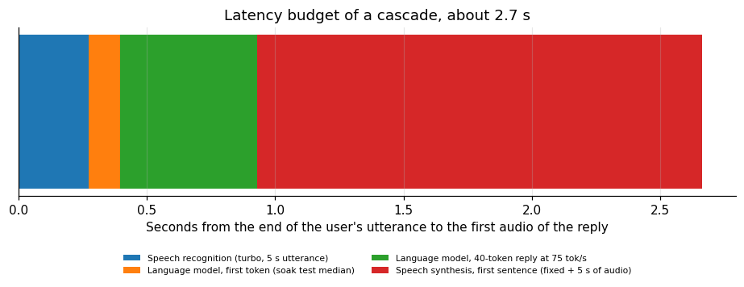

*Figure 12. A cascaded voice assistant against a duplex model.*

Chaining the measured components gives about 0.27 seconds for recognition of a 5-second utterance, 0.12 seconds for the first token of the language model, about 0.53 seconds for a 40-token reply, and 1.7 seconds for synthesizing the first sentence, for a total close to 2.7 seconds from the end of the user's sentence to the first audio of the reply (a streaming design that starts synthesis on the first sentence would shorten the language-model part). Those components were measured on different cards at different times, and the sum is an illustration of orders of magnitude, not a measured latency.

A duplex model avoids the sum, because it listens and speaks at the same time and can start answering before the user finishes. Its price is the real-time constraint: a warm factor of 0.77 on the fastest card, and a stream of that card for every active conversation. The cascade needs less hardware per conversation, because its components run in bursts, and responds more slowly. Which is better depends on what the product needs from a conversation, and that is a design question these numbers inform and do not settle.

## 15. How repeatable are the numbers?

Two cards ran the synthesis test more than once, which allows a look at run-to-run variation. The L40S ran each of the three texts three times, and the 5090 twice.

**Table 15.** How repeatable are the numbers?

|  | Case | Runs | Rtf mean | Rtf min | Rtf max | Spread max over min |
|---|---|---|---|---|---|---|
| L40S | curto | 3 | 0.34 | 0.253 | 0.434 | 1.715 |
| L40S | medio | 3 | 0.068 | 0.063 | 0.076 | 1.206 |
| L40S | longo | 3 | 0.089 | 0.071 | 0.122 | 1.718 |
| RTX 5090 | curto | 2 | 0.328 | 0.185 | 0.472 | 2.551 |
| RTX 5090 | medio | 2 | 0.058 | 0.042 | 0.074 | 1.762 |
| RTX 5090 | longo | 2 | 0.088 | 0.054 | 0.121 | 2.241 |

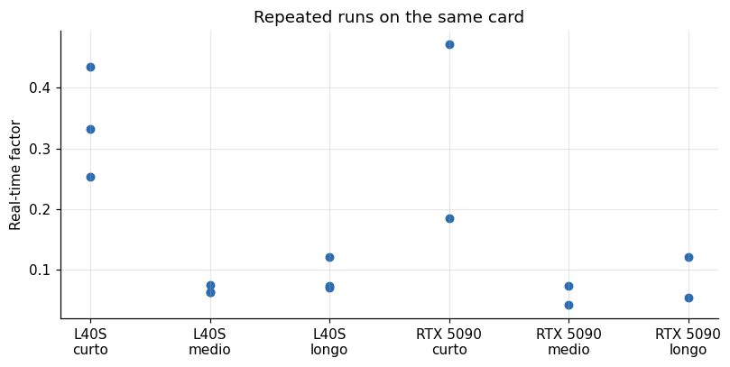

*Figure 13. Repeated runs on the same card.*

The spread between the fastest and slowest of the repeated runs is substantial for the short text. On the L40S the factor ranged from 0.253 to 0.434 for the short text, a ratio of 1.7, and from 0.063 to 0.076 for the medium text, a ratio of 1.2. On the 5090 it ranged from 0.185 to 0.472 for the short text and from 0.042 to 0.074 for the medium one. Different sessions of the same card, on different hosts, produced the variation. A single run of a short phrase cannot rank two cards that differ by less than a factor of two, and the medium and long texts are steadier.

## 16. The cost of the first call, in minutes and money

PersonaPlex makes the cold start easy to quantify, since each card ran the script twice.

**Table 16.** The cost of the first call, in minutes and money

|  | 1 | 2 | Cold over warm | Extra seconds | Price | Extra cost USD |
|---|---|---|---|---|---|---|
| L40S | 239.5 | 32.89 | 7.28 | 206.6 | 0.802 | 0.046 |
| RTX 3090 | 210.1 | 43.06 | 4.878 | 167 | 0.221 | 0.01 |
| RTX 4090 | 211.1 | 36.86 | 5.728 | 174.3 | 0.496 | 0.024 |
| RTX PRO 6000 | 148.9 | 30.62 | 4.863 | 118.3 | 1.513 | 0.05 |

The first run took between 4.9 and 7.3 times as long as the second on the four cards where both are valid (7.3 on the L40S, 5.7 on the 4090, 4.9 on the 3090 and the PRO 6000). The extra time was between 118 and 207 seconds, and cost between 1 and 5 cents of rental. The money is trivial. What is not trivial is the delay: a service that has to start a fresh instance in response to a user waits two to four minutes before it can answer, which is why a voice product must keep warm instances running instead of starting them on demand.

## 17. Quality is the missing axis

Everything above is about speed and cost. A voice product succeeds or fails on quality, and I did not measure it. This section sketches what a minimal quality test would be, so that a reader can add it.

Intelligibility. Synthesize a set of sentences, transcribe them with a strong recognizer, and compute the word error rate against the input text. A good synthesizer in the right language has a rate close to that of real speech read aloud. My round trip failed this test, with 52 percent errors on the medium text, but the setup was wrong: an English reference voice with Portuguese text. The right use of the test is to run it with the reference voice and the text in the same language.

Naturalness. This needs people. A mean opinion score from at least 15 listeners rating 20 sentences per system on a five-point scale is a common approach, and the sample size matters more than the exact scale. Automatic predictors of naturalness exist, and I would use them only to screen.

Speaker similarity. For a cloned voice, the question is whether it sounds like the target. A speaker verification model can score the similarity between the reference and the output, and listeners can rate it.

Reliability on hard inputs. Check numerals, dates, abbreviations, names and code-switching, which are where synthesizers tend to fail in practice.

Stability. Check that the same text synthesized twice gives audio of similar quality, since flow-matching models are stochastic.

None of these costs much in GPU time. The costs are people and care.

## 18. Cloning a voice responsibly

F5-TTS and OpenVoice can reproduce a voice from a few seconds of reference audio. That capability has legitimate uses, including accessibility, localization and creative work, and obvious misuses, including impersonation and fraud. The speed and cost numbers in this article show that cloning is cheap: three to eleven cents of GPU time per hour of generated speech. The barrier to misuse is not compute.

A few practices follow from that. Only clone voices with the explicit consent of the person, and keep the record of that consent. Tell listeners when speech is synthetic. Do not offer cloning of arbitrary voices to the public without verifying that the user has the right to the voice. Check the local law, since rules on voice rights, biometric data and disclosure of synthetic media vary by jurisdiction and are changing. This is a practical caution and not legal advice. I used reference clips supplied with the tools and did not clone any real person's voice for this study.

## 19. How many requests per second can one synthesis worker take?

The fixed-plus-marginal fit turns into a capacity model. If each request takes 1.5 seconds plus 0.047 seconds per second of audio, then a worker that handles one request at a time has a known service time, and a queueing formula gives the wait that users see at a given arrival rate.

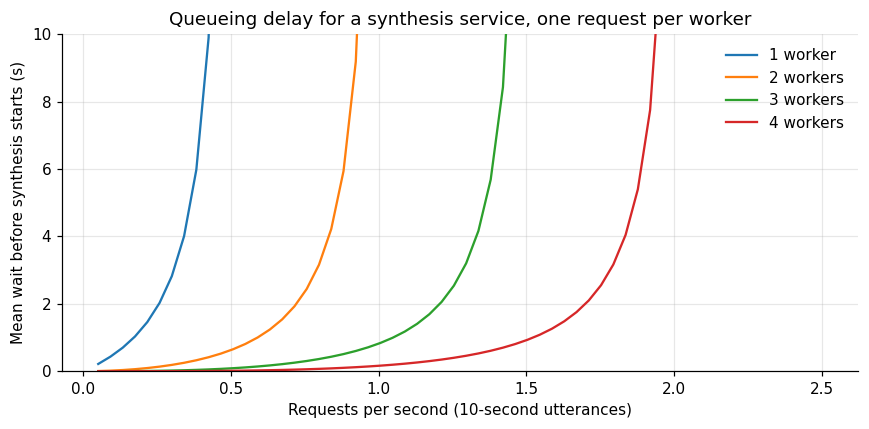

*Figure 14. Queueing delay for a synthesis service, one request per worker.*

**Table 17.** How many requests per second can one synthesis worker take?

| Workers | Requests per s with mean wait under 1s | Utterances per hour |
|---|---|---|
| 1 | 0.18 | 648 |
| 2 | 0.59 | 2,124 |
| 4 | 1.53 | 5,508 |
| 8 | 3.48 | 12,528 |

For a ten-second utterance the service time is about 2.0 seconds, so one worker saturates near half a request per second. With the mean wait held under a second, one worker takes about 0.18 requests per second, two workers about 0.59, four about 1.5 and eight about 3.5, which is 650, 2,100, 5,500 and 12,500 utterances an hour. The numbers rise slightly faster than linearly with workers, which is the benefit of a shared queue. They assume one request per worker at a time and exponential arrival and service times, and F5-TTS may batch several requests on one GPU in a better implementation. I have not tested batching.

The practical reading is a sizing rule. A single GPU with four to eight workers can serve between 1.5 and 3.5 utterances per second, between five and thirteen thousand utterances an hour, which is a lot of voice. The fixed cost of 1.5 seconds dominates the service time for typical short replies, so reducing it by caching the encoded reference voice would raise the capacity of a worker for ten-second utterances, as the next calculation shows, and raise it more for shorter ones.

If the fixed cost fell from 1.5 seconds to 0.5 seconds, the service time for a ten-second utterance would fall from 2.0 to 1.0 seconds and the saturation point of a worker would double, from 0.51 to 1.03 requests per second. That is a hypothetical, since I have not removed the fixed cost, and the model it rests on is a straight-line fit through three text lengths.

## 20. Where this leaves a small team

A small team that wants a voice feature has a practical path. Transcription is a solved cost problem: a turbo-sized recognizer processes eighteen hours of audio per GPU hour for about a cent per hour of audio. Synthesis is cheap in compute and demanding in engineering: the model is fast, the fixed cost per call and the cold start are the things to manage, and quality needs listening tests in the target language. A live full-duplex conversation is the one that needs capacity planning, a dedicated stream per user on a card with real margin below real time, and warm instances.

The costs I measured are small compared with the cost of a person's time to evaluate and integrate any of these. If I were starting a voice product, I would spend the first week on the quality questions in the last section and the second on latency, and I would not worry about the GPU bill until the user count was in the thousands.

## 21. Reading the real-time factor correctly

The real-time factor is the number that every speech vendor quotes, and it is easy to misread in three ways.

It is a ratio of compute to audio for one stream. A factor of 0.06 does not mean the card can serve 16 listeners at once. It means one synthesis of one minute of audio occupied the card for 3.6 seconds. Serving sixteen listeners at the same time needs the card to run sixteen syntheses concurrently, and unless the implementation batches them, they queue. The capacity model in the queueing section is the right way to turn a factor into a concurrency.

It depends on the length of the request. The fixed cost of about 1.5 seconds per call makes the factor of a short phrase many times worse than that of a long paragraph. A factor quoted without a text length is incomplete.

It depends on whether the call is the first. The first call after loading is dominated by setup, and the factor of the first call can be hundreds of times the steady value.

For a full-duplex model the factor has a different meaning: it has to stay below one continuously, because the audio keeps arriving. There the margin matters more than the average, and a card with a factor of 0.92 has less than a tenth of headroom for the rest of the system.

## 22. What to measure next

Four measurements would improve this study at modest cost.

First, concurrency on a single card. Run four or eight synthesis requests at once and measure the throughput. If the implementation batches, the capacity could be several times what the sequential model above predicts.

Second, streaming. A synthesizer that emits audio as it generates it turns the whole-utterance wait into a time to first chunk of a few hundred milliseconds. I measured whole-utterance synthesis only.

Third, quality in the target language, with the listening and recognition tests described in the quality section, using a reference voice that speaks the same language as the text.

Fourth, the conversation model under load. Start several PersonaPlex streams on a card with real-time audio input and find the number at which the factor crosses one. I measured a single offline run per card.

## 23. A short checklist for voice workloads

Decide the shape first: batch narration, live captions or conversation. Choose the card by the factor of the hardest shape you need to serve, with margin. Measure the fixed cost per call and decide whether to cache the encoded reference. Warm the instance before the first user. Keep the first-call outliers out of your averages and report them separately. Test quality in your language with listeners. Record consent for every cloned voice. And price the pipeline end to end, since the speech components in this study cost a small fraction of the language model that usually sits next to them.

## 24. Comparing the four

**Table 18.** Comparing the four

| Tool | Unit | Best GPU | Worst GPU | CPU laptop |
|---|---|---|---|---|
| F5-TTS (medium text, warm) | s per s of audio | 0.056 | 0.14 | – |
| faster-whisper large-v3-turbo | s per s of audio | 0.0547 | – | – |
| PersonaPlex 7B (warm) | s per s of audio | 0.77 | 1.08 | – |
| OpenVoice conversion | s per s of audio | – | – | 0.925 |

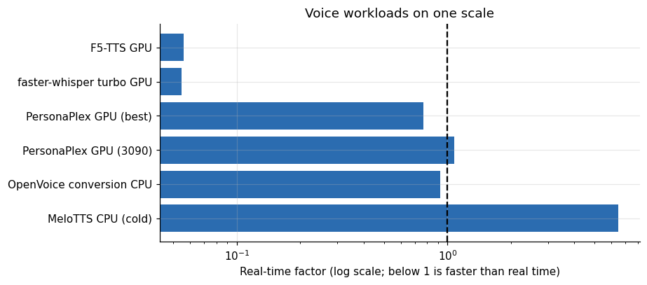

*Figure 15. Voice workloads on one scale.*

On one log scale the pattern is plain. Transcription and synthesis are an order of magnitude faster than real time on a GPU, which makes them cheap. A full-duplex model is close to real time and so needs a capable card and a dedicated stream per user. Voice conversion on a CPU hovers around real time.

## 25. What a voice product costs in GPU time

An example makes the cost concrete. Suppose a voice assistant that answers questions by text-to-speech and transcribes the user with faster-whisper.

If a user speaks with the assistant for 10 hours a month, half of it the assistant's speech and half the user's, then 5 hours of synthesis cost about 0.18 dollars and 5 hours of transcription 0.06 dollars at the 5090's synthesis cost and the 3090's transcription cost, a total of about a quarter of a dollar per user per month. That assumes the GPU is fully utilized, which real services are not; at 35 percent utilization the figure triples to about 70 cents. Next to the language model that writes the answers, the voice parts are small.

A full-duplex model changes the arithmetic, since it occupies a GPU stream for the whole conversation. At a warm real-time factor of 0.77 on the PRO 6000, one conversation hour consumes 0.77 GPU hours of a 1.513 dollar per hour card, about 1.16 dollars, and that is before the model's memory limits how many streams share a card. I did not measure concurrent streams.

## 26. Questions I expect

**Which card should I rent for speech?** For synthesis and transcription any of the cards will do, and the cheapest one with enough memory, the 3090, is the economical choice at about three cents per audio hour. For full-duplex conversation, choose by the real-time factor with margin, which means the PRO 6000, L40S or 5090.

**Is the turbo model good enough?** On a clean 66-second clip it matched the largest model. Test on your audio.

**Can I run these on a CPU?** Voice conversion ran near real time on a laptop CPU. Synthesis and the conversation model are meant for GPUs, and I would not expect interactive speed on a CPU.

**Why is the first call so slow?** Model files are downloaded, loaded into GPU memory and the kernels are prepared. Do all of that before the first user arrives.

## 27. Limitations

The F5-TTS sample is 32 calls on three texts, with cold-start outliers. Quality was not rated. The recognizer's accuracy comes from one 66-second clip, and the round-trip check mixes an English reference voice with Portuguese text. PersonaPlex was timed with an offline script on a single 40-second input, and its second run on the 5090 is an unexplained outlier. The GB10 could not run PersonaPlex or the full set of tools because of missing ARM packages. The CPU measurement is a single warm-up-inclusive run on a laptop, not a server CPU. Prices are marketplace medians, and the GB10 price is the rate at which I list the machine.

## 28. How much it cost

The speech measurements are by-products of the per-card library sweeps and the media sessions, each of which cost between 0.10 and 1.30 dollars of itemized rental inside a campaign of US$ 50.79. The CPU measurement cost electricity on a laptop. The 640-second PersonaPlex run on the 5090 cost about 0.11 dollars of rental, spent on a result I could not use.

## 29. Reproducing this analysis

Attach the dataset `gpu-ai-benchmark-campaign-2026`. Use `libs_runs.csv` for F5-TTS and the round-trip check, `sandbox_metrics.csv` for faster-whisper, `media_gated_runs.csv` for PersonaPlex and `openvoice_cpu_local.csv` for the CPU run. The harness is the file `libs.py` in the repository `voice-stt-tts-bench`.

## 30. Glossary

- **Real-time factor**: seconds of compute per second of audio; below 1 is faster than real time.
- **Word error rate**: the share of words a transcript gets wrong.
- **Full duplex**: listening and speaking at the same time.
- **Voice cloning**: synthesizing speech in the voice of a reference clip.
- **Cold start**: the first call after loading, dominated by setup.
- **Flow matching**: a family of generative models used by F5-TTS.
- **Speaker embedding**: a numeric summary of a voice.

Lucas Rangel
