# What a GPU benchmark campaign really costs

**Lucas Rangel** · [Kaggle writeup](https://www.kaggle.com/writeups/lucasrangelss/what-a-gpu-benchmark-campaign-really-costs) · [Executable notebook](https://www.kaggle.com/code/lucasrangelss/what-a-gpu-benchmark-campaign-really-costs) · [Code and data](https://github.com/LucasRangelSSouza/gpu-ai-benchmark-hub) · [Dataset](https://www.kaggle.com/datasets/lucasrangelss/gpu-ai-benchmark-campaign-2026)

## Abstract

I rented GPUs on the Vast.ai marketplace for about a day and a half to measure how language models, vision models, voice models and video tools behave on eight different cards. The campaign consumed US$ 50.79, which is about R$ 252 at the exchange rate I used (4.9652 reais per dollar). That figure is the amount my credit balance moved by, and it is the only number in this article I trust completely.

The part I can itemize is smaller. The lease ledger, which records each rented instance with its hourly price and its lifetime, explains US$ 27.25 of the spend across 166 rentals. The other US$ 23.54 is a mix of bandwidth fees, disk, time on boots that never became usable, and, for 6 rentals, an end time I never recorded. I cannot split that remainder with evidence, and I say so where it matters instead of inventing a breakdown.

Three findings change how I would plan the next campaign:

- The cheapest hour is rarely the cheapest result. The RTX 3090 cost 0.249 dollars per hour on average, but it consumed 11.8 hours of the campaign, nearly as many as the RTX 5090. The 5090 cost more per hour and produced results faster, yet it still took the largest share of the money (8.54 dollars) because I rented it 39 times.
- Retries dominate. Of 166 ledger rows, only 57 are marked complete and 48 partial, and 43 more are create requests that Vast.ai refused. Every extra boot is a fresh chance to pay for a host with slow downloads.
- Price per measurement varies by a factor of ten between cards, and its ranking is not the ranking of price per hour.

Every table and figure below is computed from the dataset attached to this notebook, and each number in the text names the file it came from.

> **Code and data.** Everything behind this article is public: the code that ran, the curated data, the analysis that regenerates every figure, and tests that pin the conclusions to the data. Repositories: [vast-gpu-benchmark-harness](https://github.com/LucasRangelSSouza/vast-gpu-benchmark-harness). Index of the whole series: [gpu-ai-benchmark-hub](https://github.com/LucasRangelSSouza/gpu-ai-benchmark-hub).

## 1. What I was trying to buy

The campaign was not a single experiment. It was about fifteen small ones, each needing a GPU for a few minutes to an hour: serving a 27 billion parameter language model under load, running object detectors, generating images and short videos, synthesizing speech, reconstructing a 3D scene, and pushing many camera streams through a detector. Each experiment needed suitable hardware, a working software stack, and model files large enough to matter. The model downloads are what make marketplace rental expensive in ways the headline hourly price hides, so I will describe the cost in the order I met it: what the ledger records, what it cannot record, what each card cost per useful measurement, and what I would change.

I should say what this article is not. It is not a comparison of Vast.ai against other clouds, because I did not rent from other clouds. It is not a recommendation to rent a particular card, because the companion articles carry the performance evidence for that. It is an accounting of one campaign by one person, written down while the records were still fresh.

## 2. Where the numbers come from

Three files carry the cost story.

`campaign_totals.json` holds the reconciled totals. I built it from the credit balance before the campaign (49.80 dollars), the single deposit I made during it (6.88 dollars) and the balance when my credit guard stopped the last rental (5.89 dollars). The arithmetic gives 50.79 dollars. This is a balance-sheet number: it contains everything the platform charged, including charges I never saw as line items.

The file is short, and this is all of it, as it sits in the harness repository.

```
{
 "reconciled_total_usd": 50.79,
 "usd_brl": 4.9652,
 "deposit_observed_usd": 6.88,
 "baseline_credit_usd": 49.8,
 "final_credit_usd": 5.89,
 "estimated_hourly_rental_usd": 27.25,
 "estimated_hourly_rental_from_budget_ledger_usd": 21.58,
 "late_sessions_usd": 5.67
}
```

The three balance figures give 49.80 plus 6.88 minus 5.89, which is 50.79. The file stores the itemized rental twice, 21.58 dollars from the budget ledger alone and 27.25 dollars after the late sessions, and the difference between the two is the 5.67 dollars kept under `late_sessions_usd`. The gap that the rest of the article tries to explain is the difference between 50.79 and 27.25, which is 23.54 dollars.

`lease_ledger.csv` has one row per instance I created, 166 in total. Each row carries the card model, the hourly price quoted at rental time, the country of the host, the hours between creation and destruction, the cost I estimated as price times time, the seconds until the instance reported ready, and a status. Two sources feed it. The first is the budget ledger that my watchdog maintained during the first day. The second is the raw event log of lease registrations and closures, which I used to add nine rentals from the last evening that the budget ledger had not yet absorbed when I first built it. The estimate multiplies price by lifetime and ignores bandwidth and storage.

`rental_cost_by_gpu.csv` is the same ledger grouped by card.

There is a gap between these sources, and explaining it honestly is the main job of this article. The ledger is an operator's log written while I was busy keeping a campaign alive. It is not an invoice, and treating it as one would give a false sense of precision.

I found one error in my own first version of this analysis, and it is worth telling because it is the kind of error this data invites. My first itemization used only the budget ledger and showed 21.58 dollars. I then noticed that the raw event log held rentals from the final evening, including a long RTX 5090 session and two RTX PRO 6000 sessions, that were missing from the budget ledger. Merging them raised the itemized figure by 5.67 dollars. A gap that looked like 57 percent of the spend became 46 percent. The lesson is that an unexplained remainder is partly an accounting artifact, and the first thing to do with it is look for records you forgot to merge.

## 3. The balance sheet

The first figure is the simplest one: how much of the money is explained.

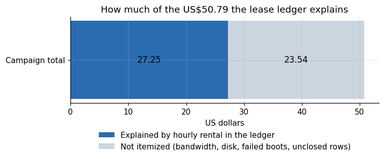

*Figure 1. How much of the US$50.79 the lease ledger explains.*

The ledger covers 54 percent of the spend (27.25 of 50.79 dollars). I want to be careful about the other 46 percent, because it is tempting to blame one cause and the data does not allow that.

Four things are in there, and I know each one happened:

1. Bandwidth. Vast.ai hosts set their own price for download traffic, from zero to about 53 dollars per terabyte across the 2,006 distinct offers my searches returned. The NVFP4 checkpoint of the 27 billion parameter model is 28.2 GiB on disk and the BF16 one is about twice that. I downloaded several variants on several hosts. A host charging 20 dollars per terabyte turns a 50 gigabyte download into one dollar.
2. Disk. I requested 330 gigabytes per instance after an early attempt with 120 gigabytes ran out of space mid-download. Disk is billed for as long as the instance exists, including while it sits idle.
3. Instances that existed but never worked. Some hosts accepted the rental and never reached a usable state. I destroyed them, but they ran for minutes.
4. Rows I did not close. 49 of the 166 ledger rows have the status "running" and no recorded lifetime. For 43 of them the lease log shows that Vast.ai refused the request, so no instance existed. The other 6 were created and never closed in the ledger, so the estimate for them is zero and the money they consumed sits in the gap.

I went back to the 49 rows with the status running and set each against the lease event log, which keeps the answer that Vast.ai gave to every create request. Three consecutive rows of the ledger show the pattern. They were created within two seconds of each other at 12:09 UTC on 26 October, for the same session, and the first two have no lifetime.

```
created_to_destroyed_h,dph_usd,est_cost_usd,gpu,ready_after_s,status,source,started_utc,session_kind
,0.4704,0.0,RTX 5090,,running,budget_ledger,2026-10-26 12:09:18,r5090b
,0.537,0.0,RTX 5090,,running,budget_ledger,2026-10-26 12:09:19,r5090b
0.267,0.6689,0.178,RTX 5090,304.0,complete,budget_ledger,2026-10-26 12:09:20,r5090b
```

The log of the first of those requests holds a refusal, and the log of the third holds an acceptance. Lines are cut where the text continues with an identifier, and ended with an ellipsis.

```
{"t_utc": "2026-10-26T12:09:19.762+00:00", "t_mono_ns": 1058446437000000, "event": "create_response", "resp": {"success": false, "error": "invalid_args", "msg": "error 404/3603: no_such_ask  Instance type by id…
{"t_utc": "2026-10-26T12:09:22.415+00:00", "t_mono_ns": 1058449093000000, "event": "create_response", "resp": {"success": true, "new_contract…
```

I repeated the match for every ledger row, using the start time and the session name. The match is mine and the harness did not keep it, so I read the counts as a reading of the logs.

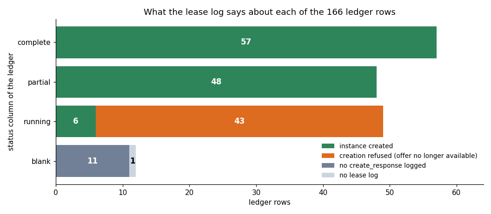

*Figure 2. Lease log outcome of the 166 ledger rows, grouped by ledger status: most rows marked running are create requests that Vast.ai refused.*

Of the 49 rows marked running, 43 are requests that Vast.ai refused with the message that the offer was no longer available, so no instance existed and there was no lifetime to record. Only 6 of the 49 were created and have no closing record. The 12 rows with a blank status are rows for my own GB10 and requests whose log has no create response. A refused request creates no instance, so those rows carry no hours and no cost, and they cannot be part of the 23.54 dollars. They do change what the ledger counts: it counts attempts, and 12 of the 39 RTX 5090 rows are refused attempts.

A fifth item is the last rental of the campaign. A final attempt to generate a 3D model with a research tool ran on an RTX 4090 until my credit guard destroyed it when the balance fell to 5.89 dollars. It cost about 0.65 dollars, which I know only from the balance drop, and it produced no 3D output. I entered it in the ledger with that balance-based cost.

I cannot say how the gap divides among these causes, because the platform's invoice did not give me a per-instance breakdown and I did not record download volume per host. The lesson is operational: write the lifetime and the traffic of every instance at destruction time, automatically. The harness in the companion repository `vast-gpu-benchmark-harness` records lifetime but not traffic, and that missing column is exactly why the gap stays open.

## 4. The campaign over time

The ledger has creation timestamps, so I can show how the itemized spend accumulated.

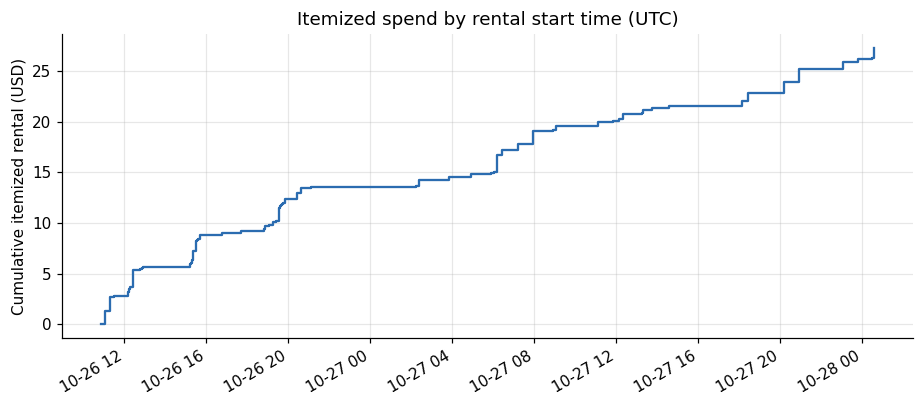

*Figure 3. Itemized spend by rental start time (UTC).*

The first rental in the ledger started on 26 October 2026 at 10:50 UTC and the last registered one on 28 October at 00:35 UTC. By 06:00 UTC on the 26th the cumulative itemized spend was 2.82 dollars, by 18:00 it was 13.54 dollars, and by 06:00 on the 27th it was 20.06 dollars. The curve is steepest in the first twelve hours, when I ran the broad sweeps over many cards at once, and flattens whenever I stopped to read results. It steepens again on the evening of the 27th, when the long-context, soak and camera studies ran on the RTX 5090 and the RTX PRO 6000.

That shape matches how the work felt. Breadth was cheap and fast. Depth was slow: a 35 minute stability test costs more than a hundred 20 millisecond detector calls, and it is also the only way to learn whether a server leaks memory over time.

## 5. Rental cost by card

Which cards used the money? This table answers it from the ledger.

**Table 1.** Rental cost by card

|  | Rentals | Hours | Cost | Mean price |
|---|---|---|---|---|
| RTX 5090 | 39 | 12.44 | 8.536 | 0.627 |
| RTX PRO 6000 | 15 | 3.668 | 5.713 | 1.659 |
| RTX 4090 | 29 | 6.22 | 4.046 | 0.548 |
| L40S | 10 | 4.907 | 3.925 | 0.801 |
| RTX 3090 | 30 | 11.8 | 2.966 | 0.249 |
| H100 NVL | 1 | 0.462 | 1.296 | 2.803 |
| A100 PCIE | 1 | 0.647 | 0.432 | 0.668 |
| A800 PCIE | 1 | 0.251 | 0.134 | 0.535 |
| RTX 3060 | 13 | 1.545 | 0.104 | 0.073 |
| GTX 1080 Ti | 14 | 1.446 | 0.096 | 0.063 |
| GTX 1650 | 1 | 0.119 | 0.006 | 0.048 |
| GB10 | 3 | 0 | 0 | 0.449 |

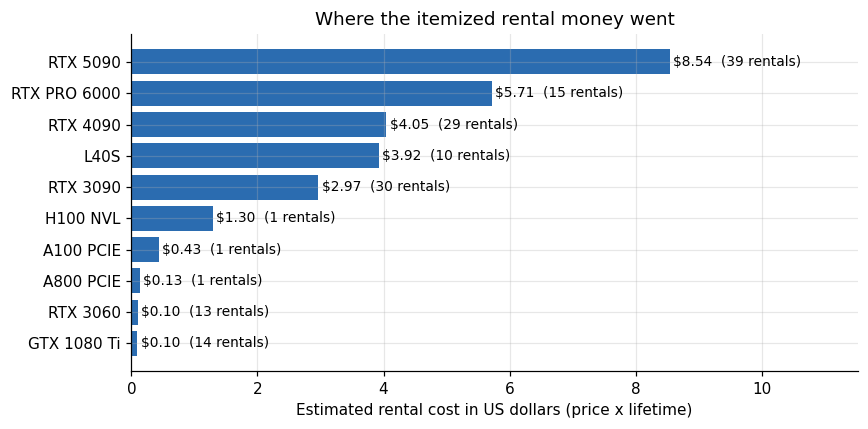

*Figure 4. Where the itemized rental money went.*

The RTX 5090 took the largest share at 8.54 dollars over 12.44 hours and 39 rentals. The RTX PRO 6000 came second at 5.71 dollars with only 15 rentals and 3.67 hours, which reflects its mean price of 1.66 dollars per hour. The L40S used 3.93 dollars over 4.91 hours, the RTX 4090 used 4.05 dollars over 6.22 hours, and the RTX 3090 used 2.97 dollars over 11.8 hours, the most hours of any card. The H100 NVL appears once, for 1.30 dollars and 0.46 hours, because I decided early that its price of 2.80 dollars per hour was not worth a full campaign.

The cheap cards barely register. The RTX 3060 ran 13 rentals for 0.10 dollars and the GTX 1080 Ti ran 14 for 0.10 dollars. They were useful for learning which software fails on old hardware, and together they cost less than a cup of coffee.

A caveat on counting rentals: a rental is a created instance, not a successful session. The 5090 count of 39 includes 12 create requests that Vast.ai refused, and instances that failed to boot or that I replaced because the host reached the model repository slowly. The sections below show how often that happened.

## 6. What each card bought

Dollars mean little without the result they bought. This section pairs each card's spend with the most expensive single piece of evidence it produced. It is a summary of the companion articles, not a replacement for them.

The RTX 5090 took 8.54 dollars, the largest share, and bought three things. It produced the stability test: 4,051 requests over 34.8 minutes against a quantized 27 billion parameter model, with no failed request, a median time to first token of 0.12 seconds and a 95th percentile of 0.21 seconds. It produced the camera study, in which 32 full-resolution streams each received 4.90 inferred frames per second while 64 streams fell to 1.77. And it produced a negative result that was worth money to know: with only 32 gigabytes of memory it cannot load the NVFP4 checkpoint of the 27 billion parameter model, and with the 4-bit AWQ build it served one long-context agent session at a median 11.35 seconds to first token. A card that costs 0.63 dollars per hour can still be the wrong card for a given product, and renting it for an hour told me so for under a dollar.

The stability test is in `soak_requests_5090_awq.csv` for the requests and `soak_gpu_5090.csv` for the card. This is what the two files say.

**Table 1a.** Stability test on the RTX 5090, 4-bit AWQ build of the 27 billion parameter model

| Measure | Value |
|---|---|
| Requests with status 200 | 4,051 of 4,051 |
| Test length | 34.8 minutes |
| First-token time, median and 95th percentile | 0.12 s and 0.21 s |
| First-token time, slowest request | 11.4 s (request 1, a long document of 10,420 prompt tokens) |
| GPU utilization, mean of 70 samples taken every 30 s | 85.6 percent |
| Video memory in use, highest sample | 32,092 MiB |
| Power draw, highest sample | 464 W |

The slowest first token of the whole test belongs to the first request, 11.4 seconds. The next slowest took 3.7 seconds, and 41 of the 4,051 requests took more than one second. The card held 32,092 MiB at the highest sample, against 32,607 MiB of memory on the card.

The RTX PRO 6000, with 5.71 dollars, bought the opposite answer. On the same long-context agent workload it served requests at a median 0.81 seconds to first token, and its NVFP4 configuration reached 1,466 output tokens per second at 32 concurrent users (1,341 at 128 users) with no errors. Its price per hour was 2.6 times the 5090's mean, and for this workload it was the only card that kept the first-token time under a second; the 5090 completed the same turns, 16 times more slowly. Cost per hour and cost per working result point in different directions here, and the second is the one that decides a product.

The long-context test is in `longctx_runs.csv`, and this is the part of it that the comparison rests on: the same agent workload on the two cards, with 1, 4 and 8 sessions running side by side and 8 turns per session, 104 turns in all, of 16,439 to 24,990 prompt tokens each.

**Table 1b.** Long-context agent workload on the RTX 5090 and the RTX PRO 6000

| Agent sessions side by side | RTX 5090, AWQ: wall seconds | RTX PRO 6000, NVFP4: wall seconds | Ratio |
|---|---|---|---|
| 1 | 82.9 | 12.9 | 6.4 |
| 4 | 135.7 | 22.9 | 5.9 |
| 8 | 527.3 | 33.2 | 15.9 |
| Median first-token time over 104 turns, seconds | 11.35 | 0.81 | 14.0 |
| 95th percentile first-token time, seconds | 43.4 | 4.6 | 9.4 |

The 16 times in the paragraph above is the wall time of the 8-session run, 527.3 seconds against 33.2. Per turn the median first-token time was 14.0 times longer on the 5090, and the 95th percentile 9.4 times longer. Every one of the 208 turns returned status 200 on both cards, so the difference is in time and not in errors.

The L40S, at 3.93 dollars, was the card for FP8. Its plain FP8 configuration reached 337.5 tokens per second at 32 users. It could not hold the draft model for speculative decoding at long context with the settings I tried, which I logged as a finding rather than a failure.

The H100 NVL, rented once for 1.30 dollars, reached 1,402 output tokens per second in FP8 with speculative decoding at 32 users (1,312 at 64 users) and no errors. I excluded it from the rest of the campaign. At 2.80 dollars per hour its throughput per dollar was not better than the PRO 6000's, and a second session would have cost another seven to nine dollars I did not have.

The RTX 4090 and RTX 3090, at 4.05 and 2.97 dollars, were the workhorses for tools: detectors, segmenters, speech and image generation, and the 9-billion-parameter language model comparisons. Their serving numbers for the larger model are modest, with the plain configuration peaking near 296 tokens per second on the 4090 and 257 on the 3090. They are cheap places to learn that something works and expensive places to learn how much load it takes.

The A100, rented once for 0.43 dollars, produced 33 usable rows. The cheap Pascal and Ampere cards, the 1080 Ti and the 3060, produced compatibility facts: which libraries refuse to run on them. Those facts cost ten cents each.

The GB10 is an ARM desktop machine I own. I list it because it appears in the ledger with a price per hour of 0.449 dollars, which is the price at which I list the machine, not a cost I paid. It produced 69 rows. Its serving throughput was 215 to 221 tokens per second in FP8 and NVFP4 with speculative decoding at 32 users, which is competitive with a 3090 on this workload for zero marginal rental cost.

Reading across these entries, the pattern is that expensive cards bought sharp answers to expensive questions (can this serve long contexts?), and cheap cards bought breadth. A campaign that had only used the cheap cards would have cost less than ten dollars and would have missed the one finding that decides what hardware a product needs.

## 7. What an hour costs depends on the card, and on the host

Price per hour is not one number per card. It is a distribution, because on Vast.ai each host sets its own price.

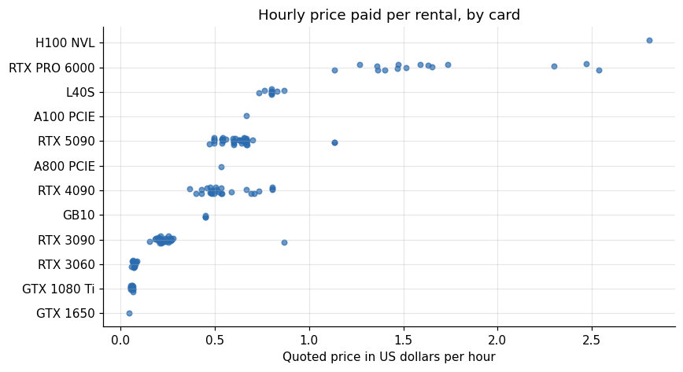

*Figure 5. Hourly price paid per rental, by card.*

**Table 2.** What an hour costs depends on the card, and on the host

|  | Min | Median | Max | Count |
|---|---|---|---|---|
| GTX 1650 | 0.048 | 0.048 | 0.048 | 1 |
| GTX 1080 Ti | 0.056 | 0.065 | 0.069 | 14 |
| RTX 3060 | 0.059 | 0.07 | 0.088 | 13 |
| RTX 3090 | 0.154 | 0.221 | 0.868 | 30 |
| GB10 | 0.449 | 0.449 | 0.449 | 3 |
| RTX 4090 | 0.367 | 0.496 | 0.804 | 29 |
| A800 PCIE | 0.535 | 0.535 | 0.535 | 1 |
| RTX 5090 | 0.47 | 0.609 | 1.135 | 39 |
| A100 PCIE | 0.668 | 0.668 | 0.668 | 1 |
| L40S | 0.735 | 0.802 | 0.869 | 10 |
| RTX PRO 6000 | 1.136 | 1.513 | 2.536 | 15 |
| H100 NVL | 2.803 | 2.803 | 2.803 | 1 |

The spread inside one card is large. RTX 3090 rentals ranged from 0.154 to 0.868 dollars per hour, with a median of 0.221 and a mean of 0.249. The RTX 5090 ranged from 0.470 to 1.135 with a median of 0.609. The RTX 4090 ranged from 0.367 to 0.804 with a median of 0.496. The RTX PRO 6000 is the widest case: 1.136 to 2.536 dollars, median 1.513. The L40S is the tightest, from 0.735 to 0.869, which probably reflects that fewer hosts offer it and they price alike.

The practical point is that a card's list price tells you little. When I picked an offer I sorted by estimated total cost, meaning hourly price plus the cost of downloading the models for that experiment at the host's bandwidth price. A host charging 0.50 dollars per hour with free bandwidth beat a 0.40 dollar host that charged 30 dollars per terabyte for any experiment downloading more than a few gigabytes.

The download price is a field on every offer, so I counted it. The offers file of the campaign holds 2,006 distinct offers returned by my searches, and the lease manifests hold the offer behind each of the 110 instances that were created. The field is a price per gigabyte, and I multiplied it by 1,024 to get a price per terabyte.

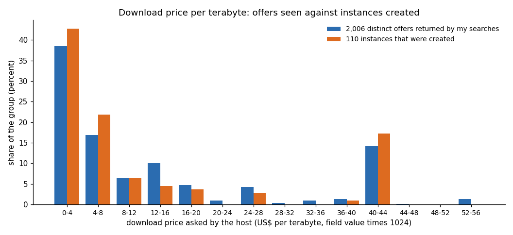

*Figure 6. Download price asked by the host, as a share of the 2,006 offers my searches returned and of the 110 instances that were created.*

The median offer asked 5.33 dollars per terabyte, 52 percent of the offers asked 6 or less, and the highest asked 53.33. Among the instances that were created the median was 4.00 and the highest 40.96, and 20 of the 110 asked more than 30. I did not log why I accepted each of those 20. At 40.96 dollars per terabyte, one download of the 28.2 GiB NVFP4 checkpoint costs about 1.13 dollars, against 0.11 at 4.00.

Across all paid rows the median hourly price is 0.497 dollars and the mean is 0.557. The cheapest rows are the 3060, 1080 Ti and 1650 at roughly 0.05 to 0.09 dollars per hour, which I used for small software compatibility tests.

## 8. Time to ready

An instance is billed from creation, not from the moment it is usable. The ledger records the seconds until the instance reported ready for 57 rows.

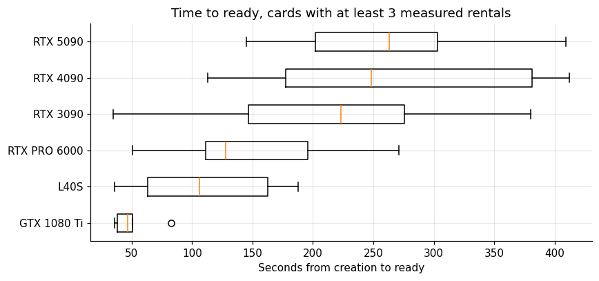

*Figure 7. Time to ready, cards with at least 3 measured rentals.*

The median wait is 178 seconds and the maximum is 412 seconds. Three minutes sounds small, for two reasons it is not. First, ready means the container started and answered over SSH. It does not mean the model is downloaded or the server is warm, and those steps came afterwards, taking from a couple of minutes on a fast host to the better part of an hour on a slow one. Second, these 57 rows are the ones that did report ready. Hosts that never became ready have no ready time and so are absent from this plot. Survivorship hides the worst cases.

By card, the L40S rentals were ready fastest (median 106 seconds across 10 rentals), then the RTX PRO 6000 at 128 seconds across 5, the 3090 at 223 seconds across 16, the 4090 at 248 across 6, and the 5090 at 263 seconds across 12. With samples this small I would not read the order as a property of the card. It reflects the hosts that happened to carry that card during that week.

## 9. Where the hosts were

Because bandwidth and distance to the model repository drive download time, host location matters more than it seems.

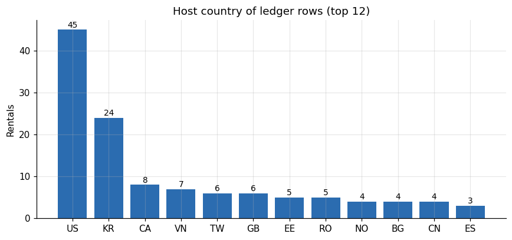

*Figure 8. Host country of ledger rows (top 12).*

The United States hosted 45 of the rentals with a recorded country and South Korea 24, followed by Canada with 8 and Vietnam with 7. Taiwan, the United Kingdom, Estonia and Romania follow with 5 or 6 each. I preferred European and North American hosts when offer prices were similar, because Hugging Face downloads from some Asian hosts ran at a fraction of the speed. That preference lives in the harness as a "west first" sort. It is a heuristic, not a measured law. South Korea supplied 24 rentals and several were fast and cheap. The ledger holds no per-host throughput, so I cannot show the effect of geography directly. What I can say is that early on I rejected hosts whose measured download speed fell below a threshold, and every rejected rental still cost minutes of billing.

The nine rows I merged from the event log have no country, because that log did not store it. That is why the country counts above sum to fewer than 164.

## 10. Cost by kind of session

A ledger row carries the name of the session that created it. Grouping by the kind of work shows where the itemized money went by purpose rather than by card.

**Table 3.** Cost by kind of session

|  | Rentals | Cost |
|---|---|---|
| Full per-card manifest | 47 | 13.71 |
| LLM serving and capability runs | 63 | 10.62 |
| Library timing sweeps | 27 | 2.74 |
| CPU sandbox tools | 29 | 0.18 |

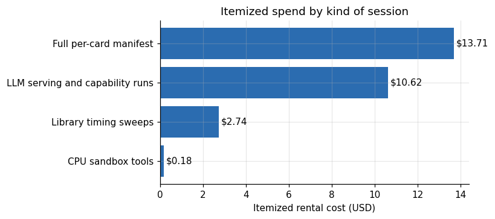

*Figure 9. Itemized spend by kind of session.*

The full per-card manifests, which ran the whole planned set of experiments on one card in one sitting, took 13.71 dollars across 47 rentals. The LLM serving and capability sessions took 10.62 dollars across 63. The library timing sweeps took 2.74 dollars across 27, and the CPU-only sandbox sessions took 0.18 dollars across 29. The sandbox number is the surprise. Twenty-nine rentals tested whether dozens of tools install and run, and the whole exercise cost less than 20 cents. Cheap CPU instances are the right place to discover that a tool cannot be installed, before a GPU hour is spent on it.

## 11. Cost per measurement

A price per hour describes the supply. The demand side is what one useful number cost. I define a measurement as one row in the two result files, `libs_runs.csv` for tool timings and `llm_serving.csv` for serving load tests, counting only runs that completed. For the serving file that means the rows flagged as valid runs; twelve rows from engine comparisons in which the server never started are excluded.

**Table 4.** Cost per measurement

|  | Rows | Cost | USD per row |
|---|---|---|---|
| A100 | 33 | 0.432 | 0.013 |
| H100 NVL | 27 | 1.296 | 0.048 |
| L40S | 71 | 3.925 | 0.055 |
| RTX 3090 | 52 | 2.966 | 0.057 |
| RTX 4090 | 66 | 4.046 | 0.061 |
| RTX PRO 6000 | 75 | 5.713 | 0.076 |
| RTX 5090 | 42 | 8.536 | 0.203 |

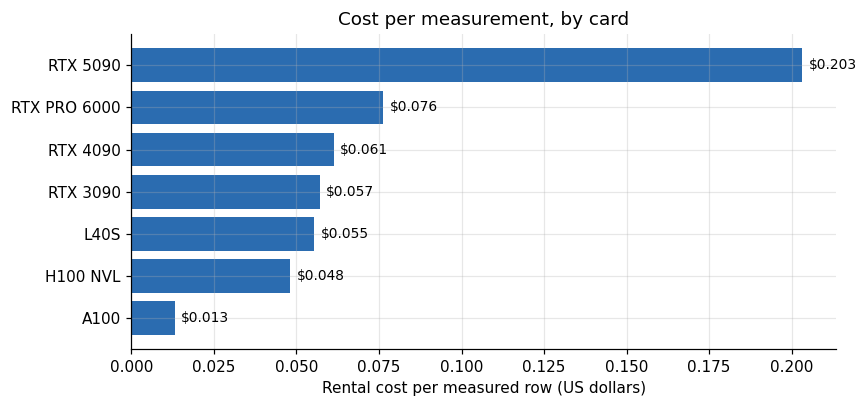

*Figure 10. Cost per measurement, by card.*

On itemized rental cost alone, the A100 produced measurements most cheaply at 0.013 dollars per row, based on 33 rows from one 0.65 hour rental. The H100 NVL came to 0.048 dollars per row (27 rows), the L40S to 0.055 (71 rows), the RTX 3090 to 0.057 (52 rows) and the RTX 4090 to 0.061 (66 rows). The RTX PRO 6000 reached 0.076 (75 rows). The RTX 5090 was the most expensive per row at 0.203 dollars, with 42 rows against 8.54 dollars of rental.

Two warnings keep this from being a ranking of the cards.

A row is not a unit of equal value. A row from a 60 minute soak test and a row from a 20 millisecond detector call are both one row, so the metric favors experiments that emit many small rows.

The 5090 rentals went disproportionately to long studies, a 35 minute stability test and a camera study, whose output is a handful of summary rows plus large raw files this table does not count. Its cost per row looks bad because its rows are few and heavy. Treat the table as a diagnostic of my workload, not as a verdict on the hardware.

## 12. What the incomplete rows teach

The ledger status splits into 57 complete rentals, 48 partial ones and 49 that never received a closing record.

**Table 5.** What the incomplete rows teach

|  | Rows | Hours | Cost |
|---|---|---|---|
| complete | 57 | 37.58 | 23.3 |
| partial | 48 | 5.93 | 3.96 |
| running | 49 | 0 | 0 |

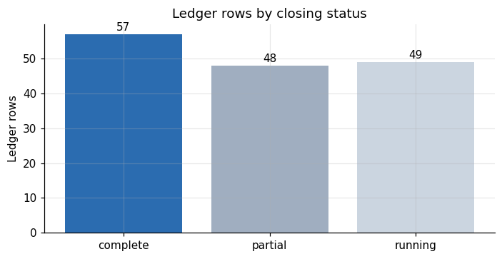

*Figure 11. Ledger rows by closing status.*

The 57 complete rows account for 37.58 hours and 23.30 dollars. The 48 partial rows account for 5.93 hours and 3.96 dollars. Partial means the instance lived and produced something but did not finish its planned script: a host with too little disk, a package that did not install on that hardware generation, a model that did not fit in memory. Those are not wasted in the research sense, because several became findings (the 32 gigabyte RTX 5090 cannot load the NVFP4 27 billion parameter checkpoint, for example, and that is a measured result). They are wasted in the budget sense, because I paid for them and did not get the number I had planned to collect.

The 49 "running" rows have no recorded hours and no cost. For 43 of them the lease log shows a refused request, which costs nothing. The other 6 hide an unknown amount of money. If each cost as much as the average partial row (3.96 dollars over 48 rows, 0.08 dollars each), they would add about half a dollar. That is a guess, marked as one. It cannot explain the whole gap, so bandwidth and disk billing must account for most of it.

## 13. A budgeting rule I would use next time

From this campaign I can write a rule of thumb, with its error bars stated. The itemized hourly rental was 52 percent of the total spend. If that is typical of model-download-heavy work, the planning multiplier is about 1.9: for every dollar of hourly rental I expect to pay close to two dollars all in. A multiplier from one campaign is a weak estimate, and the true value depends on how much is downloaded. For a workload that downloads nothing new, such as repeating a benchmark on a warmed image, I expect it to fall toward 1.2 or 1.3.

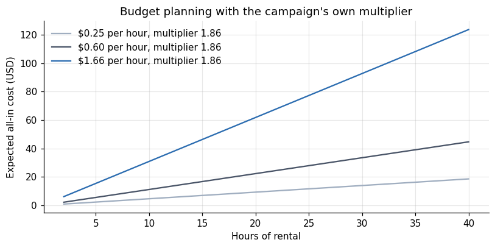

*Figure 12. Budget planning with the campaign.*

At 0.60 dollars per hour, close to the 5090's mean price, 20 hours of rental would cost 12 dollars on the itemized estimate and about 22 dollars all in at a multiplier of 1.86. The gap between those numbers is the reason I kept running short of credit while believing I had enough.

## 14. The mistakes that cost money

An operator's account is useful here, because the ledger shows the outcome and the notes show the cause. These are the incidents I can name. Each is from my operator log, which is not part of the dataset, so none of them carries a file tag.

First, the 120 gigabyte disk. An early session requested 120 gigabytes of disk. A 27 billion parameter checkpoint, a draft model for speculative decoding and a Python environment did not fit, and the download failed late, after I had paid for the first twenty minutes. I raised the request to 330 gigabytes. Larger disks cost more per hour, but a rental that cannot finish costs everything and returns nothing.

Second, the watchdog race. I wrote a watchdog that destroyed any instance labeled for the campaign that no running script owned. It destroyed a fresh instance in the seconds between creation and the first registration. The fix was a 120 second grace period. The bug cost one rental plus the time to detect it.

The grace period is in the watchdog code. The comment is in Portuguese. It says that the lease is registered only after the create call, that destroying an instance before that kills a healthy session, and that this happened on 27 October at 08:40, 1.5 seconds after the instance was created. Lines were selected from the file.

```
    # carencia de 120 s: o lease so e registrado depois do create; destruir antes disso mata sessao saudavel (aconteceu 27/10 08:40, 1,5 s apos criar)
            first = seen.setdefault(iid, time.time())
            if time.time() - first >= 120:
                log.write({"event": "wd_orphan_destroyed", "instance_id": iid, "http": code})
```

The ledger has a row for an RTX 3090 created at 08:40:40 on 27 October. It is one of the 6 created rows with no closing record, and its lease log stops after the create response. That fits the comment, but I did not prove that it is the same event.

Third, preflight checks without redirects. My preflight script tested whether a host could reach the model repository using `curl` without following redirects. Good hosts answered with a redirect and failed the check. I discarded several perfectly fine hosts, then added the redirect flag and restored them. This cost no money directly. It cost options: I rented dearer offers because the cheaper ones had been wrongly blacklisted.

Fourth, the camera step that ran an hour too long. A batch harness for the camera study consumed about an hour of 5090 time before I noticed that it counted repeated frames and so produced inflated numbers. I killed it and rewrote the harness to count only unique frames. The wasted hour cost about 0.60 dollars. Its real cost was the false result I nearly published.

Fifth, the guard. A separate process destroyed any campaign instance when the credit balance fell below a floor. I set the floor to preserve a few dollars for the storage of a personal ARM machine I own. The guard never destroyed anything, but it ran in the background for the second half of the campaign, and knowing it was there changed how aggressively I launched things.

The guard is a short loop. These are its working lines, selected from the file: it reads the credit, compares it with the floor given on the command line, and destroys every instance whose label starts with eco-.

```
        c = vast.user()["credit"]
        if c < lim:
                if str(x.get("label") or "").startswith("eco-"):
                    print(f"GUARDA: saldo {c:.2f} < {lim:.2f}: destruindo {x['id']} ->", vast.destroy(x["id"]), flush=True)
```

The floor is an argument, so the code does not say which value I used. The loop checks every 45 seconds, which means an instance can run for up to that long after the balance crosses the floor.

Sixth, the platform's rate limits. HTTP 429 responses killed local runners on several occasions, leaving remote instances alive with no local process watching them. Each such event required a manual sweep, which is why the harness has an orphan sweep.

The client that talks to the platform retries read requests that come back with 429 or a server error. These are the lines of that helper, selected from the file.

```
def _get(url, **kw):
    for i in range(12):
        if r.status_code in (429, 500, 502, 503):
            time.sleep(min(60, 4 * (i + 1)) + (hash(url) % 5))
```

The helper tries 12 times, with a sleep that grows by 4 seconds per attempt up to a cap of 60 seconds, plus a few seconds that depend on the URL. After the twelfth failure it raises. The create call has no such loop in this file. I did not keep a log of which call failed on each of the incidents, so I cannot say from the data which of the two killed a runner.

None of these is exotic. All are ordinary failures of automation that pays by the minute.

## 15. Comparing against buying hardware

A reader may ask whether 50 dollars is cheap. For a measurement campaign across eight cards it is, because buying them would cost thousands. The comparison that matters for a team that benchmarks regularly is different, and I lack the data to settle it. A single RTX 4090 costs less to own than the sum of my rentals, but it would have measured exactly one of the eight cards. The value of renting was breadth: I learned that the 32 gigabyte 5090 cannot serve the 27 billion parameter model at NVFP4 precision, that the 96 gigabyte PRO 6000 can serve long agent sessions, and that old cards fail on modern software. Those answers came from hardware I will never own.

The comparison reverses for sustained workloads. A card that runs at high utilization for months is cheaper to own than to rent. At the campaign's mean prices, a 24-hour-a-day year costs about 2,180 dollars on an RTX 3090 and about 14,500 dollars on an RTX PRO 6000. Those figures are arithmetic on ledger means, not a market quote.

I did not rent anything continuously. The numbers only show the order of magnitude at which renting stops being the sensible option.

## 16. What I would change

Based on the above, the next campaign would differ in five ways.

Log everything at destruction. For each instance: lifetime, hourly price, bytes downloaded, the host's price per terabyte, and the last script stage reached. This turns the unitemized remainder into a table.

Pin the image. Many partial rentals failed on package installation. A prebuilt image with the serving stack would turn minutes of setup, which are billed in fact, into seconds, at the price of maintaining the image.

Cache models in object storage near the hosts. Several rentals downloaded the same checkpoint from Hugging Face over a slow link. A mirror in a region with cheap egress would have cut the bandwidth bill on repeat runs, though I have not priced it.

Decide the sample size before renting. For the cheap cards I collected more rows than I needed. For the expensive ones I sometimes had one run and no repeat, so a single noisy host could define the result. The companion articles flag every measurement that rests on one host.

Rent for questions, not for cards. The most valuable rentals were the ones where I arrived with a written question and an expected number. The least valuable were the ones where I rented a card and decided afterwards what to run on it.

## 17. Questions I expect

**Could the campaign have cost less?** Probably by a third. The itemized partial rentals cost 3.96 dollars, and the first day's disk and preflight mistakes added to the unitemized remainder, so the reducible waste I can document is under 20 percent of the total. A larger saving would have required skipping the expensive cards, which would have removed the findings that mattered most. I count a third as a plausible ceiling for an operator who had done it before.

**Which single change saves the most?** Recording download volume per host. It would convert the largest unknown in the budget into a number, and every other decision, from region preference to mirroring checkpoints, would then rest on data instead of on my recollection of which hosts felt slow.

**If I had ten dollars, what would I run?** On this evidence I would rent one RTX PRO 6000 for two hours at its median price of 1.51 dollars per hour, which is about three dollars, apply the multiplier of 1.86 to get roughly six dollars all in, and spend the remainder on a repeat of the camera study on a second host to see whether the 32-stream result survives a different CPU. The camera result rests on a single host, and that is the weakest high-value number I produced.

**Is the multiplier transferable?** No. It describes how I worked: large downloads, many hosts, a few mistakes. Treat 1.86 as a warning that the hourly price understates the bill, and measure your own ratio on the first day.

**Why publish the mistakes?** Because the money lost to them is the most reusable part of the story. A table of GPU prices ages in a month. The failure modes of automation that bills by the minute do not.

## 18. Limitations

The reconciled total is exact only as a balance difference. The deposit I made could have carried a small fee that I did not separate. The ledger's cost column is an estimate by construction. Hourly prices were quoted at rental time and I did not log later changes, though a running instance keeps its rate. Country is the host's declared location and is missing for the rows merged from the event log. The ready time exists for only 57 rows and excludes hosts that never became ready. Cost per row counts every row equally. The cost of the last rental is a balance difference, not a price times time estimate. And the whole study is one campaign by one person over about a day and a half in October 2026, on a marketplace whose prices move.

The limitations above can be read claim by claim, with the evidence each one rests on.

**Table 5a.** Claims of the article, their evidence and their caveats

| Claim | Evidence | Caveat |
|---|---|---|
| The campaign consumed US$ 50.79 | `campaign_totals.json`: 49.80 plus 6.88 minus 5.89 | Exact only as a balance difference; a fee on the deposit was not separated |
| The ledger explains US$ 27.25 | `lease_ledger.csv`, price times lifetime | Ignores bandwidth and storage; 6 created rentals have no closing record |
| Bandwidth and disk billing account for most of the other US$ 23.54 | Inference only: no traffic was logged per instance | The split is unknown |
| Refused requests are not part of the gap | Lease log: 43 refusals among the 49 running rows | Match by start time and session name, made by me |
| The A100 was cheapest per row and the RTX 5090 dearest | `libs_runs.csv` and `llm_serving.csv` | A row is not a unit of equal value; the A100 figure is one rental |
| The all-in multiplier is 1.86 | 50.79 divided by 27.25 | One campaign, large downloads; not transferable |

## 19. How much it cost

This article is about cost, so the section is short. The campaign consumed US$ 50.79, which is R$ 252 at 4.9652. Producing this article added nothing to that figure: it analyses data already collected and runs on Kaggle's free notebook environment. The only direct cost of the article series is my time.

## 20. Reproducing this analysis

Attach the dataset `gpu-ai-benchmark-campaign-2026` to a Kaggle notebook and run the cells in order. The setup cell loads every CSV. If you run it elsewhere, set the `LOCAL_DATA` environment variable to the folder holding the files. The code in this notebook is the code that produced the figures, and nothing is edited by hand.

The companion repositories are published under the GitHub account LucasRangelSSouza. The harness repository contains the scripts that created, watched and destroyed the instances, with the hardcoded credential paths replaced by environment variables.

## 21. Glossary

- **Lease or rental**: one instance created on Vast.ai.
- **Ready time**: seconds from creation until the instance accepted an SSH connection.
- **All-in multiplier**: the reconciled total divided by the itemized hourly rental estimate.
- **Row**: one successful measurement record in the result files.
- **NVFP4**: a 4-bit floating point weight format supported by recent NVIDIA GPUs.
- **Speculative decoding**: a technique where a small draft model proposes tokens that the large model verifies.

Lucas Rangel
