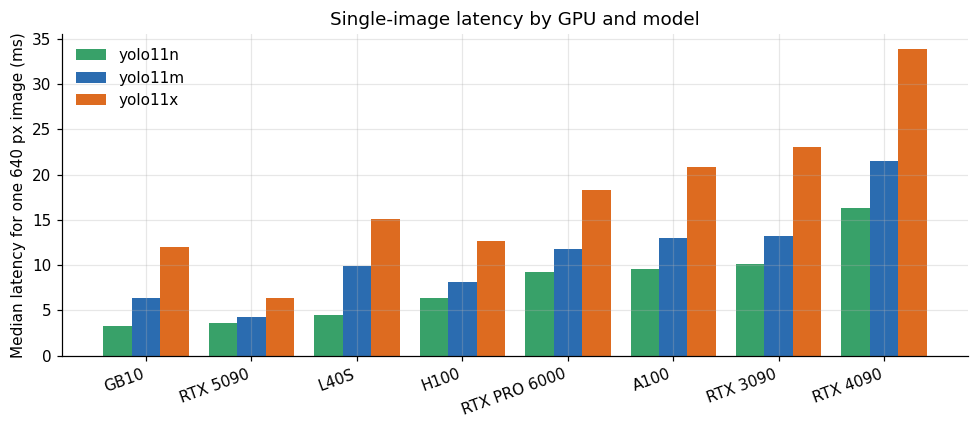
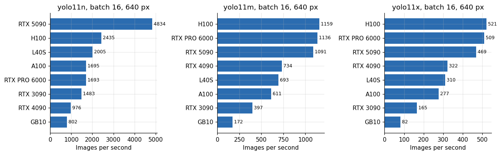
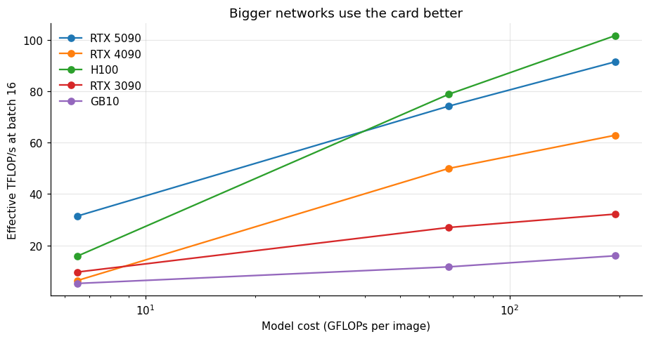
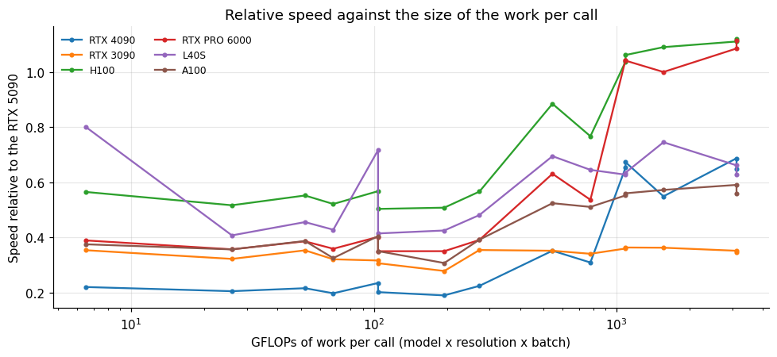
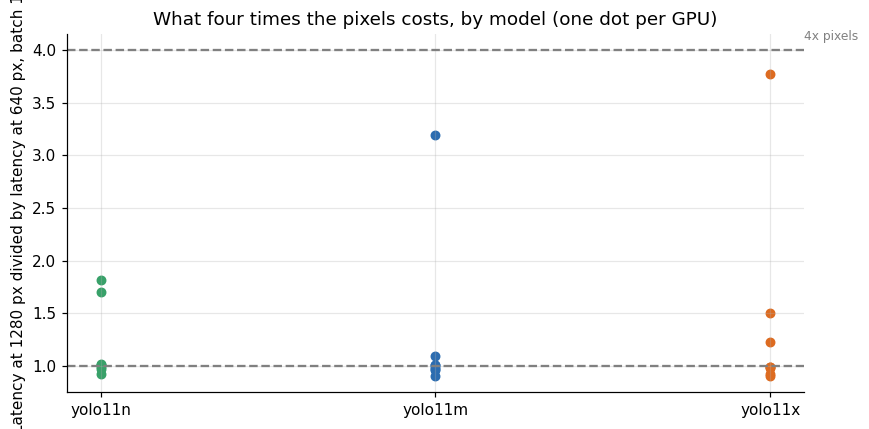
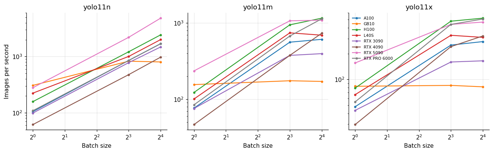
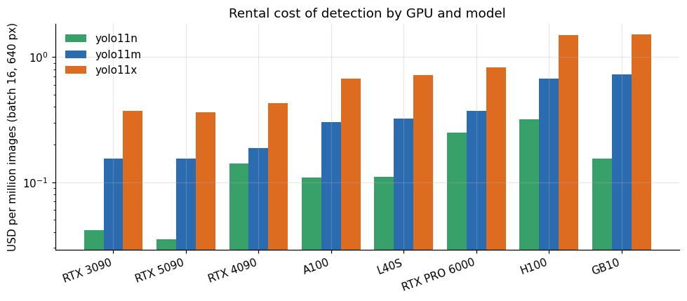
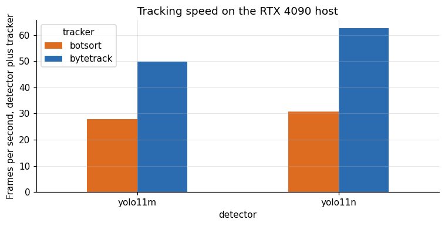
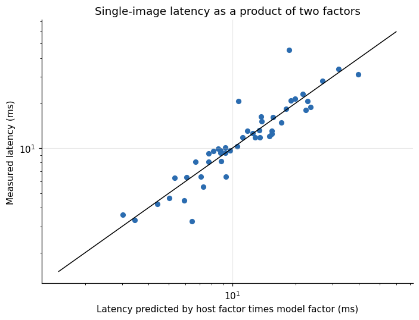
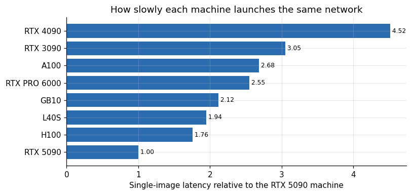

# YOLO11 on eight GPUs and a CPU-bound surprise

**Lucas Rangel** · [Kaggle writeup](https://www.kaggle.com/writeups/lucasrangelss/yolo11-on-eight-gpus-and-a-cpu-bound-surprise) · [Executable notebook](https://www.kaggle.com/code/lucasrangelss/yolo11-on-eight-gpus-and-a-cpu-bound-surprise) · [Code and data](https://github.com/LucasRangelSSouza/gpu-ai-benchmark-hub) · [Dataset](https://www.kaggle.com/datasets/lucasrangelss/gpu-ai-benchmark-campaign-2026)

## Abstract

Object detection is the workload people expect a GPU to handle easily, and for the larger YOLO11 models it does. For the small ones it does not, and the reason changes how you should read any benchmark of them. I timed three YOLO11 sizes (nano, medium and extra-large) in half precision on eight GPUs, at two resolutions and several batch sizes, with the input tensor already on the card so that decoding and preprocessing are out of the picture. The point was to isolate the network itself.

The result looks like a hardware ranking, and for the biggest model it is one. For the smallest model it is mostly something else.

- On the largest workload, the extra-large model at batch 16, throughput ranked the cards the way their specifications suggest: H100 521 images per second, RTX PRO 6000 509, RTX 5090 469, RTX 4090 322, L40S 310, A100 277, RTX 3090 165 and GB10 82.
- On the smallest workload, the nano model at batch 16, the ranking changed in ways the hardware cannot explain. The RTX 5090 reached 4,834 images per second and the H100, which is a far larger and costlier card, 2,435. The RTX 4090 managed 976, a fifth of the 5090, although on the extra-large model it reached 69 percent of it.
- The explanation is that a small network launches many tiny GPU kernels, and the speed of launching them depends on the host CPU and driver, not on the GPU. The 5090 machine had a fast host. Most of the others did not.
- Converting speed to effective compute makes the effect visible. The nano model reaches 0.4 to 2 TFLOP/s at batch 1 on every card, a few percent of what the same card delivers on the extra-large model.
- Cost per million images at batch 16 on the medium model was 0.155 dollars on both the RTX 3090 and the RTX 5090, 0.188 on the 4090, 0.30 to 0.37 on the A100, L40S and PRO 6000, and 0.67 to 0.73 on the H100 and the GB10.

The lesson is practical. A benchmark of a small model on a rented GPU measures the machine around the GPU as much as the GPU. If you plan capacity from such a number, measure it on the machine you will run.

> **Code and data.** Everything behind this article is public: the code that ran, the curated data, the analysis that regenerates every figure, and tests that pin the conclusions to the data. Repositories: [vision-detection-tracking-bench](https://github.com/LucasRangelSSouza/vision-detection-tracking-bench). Index of the whole series: [gpu-ai-benchmark-hub](https://github.com/LucasRangelSSouza/gpu-ai-benchmark-hub).

## 1. What the test measures

The harness loads a YOLO11 model with the Ultralytics library, moves the underlying network to the GPU in half precision, and creates a random input tensor on the card. It then calls the network on the tensor 5 times to warm up and 30 times to measure, calling `torch.cuda.synchronize()` after each call so that the time includes the full execution on the GPU. It records the median, the 95th percentile and the mean latency per call, and computes frames per second as the batch size divided by the median latency.

What is in the number: the forward pass of the network, including the launching of every kernel from Python. What is not in it: reading a frame from a camera or a file, decoding it, resizing and normalizing it, running non-maximum suppression on the output, drawing, tracking, or sending anything over a network. Those steps are on the CPU in a typical pipeline and add to the cost. The other article in this series that deals with real camera streams measures them.

The grid has three models (nano, medium, extra-large), two resolutions (640 and 1280 pixels), and for each resolution a few batch sizes (1, 8 and 16 at 640, and 1 and 4 at 1280), on eight cards: RTX 3090, RTX 4090, RTX 5090, L40S, A100, H100 NVL, RTX PRO 6000 and the GB10. That is 15 settings per card and 120 rows, each with 30 timed calls.

The harness is short enough to show. These are the lines of the script that ran on every card (`libs.py`, function `yolo2`), copied unchanged, followed by the timing helper they call.

```
    for name in ("yolo11n", "yolo11m", "yolo11x"):
        try:
            m = YOLO(f"{name}.pt")
            net = m.model.cuda().half().eval()
            for bs, sz in ((1, 640), (8, 640), (16, 640), (1, 1280), (4, 1280)):
                x = torch.rand(bs, 3, sz, sz, device="cuda", dtype=torch.float16)
                torch.cuda.reset_peak_memory_stats()
                with torch.no_grad():
                    r = timed(lambda: net(x), 30, warm=5)
                rec("yolo_gpu_only", "ok", model=name, batch=bs, imgsz=sz, **r, fps_gpu=round(bs * 1000 / r["p50_ms"], 1), vram_gb=vram_peak(),
                    measurement_kind="measured")
```

```
def timed(fn, n, warm=3):
    import torch
    for _ in range(warm):
        fn()
    torch.cuda.synchronize()
    ts = []
    for _ in range(n):
        t = time.perf_counter()
        fn()
        torch.cuda.synchronize()
        ts.append(time.perf_counter() - t)
    ts.sort()
    return {"n": n, "p50_ms": round(ts[len(ts) // 2] * 1000, 2), "p95_ms": round(ts[max(0, int(len(ts) * .95) - 1)] * 1000, 2),
            "mean_ms": round(sum(ts) / len(ts) * 1000, 2)}
```

Two details follow from the code. The input is `torch.rand` created on the card in half precision, so no image is read or decoded, and the clock stops after `torch.cuda.synchronize()` on every call. The 95th percentile is the element at index `int(n * .95) - 1` of the sorted times, which for 30 calls is the third slowest call, so it is a rough tail figure.

The timing is stable. The median ratio of the 95th percentile to the median latency is 1.01, and the worst case among the 120 rows is 1.59, so single numbers like the median are representative of what each setting does on that host. What the repeatability does not tell you is whether a different machine with the same card would give the same number, and the rest of this article suggests it would not.

## 2. Latency for a single image

The latency of one image is what matters for a camera that needs a decision in real time.

**Table 1.** Latency for a single image

|  | Yolo11n | Yolo11m | Yolo11x |
|---|---|---|---|
| GB10 | 3.3 | 6.4 | 12 |
| RTX 5090 | 3.6 | 4.2 | 6.4 |
| L40S | 4.5 | 9.9 | 15.1 |
| H100 | 6.4 | 8.1 | 12.6 |
| RTX PRO 6000 | 9.2 | 11.8 | 18.3 |
| A100 | 9.6 | 13 | 20.9 |
| RTX 3090 | 10.1 | 13.2 | 23 |
| RTX 4090 | 16.3 | 21.4 | 33.8 |



*Figure 1. Single-image latency by GPU and model.*

At one 640-pixel image per call, the nano model took 3.3 milliseconds on the GB10, 3.6 on the RTX 5090, 4.5 on the L40S, 6.3 on the H100, 9.2 on the PRO 6000, 9.6 on the A100, 10.1 on the RTX 3090 and 16.3 on the RTX 4090. This ordering is the first sign of trouble. The H100 is a much larger card than the L40S, yet it was slower on the nano model. The 4090 is slower than the 3090, a card of the previous generation.

For the extra-large model at one image the 5090 took 6.4 milliseconds, the GB10 12.0, the H100 12.6, the L40S 15.1, the PRO 6000 18.3, the A100 20.9, the 3090 23.0 and the 4090 33.8. That order is only a little closer to the hardware: at one image per call even the largest network is mostly waiting on launches on most of these machines, as the next sections show.

## 3. Throughput at the largest batch

Throughput is what a server cares about. At batch 16 the card sees the most work per call.

**Table 2.** Throughput at the largest batch

|  | Yolo11n | Yolo11m | Yolo11x |
|---|---|---|---|
| H100 | 2,435 | 1,159 | 521 |
| RTX PRO 6000 | 1,693 | 1,136 | 509 |
| RTX 5090 | 4,834 | 1,091 | 469 |
| RTX 4090 | 976 | 734 | 322 |
| L40S | 2,005 | 693 | 310 |
| A100 | 1,695 | 611 | 277 |
| RTX 3090 | 1,483 | 397 | 165 |
| GB10 | 802 | 172 | 82 |



*Figure 2. , batch 16, 640 px.*

For the extra-large model at batch 16 the order, with images per second, is H100 521, PRO 6000 509, 5090 469, 4090 322, L40S 310, A100 277, 3090 165 and GB10 82. For the medium model it is H100 1,159, PRO 6000 1,136, 5090 1,091, 4090 734, L40S 693, A100 611, 3090 397 and GB10 172. For the nano model it is 5090 4,834, H100 2,435, L40S 2,005, A100 1,695, PRO 6000 1,693, 3090 1,483, 4090 976 and GB10 802.

The first two rankings are plausible. The data center cards and the newest consumer card lead, the Ada and Ampere consumer cards are in the middle, and the ARM machine is last because its GPU has far less memory bandwidth. The nano ranking is not plausible. A 4090 should not trail the 3090 by a third, and a PRO 6000 should not deliver the same speed as an A100.

## 4. Reading the speeds as compute

To compare models of different size, convert frames per second into effective compute: the number of floating point operations the network needs per image times the images per second. The Ultralytics documentation publishes the cost of each model at 640 pixels: 6.5 billion operations for the nano model, 68.0 for the medium and 194.9 for the extra-large. These are published figures and I did not measure them. I scale them by the square of the resolution ratio for the 1280 pixel runs.

**Table 3.** Reading the speeds as compute

|  | Best effective TFLOP/s (any setting) |
|---|---|
| GB10 | 17.2 |
| RTX 3090 | 32.2 |
| A100 | 54 |
| RTX 4090 | 62.9 |
| L40S | 64 |
| RTX 5090 | 91.4 |
| RTX PRO 6000 | 99.9 |
| H100 | 101.6 |

**Table 4.** Reading the speeds as compute (part 2)

|  | GPU batch | A100 | GB10 | H100 | L40S | RTX 3090 | RTX 4090 | RTX 5090 |
|---|---|---|---|---|---|---|---|---|
| yolo11m | 1 | 5.2 | 10.6 | 8.4 | 6.9 | 5.1 | 3.2 | 16 |
| yolo11m | 8 | 38.1 | 11.9 | 64.4 | 50.6 | 25.6 | 25.6 | 72.7 |
| yolo11m | 16 | 41.6 | 11.7 | 78.8 | 47.1 | 27 | 49.9 | 74.2 |
| yolo11n | 1 | 0.7 | 2 | 1 | 1.5 | 0.6 | 0.4 | 1.8 |
| yolo11n | 8 | 5.5 | 5.4 | 7.9 | 6.5 | 5.1 | 3.1 | 14.3 |
| yolo11n | 16 | 11 | 5.2 | 15.8 | 13 | 9.6 | 6.3 | 31.4 |
| yolo11x | 1 | 9.3 | 16.2 | 15.4 | 12.9 | 8.5 | 5.8 | 30.4 |
| yolo11x | 8 | 49.2 | 16.6 | 93.6 | 64 | 31.2 | 47.2 | 85.9 |
| yolo11x | 16 | 54 | 16 | 101.6 | 60.5 | 32.2 | 62.9 | 91.4 |



*Figure 3. Bigger networks use the card better.*

The best effective compute reached on any setting was 101.6 TFLOP/s on the H100, 99.9 on the PRO 6000, 91.4 on the 5090, 64.0 on the L40S, 62.9 on the 4090, 54.0 on the A100, 32.2 on the 3090 and 17.2 on the GB10. These come from the extra-large model at batch 16 or the largest 1280-pixel batch, the settings that give the card the most to do. They are the closest thing in this experiment to a measure of the card itself, and they rank the hardware in an order that matches expectation.

Now the same cards on the nano model at batch 1: 0.4 TFLOP/s on the 4090, 0.6 on the 3090, 0.7 on the A100 and PRO 6000, 1.0 on the H100, 1.5 on the L40S and 1.8 on the 5090, with the GB10 at 2.0. That is between 0.6 and 2.3 percent of the best compute each card reached, on seven of the eight cards (the GB10 reaches 12 percent). The small network does not have enough work to hide the cost of launching its kernels, and the time per image is mostly fixed overhead.

## 5. The overhead is the host

How do I know the overhead belongs to the host and not to the GPU? Because the ratio between cards should be about the same on every workload if the GPU were the limit, and it is not. Take the RTX 5090 as the reference and look at the speed of each card relative to it.



*Figure 4. Relative speed against the size of the work per call.*

**Table 5.** The overhead is the host

|  | Imgsz | GPU batch | RTX 4090 | RTX 3090 | H100 | RTX PRO 6000 | L40S | A100 |
|---|---|---|---|---|---|---|---|---|
| yolo11n | 640 | 1 | 0.22 | 0.35 | 0.57 | 0.39 | 0.8 | 0.38 |
| yolo11n | 1,280 | 1 | 0.21 | 0.32 | 0.52 | 0.36 | 0.41 | 0.36 |
| yolo11n | 640 | 8 | 0.22 | 0.35 | 0.55 | 0.39 | 0.46 | 0.39 |
| yolo11x | 640 | 8 | 0.55 | 0.36 | 1.09 | 1 | 0.75 | 0.57 |
| yolo11x | 640 | 16 | 0.69 | 0.35 | 1.11 | 1.09 | 0.66 | 0.59 |
| yolo11x | 1,280 | 4 | 0.65 | 0.35 | 1.12 | 1.11 | 0.63 | 0.56 |

If the GPU were the limit, each line in the figure would be flat. Only the 3090's is roughly flat, at 0.28 to 0.36 of the 5090 across everything. The other lines rise with the size of the work. The 4090 is at 0.19 to 0.22 of the 5090 on small calls and 0.55 to 0.69 on large ones. The H100 is at 0.50 to 0.57 on small calls and 1.04 to 1.12 on large ones. The PRO 6000 moves from 0.35 to 0.39 on small calls to 1.00 to 1.11 on large ones.

The reading is that on small calls, several of these machines were slower than the 5090 machine by the same factor regardless of the card, which is what a slower CPU gives. On large calls the GPU is the limit and the lines reach the values the hardware warrants. The 5090 host launched kernels about five times faster than the 4090 host, and about two to three times faster than the H100 and PRO 6000 hosts. I did not record the CPU models on these machines in a form I can quote, so this is an inference from the pattern, and I would not call it proven. The 3090 host shows a flat ratio, which means that host was about as fast per launch as the 5090 host relative to the card, and its absolute speed is just the speed of an older card.

## 6. Does resolution rescue the small model?

If the nano model is overhead-bound, quadrupling the pixels should barely change its latency at batch 1. That is a test.

**Table 6.** Does resolution rescue the small model?

|  | Imgsz model | 640.0 | 1280.0 | Slowdown 1280 vs 640 |
|---|---|---|---|---|
| A100 | yolo11x | 20.86 | 18.79 | 0.9 |
| A100 | yolo11m | 13.03 | 11.8 | 0.91 |
| RTX 5090 | yolo11n | 3.59 | 3.31 | 0.92 |
| RTX 4090 | yolo11x | 33.8 | 31.09 | 0.92 |
| RTX 4090 | yolo11m | 21.44 | 20.61 | 0.96 |
| A100 | yolo11n | 9.56 | 9.28 | 0.97 |
| L40S | yolo11m | 9.9 | 9.62 | 0.97 |
| RTX PRO 6000 | yolo11x | 18.32 | 17.9 | 0.98 |
| RTX 4090 | yolo11n | 16.29 | 16.12 | 0.99 |
| L40S | yolo11x | 15.09 | 14.89 | 0.99 |
| H100 | yolo11x | 12.63 | 12.52 | 0.99 |
| RTX 3090 | yolo11m | 13.21 | 13.05 | 0.99 |
| H100 | yolo11m | 8.13 | 8.17 | 1 |
| RTX PRO 6000 | yolo11m | 11.81 | 11.83 | 1 |

*First 14 of 24 rows; the full table is in the executable notebook.*



*Figure 5. What four times the pixels costs, by model (one dot per GPU).*

In 19 of the 24 combinations of card and model, the latency of one image at 1280 pixels was within 25 percent of the latency at 640 pixels, and on 17 of them it was within 10 percent (ratios from 0.90 to 1.01) where four times the work would show a ratio of 4. This holds for the extra-large model too: on the 4090 it took 33.8 milliseconds at 640 pixels and 31.1 at 1280, and on the A100 20.9 against 18.8. The exceptions are informative. The GB10 shows ratios of 1.7, 3.2 and 3.8 for the three models, as a slow GPU behind a fast host should. The 5090 and the L40S show ratios above 1.5 for some models, and the 3090 shows 1.22 on the extra-large model. Four times the pixels is nearly free at batch 1 on most of these machines, which is another way of saying the GPU is idle most of the time. For a real-time detector it also means that running at 1280 pixels costs no latency and finds smaller objects.

## 7. Batching

Batching is the standard cure for launch-bound work: one launch serves many images.



*Figure 6. Batching.*

**Table 7.** Batching

|  | Yolo11m | Yolo11n | Yolo11x |
|---|---|---|---|
| A100 | 8 | 16.2 | 5.8 |
| GB10 | 1.1 | 2.6 | 1 |
| H100 | 9.4 | 15.5 | 6.6 |
| L40S | 6.9 | 9 | 4.7 |
| RTX 3090 | 5.2 | 15 | 3.8 |
| RTX 4090 | 15.8 | 15.9 | 10.9 |
| RTX 5090 | 4.6 | 17.4 | 3 |
| RTX PRO 6000 | 13.4 | 15.6 | 9.3 |

Batching from 1 to 16 multiplied the nano model's throughput by 15 to 17 times on six of the eight cards (4,834 against 279 on the 5090, a factor of 17.4), by 9 on the L40S and by 2.6 on the GB10. A factor of 16 means that a batch of 16 images took no longer than one image, so the call time was fixed overhead. For the medium model the factor ranged from 15.8 on the 4090 to 4.6 on the 5090, and for the extra-large model from 10.9 on the 4090 and 9.3 on the PRO 6000 to 3.0 on the 5090 and 1.0 on the GB10, where the GPU itself was the limit. A batch of 16 is not always practical: in a camera system the frames arrive one stream at a time, and waiting to collect sixteen adds latency of sixteen frame intervals at the stream's frame rate. At a few frames per second per camera, a batch gathers frames from many cameras at once, and the wait is short.

## 8. What an image costs

**Table 8.** What an image costs

|  | Yolo11n | Yolo11m | Yolo11x |
|---|---|---|---|
| RTX 3090 | 0.041 | 0.155 | 0.372 |
| RTX 5090 | 0.035 | 0.155 | 0.361 |
| RTX 4090 | 0.141 | 0.188 | 0.427 |
| A100 | 0.109 | 0.304 | 0.669 |
| L40S | 0.111 | 0.322 | 0.717 |
| RTX PRO 6000 | 0.248 | 0.37 | 0.825 |
| H100 | 0.32 | 0.672 | 1.494 |
| GB10 | 0.156 | 0.727 | 1.523 |



*Figure 7. Rental cost of detection by GPU and model.*

Using the median hourly prices from the lease ledger, the cost of a million images at batch 16 and 640 pixels is lowest on the RTX 5090 for all three models (0.035, 0.155 and 0.361 dollars), with the 3090 within 5 percent for the medium and extra-large models (0.155 and 0.372) and 17 percent behind on the nano model (0.041). The 4090 costs 0.188 for the medium model, the A100 0.304, the L40S 0.322, the PRO 6000 0.370, the H100 0.672 and the GB10 0.727. The GB10's price is the rate at which I list it, not a cost I paid.

The data center cards are the fastest and the least efficient in dollars per image. The H100 is twice the speed of the 5090 on none of these workloads and four times the price. If the job is detection on a model of this size, a consumer card is the economical choice, and a PRO 6000 or H100 earns its price only if you also need its memory for something else. The 3090 matching the 5090 on cost per image for the medium model is a result of the 3090's low price per hour. It would need roughly three cards to match one 5090's throughput.

## 9. How many cameras is that?

A surveillance camera is typically analyzed at a few frames per second, not at 30. At 5 frames per second per camera, a card that processes 1,000 images per second could serve 200 cameras if nothing else limited it.

**Table 9.** How many cameras is that?

|  | Cameras at 5 fps, GPU forward pass only |
|---|---|
| H100 | 232 |
| RTX PRO 6000 | 227 |
| RTX 5090 | 218 |
| RTX 4090 | 147 |
| L40S | 139 |
| A100 | 122 |
| RTX 3090 | 79 |
| GB10 | 34 |

For the medium model at batch 16, the GPU-only capacity is about 232 cameras at 5 frames per second on the H100, 227 on the PRO 6000, 218 on the 5090, 147 on the 4090, 139 on the L40S and 122 on the A100, down to 79 on the 3090 and 34 on the GB10. These are upper bounds, because the real pipeline must decode every stream, resize frames and post-process results on the CPU. The camera article in this series measured the real limit on a 5090 host with 12 virtual CPUs: 32 full-resolution streams at about 4.9 inferred frames per second each, far below the 218 the GPU alone could handle, because decoding saturated the CPU. The GPU is rarely the bottleneck of a camera system.

## 10. Tracking adds CPU work

The tracker is another place where the CPU matters. I ran two trackers from the Ultralytics library, ByteTrack and BoT-SORT, on an 11-frame clip looped to 600 frames on the 4090 host, with the nano and the medium detector.

**Table 10.** Tracking adds CPU work

|  | Tracker | Detector | Frames | Wall s | Fps | Unique ids |
|---|---|---|---|---|---|---|
| 50 | bytetrack | yolo11n | 600 | 9.59 | 62.6 | 3 |
| 51 | bytetrack | yolo11m | 600 | 12.04 | 49.8 | 4 |
| 52 | botsort | yolo11n | 600 | 19.57 | 30.7 | 3 |
| 53 | botsort | yolo11m | 600 | 21.54 | 27.9 | 4 |



*Figure 8. Tracking speed on the RTX 4090 host.*

With the nano detector, ByteTrack processed 62.6 frames per second and BoT-SORT 30.7. With the medium detector the figures were 49.8 and 27.9. BoT-SORT cost about twice as much per frame as ByteTrack with the small detector and 1.8 times with the medium one, which fits its design: it adds camera-motion compensation and an appearance model. On this host, the nano detector plus ByteTrack ran at 62.6 frames per second in total, which is close to the 61 frames per second the bare nano detector reached at batch 1 in the GPU-only test, meaning ByteTrack added little. All of this is on a host that I have shown to be launch-bound, so the absolute speeds would be higher on a faster machine.

The four records behind the tracking table come from the log of the 4090 session. They are shown as logged.

```
track ok {'tracker': 'bytetrack.yaml', 'detector': 'yolo11n', 'frames': 600, 'src_frames': 11, 'wall_s': 9.59, 'fps': 62.6, 'unique_ids': 3, 'note': 'sem ground truth: HOTA/IDF1 NOT_TESTED', 'measurement_kind': 'measured', 'lib': 'track', 'status': 'ok'}
track ok {'tracker': 'bytetrack.yaml', 'detector': 'yolo11m', 'frames': 600, 'src_frames': 11, 'wall_s': 12.04, 'fps': 49.8, 'unique_ids': 4, 'note': 'sem ground truth: HOTA/IDF1 NOT_TESTED', 'measurement_kind': 'measured', 'lib': 'track', 'status': 'ok'}
track ok {'tracker': 'botsort.yaml', 'detector': 'yolo11n', 'frames': 600, 'src_frames': 11, 'wall_s': 19.57, 'fps': 30.7, 'unique_ids': 3, 'note': 'sem ground truth: HOTA/IDF1 NOT_TESTED', 'measurement_kind': 'measured', 'lib': 'track', 'status': 'ok'}
track ok {'tracker': 'botsort.yaml', 'detector': 'yolo11m', 'frames': 600, 'src_frames': 11, 'wall_s': 21.54, 'fps': 27.9, 'unique_ids': 4, 'note': 'sem ground truth: HOTA/IDF1 NOT_TESTED', 'measurement_kind': 'measured', 'lib': 'track', 'status': 'ok'}
```

The field `src_frames` is 11 in every record. The script in `libs.py` (function `track2`) feeds the tracker `frames[i % len(frames)]`, so the 600 frames are an 11-frame clip played in a loop. The speeds are valid as a cost per frame of the tracker code, but the identity counts (3 or 4) come from a looped 11-frame sequence, and I would not read them as tracking behavior on a continuous video. A first run of the same two trackers in the same session, fed the 11 frames once, logged 2.2 and 10.9 frames per second with 4 identities each, which shows how much a first pass is dominated by start-up.

The tracker comparison has a limit I must state: the clip has no ground truth, so I measured speed and the number of distinct identities the tracker assigned (3 or 4 over the looped 11-frame clip), and I did not measure tracking accuracy. Whether BoT-SORT's extra cost buys better identity continuity on your scenes is a separate test.

## 11. Card by card

The numbers above are easier to use with a short profile of each machine, all from the same measurements.

The RTX 5090 machine is the fastest launcher in the set and a very strong GPU. It runs the nano model at 3.6 milliseconds per image and 4,834 images per second at batch 16, the medium at 1,091 and the extra-large at 469, reaching 91 effective TFLOP/s. It is the cheapest per image on every model at 0.035, 0.155 and 0.361 dollars per million. This is the card to rent for detection in this set, with the caveat that a share of its lead on small models comes from its host.

The H100 NVL is the strongest GPU, at 101.6 effective TFLOP/s and 521 images per second on the extra-large model, and a mediocre launcher at 1.76 times the 5090 host. It shines on the large workloads, where it edges out the PRO 6000 and the 5090, and it is the most expensive per image outside the GB10 at 0.67 and 1.49 dollars per million for the medium and extra-large models. Its memory and bandwidth are wasted on a detector.

The RTX PRO 6000 is almost the H100's equal on large workloads (99.9 TFLOP/s) at about half the price per hour, and a slower launcher (2.55). It costs 0.37 and 0.83 dollars per million images for the medium and extra-large models. It makes sense when the same card also serves a language model, as in the other articles of this series, and little sense as a dedicated detector.

The RTX 4090 reached 62.9 effective TFLOP/s on the largest workload and spent most of its time waiting on a host with a launch factor of 4.5. Its single-image latency is the worst of the eight on every model, between 16.3 and 33.8 milliseconds. On large batches it is a respectable 322 images per second on the extra-large model and 0.19 dollars per million for the medium model. On this host a 4090 is a poor choice for small models and an acceptable one for large ones.

The L40S is a balanced 48 gigabyte card: 64 effective TFLOP/s, a launch factor of 1.94 and a single-image latency of 4.5 milliseconds on the nano model, second best after the 5090 among the data center cards. It is dearer per image than the consumer cards (0.32 dollars per million for the medium model).

The A100 is slower than the L40S on every workload, at 54 TFLOP/s against 64, and costs 0.30 dollars per million images for the medium model. Its launch factor of 2.68 puts it with the PRO 6000.

The RTX 3090 is the surprise of value. Its 32 effective TFLOP/s is the second lowest, and its price per hour is the lowest of the serious cards, which makes it as cheap per image as the 5090 on the medium and extra-large models. Its throughput per card is one third of the 5090's, so you need three of them for the same load, and three machines for the same launch overhead.

The GB10 is a different animal: an ARM computer with a small GPU. It has the fastest single-image latency on the nano model (3.3 milliseconds), because its launches are quick, and the lowest throughput on the large ones (82 images per second on the extra-large model), because its GPU is small. Its 17 TFLOP/s is a sixth of the data center cards. It suits a handful of cameras at the edge, which is what it is for.

## 12. A one-number model of the host

If the single-image latency is mostly the cost of launching kernels, then it should factor into two parts: how many launches the model needs, which depends on the model and not on the machine, and how slowly the machine issues them, which depends on the machine and not on the model. Taking logarithms, the latency of a model on a machine is then the sum of a model term and a machine term. This is a rank-one model, and it is a testable one. I fit it to the single-image latencies of the three models at the two resolutions on the eight machines.

**Table 11.** A one-number model of the host

|  | Launch slowdown vs the RTX 5090 host |
|---|---|
| RTX 5090 | 1 |
| H100 | 1.76 |
| L40S | 1.94 |
| GB10 | 2.12 |
| RTX PRO 6000 | 2.55 |
| A100 | 2.68 |
| RTX 3090 | 3.05 |
| RTX 4090 | 4.52 |

**Table 12.** A one-number model of the host (part 2)

|  | Yolo11m 640.0 | Yolo11m 1280.0 | Yolo11n 640.0 | Yolo11n 1280.0 | Yolo11x 640.0 | Yolo11x 1280.0 |
|---|---|---|---|---|---|---|
| A100 | 1.1 | 0.87 | 1.18 | 1 | 1.1 | 0.8 |
| GB10 | 0.69 | 1.93 | 0.51 | 0.76 | 0.8 | 2.44 |
| H100 | 1.05 | 0.92 | 1.19 | 1.06 | 1.01 | 0.81 |
| L40S | 1.16 | 0.98 | 0.76 | 1.21 | 1.09 | 0.87 |
| RTX 3090 | 0.98 | 0.85 | 1.1 | 0.98 | 1.06 | 1.05 |
| RTX 4090 | 1.08 | 0.91 | 1.19 | 1.04 | 1.05 | 0.78 |
| RTX 5090 | 0.96 | 0.92 | 1.18 | 0.96 | 0.9 | 1.1 |
| RTX PRO 6000 | 1.05 | 0.92 | 1.2 | 1.06 | 1.01 | 0.8 |



*Figure 9. Single-image latency as a product of two factors.*



*Figure 10. Single-image latency as a product of two factors.*

The model fits well. The measured single-image latency is within 20 percent of the product of a machine factor and a model-and-resolution factor in 39 of the 48 cells, and the median deviation is about 10 percent. Five of the nine exceptions are on the GB10, where at 1280 pixels the GPU is the limit and the launch term stops dominating (measured over fitted of 1.9 and 2.4 for the medium and extra-large models), and where the nano model is faster than the fit says (0.51 and 0.76). The L40S accounts for two more, at 0.76 and 1.21, on the nano model.

The machine factors, with the 5090 machine as 1.00, are 1.76 for the H100, 1.94 for the L40S, 2.55 for the PRO 6000, 2.68 for the A100, 3.05 for the 3090 and 4.52 for the 4090. The GB10 comes out at 2.12 but that number is pulled up by its GPU-bound cells and should not be read as a launch speed. A machine factor of 4.5 means that the same network takes four and a half times as long to issue on the 4090 host as on the 5090 host, whatever the network.

The model factors, expressed as latency on the 5090 host, are about 3.0 milliseconds for the nano model, 4.4 for the medium and 7.1 for the extra-large at 640 pixels. They grow with the depth of the network, which is the number of kernels to launch, and not with its arithmetic, which grows 30 times from nano to extra-large. Compare 3.0 against 7.1: a model that needs thirty times the arithmetic needs 2.3 times the time.

I should be careful about what the machine factor contains. It is a measure of the whole path from Python to the GPU: the interpreter, the framework's dispatch, the driver and the CPU running them. It does not separate those components. Three of the eight machines (the 5090, 4090 and 3090) are consumer-class hosts and the others are data center or workstation hosts, and the factors do not sort by class. What the fit tells you is that the host matters by a factor of up to 4.5 for work of this kind, and the card itself can be the same.

## 13. What this means for the earlier results

With the factor in hand, the strange results make sense. The 4090 trailing the 3090 on the nano model is a statement about the hosts: 4.52 against 3.05. The H100 delivering half the 5090's speed on the nano model at batch 16 is a launch factor of 1.76 acting on a model that has no work for the H100's compute. The PRO 6000 reaching the same speed as the A100 is two hosts with factors of 2.55 and 2.68.

It also gives a way to guess what the cards would do on a better host. If the 4090 ran on a machine as fast as the 5090 one, its single-image latency for the nano model would fall from 16.3 to about 3.6 milliseconds, and its batch-16 throughput on the nano model would rise from 976 images per second to something close to the 5090's, limited by the 4090's own compute. I did not run that experiment, and the numbers are projections from a model. On the large workloads, where the GPU is the limit, the machine factor drops out, and the 4090's 62.9 effective TFLOP/s against the 5090's 91.4 is a fair statement of the hardware.

## 14. Rules for sizing a detection service

Pull the findings into rules that I would use myself.

For large models and large batches, trust the card. A benchmark that reaches 60 percent or more of a card's effective compute (the extra-large model at batch 8 or 16 here) is measuring the GPU, and results transfer between hosts within about 10 percent.

For small models, or any case with batch 1, trust only measurements made on your host. Latency will be dominated by launch overhead that varies by a factor of four or five between machines with similar cards, and the ranking of cards can invert.

Batch as much as latency allows. For a small model the cost of a call is almost fixed, so a batch of 16 gives up to sixteen times the throughput for the same latency. A camera system that gathers one frame from each of sixteen streams loses nothing in latency.

Use the larger resolution when it helps detection. At batch 1 on most hosts, four times the pixels cost less than 25 percent in latency in 19 of 24 cases.

Compute the cost per million images from the throughput at your batch size and your host, not from a vendor's number.

Remember that detection is only the middle of the pipeline. Decoding, preprocessing and tracking run on the CPU and, on a host with slow launches, compete with the launches for the same cores.

## 15. What I did not test

The harness used PyTorch's eager mode with half precision. Launch overhead is exactly the problem that CUDA graphs, `torch.compile` and TensorRT engines are designed to remove, by recording the sequence of kernels once and replaying it with a single launch. I expect them to flatten the small-model results considerably, and to raise the nano model's throughput on every host toward the GPU's limit. I did not measure that, so it remains an expectation.

I did not test multiple processes sharing one card, which is another way to hide launch latency: while one process waits on its CPU, another keeps the GPU busy. The small models use between 0.05 and 2.2 GB of memory in these tests, so a 24 gigabyte card has room for many copies.

I did not test real image content, preprocessing or post-processing. The random tensor stands in for the network input only.

## 16. Reading a detector benchmark

A published number for a detector on a given GPU deserves these questions. Which model size, and which input resolution? What batch size? Is the time the network alone, or the whole pipeline including preprocessing and post-processing? Which host, in particular which CPU? Is the precision half, full or 8-bit integer, and was the model compiled? How many iterations, and what statistic is reported? If the answers are not given, the number is a marketing figure.

A small model on a fast GPU is a test of the host. A large model on a slow GPU is a test of the GPU. Most published numbers lie somewhere between, and you cannot tell where without the details.

## 17. Questions I expect

**Why is the 4090 so slow here?** Because its host launched kernels about four and a half times more slowly than the 5090's. On the large workloads, where launches do not dominate, it reached 69 percent of the 5090's speed, which is about what the hardware difference warrants.

**Does this mean small YOLO models are not worth a GPU?** No. It means a GPU running a small model at batch 1 is mostly idle and the speed is set by the CPU, so use batches, graphs or a faster CPU, or run many streams per card.

**Is the 5090 the best card for detection?** On cost per image in these tests it was, along with the 3090 for the medium model. Part of that is its fast host. In a different data center the ranking could change.

**Should I trust the GB10 numbers?** They are real, and they show a different regime: a fast launcher behind a slow GPU. It was the best card at the nano model's single-image latency and the worst at throughput on the large model.

## 18. Limitations

Each row is the median of 30 calls after 5 warm-ups, from one host per card. The host effect is inferred from the pattern of ratios and not from CPU measurements. The random input tensor means the network does no real detection work in non-maximum suppression, which is outside the timed region anyway. The published GFLOPs figures are used only to convert speed to an effective compute number, and a different FLOP counting convention would scale all the TFLOP/s figures together. Half precision with the default PyTorch settings is not the fastest possible configuration: TensorRT or compiled graphs could reduce launch overhead and change the small-model picture considerably, and I did not test them. The trackers ran on one card. Prices are marketplace medians.

## 19. How much it cost

The YOLO grid ran inside the per-card library sweeps, each of which cost between 0.10 and 0.90 dollars of itemized rental, as part of the campaign total of US$ 50.79. The GPU-only YOLO runs themselves take seconds per card. Their cost is the cost of getting a machine ready, which is why a rental of this kind is dominated by setup and not by the measurement.

## 20. Reproducing this analysis

Attach the dataset `gpu-ai-benchmark-campaign-2026` and use `libs_runs.csv`, filtering on the library names shown above. The harness is the file `libs.py` in the repository `vision-detection-tracking-bench`.

## 21. Glossary

- **Launch-bound**: limited by the time the CPU needs to send work to the GPU.
- **Compute-bound**: limited by the arithmetic throughput of the GPU.
- **Batch**: the number of images processed in one call.
- **FLOPs**: floating point operations.
- **Effective TFLOP/s**: published operations per image times measured images per second.
- **Half precision**: 16-bit floating point.
- **NMS**: non-maximum suppression, the post-processing step that removes duplicate boxes.
- **ByteTrack and BoT-SORT**: multi-object trackers that assign identities to detections across frames.

Lucas Rangel
